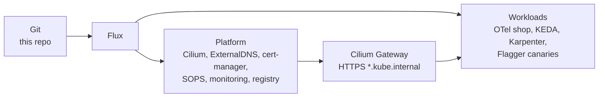
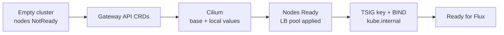

# kube_local

How I keep current with Kubernetes and EKS while my day job runs neither. A
local cluster built to mirror EKS wherever it can, run entirely through
GitOps, with a written lesson for every product on it.

| | |
| --- | --- |
| [Lessons](docs/README.md) | 15 written, a mesh stub, 4 planned: Cilium, Flux, ExternalDNS, cert-manager, SOPS, Flux Operator, monitoring, registry, image promotion, Flagger, OpenTelemetry, Istio ambient, KEDA, Karpenter, BPF profiling, Chaos Mesh |
| [Decisions](docs/adr/README.md) | What was picked, what it costs, what changes on EKS |
| [CI](.github/workflows/validate.yaml) | Every Flux layer built offline and validated against Kubernetes and CRD schemas |



## Here and on EKS

| Concern | Here | On EKS | Lesson |
| --- | --- | --- | --- |
| Nodes | k3d on rootful Podman; EKS-style node names, zone and instance-type labels | Managed node groups | Platform |
| Pod network, Services | Cilium, kube-proxy replacement | VPC CNI, or Cilium | 1 |
| Load balancer | Cilium LB-IPAM with L2 announcements | NLB or ALB through the AWS Load Balancer Controller | 1 |
| Ingress | Gateway API on Cilium | Gateway API on the Load Balancer Controller, or Cilium | 1 |
| GitOps | Flux, run by Flux Operator | Flux, or Argo CD managed by EKS Capabilities | 2, 6 |
| DNS | BIND, RFC2136 with a TSIG key | Route53, with an IAM role | 3 |
| Certificates | cert-manager with a private mkcert CA | ACM on the load balancer, or cert-manager with Let's Encrypt or AWS Private CA | 4 |
| Secrets | SOPS with age | SOPS with KMS, or External Secrets with Secrets Manager | 5 |
| Metrics | Prometheus and Grafana | The same, or Amazon Managed Prometheus and Grafana | 7 |
| Registry | k3d's registry | ECR, with pull-through cache | 8 |
| Mesh | Istio ambient (planned) | The same | 12 |
| Node autoscaling | Karpenter on KWOK nodes | Karpenter on EC2 | 14 |
| Workload IAM | IRSA against a real AWS account (planned) | Pod Identity, or IRSA | 18 |
| Deprecated APIs | An alert on the API server's metric (planned) | Cluster insights | 19 |
| Self-service | kro (planned) | kro through EKS Capabilities | 20 |

## The platform layer

This repo starts from a bare cluster: the dotfiles repo creates it with no
CNI, and `bootstrap.sh` makes it ready for Flux. Everything after that is in
Git and applied by Flux, following [docs/](docs/README.md).

## Contents

```
cilium/values.yaml            Cilium settings you'd also use on EKS.
overlays/local/               Everything that only exists because this is k3d.
  bootstrap.sh                Gateway API CRDs, Cilium, LB pool, local DNS.
  cilium-values.yaml          k3d-only Cilium settings.
  lb-ipam.yaml                LoadBalancer IP pool on the k3d node network.
  dns/bind.yaml               BIND serving kube.internal (stand-in for Route53).
  dns/tsig-secret.sh          TSIG key BIND accepts updates with. Never in Git.
  dns/coredns-custom.yaml     Pods resolve kube.internal through BIND.
clusters/, infrastructure/,   What Flux applies, in layers.
  apps/
docs/                         Lessons: what to install next, by hand then with Flux.
  adr/                        Decisions behind the platform.
.github/renovate.json5        Renovate: bumps the Cilium and Gateway API pins in bootstrap.sh.
.github/validate.sh           Builds every Flux Kustomization offline and runs kubeconform.
.github/workflows/            Runs validate.sh on pull requests and on master.
```

Helm merges `cilium/values.yaml` then `overlays/local/cilium-values.yaml`. No
Kustomize.

## Usage

```sh
# dotfiles (zsh function): empty cluster, nodes NotReady
kube-create

# here: platform
./overlays/local/bootstrap.sh
```

`bootstrap.sh` is re-runnable and only targets the `k3d-dev` context.



## What the cluster provides

| Capability | Detail |
| --- | --- |
| Nodes | `controlplane` (etcd, tainted `NoSchedule`) + 3 workers named like EKS (`i-0a1b2c3d4e5f60001.eu-west-2.compute.internal`), labelled `eu-west-2a/b/c`, `m5.large`, nodegroup `general` |
| Kubernetes | k3s 1.36 |
| CNI and Services | Cilium (pinned in `bootstrap.sh`), kube-proxy replacement, vxlan tunnel |
| Gateway API | Standard CRDs (pinned in `bootstrap.sh`), GatewayClass `cilium` |
| LoadBalancer | Cilium LB-IPAM + L2 announcements, `10.89.0.200-250`, reachable from the host |
| DNS zone | BIND for `kube.internal` on `10.89.0.250`, empty, RFC2136 updates with TSIG key `externaldns` (`hmac-sha256`) |
| Name resolution | Pods via CoreDNS forward; host via resolved on `k3d0` (Linux) |
| Observability | Hubble relay + UI, `bpf.monitorAggregation: none` |
| Storage | k3s `local-path`, `WaitForFirstConsumer` |
| Metrics | k3s `metrics-server`, so `kubectl top` and HPAs work |
| Registry | Push to `localhost:5050` from the host; pull as `k3d-registry.localhost:5000` in pods |
| Host ports | 25565 to NodePort 30000; 30001-30004 straight through. LAN-reachable |
| API server | `127.0.0.1` only |

### Cilium settings

Base (`cilium/values.yaml`): `kubeProxyReplacement: true`,
`gatewayAPI.enabled: true`, Hubble relay and UI, `bpf.monitorAggregation: none`.

Local (`overlays/local/cilium-values.yaml`):

| Setting | Why |
| --- | --- |
| `k8sServicePort: 6443`; `bootstrap.sh` sets `k8sServiceHost` to `<context>-serverlb` | No kube-proxy, so Cilium needs the API server address directly. |
| `routingMode: tunnel`, vxlan | k3d doesn't install pod CIDR routes on nodes. |
| `l2announcements.enabled` | Stands in for a cloud load balancer, with `lb-ipam.yaml`. |
| `cgroup.autoMount.enabled: false`, `cgroup.hostRoot: /sys/fs/cgroup` | k3d nodes don't propagate mounts; without this, ClusterIPs fail with `network is unreachable`. |
| `ipam.mode: kubernetes` | Pods use k3s's `10.42.0.0/16`. Cilium's default `10.0.0.0/8` overlaps the node network. |
| `operator.replicas: 1` | One server node. |

## Shared values

The cluster name, network, DNS address and registry are shared with dotfiles
and os_build. The list is in dotfiles' [kubernetes.md](https://github.com/bourbonfgiles/dotfiles/blob/master/kubernetes.md#how-the-repos-fit).

## Working with the cluster

Run these from this repo on your machine. Every command names the cluster
(`--context k3d-dev`, or `--kube-context` for helm) so it can't hit a work
context.

| To | Run |
| --- | --- |
| Node containers | `kpodman ps` (plain `podman` is rootless and sees nothing) |
| Cilium health | `cilium status --context k3d-dev` |
| Live flows | `cilium --context k3d-dev hubble port-forward` in one terminal, `hubble observe -f` in another |
| Hubble UI | `cilium --context k3d-dev hubble ui` |
| Query BIND | `dig @10.89.0.250 <name>.kube.internal` |
| Read the TSIG secret | `kubectl --context k3d-dev -n dns get secret externaldns-tsig -o jsonpath='{.data.secret}' \| base64 -d` |

## Bump Cilium or Gateway API

Renovate opens the PR; nothing tests it but this. Run on the live cluster, which
is the upgrade that will really happen:

```sh
git -C ~/repos/personal/kube_local fetch
git -C ~/repos/personal/kube_local switch <renovate branch>
~/repos/personal/kube_local/overlays/local/bootstrap.sh
cilium status --context k3d-dev
kubectl --context k3d-dev get gatewayclass cilium
dig @10.89.0.250 kube.internal SOA +short
git -C ~/repos/personal/kube_local switch master
```

| Check | Pass |
| --- | --- |
| `bootstrap.sh` | Exits 0 |
| `cilium status` | All OK, no errors |
| GatewayClass `cilium` | `ACCEPTED` `True` |
| `dig` | Returns the SOA record |

Pass: merge the PR. Fail: comment on the PR and run `bootstrap.sh` from
`master`. Older CRDs don't always apply over newer ones; if it doesn't recover,
`kube-delete` and `kube-create`.

## Troubleshooting

| Symptom | Cause | Fix |
| --- | --- | --- |
| Nodes stay `NotReady` | No CNI yet | Run `bootstrap.sh`. |
| GatewayClass `cilium` missing | CRDs applied after the Cilium operator started | `kubectl --context k3d-dev -n kube-system rollout restart deploy/cilium-operator` |
| ClusterIPs `network is unreachable` | cgroup settings changed on a live cluster; Cilium keeps its pinned hooks | Rebuild the cluster. |
| `type: LoadBalancer` stuck `<pending>` | `lb-ipam.yaml` not applied, or range outside the network | `kpodman network inspect k3d-dev`, re-run `bootstrap.sh`. |
| Route returns 503 after adding NetworkPolicies | Cilium's Gateway reaches pods from the `ingress` identity, which a plain `NetworkPolicy` can't select | `CiliumNetworkPolicy` with `fromEntities: [ingress]`. Hubble shows no `DROPPED`; Envoy refuses it. |
| External lookups from pods stall | The host's LAN search domain reached pods | A pod's `/etc/resolv.conf` should list only cluster search domains. |
| `kube.internal` doesn't resolve on the host | `kube-internal-dns` not active | `systemctl status kube-internal-dns`, `resolvectl status k3d0`. |
| Records vanish after BIND restarts | Zone lives in an `emptyDir` | Whatever writes records (ExternalDNS) re-syncs. |
| `k3d cluster create` fails reading logs | Podman's journald log reader | `kube-create` and `kube-up` retry. |
| Pods can't pull `localhost:5050/...` | That name is the host's | Use `k3d-registry.localhost:5000/...`. |
| `curl` from a pod to `k3d-registry.localhost` is refused | curl sends every `*.localhost` name to `127.0.0.1` | Test with `wget` or `curl --resolve`; Flux and containerd resolve it normally. |

## Not emulated

- Pod Identity: its agent calls an API only EKS clusters have. IRSA can be
  done against a real AWS account (lesson 18, planned).
- Route53: BIND over RFC2136. LocalStack's Route53 DNS needs a paid plan.
- EBS: `local-path` only.
- NLB/ALB: L2 announcements.

BPF tools run on the host against pod processes: rootful Podman shares the
host's PID view. For a JVM, `-XX:+PreserveFramePointer` keeps stacks walkable.
