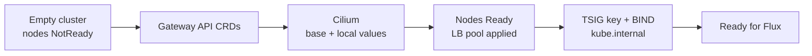
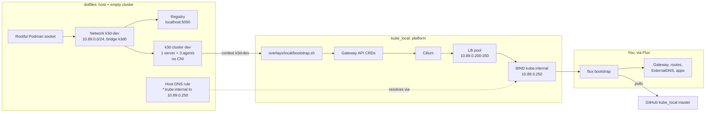

# kube_local

The platform layer for a local k3d cluster that stands in for a bare EKS
cluster. The dotfiles repo creates the cluster with no CNI; this repo makes it
ready for a GitOps tool. Nothing else is installed. [docs/](docs/README.md) is a
numbered learning path for what to add next.

## Contents

```
cilium/values.yaml            Cilium settings you'd also use on EKS.
overlays/local/               Everything that only exists because this is k3d.
  bootstrap.sh                Gateway API CRDs, Cilium, LB pool, local DNS.
  cilium-values.yaml          k3d-only Cilium settings.
  lb-ipam.yaml                LoadBalancer IP pool on the k3d node network.
  dns/bind.yaml               BIND serving kube.internal (stand-in for Route53).
  dns/tsig-secret.sh          TSIG key BIND accepts updates with. Never in Git.
  dns/coredns-custom.yaml     Pods resolve kube.internal through BIND.
```

Helm merges `cilium/values.yaml` then `overlays/local/cilium-values.yaml`. No
Kustomize.

## Usage

```sh
# dotfiles: empty cluster, nodes NotReady
cd ~/repos/personal/dotfiles
uv run python -c 'from dotfiles.services import k8s; k8s.create_cluster()'

# here: platform
./overlays/local/bootstrap.sh
```

`bootstrap.sh` is re-runnable and only targets the `k3d-dev` context.



## What the cluster provides

| Capability | Detail |
| --- | --- |
| Nodes | 1 server (etcd, tainted `NoSchedule`) + 3 agents labelled `eu-west-2a/b/c`, `m5.large`, nodegroup `general` |
| Kubernetes | k3s 1.36 |
| CNI and Services | Cilium 1.20.3, kube-proxy replacement, vxlan tunnel |
| Gateway API | v1.6.3 standard CRDs, GatewayClass `cilium` |
| LoadBalancer | Cilium LB-IPAM + L2 announcements, `10.89.0.200-250`, reachable from the host |
| DNS zone | BIND for `kube.internal` on `10.89.0.250`, empty, RFC2136 updates with TSIG key `externaldns` (`hmac-sha256`) |
| Name resolution | Pods via CoreDNS forward; host via a dotfiles systemd unit (Linux) |
| Observability | Hubble relay + UI, `bpf.monitorAggregation: none` |
| Storage | k3s `local-path`, `WaitForFirstConsumer` |
| Metrics | k3s `metrics-server`, so `kubectl top` and HPAs work |
| Registry | Push to `localhost:5050` from the host; pull as `k3d-registry.localhost:5000` in pods |
| Host ports | 25565 to NodePort 30000; 30001-30004 straight through. LAN-reachable |
| API server | `127.0.0.1` only |

### Cilium settings

Base (`cilium/values.yaml`): `kubeProxyReplacement: true`,
`gatewayAPI.enabled: true`, Hubble relay and UI, `bpf.monitorAggregation: none`.

Local (`overlays/local/cilium-values.yaml`):

| Setting | Why |
| --- | --- |
| `k8sServiceHost: k3d-dev-serverlb`, port 6443 | No kube-proxy, so Cilium needs the API server address directly. |
| `routingMode: tunnel`, vxlan | k3d doesn't install pod CIDR routes on nodes. |
| `l2announcements.enabled` | Stands in for a cloud load balancer, with `lb-ipam.yaml`. |
| `cgroup.autoMount.enabled: false`, `cgroup.hostRoot: /sys/fs/cgroup` | k3d nodes don't propagate mounts; without this, ClusterIPs fail with `network is unreachable`. |
| `ipam.mode: kubernetes` | Pods use k3s's `10.42.0.0/16`. Cilium's default `10.0.0.0/8` overlaps the node network. |
| `operator.replicas: 1` | One server node. |

## How it links to dotfiles



The repos don't call each other. They share these values, so change both sides
together. The dotfiles side is in its `kubernetes.md`.

| Value | dotfiles | kube_local |
| --- | --- | --- |
| Cluster `dev`, context `k3d-dev` | `home/dot_config/k3d/config.yaml` | `bootstrap.sh` default argument |
| API endpoint `k3d-dev-serverlb:6443` | k3d's load balancer | `overlays/local/cilium-values.yaml` |
| Network `10.89.0.0/24` | `_CLUSTER_SUBNET` in `services/k8s.py` | `overlays/local/lb-ipam.yaml` |
| DNS `10.89.0.250`, zone `kube.internal` | `_KUBE_DNS_SERVER`, `_KUBE_DNS_DOMAIN` | `overlays/local/dns/bind.yaml` |
| flannel, kube-proxy, servicelb, traefik, network policy off | k3s args | Cilium replaces them |
| Registry `k3d-registry.localhost:5000` | `services/k8s.py` | image references |

## Working with the cluster

Run these from this repo on your machine. Every command names the cluster
(`--context k3d-dev`, or `--kube-context` for helm) so it can't hit a work
context.

| To | Run |
| --- | --- |
| Node containers | `kpodman ps` (plain `podman` is rootless and sees nothing) |
| Cilium health | `cilium status --context k3d-dev` |
| Live flows | `cilium --context k3d-dev hubble port-forward` in one terminal, `hubble observe -f` in another |
| Hubble UI | `cilium --context k3d-dev hubble ui` |
| Query BIND | `dig @10.89.0.250 <name>.kube.internal` |
| Read the TSIG secret | `kubectl --context k3d-dev -n dns get secret externaldns-tsig -o jsonpath='{.data.secret}' \| base64 -d` |

## Troubleshooting

| Symptom | Cause | Fix |
| --- | --- | --- |
| Nodes stay `NotReady` | No CNI yet | Run `bootstrap.sh`. |
| GatewayClass `cilium` missing | CRDs applied after the Cilium operator started | `kubectl --context k3d-dev -n kube-system rollout restart deploy/cilium-operator` |
| ClusterIPs `network is unreachable` | cgroup settings changed on a live cluster; Cilium keeps its pinned hooks | Rebuild the cluster. |
| `type: LoadBalancer` stuck `<pending>` | `lb-ipam.yaml` not applied, or range outside the network | `kpodman network inspect k3d-dev`, re-run `bootstrap.sh`. |
| Route returns 503 after adding NetworkPolicies | Cilium's Gateway reaches pods from the `ingress` identity, which a plain `NetworkPolicy` can't select | `CiliumNetworkPolicy` with `fromEntities: [ingress]`. Hubble shows no `DROPPED`; Envoy refuses it. |
| External lookups from pods stall | LAN search domain inherited (fixed in dotfiles) | Check a pod's `/etc/resolv.conf` has no `fritz.box`. |
| `kube.internal` doesn't resolve on the host | dotfiles unit not active | `systemctl status dotfiles-kube-dns`, `resolvectl status k3d0`. |
| Records vanish after BIND restarts | Zone lives in an `emptyDir` | Whatever writes records (ExternalDNS) re-syncs. |
| `k3d cluster create` fails reading logs | Podman's journald reader | dotfiles retries; file logging comes from its `k8s` step. |
| Pods can't pull `localhost:5050/...` | That name is the host's | Use `k3d-registry.localhost:5000/...`. |
| `curl` from a pod to `k3d-registry.localhost` is refused | curl sends every `*.localhost` name to `127.0.0.1` | Test with `wget` or `curl --resolve`; Flux and containerd resolve it normally. |

## Not emulated

- IRSA / Pod Identity: no AWS IAM.
- Route53: BIND over RFC2136. LocalStack's Route53 DNS needs a paid plan.
- EBS: `local-path` only.
- NLB/ALB: L2 announcements.

BPF tools run on the host against pod processes: rootful Podman shares the
host's PID view. For a JVM, `-XX:+PreserveFramePointer` keeps stacks walkable.
