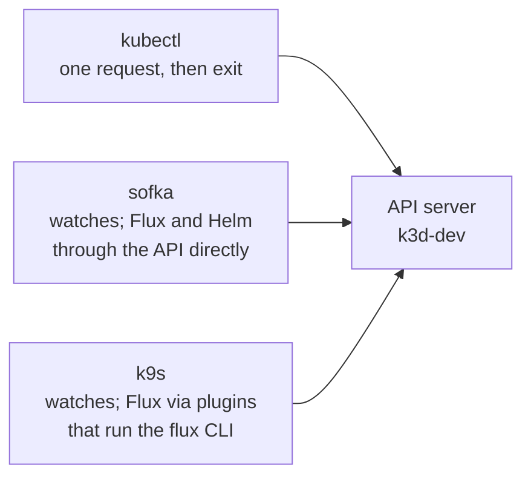
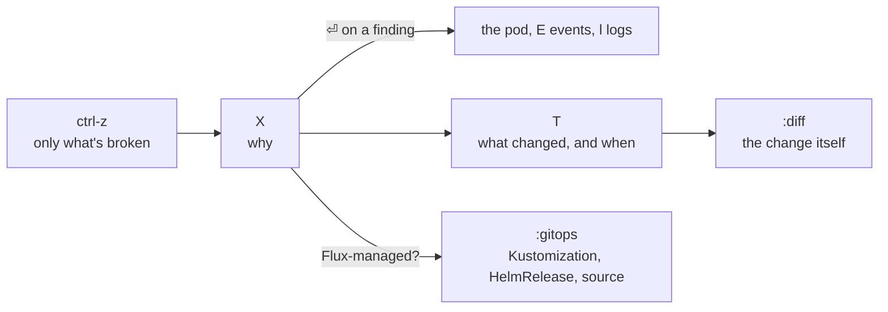

# 0. kubectl, sofka and k9s

> You end up with: one way to look at anything in these lessons from three
> tools, and a habit for working out why something is broken before you read
> its YAML.

## What they are

All three are clients of the same API server. None of them installs anything
in the cluster.

| Tool | What it is | Best at |
| --- | --- | --- |
| `kubectl` | The reference CLI | Anything scriptable or copy-pasteable, and the exact command a doc or an error message gives you |
| sofka | A TUI over watches, in Rust, inspired by k9s | Your default: browsing and acting, and working out *why* with Explain, Timeline, Diff, and Flux and Helm built in |
| k9s | The established TUI, in Go | The fallback where sofka isn't installed, with the dotfiles aliases and Flux plugins |



sofka and k9s share most of their keys and the `:` command syntax, so
`:pods -n podinfo`, `d`, `l`, `s`, `y`, `x` and `Shift-f` do the same thing in
both. The lessons are kubectl-first: each check is the kubectl command, then
one `sofka / k9s:` line with the keys, split only where the two differ. This
page has the full side by side, and what sofka does beyond k9s.

### Which tool when

| You want to | Reach for |
| --- | --- |
| Watch something come up, tail logs, shell in, port-forward | sofka or k9s |
| Know why a pod, Deployment or HelmRelease is unhealthy | sofka `X` |
| Know what changed and when, while you were watching | sofka `T`, `:diff` |
| Reconcile, suspend or resume a Flux object | sofka `t`, k9s `Shift-r` / `Shift-t` (dotfiles plugins), or `flux` |
| Put a check in a script, a README or a commit message | `kubectl` |
| Diff, trace or bootstrap Flux | `flux` |

## On EKS

The same three tools. Both TUIs use your kubeconfig's exec plugin
(`aws eks get-token`), and sofka prompts for MFA if the plugin asks. Start
either with `--readonly` against a shared cluster.

## Requirements

**In the cluster**: nothing. metrics-server (k3s ships it) adds CPU and memory
columns to both TUIs.

**On your machine**: `kubectl`, `sofka` and `k9s` from the dotfiles brewfile.
Check with `sofka --version`; this page was written against sofka 0.32.0 and
k9s 0.51.0.

## Start them

| | kubectl | sofka | k9s |
| --- | --- | --- | --- |
| Start | `kubectl --context k3d-dev ...` | `sofka --context k3d-dev` | `k9s --context k3d-dev` |
| In a namespace | `-n podinfo` | `sofka --context k3d-dev -n podinfo` | `k9s --context k3d-dev -n podinfo` |
| Open a view | `kubectl --context k3d-dev get helmreleases -A` | `sofka --context k3d-dev helmreleases -A` | `k9s --context k3d-dev -c helmreleases` |
| No writes | n/a | `--readonly` | `--readonly` |
| Check the connection | `kubectl --context k3d-dev cluster-info` | `sofka --context k3d-dev --check` | |

sofka can also bring your k9s setup across. Look before you write anything:

```sh
sofka import k9s --dry-run
```

It reads your k9s config and writes into `~/.config/sofka`,
outside chezmoi. sofka's Flux actions are built in, so you don't need the
plugins.

## Side by side

| Do, on lesson 2's podinfo | kubectl | sofka | k9s |
| --- | --- | --- | --- |
| List | `kubectl --context k3d-dev get pods -n podinfo` | `:pods -n podinfo` | `:pods -n podinfo` |
| All namespaces | `-A` | `0` | `0` |
| Switch namespace | `-n flux-system` | `n` | `:ns`, then `⏎` |
| Custom resources | `kubectl --context k3d-dev get crds` | `:crds`, `⏎` on one | `:crds`, `⏎` on one |
| Describe | `kubectl --context k3d-dev -n podinfo describe deploy podinfo` | `d` | `d` |
| YAML | `kubectl --context k3d-dev -n podinfo get deploy podinfo -o yaml` | `y` | `y` |
| Events for an object | `kubectl --context k3d-dev -n podinfo events --for deploy/podinfo` | `E` | `:events`, filter |
| Logs, follow | `kubectl --context k3d-dev -n podinfo logs -f deploy/podinfo` | `l` | `l` |
| Previous container's logs | `kubectl --context k3d-dev -n podinfo logs -p deploy/podinfo` | `p` | `p` |
| Shell | `kubectl --context k3d-dev -n podinfo exec -it deploy/podinfo -- sh` | `s` | `s` |
| Port-forward | `kubectl --context k3d-dev -n podinfo port-forward svc/podinfo 9898` | `f` or `Shift-f`, `:pf` to manage | `Shift-f`, `:pf` to manage |
| Decode a Secret | `kubectl --context k3d-dev -n flux-system get secret flux-system -o jsonpath='{.data.identity\.pub}' \| base64 -d` | `x` | `x` |
| Owner | `kubectl --context k3d-dev -n podinfo get pods -l app.kubernetes.io/name=podinfo -o jsonpath='{.items[*].metadata.ownerReferences[*].name}'` | `Shift-j` | `Shift-j` |
| Restart a workload | `kubectl --context k3d-dev -n podinfo rollout restart deploy/podinfo` | `r` | `r` |
| Only what's broken | | `ctrl-z` | `ctrl-z` |
| Tree from a kind down to containers | | `:deploy -n podinfo`, then `:xray` | `:xray deploy podinfo` |
| Helm releases | `helm --kube-context k3d-dev list -A` | `:helm`, `⏎` for history | `:helm`, `r` for history |
| Flux reconcile | `flux --context k3d-dev reconcile hr podinfo -n podinfo` | `t` | `Shift-r` (plugin) |
| Flux suspend | `flux --context k3d-dev suspend hr podinfo -n podinfo` | `t` | `Shift-t` (plugin) |
| Flux resume | `flux --context k3d-dev resume hr podinfo -n podinfo` | `t` | `Shift-t` (plugin) |
| Where an object came from | `flux --context k3d-dev trace -n podinfo deployment podinfo` | `:gitops` | `Shift-q` (plugin) |

Both TUIs list every key for the view you're in with `?`.

## Troubleshooting with sofka

k9s shows you the state; sofka also reads it for you. The loop:



| Key / command | Answers | Notes |
| --- | --- | --- |
| `ctrl-z` | What needs attention here? | Pods not ready, workloads not `Ready`, failed Jobs, Flux objects suspended or not `Ready` |
| `X` / `:explain` | Why is this unhealthy? | Workloads: rollout state, blocking pods and their reason (`ImagePullBackOff`, `CrashLoopBackOff`, `OOMKilled`, unschedulable, failed probes). Jobs, CronJobs, PVCs and Nodes get their own checks. Any other kind: its `Ready` condition and the other conditions. Recent Warning events for all. `⏎`, `E` or `l` on a finding jumps to it. |
| `T` / `:timeline` | What changed, in order? | Replica, readiness, phase, restart and condition changes. Only what sofka saw while it ran; nothing on disk. |
| `:diff` | What exactly changed? | Against `last-applied-configuration`, or for Flux- and Helm-managed objects, the previous version this session saw |
| `:gitops` | Who owns this? | The Kustomization or HelmRelease, its source with applied and latest revision, `dependsOn`, and the managed resources. sofka's `flux trace`. |
| `⏎` on a HelmRelease, or `:helm` | What did Helm actually install? | Revision history; `⏎` values, `y` manifest, `d` notes. Read from Helm's own Secrets. |
| `u` / `:adjacent` | What's connected to this? | Owners, children, and the ConfigMaps, Secrets, claims and node it names, one hop each way |
| `:rollout-history` | Which revision broke it? | Deployment, StatefulSet and DaemonSet revisions; `⏎` diffs one against live |
| `:bundle` | Hand it to someone | YAML, owner, Explain, events, timeline and recent logs as one redacted Markdown file (`:bundle-save`) |
| `ctrl-z` in logs | Only the errors | Warning and error lines, when the app's log format says which they are |

> [!TIP]
> Leave sofka open on the namespace before you break something. Timeline and
> the session diff only know what they watched.

### Try it

Three failures at once, in `scratch/00/`:

**Write `scratch/00/broken.yaml`**
```yaml
# scratch/00/broken.yaml
apiVersion: v1
kind: Namespace
metadata:
  name: broken
---
apiVersion: apps/v1
kind: Deployment
metadata:
  name: bad-tag
  namespace: broken
spec:
  selector: {matchLabels: {app: bad-tag}}
  template:
    metadata: {labels: {app: bad-tag}}
    spec:
      containers:
        - name: podinfo
          image: ghcr.io/stefanprodan/podinfo:0.0.0-nope
---
apiVersion: apps/v1
kind: Deployment
metadata:
  name: crashloop
  namespace: broken
spec:
  selector: {matchLabels: {app: crashloop}}
  template:
    metadata: {labels: {app: crashloop}}
    spec:
      containers:
        - name: busybox
          image: busybox:1.37
          command: [sh, -c, "echo starting; sleep 2; echo oh no >&2; exit 1"]
---
apiVersion: apps/v1
kind: Deployment
metadata:
  name: too-big
  namespace: broken
spec:
  selector: {matchLabels: {app: too-big}}
  template:
    metadata: {labels: {app: too-big}}
    spec:
      containers:
        - name: podinfo
          image: ghcr.io/stefanprodan/podinfo:6.7.1
          resources:
            requests: {cpu: "64"}
```

Start sofka on the namespace first, so its timeline sees everything:

```sh
sofka --context k3d-dev -n broken deployments
kubectl --context k3d-dev apply -f scratch/00/broken.yaml   # second terminal
```

| Try | kubectl | sofka | k9s |
| --- | --- | --- | --- |
| Find what's broken | `kubectl --context k3d-dev get pods -n broken` | `ctrl-z` | `:pods -n broken`, `ctrl-z` |
| `bad-tag`: why | `kubectl --context k3d-dev -n broken describe pod -l app=bad-tag`, read Events | `X` on the Deployment | `d` on the pod |
| `crashloop`: what it said | `kubectl --context k3d-dev -n broken logs -p -l app=crashloop` | `X`, then `l` on the finding | `p` on the pod |
| `too-big`: why | `kubectl --context k3d-dev get events -n broken --field-selector reason=FailedScheduling` | `X`: unschedulable, and the scheduler's message | `:events -n broken` |
| What happened, in order | `kubectl --context k3d-dev get events -n broken --sort-by=.lastTimestamp` | `T` on `crashloop`: each restart | `:events -n broken` |

Then fix `bad-tag` and watch the rollout:

<details>
<summary>Fix <code>bad-tag</code> to <code>6.7.1</code></summary>

**Replace `scratch/00/broken.yaml`**
```yaml
# scratch/00/broken.yaml
apiVersion: v1
kind: Namespace
metadata:
  name: broken
---
apiVersion: apps/v1
kind: Deployment
metadata:
  name: bad-tag
  namespace: broken
spec:
  selector: {matchLabels: {app: bad-tag}}
  template:
    metadata: {labels: {app: bad-tag}}
    spec:
      containers:
        - name: podinfo
          # ── new ──
          image: ghcr.io/stefanprodan/podinfo:6.7.1
          # ── end new ──
---
apiVersion: apps/v1
kind: Deployment
metadata:
  name: crashloop
  namespace: broken
spec:
  selector: {matchLabels: {app: crashloop}}
  template:
    metadata: {labels: {app: crashloop}}
    spec:
      containers:
        - name: busybox
          image: busybox:1.37
          command: [sh, -c, "echo starting; sleep 2; echo oh no >&2; exit 1"]
---
apiVersion: apps/v1
kind: Deployment
metadata:
  name: too-big
  namespace: broken
spec:
  selector: {matchLabels: {app: too-big}}
  template:
    metadata: {labels: {app: too-big}}
    spec:
      containers:
        - name: podinfo
          image: ghcr.io/stefanprodan/podinfo:6.7.1
          resources:
            requests: {cpu: "64"}
```

```sh
kubectl --context k3d-dev apply -f scratch/00/broken.yaml
kubectl --context k3d-dev -n broken rollout status deploy/bad-tag
kubectl --context k3d-dev -n broken rollout history deploy/bad-tag
```

Two revisions. sofka: `:rollout-history` on the Deployment, `⏎` on revision 1
for the old image line. k9s: `z` on the Deployment for its ReplicaSets.

</details>

Clean up:

```sh
kubectl --context k3d-dev delete -f scratch/00/broken.yaml
```

## Where it gets hard

- `d` is `kubectl describe` in both TUIs: it's only as good as the object's
  status and events.
- sofka's Explain is rules, not magic. A kind with no `Ready` condition, or one
  that keeps its status somewhere else (an HTTPRoute's is per parent Gateway),
  gets little from `X`. Read `d` instead.
- Timeline and the session diff start empty every time sofka starts.
- sofka's `t` patches Flux objects directly; k9s's plugins run the `flux` CLI.
  Either way, a change to a Git-managed object that isn't in Git gets reverted.
  sofka warns before you edit one.
- `Shift-r` and friends only exist because of the dotfiles k9s plugins, and
  only on the Flux kinds they're scoped to.

## Coming from Argo CD

sofka drives Argo CD the same way it drives Flux, without the `argocd` CLI:
`t` on an Application syncs, refreshes, suspends or resumes, and `⏎` (or
`:argocd`) opens its sources, revisions, managed objects and what's blocking
it. That's for work clusters; nothing here runs Argo CD.

## Links

- <https://sofka.rs>
- <https://github.com/nklmilojevic/sofka/blob/v0.32.0/docs/keys.md>
- <https://github.com/nklmilojevic/sofka/blob/v0.32.0/docs/debugging.md>
- <https://k9scli.io/topics/commands/>
- <https://kubernetes.io/docs/reference/kubectl/quick-reference/>
