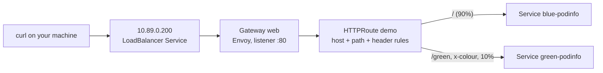

# 1. Cilium and Gateway API

> You end up with: a Gateway on `10.89.0.200`, routes splitting traffic
> between two podinfo releases by path, header and weight, and Hubble showing
> every request.

## What it is

### Cilium

Cilium is the cluster's CNI: it gives every pod an address and moves packets
between them. It does it with eBPF programs loaded into the kernel on each
node, rather than iptables rules. In this cluster it also replaces three
things k3s would normally run:

| Job | Usually done by | Here |
| --- | --- | --- |
| Pod networking | flannel | Cilium, vxlan tunnel between nodes |
| ClusterIP Services | kube-proxy (iptables) | Cilium's eBPF service map |
| `type: LoadBalancer` | A cloud LB, or k3s servicelb | Cilium LB-IPAM hands out `10.89.0.200-250`; L2 announcements answer ARP for them |
| Ingress / Gateway | Traefik | Cilium's Gateway API, using an Envoy proxy it runs on each node |

`bootstrap.sh` installed all of this. This lesson is about using it.

### Gateway API

The successor to `Ingress`. It splits one object into three, so each team
owns its part:

| Kind | Who owns it | Says |
| --- | --- | --- |
| `GatewayClass` | Whoever installs the implementation | "Gateways of class `cilium` are run by Cilium." Already exists. |
| `Gateway` | The platform team | "Listen on port 80 at one address, and accept routes from these namespaces." |
| `HTTPRoute` | The app team | "For host `demo.kube.internal`, send `/green` to this Service, everything else to that one." |



A route attaches to a Gateway with `parentRefs`. The Gateway decides whether
to accept it (`allowedRoutes`), and both objects report the result in their
`status`. When something doesn't work, the status says why.

### Hubble

Hubble reads the same eBPF datapath and shows every flow: who talked to whom,
on what port, whether it was forwarded or dropped, and for HTTP, the method,
path and status code.

## On EKS

Cilium can be the CNI on EKS in place of the AWS VPC CNI, with the same Gateway
API. More commonly the AWS Load Balancer Controller implements Gateway API with
an ALB. The `Gateway` and `HTTPRoute` objects are the same either way; only the
`gatewayClassName` changes.

## Requirements

**In the cluster**

- `cilium --context k3d-dev status` is all green.
- k9s `:gatewayclasses` shows `cilium` with `ACCEPTED True`.

**On your machine**: `kubectl`, `helm`, `cilium`, `hubble`, `k9s`, `sofka`, `curl`.

## Look around first

What `bootstrap.sh` turned on:

```sh
cilium --context k3d-dev config view | grep -iE 'gateway|kube-proxy|l2'
```

The Service table that replaces kube-proxy. In k9s, `:pods -n kube-system`,
pick a `cilium-` pod (not the operator), `s`:

```sh
# in the pod shell
cilium-dbg service list
```

Each ClusterIP and its backends, in an eBPF map instead of iptables.

Hubble needs two terminals:

```sh
cilium --context k3d-dev hubble port-forward     # terminal 1, leave running
hubble observe -f                                 # terminal 2
```

`cilium --context k3d-dev hubble ui` opens the service map in a browser.

## Install by hand

Everything here lives in `scratch/01/`. The Gateway files are reused in
lesson 2.

### 1. Two backends

podinfo is a small web app whose page shows a message, so you can tell which
release answered:

```sh
helm --kube-context k3d-dev install blue oci://ghcr.io/stefanprodan/charts/podinfo \
  --version 6.7.1 -n demo --create-namespace --set ui.message=blue
helm --kube-context k3d-dev install green oci://ghcr.io/stefanprodan/charts/podinfo \
  --version 6.7.1 -n demo --set ui.message=green
```

k9s `:svc -n demo` shows `blue-podinfo` and `green-podinfo` on port 9898.

### 2. A Gateway

```yaml
# scratch/01/gateway.yaml
apiVersion: v1
kind: Namespace
metadata:
  name: gateway
---
apiVersion: gateway.networking.k8s.io/v1
kind: Gateway
metadata:
  name: web
  namespace: gateway
spec:
  gatewayClassName: cilium
  listeners:
    - name: http
      protocol: HTTP
      port: 80
      allowedRoutes:
        namespaces:
          from: All
```

```sh
kubectl --context k3d-dev apply -f scratch/01/gateway.yaml
```

k9s `:gateways -A` until `PROGRAMMED True` with an address, usually
`10.89.0.200`. `:svc -n gateway` shows the LoadBalancer Service Cilium created
for it.

### 3. A route, one step at a time

Start with everything to `blue`:

```yaml
# scratch/01/route.yaml
apiVersion: gateway.networking.k8s.io/v1
kind: HTTPRoute
metadata:
  name: demo
  namespace: demo
spec:
  parentRefs:
    - name: web
      namespace: gateway
  hostnames: [demo.kube.internal]
  rules:
    - backendRefs:
        - name: blue-podinfo
          port: 9898
```

```sh
kubectl --context k3d-dev apply -f scratch/01/route.yaml
curl -s -H 'Host: demo.kube.internal' http://10.89.0.200/ | jq .message
```

Then replace `rules:` with each of these in turn, re-apply, and predict the
answer before you `curl`:

<details>
<summary>Path: <code>/green</code> to green, rewritten to <code>/</code></summary>

```yaml
  rules:
    - matches:
        - path:
            type: PathPrefix
            value: /green
      filters:
        - type: URLRewrite
          urlRewrite:
            path:
              type: ReplacePrefixMatch
              replacePrefixMatch: /
      backendRefs:
        - name: green-podinfo
          port: 9898
    - backendRefs:
        - name: blue-podinfo
          port: 9898
```

`curl -H 'Host: demo.kube.internal' http://10.89.0.200/green`. Without the
filter, podinfo gets `/green`, which it doesn't serve.

</details>

<details>
<summary>Header: <code>x-colour: green</code> to green</summary>

Add this rule above the catch-all:

```yaml
    - matches:
        - headers:
            - name: x-colour
              value: green
      backendRefs:
        - name: green-podinfo
          port: 9898
```

`curl -H 'Host: demo.kube.internal' -H 'x-colour: green' http://10.89.0.200/`

</details>

<details>
<summary>Weights: 90/10 split</summary>

Make the catch-all:

```yaml
    - backendRefs:
        - name: blue-podinfo
          port: 9898
          weight: 90
        - name: green-podinfo
          port: 9898
          weight: 10
```

```sh
for i in $(seq 50); do
  curl -s -H 'Host: demo.kube.internal' http://10.89.0.200/ | jq -r .message
done | sort | uniq -c
```

</details>

Watch the requests in `hubble observe -f`. The source shows as `(ingress)`:
that's Cilium's Envoy, not your machine.

**Where to look**

| Check | kubectl | k9s | sofka |
| --- | --- | --- | --- |
| GatewayClass accepted | `kubectl --context k3d-dev get gatewayclasses` | `:gatewayclasses` | `:gatewayclasses` |
| Cilium's service map | `kubectl --context k3d-dev -n kube-system exec ds/cilium -c cilium-agent -- cilium-dbg service list` | `:pods -n kube-system`, `s` on a `cilium-` pod | The same |
| Backends | `kubectl --context k3d-dev get svc -n demo` | `:svc -n demo` | `:svc -n demo` |
| Gateway programmed, with an address | `kubectl --context k3d-dev get gateways -A` | `:gateways -A` | `:gateways -A` |
| Route conditions | `kubectl --context k3d-dev -n demo describe httproute demo` | `d` on the route | `d` on the route |
| Which paths a route matches | `kubectl --context k3d-dev -n demo get httproute demo -o yaml` | `y` | `:httproutes -n demo`: the `ROUTES` column |

### 4. Clean up

```sh
kubectl --context k3d-dev delete -f scratch/01/route.yaml -f scratch/01/gateway.yaml
helm --kube-context k3d-dev uninstall -n demo blue green
kubectl --context k3d-dev delete namespace demo
```

Keep `scratch/01/gateway.yaml`: it becomes Flux's first object in lesson 2.

## Install with Flux

Not yet: [lesson 2](02-flux.md) installs Flux and puts this Gateway in Git.

## Exercises

1. Explain each condition on the route (`d` in k9s): `Accepted` and
   `ResolvedRefs`.
2. Break it on purpose: set the route's `parentRefs` namespace to `default`.
   `curl` gets a 404; find the reason in the route's status.
3. Change the Gateway's `allowedRoutes` to `from: Same`. Which status changes,
   the Gateway's or the route's?
4. Filter Hubble to one backend:
   `hubble observe -f --to-namespace demo --protocol http`.
5. Point a route in `demo` at a Service in another namespace. It fails with
   `RefNotPermitted` until a `ReferenceGrant` in the target namespace allows
   it.
6. Harder: add a `CiliumNetworkPolicy` that only allows traffic to
   `blue-podinfo` from its own namespace. The route now returns 503, and
   Hubble shows no drop. Allow `fromEntities: [ingress]` to fix it, and work
   out why a plain `NetworkPolicy` can't.

## Where it gets hard

- A route that doesn't attach shows nothing in `curl`, only a 404. The reason
  is always in the route's status, under each parent Gateway. sofka's `X`
  doesn't read that; use `d`.
- `curl` without the `Host` header gets a 404 from Envoy: no route matches.
- Rule precedence isn't file order. The longest path match wins, then the
  rule with the most header matches. Two rules matching the same request is
  legal and confusing.
- Cilium only enables Gateway API if its CRDs existed when the operator
  started. If `:gatewayclasses` is empty, see the repo README's
  Troubleshooting table.

## Links

- <https://gateway-api.sigs.k8s.io/guides/http-routing/>
- <https://docs.cilium.io/en/stable/network/servicemesh/gateway-api/gateway-api/>
- <https://docs.cilium.io/en/stable/observability/hubble/>
