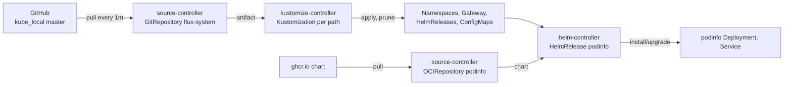
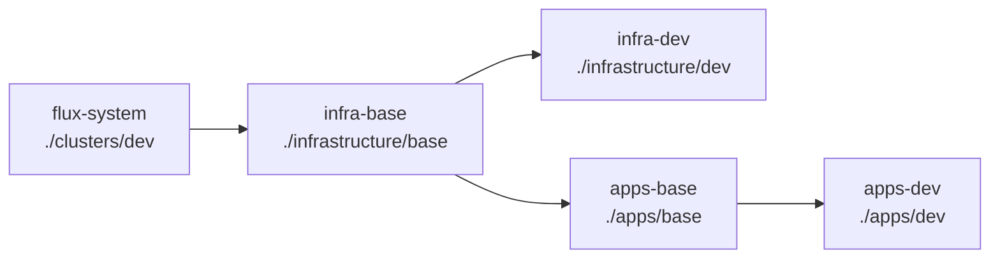

# 2. Flux

> You end up with: Flux syncing this repo, the lesson 1 Gateway and podinfo
> coming from Git, and, last, Cilium itself managed by Flux.

## What it is

Flux is a set of controllers that make the cluster match a Git repository.
You never run `kubectl apply` against the cluster; you push, and Flux pulls.
Each controller does one job and talks to the others through custom
resources:

| Controller | Watches | Does |
| --- | --- | --- |
| source-controller | `GitRepository`, `OCIRepository`, `HelmRepository` | Fetches a repo or chart on an interval and stores it as an artifact inside the cluster |
| kustomize-controller | `Kustomization` | Applies every manifest under a path in an artifact, deletes what was removed (`prune`), reports health |
| helm-controller | `HelmRelease` | Installs and upgrades a chart with given values, the way `helm upgrade --install` would |
| notification-controller | `Provider`, `Alert`, `Receiver` | Sends events out (Slack, Discord), takes webhooks in |
| image-reflector-controller | `ImageRepository`, `ImagePolicy` | Scans a registry's tags and picks one (lesson 8) |
| image-automation-controller | `ImageUpdateAutomation` | Commits the picked tag back to Git (lesson 8) |



Everything runs on a loop: every `interval`, each object is reconciled again.
That's what makes drift correct itself.

> [!NOTE]
> A Flux `Kustomization` is Flux's sync object: "apply this path". It isn't
> Kustomize, and nothing in this repo needs a `kustomization.yaml`. Flux
> generates one internally when a path doesn't have one.

## On EKS

The same. You install Flux with `flux bootstrap` exactly as here; it isn't an
EKS add-on. The difference is credentials: on EKS the source and image
controllers would use IAM roles for ECR and KMS instead of tokens and keys.

## Requirements

**In the cluster**: the platform, with nothing left from lesson 1.

**On your machine**

| Tool | Why |
| --- | --- |
| `flux` | Install, bootstrap, and everything kubectl can't do |
| `kubectl`, `helm`, `git` | As usual |
| `sofka` or `k9s` | [Lesson 0](00-tools.md) |
| A GitHub fine-grained token | Only for bootstrap; [made just before it](#a-token-for-bootstrap) and not kept |

Check the cluster is ready for Flux:

```sh
flux --context k3d-dev check --pre
```

## By hand, for comparison

> [!NOTE]
> Read this, don't run it. It's what Flux looks like without Git, so you can
> see what bootstrap adds.

Flux's objects work without Git: install the controllers, then apply a source
and a HelmRelease yourself.

**Example only: don't run it**
```sh
flux --context k3d-dev install
kubectl --context k3d-dev apply -f podinfo.yaml
```

**Example only: don't write it**
```yaml
# podinfo.yaml
apiVersion: source.toolkit.fluxcd.io/v1
kind: OCIRepository
metadata:
  name: podinfo
  namespace: flux-system
spec:
  interval: 1h
  url: oci://ghcr.io/stefanprodan/charts/podinfo
  ref:
    tag: 6.7.1
  layerSelector:
    mediaType: application/vnd.cncf.helm.chart.content.v1.tar+gzip
    operation: copy
---
apiVersion: helm.toolkit.fluxcd.io/v2
kind: HelmRelease
metadata:
  name: podinfo
  namespace: flux-system
spec:
  interval: 5m
  releaseName: podinfo
  targetNamespace: podinfo
  install:
    createNamespace: true
  chartRef:
    kind: OCIRepository
    name: podinfo
  values:
    ui:
      message: hello from helm-controller
```

helm-controller installs and upgrades the chart, but every change is another
`kubectl apply` from someone's laptop, and nothing records it. The rest of this
lesson makes Git the only way in: you push, Flux applies.

## Install with Flux

Bootstrap installs the controllers, commits them to this repo, and points them
at it, so Flux manages itself from Git.

### A token for bootstrap

Bootstrap uses a GitHub token once: to add a deploy key to the repo and push
its first commit. From then on Flux uses the deploy key, which it keeps in
Secret `flux-system/flux-system`. The token isn't stored anywhere, so make a
short-lived one now and let it expire.

On GitHub: **Settings → Developer settings → Personal access tokens →
Fine-grained tokens → Generate new token**.

| Field | Value |
| --- | --- |
| Token name | `flux-bootstrap-k3d-dev` |
| Expiration | 7 days |
| Resource owner | `bourbonfgiles` |
| Repository access | Only select repositories: `kube_local` |
| Administration | Read and write: creates the deploy key |
| Contents | Read and write: pushes `~/repos/personal/kube_local/clusters/dev/flux-system/` |
| Metadata | Read-only (GitHub adds it) |

Copy the token. Read it into the shell without echoing it or leaving it in
your history:

```sh
read -rs 'GITHUB_TOKEN?GitHub token: ' && export GITHUB_TOKEN
```

You need a new one only if you bootstrap again, for example on a new cluster.

### Bootstrap

```sh
flux bootstrap github --context k3d-dev \
  --owner bourbonfgiles --repository kube_local --personal --private=false \
  --branch master --path ~/repos/personal/kube_local/clusters/dev \
  --components-extra image-reflector-controller,image-automation-controller \
  --read-write-key
```

| Flag | Why |
| --- | --- |
| `--path clusters/dev` | Flux applies everything under this folder. It's the entry point. |
| `--components-extra ...` | The image controllers for lesson 8. Adding them later means bootstrapping again. |
| `--read-write-key` | The deploy key can push, also for lesson 8. A read-only key isn't upgraded in place. |

Then drop the token and fetch bootstrap's commit:

```sh
unset GITHUB_TOKEN
git -C ~/repos/personal/kube_local pull
kubectl --context k3d-dev -n flux-system get secret flux-system
```

The Secret is the deploy key; the same key shows under the repo's
**Settings → Deploy keys**. Bootstrap committed `~/repos/personal/kube_local/clusters/dev/flux-system/`:

- `gotk-components.yaml`: Flux itself.
- `gotk-sync.yaml`: a `GitRepository` for this repo and a `Kustomization`
  named `flux-system` that applies `./clusters/dev`.

## How this repo is laid out

> [!IMPORTANT]
> Bootstrap only wrote `~/repos/personal/kube_local/clusters/dev/flux-system/`. You write every
> other file yourself, at the full paths given. The next three parts explain the layout;
> [Write the files](#write-the-files) is where you create them.

Once Flux is in, everything you add goes in one of these places. `<component>`
stands for each chart you add in later lessons:

**Example only: the pattern, nothing to create here**
```
~/repos/personal/kube_local/
  clusters/dev/
    flux-system/                 Written by bootstrap. Don't edit.
    infrastructure.yaml          Kustomizations infra-base, infra-dev (and later infra-dev-config)
    apps.yaml                    Kustomizations apps-base, apps-dev
  infrastructure/
    base/<component>/            What every cluster gets
      namespace.yaml
      source.yaml                HelmRepository or OCIRepository
      release.yaml               HelmRelease
      values.yaml                ConfigMap <component>-values-base
      route.yaml                 HTTPRoute, hostname <component>.${CLUSTER_DOMAIN}
    dev/<component>/             Only what differs on this cluster, named after clusters/dev
      values.yaml                ConfigMap <component>-values-dev
    dev-config/<component>/      Objects only this cluster has, whose CRDs come from a chart (lesson 4)
  apps/
    base/<app>/, dev/<app>/      The same split for applications
```

`base/` is not EKS and not k3d: it's every cluster. The overlay is named after
the folder under `clusters/`, as in Flux's own example repo. An EKS cluster
would get `~/repos/personal/kube_local/clusters/eks/` pointing at the same
`base/` folders plus `~/repos/personal/kube_local/infrastructure/eks/` and
`~/repos/personal/kube_local/apps/eks/`. Nothing in `base/` changes.

Put a file in `base/` if every cluster has the object, even when one field
differs; make that field a variable. Put it in `dev/` only if the object
itself is specific to this cluster: the mkcert CA issuer, the KWOK build of
Karpenter, the k3d registry.

### Layers

`flux-system` applies `~/repos/personal/kube_local/clusters/dev/`, which holds one Kustomization per
layer. Each points at a folder and can wait for another with `dependsOn`:



`apps-base` waits on `infra-base`, `apps-dev` on `apps-base`, and
`infra-dev` on `infra-base`. Add each one when its folder has its first
file: Flux can't apply a path that isn't in Git.

### Cluster variables

The base layers set two variables, and Flux replaces `${CLUSTER_NAME}` and
`${CLUSTER_DOMAIN}` in every file under their path before applying it:

**Example only: the block both base layers carry**
```yaml
  postBuild:
    substitute:
      CLUSTER_NAME: dev
      CLUSTER_DOMAIN: kube.internal
```

| Variable | Used for | On EKS |
| --- | --- | --- |
| `CLUSTER_NAME` | The overlay ConfigMap a base HelmRelease reads: `podinfo-values-${CLUSTER_NAME}` | `eks`, so it reads `podinfo-values-eks` |
| `CLUSTER_DOMAIN` | Hostnames on routes, the Gateway and Canaries: `podinfo.${CLUSTER_DOMAIN}` | Your real domain |
| `CLUSTER_ISSUER` | Added in [lesson 4](04-cert-manager.md) on `infra-base`: the cert-manager issuer the Gateway names | An ACME issuer |

> [!WARNING]
> An unset variable becomes an empty string, not an error: a typo gives you
> `podinfo.` as a hostname. Only `${...}` is substituted; write `$${...}` to
> keep one literally. A bare `$`, such as `$imagepolicy`, is left alone.

### Chart values

By hand, values are files and a later `-f` wins:

**Example only: don't run it**
```sh
helm upgrade --install podinfo ... -f values-base.yaml -f values-dev.yaml
```

Flux can't read a values file from Git, so each file's contents go into a
ConfigMap under the key `values.yaml`, and the HelmRelease lists them in the
same order:

| By hand | With Flux |
| --- | --- |
| `-f values-base.yaml` | ConfigMap `podinfo-values-base` in `~/repos/personal/kube_local/apps/base/podinfo/values.yaml` |
| `-f values-dev.yaml` | ConfigMap `podinfo-values-dev` in `~/repos/personal/kube_local/apps/dev/podinfo/values.yaml`, listed in base as `podinfo-values-${CLUSTER_NAME}` |
| `--set image.tag=...` | `spec.values` on the HelmRelease. Overrides every ConfigMap. |

- The ConfigMaps must be in the HelmRelease's namespace.
- The watch label makes Flux upgrade as soon as a ConfigMap changes, instead
  of at the next `interval`.
- The route is in base: every cluster routes podinfo. Only its hostname
  differs, and that's `${CLUSTER_DOMAIN}`.

### Write the files

Everything below goes in `~/repos/personal/kube_local`, at the top level, next
to `clusters/`. Nothing but the Kustomization files goes under `clusters/dev/`:
`flux-system` applies that folder directly, so anything else there skips the
layers.

1. Create the infrastructure folder and copy the Gateway from lesson 1:
   ```sh
   mkdir -p ~/repos/personal/kube_local/infrastructure/base/gateway
   cp ~/repos/personal/scratch/01/gateway.yaml ~/repos/personal/kube_local/infrastructure/base/gateway/
   ```
2. Create the first layer:

   **Write `~/repos/personal/kube_local/clusters/dev/infrastructure.yaml`**
   ```yaml
   # ~/repos/personal/kube_local/clusters/dev/infrastructure.yaml
   apiVersion: kustomize.toolkit.fluxcd.io/v1
   kind: Kustomization
   metadata:
     name: infra-base
     namespace: flux-system
   spec:
     interval: 10m
     retryInterval: 1m
     sourceRef:
       kind: GitRepository
       name: flux-system
     path: ./infrastructure/base
     prune: true
     postBuild:
       substitute:
         CLUSTER_NAME: dev
         CLUSTER_DOMAIN: kube.internal
   ```

3. Commit, push, and reconcile rather than waiting a minute:
   ```sh
   git -C ~/repos/personal/kube_local add ~/repos/personal/kube_local/clusters/dev/infrastructure.yaml ~/repos/personal/kube_local/infrastructure/
   git -C ~/repos/personal/kube_local commit -m "Add infra-base with the Gateway"
   git -C ~/repos/personal/kube_local push
   flux --context k3d-dev reconcile kustomization flux-system --with-source
   ```
4. `kubectl --context k3d-dev get kustomizations,gateways -A`: the Gateway is
   back, from Git. sofka / k9s: `:kustomizations all`, then `:gateways all`.
5. Create the podinfo folders:
   ```sh
   mkdir -p ~/repos/personal/kube_local/apps/base/podinfo ~/repos/personal/kube_local/apps/dev/podinfo
   ```
6. Create podinfo's six files:

   **Write `~/repos/personal/kube_local/apps/base/podinfo/namespace.yaml`**
   ```yaml
   # ~/repos/personal/kube_local/apps/base/podinfo/namespace.yaml
   apiVersion: v1
   kind: Namespace
   metadata:
     name: podinfo
   ```

   **Write `~/repos/personal/kube_local/apps/base/podinfo/source.yaml`**
   ```yaml
   # ~/repos/personal/kube_local/apps/base/podinfo/source.yaml
   apiVersion: source.toolkit.fluxcd.io/v1
   kind: OCIRepository
   metadata:
     name: podinfo
     namespace: podinfo
   spec:
     interval: 1h
     url: oci://ghcr.io/stefanprodan/charts/podinfo
     ref:
       tag: 6.7.1
     layerSelector:
       mediaType: application/vnd.cncf.helm.chart.content.v1.tar+gzip
       operation: copy
   ```

   **Write `~/repos/personal/kube_local/apps/base/podinfo/release.yaml`**
   ```yaml
   # ~/repos/personal/kube_local/apps/base/podinfo/release.yaml
   apiVersion: helm.toolkit.fluxcd.io/v2
   kind: HelmRelease
   metadata:
     name: podinfo
     namespace: podinfo
   spec:
     interval: 10m
     chartRef:
       kind: OCIRepository
       name: podinfo
     valuesFrom:
       - kind: ConfigMap
         name: podinfo-values-base
       - kind: ConfigMap
         name: podinfo-values-${CLUSTER_NAME}
   ```

   **Write `~/repos/personal/kube_local/apps/base/podinfo/values.yaml`**
   ```yaml
   # ~/repos/personal/kube_local/apps/base/podinfo/values.yaml
   apiVersion: v1
   kind: ConfigMap
   metadata:
     name: podinfo-values-base
     namespace: podinfo
     labels:
       reconcile.fluxcd.io/watch: Enabled
   data:
     values.yaml: |
       replicaCount: 2
   ```

   **Write `~/repos/personal/kube_local/apps/base/podinfo/route.yaml`**
   ```yaml
   # ~/repos/personal/kube_local/apps/base/podinfo/route.yaml
   apiVersion: gateway.networking.k8s.io/v1
   kind: HTTPRoute
   metadata:
     name: podinfo
     namespace: podinfo
   spec:
     parentRefs:
       - name: web
         namespace: gateway
     hostnames: ["podinfo.${CLUSTER_DOMAIN}"]
     rules:
       - backendRefs:
           - name: podinfo
             port: 9898
   ```

   **Write `~/repos/personal/kube_local/apps/dev/podinfo/values.yaml`**
   ```yaml
   # ~/repos/personal/kube_local/apps/dev/podinfo/values.yaml
   apiVersion: v1
   kind: ConfigMap
   metadata:
     name: podinfo-values-dev
     namespace: podinfo
     labels:
       reconcile.fluxcd.io/watch: Enabled
   data:
     values.yaml: |
       ui:
         message: k3d
   ```

7. Create the apps layers:

   **Write `~/repos/personal/kube_local/clusters/dev/apps.yaml`**
   ```yaml
   # ~/repos/personal/kube_local/clusters/dev/apps.yaml
   apiVersion: kustomize.toolkit.fluxcd.io/v1
   kind: Kustomization
   metadata:
     name: apps-base
     namespace: flux-system
   spec:
     interval: 10m
     retryInterval: 1m
     dependsOn:
       - name: infra-base
     sourceRef:
       kind: GitRepository
       name: flux-system
     path: ./apps/base
     prune: true
     postBuild:
       substitute:
         CLUSTER_NAME: dev
         CLUSTER_DOMAIN: kube.internal
   ---
   apiVersion: kustomize.toolkit.fluxcd.io/v1
   kind: Kustomization
   metadata:
     name: apps-dev
     namespace: flux-system
   spec:
     interval: 10m
     retryInterval: 1m
     dependsOn:
       - name: apps-base
     sourceRef:
       kind: GitRepository
       name: flux-system
     path: ./apps/dev
     prune: true
   ```

8. Commit, push, reconcile, then ask podinfo for its message:
   ```sh
   git -C ~/repos/personal/kube_local add ~/repos/personal/kube_local/clusters/dev/apps.yaml ~/repos/personal/kube_local/apps/
   git -C ~/repos/personal/kube_local commit -m "Add podinfo"
   git -C ~/repos/personal/kube_local push
   flux --context k3d-dev reconcile kustomization flux-system --with-source
   kubectl --context k3d-dev wait kustomization/apps-dev -n flux-system --for=condition=Ready --timeout=5m
   curl -s -H 'Host: podinfo.kube.internal' http://10.89.0.200/ | jq .message
   ```
   The message is `k3d`, from the dev ConfigMap; the route came from base
   with `podinfo.kube.internal` substituted in. sofka / k9s:
   `:helmreleases all`.

## Iterate

Every change is a commit. New and changed lines sit between `# ── new ──` and
`# ── end new ──`. Reconciling by hand only skips the 1m poll of Git; Flux
applies a push on its own.

### 1. Helm drift: Flux doesn't notice by default

The one behaviour that surprises Argo CD users. No file change:

```sh
kubectl --context k3d-dev -n podinfo delete service podinfo
kubectl --context k3d-dev -n podinfo get service podinfo
```

It stays gone, and `curl` through the Gateway fails: by default helm-controller
only checks its own changes.

### 2. Turn on drift detection

**Replace `~/repos/personal/kube_local/apps/base/podinfo/release.yaml`**
```yaml
# ~/repos/personal/kube_local/apps/base/podinfo/release.yaml
apiVersion: helm.toolkit.fluxcd.io/v2
kind: HelmRelease
metadata:
  name: podinfo
  namespace: podinfo
spec:
  interval: 10m
  # ── new ──
  driftDetection:
    mode: enabled
  # ── end new ──
  chartRef:
    kind: OCIRepository
    name: podinfo
  valuesFrom:
    - kind: ConfigMap
      name: podinfo-values-base
    - kind: ConfigMap
      name: podinfo-values-${CLUSTER_NAME}
```

```sh
git -C ~/repos/personal/kube_local add ~/repos/personal/kube_local/apps/base/podinfo/release.yaml
git -C ~/repos/personal/kube_local commit -m "podinfo: drift detection"
git -C ~/repos/personal/kube_local push
flux --context k3d-dev reconcile kustomization apps-base --with-source
kubectl --context k3d-dev -n podinfo get service podinfo
```

The Service is back: helm-controller now compares the cluster with the release
and corrects it. Delete it again, then reconcile the HelmRelease rather than
wait the 10m interval:

```sh
kubectl --context k3d-dev -n podinfo delete service podinfo
flux --context k3d-dev reconcile helmrelease podinfo -n podinfo
kubectl --context k3d-dev -n podinfo get service podinfo
```

Drift detection stays on from here; later lessons expect it.

### Asking Flux what it did

| Question | Command | sofka / k9s |
| --- | --- | --- |
| Where did this object come from? | `flux --context k3d-dev trace -n podinfo deployment podinfo` | sofka `:gitops` on it; k9s `Shift-q` (plugin) |
| What does a Kustomization own? | `flux --context k3d-dev tree kustomization apps-base` | |
| What would this push change? | `flux --context k3d-dev diff kustomization apps-base --path ~/repos/personal/kube_local/apps/base` | |
| What happened, in order? | `flux --context k3d-dev events -A` | `:events flux-system` |
| Which Helm revision is live? | `helm --kube-context k3d-dev history podinfo -n podinfo` | sofka `⏎` on the HelmRelease; k9s `:helm` |
| Why isn't it Ready? | `flux --context k3d-dev get all -A --status-selector ready=false` | sofka `ctrl-z`, then `X` |

Undo is `git -C ~/repos/personal/kube_local revert`, pushed: each revert is a
new Helm revision, not a Helm rollback.

## Exercises

One, and later lessons depend on it: lesson 6 changes Cilium's values through
Flux.

### Adopt Cilium

`bootstrap.sh` installed Cilium with `helm`. A HelmRelease with the same
release name and namespace takes that release over, so Flux owns the CNI.

| File | Contents |
| --- | --- |
| `~/repos/personal/kube_local/clusters/dev/infrastructure.yaml` | Add Kustomization `infra-dev` |
| `~/repos/personal/kube_local/infrastructure/base/cilium/source.yaml` | HelmRepository `cilium` in `kube-system`, `url: https://helm.cilium.io` |
| `~/repos/personal/kube_local/infrastructure/base/cilium/release.yaml` | HelmRelease `cilium` in `kube-system`, `chart.spec.version: 1.20.3`, `valuesFrom` `cilium-values-base`, then `cilium-values-${CLUSTER_NAME}` |
| `~/repos/personal/kube_local/infrastructure/base/cilium/values.yaml` | ConfigMap `cilium-values-base`: the contents of `~/repos/personal/kube_local/cilium/values.yaml` |
| `~/repos/personal/kube_local/infrastructure/dev/cilium/values.yaml` | ConfigMap `cilium-values-dev`: the contents of `~/repos/personal/kube_local/overlays/local/cilium-values.yaml` |

**Replace `~/repos/personal/kube_local/clusters/dev/infrastructure.yaml`**
```yaml
# ~/repos/personal/kube_local/clusters/dev/infrastructure.yaml
apiVersion: kustomize.toolkit.fluxcd.io/v1
kind: Kustomization
metadata:
  name: infra-base
  namespace: flux-system
spec:
  interval: 10m
  retryInterval: 1m
  sourceRef:
    kind: GitRepository
    name: flux-system
  path: ./infrastructure/base
  prune: true
  postBuild:
    substitute:
      CLUSTER_NAME: dev
      CLUSTER_DOMAIN: kube.internal
# ── new ──
---
apiVersion: kustomize.toolkit.fluxcd.io/v1
kind: Kustomization
metadata:
  name: infra-dev
  namespace: flux-system
spec:
  interval: 10m
  retryInterval: 1m
  dependsOn:
    - name: infra-base
  sourceRef:
    kind: GitRepository
    name: flux-system
  path: ./infrastructure/dev
  prune: true
# ── end new ──
```

**Write `~/repos/personal/kube_local/infrastructure/base/cilium/source.yaml`**
```yaml
# ~/repos/personal/kube_local/infrastructure/base/cilium/source.yaml
apiVersion: source.toolkit.fluxcd.io/v1
kind: HelmRepository
metadata:
  name: cilium
  namespace: kube-system
spec:
  interval: 1h
  url: https://helm.cilium.io
```

**Write `~/repos/personal/kube_local/infrastructure/base/cilium/release.yaml`**
```yaml
# ~/repos/personal/kube_local/infrastructure/base/cilium/release.yaml
apiVersion: helm.toolkit.fluxcd.io/v2
kind: HelmRelease
metadata:
  name: cilium
  namespace: kube-system
spec:
  interval: 10m
  chart:
    spec:
      chart: cilium
      version: 1.20.3
      sourceRef:
        kind: HelmRepository
        name: cilium
  valuesFrom:
    - kind: ConfigMap
      name: cilium-values-base
    - kind: ConfigMap
      name: cilium-values-${CLUSTER_NAME}
```

**Write `~/repos/personal/kube_local/infrastructure/base/cilium/values.yaml`**
```yaml
# ~/repos/personal/kube_local/infrastructure/base/cilium/values.yaml
apiVersion: v1
kind: ConfigMap
metadata:
  name: cilium-values-base
  namespace: kube-system
  labels:
    reconcile.fluxcd.io/watch: Enabled
data:
  values.yaml: |
    kubeProxyReplacement: true

    hubble:
      enabled: true
      relay:
        enabled: true
      ui:
        enabled: true

    bpf:
      monitorAggregation: none

    gatewayAPI:
      enabled: true
```

**Write `~/repos/personal/kube_local/infrastructure/dev/cilium/values.yaml`**
```yaml
# ~/repos/personal/kube_local/infrastructure/dev/cilium/values.yaml
apiVersion: v1
kind: ConfigMap
metadata:
  name: cilium-values-dev
  namespace: kube-system
  labels:
    reconcile.fluxcd.io/watch: Enabled
data:
  values.yaml: |
    # kube-proxy is disabled, so Cilium needs the API server address directly.
    k8sServiceHost: k3d-dev-serverlb
    k8sServicePort: 6443

    # Native routing would need pod CIDR routes on every node; k3d doesn't add them.
    routingMode: tunnel
    tunnelProtocol: vxlan

    # Stands in for a cloud load balancer. Inert until lb-ipam.yaml is applied.
    l2announcements:
      enabled: true

    # k3d nodes don't propagate mounts, so an auto-mounted cgroup2 never reaches the
    # agent and socket-LB hooks miss every pod. Use the node's own cgroup root.
    cgroup:
      autoMount:
        enabled: false
      hostRoot: /sys/fs/cgroup

    operator:
      replicas: 1

    # Use the pod CIDR k3s assigns each node (10.42.0.0/16). Cilium's own default
    # pool, 10.0.0.0/8, overlaps the node network.
    ipam:
      mode: kubernetes
```

The ConfigMaps hold `~/repos/personal/kube_local/cilium/values.yaml` and
`~/repos/personal/kube_local/overlays/local/cilium-values.yaml` unchanged.

1. Compare what's installed with what you're about to commit. The two
   ConfigMaps merged must give exactly this:
   ```sh
   helm --kube-context k3d-dev get values cilium -n kube-system
   ```
2. Push. `kubectl --context k3d-dev get helmreleases -n kube-system -w`:
   `cilium` upgrades to the same values,
   and `helm --kube-context k3d-dev history cilium -n kube-system` shows a new
   revision.
3. From now on the ConfigMaps are the truth. `bootstrap.sh` still installs
   Cilium from the original two files on a fresh cluster, before Flux exists,
   so keep them identical.

> [!WARNING]
> Wrong Cilium values take the cluster network down, and with it Flux's
> ability to fix them. If it goes wrong:
>
> ```sh
> flux --context k3d-dev suspend helmrelease cilium -n kube-system
> ~/repos/personal/kube_local/overlays/local/bootstrap.sh
> ```
>
> Fix the values in Git and push, then hand Cilium back to Flux:
>
> ```sh
> flux --context k3d-dev resume helmrelease cilium -n kube-system
> kubectl --context k3d-dev get helmreleases -n kube-system -w
> ```

## Where it gets hard

- Flux reads GitHub, not your checkout. Push before expecting anything.
- A HelmRelease in `base/` reports its dev ConfigMap missing until the dev
  layer has applied it. It retries on its own.
- CRD ordering: a Kustomization that applies an object whose CRD comes from a
  chart fails until the chart is installed. If something the chart needs is in
  the same Kustomization, they wait on each other forever. Lesson 4 gives such
  objects their own layer.
- Flux commits to the repo (bootstrap now, image automation in lesson 8).
  `git -C ~/repos/personal/kube_local pull` before you commit.

## Coming from Argo CD

| Argo CD | Flux |
| --- | --- |
| `Application` (Git path) | `GitRepository` + `Kustomization` |
| `Application` (Helm) | `HelmRepository` / `OCIRepository` + `HelmRelease` |
| App of apps | A `Kustomization` whose path holds more `Kustomization`s, as `~/repos/personal/kube_local/clusters/dev/` does |
| Sync waves | `dependsOn` |
| Self-heal | Default for manifests, at `interval`; `driftDetection` for HelmReleases |
| Disable auto-sync | `suspend: true` in Git, or `flux suspend` (itself drift Flux won't revert) |
| UI diff | `flux diff kustomization` |
| Argo Rollouts | Flagger (lesson 9) |
| Argo CD Image Updater | Image automation controllers (lesson 8) |

How they behave differently:

| | Argo CD | Flux |
| --- | --- | --- |
| Drift | Self-heal reverts any managed object, Helm or not, as soon as it sees it | A Kustomization re-applies plain manifests at its `interval` (10m here). A HelmRelease ignores drift in what Helm installed unless `driftDetection.mode: enabled` |
| Change detection | Watches live state | Polls Git at the GitRepository `interval` (1m here) and re-applies on a timer |
| Helm | Renders the chart itself; no Helm release exists | A real Helm release: `helm list`, `helm history` and Helm hooks all apply |
| Ordering | Sync waves within an app | `dependsOn` between Kustomizations or HelmReleases |
| Health | Built-in health checks per kind | `Ready` conditions; `wait: true` or `healthChecks` on a Kustomization to gate `dependsOn` |
| Multi-tenancy | Projects | Kustomization `serviceAccountName`, namespaced Flux objects |

## Links

- <https://fluxcd.io/flux/components/>
- <https://fluxcd.io/flux/installation/bootstrap/github/>
- <https://fluxcd.io/flux/components/kustomize/kustomizations/>
- <https://fluxcd.io/flux/components/helm/helmreleases/>
