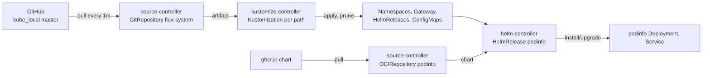
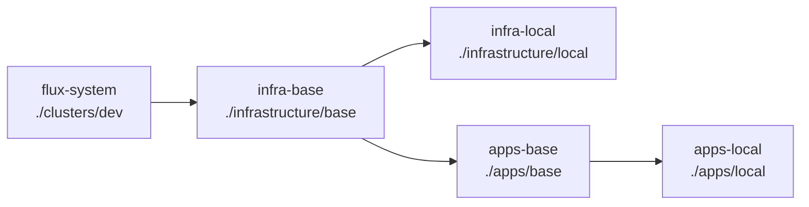

# 2. Flux

> You end up with: Flux syncing this repo, the lesson 1 Gateway and podinfo
> coming from Git, and, last, Cilium itself managed by Flux.

## What it is

Flux is a set of controllers that make the cluster match a Git repository.
You never run `kubectl apply` against the cluster; you push, and Flux pulls.
Each controller does one job and talks to the others through custom
resources:

| Controller | Watches | Does |
| --- | --- | --- |
| source-controller | `GitRepository`, `OCIRepository`, `HelmRepository` | Fetches a repo or chart on an interval and stores it as an artifact inside the cluster |
| kustomize-controller | `Kustomization` | Applies every manifest under a path in an artifact, deletes what was removed (`prune`), reports health |
| helm-controller | `HelmRelease` | Installs and upgrades a chart with given values, the way `helm upgrade --install` would |
| notification-controller | `Provider`, `Alert`, `Receiver` | Sends events out (Slack, Discord), takes webhooks in |
| image-reflector-controller | `ImageRepository`, `ImagePolicy` | Scans a registry's tags and picks one (lesson 8) |
| image-automation-controller | `ImageUpdateAutomation` | Commits the picked tag back to Git (lesson 8) |



Everything runs on a loop: every `interval`, each object is reconciled again.
That's what makes drift correct itself.

> [!NOTE]
> A Flux `Kustomization` is Flux's sync object: "apply this path". It isn't
> Kustomize, and nothing in this repo needs a `kustomization.yaml`. Flux
> generates one internally when a path doesn't have one.

## On EKS

The same. You install Flux with `flux bootstrap` exactly as here; it isn't an
EKS add-on. The difference is credentials: on EKS the source and image
controllers would use IAM roles for ECR and KMS instead of tokens and keys.

## Requirements

**In the cluster**: the platform, with nothing left from lesson 1.

**On your machine**

| Tool | Why |
| --- | --- |
| `flux` | Install, bootstrap, and everything k9s can't do |
| `kubectl`, `helm`, `k9s`, `git` | As usual |
| A GitHub fine-grained token on `kube_local` | Bootstrap creates a deploy key and commits. Permissions: Administration read/write, Contents read/write, Metadata read |

Check the cluster is ready for Flux:

```sh
flux --context k3d-dev check --pre
```

## Install by hand

First, Flux without Git: the controllers, and Flux objects you apply yourself.
This shows what each object does before bootstrap wires them to a repo.

### 1. The controllers

```sh
flux --context k3d-dev install
```

k9s `:pods -n flux-system`: four controllers. `:crds` and filter `fluxcd`
to see the kinds they brought.

### 2. A chart, the Flux way

```yaml
# scratch/02/podinfo.yaml
apiVersion: source.toolkit.fluxcd.io/v1
kind: OCIRepository
metadata:
  name: podinfo
  namespace: flux-system
spec:
  interval: 1h
  url: oci://ghcr.io/stefanprodan/charts/podinfo
  ref:
    tag: 6.7.1
  layerSelector:
    mediaType: application/vnd.cncf.helm.chart.content.v1.tar+gzip
    operation: copy
---
apiVersion: helm.toolkit.fluxcd.io/v2
kind: HelmRelease
metadata:
  name: podinfo
  namespace: flux-system
spec:
  interval: 5m
  releaseName: podinfo
  targetNamespace: podinfo
  install:
    createNamespace: true
  chartRef:
    kind: OCIRepository
    name: podinfo
  values:
    ui:
      message: hello from helm-controller
```

```sh
kubectl --context k3d-dev apply -f scratch/02/podinfo.yaml
```

Watch it in k9s: `:ocirepositories -A` fetches the chart, `:helmreleases -A`
installs it, `:pods -n podinfo` runs it.

### 3. Iterate

Each of these is an edit to `scratch/02/podinfo.yaml` and a re-apply, unless
it says otherwise:

| Try | Then look at |
| --- | --- |
| Change `ui.message` | `helm --kube-context k3d-dev history podinfo -n podinfo`: a new revision |
| Add `replicaCount: 3` under `values` | `:pods -n podinfo` |
| `kubectl --context k3d-dev -n podinfo scale deploy podinfo --replicas 1` | It stays at 1: helm-controller only checks its own changes by default |
| Add `driftDetection: {mode: enabled}` under `spec`, then scale again | Flux puts it back to 3 |
| `flux --context k3d-dev suspend helmrelease podinfo -n flux-system`, change a value, re-apply | Nothing happens until `flux resume` |
| Set `ref.tag` to `9.9.9` | `d` on the OCIRepository: the error, and the HelmRelease keeps the last good chart |

### 4. Clean up

```sh
kubectl --context k3d-dev delete -f scratch/02/podinfo.yaml   # helm-controller uninstalls podinfo
kubectl --context k3d-dev delete namespace podinfo
flux --context k3d-dev uninstall
```

Delete the HelmRelease before uninstalling Flux. Otherwise nothing is left to
uninstall the chart.

## Install with Flux

Bootstrap installs the controllers again, but this time commits them to this
repo and points them at it, so Flux manages itself from Git.

```sh
export GITHUB_TOKEN=...
flux bootstrap github --context k3d-dev \
  --owner bourbonfgiles --repository kube_local --personal --private=false \
  --branch master --path clusters/dev \
  --components-extra image-reflector-controller,image-automation-controller \
  --read-write-key
```

| Flag | Why |
| --- | --- |
| `--path clusters/dev` | Flux applies everything under this folder. It's the entry point. |
| `--components-extra ...` | The image controllers for lesson 8. Adding them later means bootstrapping again. |
| `--read-write-key` | The deploy key can push, also for lesson 8. A read-only key isn't upgraded in place. |

Then `git pull`. Bootstrap committed `clusters/dev/flux-system/`:

- `gotk-components.yaml`: Flux itself.
- `gotk-sync.yaml`: a `GitRepository` for this repo and a `Kustomization`
  named `flux-system` that applies `./clusters/dev`.

## How this repo is laid out

Once Flux is in, everything you add goes in one of these places:

```
clusters/dev/
  flux-system/                 Written by bootstrap. Don't edit.
  infrastructure.yaml          Kustomizations infra-base, infra-local (and later infra-local-config)
  apps.yaml                    Kustomizations apps-base, apps-local
infrastructure/
  base/<component>/            As you'd deploy it on EKS
    namespace.yaml
    source.yaml                HelmRepository or OCIRepository
    release.yaml               HelmRelease
    values.yaml                ConfigMap <component>-values-base
  local/<component>/           Only because this is k3d
    values.yaml                ConfigMap <component>-values-local
    route.yaml                 Anything naming *.kube.internal
  local-config/<component>/    Local objects whose CRDs come from a chart (lesson 4)
apps/
  base/<app>/, local/<app>/    The same split for applications
```

An EKS cluster would get `clusters/eks/` pointing at the same `base/`
folders plus an `infrastructure/eks/`. Nothing in `base/` changes.

### Layers

`flux-system` applies `clusters/dev/`, which holds one Kustomization per
layer. Each points at a folder and can wait for another with `dependsOn`:



```yaml
# clusters/dev/infrastructure.yaml
apiVersion: kustomize.toolkit.fluxcd.io/v1
kind: Kustomization
metadata:
  name: infra-base
  namespace: flux-system
spec:
  interval: 10m
  retryInterval: 1m
  sourceRef:
    kind: GitRepository
    name: flux-system
  path: ./infrastructure/base
  prune: true
```

The others are the same shape with their own `name`, `path` and `dependsOn`
(`apps-base` waits on `infra-base`; `apps-local` on `apps-base`; `infra-local`
on `infra-base`). Add each one when its folder has its first file: Flux can't
apply a path that isn't in Git.

### Chart values

By hand, values are files and a later `-f` wins:

```sh
helm upgrade --install podinfo ... -f values-base.yaml -f values-local.yaml
```

Flux can't read a values file from Git, so each file's contents go into a
ConfigMap under the key `values.yaml`, and the HelmRelease lists them in the
same order:

| By hand | With Flux |
| --- | --- |
| `-f values-base.yaml` | ConfigMap `podinfo-values-base` in `apps/base/podinfo/values.yaml` |
| `-f values-local.yaml` | ConfigMap `podinfo-values-local` in `apps/local/podinfo/values.yaml` |
| `--set image.tag=...` | `spec.values` on the HelmRelease. Overrides every ConfigMap. |

<details>
<summary>podinfo as Flux files</summary>

```yaml
# apps/base/podinfo/namespace.yaml
apiVersion: v1
kind: Namespace
metadata:
  name: podinfo
---
# apps/base/podinfo/source.yaml
apiVersion: source.toolkit.fluxcd.io/v1
kind: OCIRepository
metadata:
  name: podinfo
  namespace: podinfo
spec:
  interval: 1h
  url: oci://ghcr.io/stefanprodan/charts/podinfo
  ref:
    tag: 6.7.1
  layerSelector:
    mediaType: application/vnd.cncf.helm.chart.content.v1.tar+gzip
    operation: copy
---
# apps/base/podinfo/release.yaml
apiVersion: helm.toolkit.fluxcd.io/v2
kind: HelmRelease
metadata:
  name: podinfo
  namespace: podinfo
spec:
  interval: 10m
  chartRef:
    kind: OCIRepository
    name: podinfo
  valuesFrom:
    - kind: ConfigMap
      name: podinfo-values-base
    - kind: ConfigMap
      name: podinfo-values-local
---
# apps/base/podinfo/values.yaml
apiVersion: v1
kind: ConfigMap
metadata:
  name: podinfo-values-base
  namespace: podinfo
  labels:
    reconcile.fluxcd.io/watch: Enabled
data:
  values.yaml: |
    replicaCount: 2
---
# apps/local/podinfo/values.yaml
apiVersion: v1
kind: ConfigMap
metadata:
  name: podinfo-values-local
  namespace: podinfo
  labels:
    reconcile.fluxcd.io/watch: Enabled
data:
  values.yaml: |
    ui:
      message: k3d
---
# apps/local/podinfo/route.yaml
apiVersion: gateway.networking.k8s.io/v1
kind: HTTPRoute
metadata:
  name: podinfo
  namespace: podinfo
spec:
  parentRefs:
    - name: web
      namespace: gateway
  hostnames: [podinfo.kube.internal]
  rules:
    - backendRefs:
        - name: podinfo
          port: 9898
```

</details>

- The ConfigMaps must be in the HelmRelease's namespace.
- The watch label makes Flux upgrade as soon as a ConfigMap changes, instead
  of at the next `interval`.
- The route is local because its hostname is.

### First objects from Git

1. `mkdir -p infrastructure/base/gateway` and move the Gateway in:
   `cp scratch/01/gateway.yaml infrastructure/base/gateway/`.
2. Write `clusters/dev/infrastructure.yaml` with `infra-base`.
3. Commit, push, and reconcile rather than waiting a minute:
   ```sh
   flux --context k3d-dev reconcile kustomization flux-system --with-source
   ```
4. k9s `:kustomizations -A`, then `:gateways -A`: the Gateway is back, from Git.
5. The podinfo files above, plus `clusters/dev/apps.yaml` with `apps-base` and
   `apps-local`. Push, then
   `curl -s -H 'Host: podinfo.kube.internal' http://10.89.0.200/ | jq .message`.

## Exercises

1. Drift on a plain manifest: delete the route with `kubectl` and watch
   `apps-local` put it back within its interval.
2. Drift on a chart: delete the podinfo Deployment. It doesn't come back until
   you add `spec.driftDetection.mode: enabled` to the HelmRelease.
3. Change `replicaCount` in `apps/base/podinfo/values.yaml` and push. Watch
   `:helmreleases` upgrade.
4. Ask Flux where a pod came from:
   ```sh
   flux --context k3d-dev trace -n podinfo deployment podinfo
   ```
5. Preview a change before pushing:
   ```sh
   flux --context k3d-dev diff kustomization apps-base --path ./apps/base
   ```
6. Harder: adopt Cilium, below.

## Adopting Cilium

`bootstrap.sh` installed Cilium with `helm`. A HelmRelease with the same
release name and namespace takes that release over, so Flux owns the CNI.

| File | Contents |
| --- | --- |
| `clusters/dev/infrastructure.yaml` | Add Kustomization `infra-local` |
| `infrastructure/base/cilium/source.yaml` | HelmRepository `cilium` in `kube-system`, `url: https://helm.cilium.io` |
| `infrastructure/base/cilium/release.yaml` | HelmRelease `cilium` in `kube-system`, `chart.spec.version: 1.20.3`, `valuesFrom` both ConfigMaps, base first |
| `infrastructure/base/cilium/values.yaml` | ConfigMap `cilium-values-base`: the contents of `cilium/values.yaml` |
| `infrastructure/local/cilium/values.yaml` | ConfigMap `cilium-values-local`: the contents of `overlays/local/cilium-values.yaml` |

1. Compare what's installed with what you're about to commit. The two
   ConfigMaps merged must give exactly this:
   ```sh
   helm --kube-context k3d-dev get values cilium -n kube-system
   ```
2. Push. `:helmreleases -n kube-system`: `cilium` upgrades to the same values,
   and `helm --kube-context k3d-dev history cilium -n kube-system` shows a new
   revision.
3. From now on the ConfigMaps are the truth. `bootstrap.sh` still installs
   Cilium from the original two files on a fresh cluster, before Flux exists,
   so keep them identical.

> [!WARNING]
> Wrong Cilium values take the cluster network down, and with it Flux's
> ability to fix them. If it goes wrong:
> `flux --context k3d-dev suspend helmrelease cilium -n kube-system`, re-run
> `overlays/local/bootstrap.sh`, fix the values, then
> `flux --context k3d-dev resume helmrelease cilium -n kube-system`.

## Where it gets hard

- Flux reads GitHub, not your checkout. Push before expecting anything.
- A HelmRelease in `base/` reports its local ConfigMap missing until the local
  layer has applied it. It retries on its own.
- CRD ordering: a Kustomization that applies an object whose CRD comes from a
  chart fails until the chart is installed. If something the chart needs is in
  the same Kustomization, they wait on each other forever. Lesson 4 gives such
  objects their own layer.
- Flux commits to the repo (bootstrap now, image automation in lesson 8).
  `git pull` before you commit.

## Coming from Argo CD

| Argo CD | Flux |
| --- | --- |
| `Application` (Git path) | `GitRepository` + `Kustomization` |
| `Application` (Helm) | `HelmRepository` / `OCIRepository` + `HelmRelease` |
| App of apps | A `Kustomization` whose path holds more `Kustomization`s, as `clusters/dev/` does |
| Sync waves | `dependsOn` |
| Self-heal | Default for manifests; `driftDetection` for HelmReleases |
| Argo Rollouts | Flagger (lesson 9) |
| Argo CD Image Updater | Image automation controllers (lesson 8) |

## Links

- <https://fluxcd.io/flux/components/>
- <https://fluxcd.io/flux/installation/bootstrap/github/>
- <https://fluxcd.io/flux/components/kustomize/kustomizations/>
- <https://fluxcd.io/flux/components/helm/helmreleases/>
