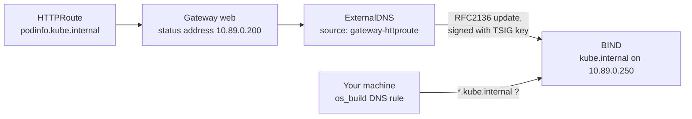

# 3. ExternalDNS

> You end up with: every route's hostname resolving from your machine within
> a minute, with no DNS edits by hand.

## What it is

ExternalDNS is a controller that turns Kubernetes objects into DNS records.
It reads hostnames from its **sources** (here `HTTPRoute`s and Services),
works out the address each should point at, and writes the difference to a
DNS **provider**.



| Idea | Means |
| --- | --- |
| Source | Where names come from. For a route, the address comes from its Gateway's status, not the route. |
| Provider | Where records go. Route53 on AWS; here BIND, spoken to over RFC2136 (standard dynamic DNS updates). |
| TSIG | A shared secret that signs each update, so BIND only accepts changes from ExternalDNS. `bootstrap.sh` made one in `dns/externaldns-tsig`. |
| Registry | ExternalDNS writes a TXT record next to each A record saying it owns it, so it never deletes records it didn't create. |
| Policy | `sync` creates and deletes; `upsert-only` never deletes. |

BIND here is the local stand-in for a Route53 hosted zone. It starts empty.

## On EKS

The same chart, writing to a Route53 hosted zone instead of BIND. What
changes is the provider and how ExternalDNS proves who it is: an IAM role
instead of a TSIG key, so there's no Secret in the cluster at all.

The repo is built so that only one file differs between the two clusters.
`release.yaml` doesn't say which cluster it's on. It reads two ConfigMaps,
and the second one's name ends in `${CLUSTER_NAME}`, which Flux fills in from
the cluster's own `clusters/<name>/infrastructure.yaml` ([lesson
2](02-flux.md#cluster-variables)):

| File | Here (`dev`) | On EKS (`eks`) |
| --- | --- | --- |
| `clusters/<name>/infrastructure.yaml` | `CLUSTER_NAME: dev` | `CLUSTER_NAME: eks` |
| `infrastructure/base/external-dns/release.yaml` | The same file: chart, version, `valuesFrom` | The same file |
| `infrastructure/base/external-dns/values.yaml` | The same file: sources, policy, registry | The same file |
| `infrastructure/<name>/external-dns/values.yaml` | `provider: rfc2136`, BIND's address, the TSIG key name and algorithm | `provider: aws`, the zone type, the IAM role |
| Credentials | Secret `externaldns-tsig`, made by hand below | None in the cluster: an IAM role |
| `txtOwnerId` | `k3d-dev` | Unique per cluster, so two clusters sharing a zone never delete each other's records |

The EKS file, for comparison:

**Example only: `~/repos/personal/kube_local/infrastructure/eks/external-dns/values.yaml`**
```yaml
apiVersion: v1
kind: ConfigMap
metadata:
  name: external-dns-values-eks
  namespace: external-dns
  labels:
    reconcile.fluxcd.io/watch: Enabled
data:
  values.yaml: |
    provider:
      name: aws
    txtOwnerId: eks-prod
    domainFilters: [example.com]
    extraArgs:
      - --aws-zone-type=public
    # IRSA: the pod assumes this role. With Pod Identity, leave this out and
    # associate the role with the external-dns service account in AWS instead.
    serviceAccount:
      annotations:
        eks.amazonaws.com/role-arn: arn:aws:iam::111122223333:role/external-dns
```

The role needs `route53:ChangeResourceRecordSets` on the hosted zone, and
`route53:ListHostedZones`, `route53:ListResourceRecordSets` and
`route53:ListTagsForResources`. The listing permissions do the job that
`--rfc2136-axfr` does here: without them it can't see what it owns, so it
can't delete anything.

## Requirements

**In the cluster**: lessons 0 to 2 done, so Flux syncs this repo, owns
Cilium, and podinfo answers on its route `podinfo.kube.internal` through the
Gateway. BIND
answers: `dig @10.89.0.250 ns.kube.internal` returns `10.89.0.250`.

**On your machine**: `kubectl`, `helm`, `flux`, `dig`, `curl`, and `sofka` or
`k9s` ([lesson 0](00-tools.md)). The
host resolves `kube.internal` through the os_build image's `kube-internal-dns`
unit; `resolvectl status k3d0` should list `10.89.0.250`.

## By hand, for comparison

> [!NOTE]
> Read this, don't run it. Flux does the same from Git below.

By hand, ExternalDNS is one `helm` command with a base and a dev values
file:

**Example only: don't run it**
```sh
helm --kube-context k3d-dev upgrade --install external-dns external-dns \
  --repo https://kubernetes-sigs.github.io/external-dns/ --version 1.23.0 \
  -n external-dns --create-namespace -f values-base.yaml -f values-dev.yaml
```

Each values file becomes a ConfigMap below, unchanged, under
`data.values.yaml`. `helm show values external-dns --repo
https://kubernetes-sigs.github.io/external-dns/ --version 1.23.0` lists every
key.

## Install with Flux

| Kind | Name | File |
| --- | --- | --- |
| Namespace | `external-dns` | `~/repos/personal/kube_local/infrastructure/base/external-dns/namespace.yaml` |
| Secret | `externaldns-tsig` | By hand; lesson 5 puts it in Git encrypted |
| HelmRepository | `external-dns` | `~/repos/personal/kube_local/infrastructure/base/external-dns/source.yaml` |
| HelmRelease | `external-dns` | `~/repos/personal/kube_local/infrastructure/base/external-dns/release.yaml` |
| ConfigMap | `external-dns-values-base` | `~/repos/personal/kube_local/infrastructure/base/external-dns/values.yaml` |
| ConfigMap | `external-dns-values-dev` | `~/repos/personal/kube_local/infrastructure/dev/external-dns/values.yaml` |

### 1. The namespace

The Secret in step 2 needs a namespace to go in, and the namespace comes
from Git like everything else.

```sh
mkdir -p ~/repos/personal/kube_local/infrastructure/base/external-dns ~/repos/personal/kube_local/infrastructure/dev/external-dns
```

**Write `~/repos/personal/kube_local/infrastructure/base/external-dns/namespace.yaml`**
```yaml
# ~/repos/personal/kube_local/infrastructure/base/external-dns/namespace.yaml
apiVersion: v1
kind: Namespace
metadata:
  name: external-dns
```

```sh
git -C ~/repos/personal/kube_local add ~/repos/personal/kube_local/infrastructure/base/external-dns/namespace.yaml
git -C ~/repos/personal/kube_local commit -m "ExternalDNS namespace"
git -C ~/repos/personal/kube_local push
flux --context k3d-dev reconcile kustomization infra-base --with-source
kubectl --context k3d-dev get namespace external-dns
```

sofka / k9s: `:namespaces`

### 2. The TSIG secret

ExternalDNS needs the same key BIND has. A Secret can't go in Git in plain
text, so this one is made by hand until lesson 5 encrypts it. Copy it across
from BIND's namespace:

```sh
kubectl --context k3d-dev -n external-dns create secret generic externaldns-tsig \
  --from-literal=secret="$(kubectl --context k3d-dev -n dns get secret externaldns-tsig \
    -o jsonpath='{.data.secret}' | base64 -d)"
kubectl --context k3d-dev -n external-dns get secret externaldns-tsig \
  -o jsonpath='{.data.secret}' | base64 -d
```

The last command should print the same key BIND has.

sofka / k9s: `:secrets external-dns`, `x` to decode

### 3. The chart and its values

This chart comes from a classic Helm repository, so the release uses
`chart.spec` with a `HelmRepository`, where podinfo used `chartRef` with an
`OCIRepository`.

**Write `~/repos/personal/kube_local/infrastructure/base/external-dns/source.yaml`**
```yaml
# ~/repos/personal/kube_local/infrastructure/base/external-dns/source.yaml
apiVersion: source.toolkit.fluxcd.io/v1
kind: HelmRepository
metadata:
  name: external-dns
  namespace: external-dns
spec:
  interval: 1h
  url: https://kubernetes-sigs.github.io/external-dns/
```

The release is the part every cluster shares. `valuesFrom` is the `-f` list
from the helm command: the base ConfigMap first, then the cluster's, and
later keys win. `${CLUSTER_NAME}` is `dev` here, so it reads
`external-dns-values-dev`; on EKS the same line reads
`external-dns-values-eks`.

**Write `~/repos/personal/kube_local/infrastructure/base/external-dns/release.yaml`**
```yaml
# ~/repos/personal/kube_local/infrastructure/base/external-dns/release.yaml
apiVersion: helm.toolkit.fluxcd.io/v2
kind: HelmRelease
metadata:
  name: external-dns
  namespace: external-dns
spec:
  interval: 10m
  chart:
    spec:
      chart: external-dns
      version: 1.23.0
      sourceRef:
        kind: HelmRepository
        name: external-dns
  valuesFrom:
    - kind: ConfigMap
      name: external-dns-values-base
    - kind: ConfigMap
      name: external-dns-values-${CLUSTER_NAME}
```

The base values: which objects to read, whether to delete, and how to mark
ownership. None of it depends on the provider.

**Write `~/repos/personal/kube_local/infrastructure/base/external-dns/values.yaml`**
```yaml
# ~/repos/personal/kube_local/infrastructure/base/external-dns/values.yaml
apiVersion: v1
kind: ConfigMap
metadata:
  name: external-dns-values-base
  namespace: external-dns
  labels:
    reconcile.fluxcd.io/watch: Enabled
data:
  values.yaml: |
    sources: [service, gateway-httproute, gateway-grpcroute]
    policy: sync
    registry: txt
```

The dev values: BIND as the provider, how to reach it, and the key from
step 2, passed in as an environment variable.

**Write `~/repos/personal/kube_local/infrastructure/dev/external-dns/values.yaml`**
```yaml
# ~/repos/personal/kube_local/infrastructure/dev/external-dns/values.yaml
apiVersion: v1
kind: ConfigMap
metadata:
  name: external-dns-values-dev
  namespace: external-dns
  labels:
    reconcile.fluxcd.io/watch: Enabled
data:
  values.yaml: |
    provider:
      name: rfc2136
    txtOwnerId: k3d-dev
    domainFilters: [kube.internal]
    extraArgs:
      - --rfc2136-host=bind.dns.svc.cluster.local.
      - --rfc2136-port=53
      - --rfc2136-zone=kube.internal
      - --rfc2136-tsig-keyname=externaldns
      - --rfc2136-tsig-secret-alg=hmac-sha256
      - --rfc2136-axfr
    env:
      - name: EXTERNAL_DNS_RFC2136_TSIG_SECRET
        valueFrom:
          secretKeyRef:
            name: externaldns-tsig
            key: secret
```

`infra-dev`, from lesson 2, applies this folder after `infra-base`, so the
namespace and release exist before the dev ConfigMap lands.

### 4. Push and check

```sh
git -C ~/repos/personal/kube_local add ~/repos/personal/kube_local/infrastructure/
git -C ~/repos/personal/kube_local commit -m "ExternalDNS with Flux"
git -C ~/repos/personal/kube_local push
flux --context k3d-dev reconcile kustomization flux-system --with-source
kubectl --context k3d-dev get helmreleases -n external-dns -w
```

The HelmRelease reports `external-dns-values-dev` missing until `infra-dev`
has applied it, then installs. sofka / k9s: `:helmreleases external-dns`

```sh
kubectl --context k3d-dev -n external-dns logs deploy/external-dns -f
```

Look for `Adding RR` lines. For only the failures, pipe through
`grep -iE 'error|warn'`.

sofka / k9s: `:pods external-dns`, `l`. Only the failures: sofka `ctrl-z`
in the logs view; k9s `/error`.

```sh
dig +short @10.89.0.250 podinfo.kube.internal
curl -s http://podinfo.kube.internal/ | jq .message
dig @10.89.0.250 -t TXT podinfo.kube.internal
```

The TXT record is the ownership record: it names `k3d-dev`.

## Iterate

Every change is a commit. New or changed lines sit between `# ── new ──` and
`# ── end new ──`.

### Changes worth knowing

Each row is one commit, then its revert. What happens is the point; try any you like.

| Change | File | What happens |
| --- | --- | --- |
| Add `"hello.${CLUSTER_DOMAIN}"` to `hostnames` | `~/repos/personal/kube_local/apps/base/podinfo/route.yaml` | An A record and a TXT ownership record within ExternalDNS's 1m interval. Take it off again and both go. |
| `policy: upsert-only` | `~/repos/personal/kube_local/infrastructure/base/external-dns/values.yaml` | Creates and updates, never deletes: a hostname taken off a route keeps its record. `sync` deletes it. Push the policy before the route change, or the delete happens first. |
| Drop `--rfc2136-axfr` | `~/repos/personal/kube_local/infrastructure/dev/external-dns/values.yaml` | ExternalDNS can't list the zone, so it can't work out what to delete; its logs say so. |

## Exercises

1. In Git, a Service of `type: LoadBalancer` with the annotation
   `external-dns.alpha.kubernetes.io/hostname: lb.kube.internal`. Cilium gives
   it an address from the pool; ExternalDNS names it.
2. Restart BIND
   (`kubectl --context k3d-dev -n dns rollout restart deploy/bind`, or `r` on
   it in `:deploy dns`). The zone lives in an
   `emptyDir`, so records vanish. Time how long until ExternalDNS puts them
   back.
3. Harder: a second ExternalDNS HelmRelease in Git, in its own namespace,
   with `txtOwnerId: other`. Work
   out from the TXT records why neither deletes the other's records, and what
   happens when both claim the same name.

## Where it gets hard

- The trailing dot on `--rfc2136-host` matters: without it the lookup walks
  the pod's DNS search list first.
- Without `--rfc2136-axfr` it can't read the zone back, so it never deletes
  anything.
- A Gateway without an address produces no records for its routes.
- On your machine, names only resolve through the os_build DNS unit. If `dig
  @10.89.0.250` works but `curl` doesn't, it's the host side:
  `systemctl status kube-internal-dns`.
- Errors from BIND show only in ExternalDNS's logs, often as a terse
  `NOTAUTH` or `REFUSED`. Those usually mean a wrong key name, algorithm or
  zone. A sofka extra ([lesson 0](00-tools.md)): `ctrl-z` in the logs view
  hides everything but warnings and errors.

## Links

- <https://kubernetes-sigs.github.io/external-dns/latest/docs/tutorials/rfc2136/>
- <https://kubernetes-sigs.github.io/external-dns/latest/docs/tutorials/aws/>
- <https://kubernetes-sigs.github.io/external-dns/latest/docs/sources/gateway-api/>
