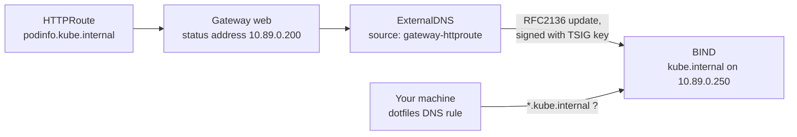

# 3. ExternalDNS

> You end up with: every route's hostname resolving from your machine within
> a minute, with no DNS edits by hand.

## What it is

ExternalDNS is a controller that turns Kubernetes objects into DNS records.
It reads hostnames from its **sources** (here `HTTPRoute`s and Services),
works out the address each should point at, and writes the difference to a
DNS **provider**.



| Idea | Means |
| --- | --- |
| Source | Where names come from. For a route, the address comes from its Gateway's status, not the route. |
| Provider | Where records go. Route53 on AWS; here BIND, spoken to over RFC2136 (standard dynamic DNS updates). |
| TSIG | A shared secret that signs each update, so BIND only accepts changes from ExternalDNS. `bootstrap.sh` made one in `dns/externaldns-tsig`. |
| Registry | ExternalDNS writes a TXT record next to each A record saying it owns it, so it never deletes records it didn't create. |
| Policy | `sync` creates and deletes; `upsert-only` never deletes. |

BIND here is the local stand-in for a Route53 hosted zone. It starts empty.

## On EKS

The same chart with `provider.name: aws`, writing to Route53, authenticated
with an IAM role on its service account (IRSA or Pod Identity) instead of a
TSIG key. The sources, policy and registry values don't change.

## Requirements

**In the cluster**

- BIND answering: `dig @10.89.0.250 ns.kube.internal` returns `10.89.0.250`.
- The Gateway and podinfo's route `podinfo.kube.internal` from lesson 2.
- Flux, for the Flux part.

**On your machine**: `kubectl`, `helm`, `flux`, `dig`, `curl`, and `sofka` or
`k9s` ([lesson 0](00-tools.md)). The
host resolves `kube.internal` through the dotfiles `dotfiles-kube-dns`
unit; `resolvectl status k3d0` should list `10.89.0.250`.

## Install by hand

### 1. The TSIG secret

ExternalDNS needs the same key BIND has. Copy it into a new namespace:

```sh
kubectl --context k3d-dev create namespace external-dns
kubectl --context k3d-dev -n external-dns create secret generic externaldns-tsig \
  --from-literal=secret="$(kubectl --context k3d-dev -n dns get secret externaldns-tsig \
    -o jsonpath='{.data.secret}' | base64 -d)"
kubectl --context k3d-dev -n external-dns get secret externaldns-tsig \
  -o jsonpath='{.data.secret}' | base64 -d
```

The second command should print the same key BIND has.

sofka / k9s: `:secrets -n external-dns`, `x` to decode

### 2. Values

Split from the start into what you'd keep on EKS and what's local:

```yaml
# scratch/03/values-base.yaml
sources: [service, gateway-httproute, gateway-grpcroute]
policy: sync
registry: txt
```

```yaml
# scratch/03/values-local.yaml
provider:
  name: rfc2136
txtOwnerId: k3d-dev
domainFilters: [kube.internal]
extraArgs:
  - --rfc2136-host=bind.dns.svc.cluster.local.
  - --rfc2136-port=53
  - --rfc2136-zone=kube.internal
  - --rfc2136-tsig-keyname=externaldns
  - --rfc2136-tsig-secret-alg=hmac-sha256
  - --rfc2136-axfr
env:
  - name: EXTERNAL_DNS_RFC2136_TSIG_SECRET
    valueFrom:
      secretKeyRef:
        name: externaldns-tsig
        key: secret
```

`helm show values external-dns --repo https://kubernetes-sigs.github.io/external-dns/`
lists every key.

### 3. Install

```sh
helm --kube-context k3d-dev upgrade --install external-dns external-dns \
  --repo https://kubernetes-sigs.github.io/external-dns/ --version 1.23.0 \
  -n external-dns -f scratch/03/values-base.yaml -f scratch/03/values-local.yaml
```

```sh
kubectl --context k3d-dev -n external-dns logs deploy/external-dns -f
```

Look for `Adding RR` lines. For only the failures, pipe through
`grep -iE 'error|warn'`.

sofka / k9s: `:pods -n external-dns`, `l`. Only the failures: sofka `ctrl-z`
in the logs view; k9s `/error`.

Then:

```sh
dig +short @10.89.0.250 podinfo.kube.internal
curl -s http://podinfo.kube.internal/ | jq .message
```

### 4. Iterate

| Try | Then look at |
| --- | --- |
| `dig @10.89.0.250 -t TXT podinfo.kube.internal` | The ownership record, naming `k3d-dev` |
| Add a second hostname to the route (Flux will revert it later; fine for now) | A new record within a minute |
| Set `policy: upsert-only`, upgrade, remove the hostname | The record stays |
| Remove `--rfc2136-axfr`, upgrade | Logs: it can't list the zone, so it can't reconcile deletes |

### 5. Clean up

```sh
helm --kube-context k3d-dev uninstall external-dns -n external-dns
```

Leave the namespace and Secret: Flux uses them next.

## Install with Flux

| Kind | Name | File |
| --- | --- | --- |
| Namespace | `external-dns` | `infrastructure/base/external-dns/namespace.yaml` |
| HelmRepository | `external-dns` | `infrastructure/base/external-dns/source.yaml` |
| HelmRelease | `external-dns` | `infrastructure/base/external-dns/release.yaml` |
| ConfigMap | `external-dns-values-base` | `infrastructure/base/external-dns/values.yaml` |
| ConfigMap | `external-dns-values-local` | `infrastructure/local/external-dns/values.yaml` |
| Secret | `externaldns-tsig` | Still by hand; lesson 5 puts it in Git encrypted |

This chart comes from a classic Helm repository, so the release uses
`chart.spec` with a `HelmRepository`, where podinfo used `chartRef` with an
`OCIRepository`:

```yaml
# infrastructure/base/external-dns/source.yaml
apiVersion: source.toolkit.fluxcd.io/v1
kind: HelmRepository
metadata:
  name: external-dns
  namespace: external-dns
spec:
  interval: 1h
  url: https://kubernetes-sigs.github.io/external-dns/
---
# infrastructure/base/external-dns/release.yaml
apiVersion: helm.toolkit.fluxcd.io/v2
kind: HelmRelease
metadata:
  name: external-dns
  namespace: external-dns
spec:
  interval: 10m
  chart:
    spec:
      chart: external-dns
      version: 1.23.0
      sourceRef:
        kind: HelmRepository
        name: external-dns
  valuesFrom:
    - kind: ConfigMap
      name: external-dns-values-base
    - kind: ConfigMap
      name: external-dns-values-local
```

The values ConfigMaps hold `scratch/03/values-base.yaml` and
`values-local.yaml` unchanged, indented under `data.values.yaml`:

```yaml
# infrastructure/base/external-dns/values.yaml
apiVersion: v1
kind: ConfigMap
metadata:
  name: external-dns-values-base
  namespace: external-dns
  labels:
    reconcile.fluxcd.io/watch: Enabled
data:
  values.yaml: |
    sources: [service, gateway-httproute, gateway-grpcroute]
    policy: sync
    registry: txt
```

`infrastructure/local/external-dns/values.yaml` is the same shape, named
`external-dns-values-local`. This is the first file under
`infrastructure/local/`, so add the `infra-local` Kustomization to
`clusters/dev/infrastructure.yaml` (lesson 2) in the same commit. Push, then
`kubectl --context k3d-dev get helmreleases -n external-dns -w` until `Ready`.

sofka / k9s: `:helmreleases -n external-dns`

## Exercises

1. Delete podinfo's route in Git and watch its A and TXT records go.
2. A Service of `type: LoadBalancer` with the annotation
   `external-dns.alpha.kubernetes.io/hostname: lb.kube.internal`. Cilium gives
   it an address from the pool; ExternalDNS names it.
3. Restart BIND
   (`kubectl --context k3d-dev -n dns rollout restart deploy/bind`, or `r` on
   it in `:deploy -n dns`). The zone lives in an
   `emptyDir`, so records vanish. Time how long until ExternalDNS puts them
   back.
4. Harder: install a second ExternalDNS by hand with `txtOwnerId: other`. Work
   out from the TXT records why neither deletes the other's records, and what
   happens when both claim the same name.

## Where it gets hard

- The trailing dot on `--rfc2136-host` matters: without it the lookup walks
  the pod's DNS search list first.
- Without `--rfc2136-axfr` it can't read the zone back, so it never deletes
  anything.
- A Gateway without an address produces no records for its routes.
- On your machine, names only resolve through the dotfiles DNS unit. If `dig
  @10.89.0.250` works but `curl` doesn't, it's the host side:
  `systemctl status dotfiles-kube-dns`.
- Errors from BIND show only in ExternalDNS's logs, often as a terse
  `NOTAUTH` or `REFUSED`. Those usually mean a wrong key name, algorithm or
  zone. A sofka extra ([lesson 0](00-tools.md)): `ctrl-z` in the logs view
  hides everything but warnings and errors.

## Links

- <https://kubernetes-sigs.github.io/external-dns/latest/docs/tutorials/rfc2136/>
- <https://kubernetes-sigs.github.io/external-dns/latest/docs/sources/gateway-api/>
