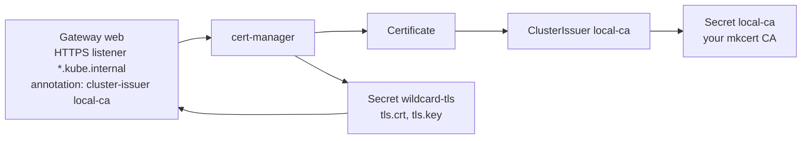

# 4. cert-manager and HTTPS

> You end up with: an HTTPS listener on the Gateway, a certificate for
> `*.kube.internal` renewed automatically, and Zen showing a padlock.

## What it is

cert-manager is a controller that gets certificates and keeps them renewed.
You describe the certificate you want; it asks an issuer to sign it and stores
the result in a Secret.

| Kind | Says |
| --- | --- |
| `ClusterIssuer` / `Issuer` | Who signs. A CA key pair, Let's Encrypt (ACME), Vault, AWS Private CA. Cluster-wide or one namespace. |
| `Certificate` | What you want: DNS names, lifetime, which issuer, which Secret to write. |
| `CertificateRequest` | One signing attempt. cert-manager makes these; you read them when something fails. |
| Secret (`kubernetes.io/tls`) | The result: `tls.crt` and `tls.key`, renewed before expiry. |

With Gateway API support on, you don't even write the `Certificate`:
cert-manager watches Gateways with a `cert-manager.io/cluster-issuer`
annotation and creates one per HTTPS listener.



### You don't need to own a CA

Public CAs won't issue for `.internal`, so you make a private one. A CA is just
a key pair your machine is told to trust. mkcert creates one on your machine;
cert-manager signs every certificate with it. The CA outlives cluster
rebuilds, so you trust it once.

> [!WARNING]
> Whoever holds the CA key can mint a certificate for any site your machine
> will believe. Never put `rootCA-key.pem` in Git unencrypted.

## On EKS

The same chart and values, with a `ClusterIssuer` for Let's Encrypt using
Route53 DNS-01 (authenticated with an IAM role), or AWS Private CA. Or skip
cert-manager and terminate TLS on the load balancer with ACM.

## Requirements

**In the cluster**: Flux and ExternalDNS (lesson 3), so names resolve.

**On your machine**: `mkcert`, `/usr/bin/trust`, `openssl`, `kubectl`,
`helm`, `flux`, `curl`, Zen, and `sofka` or `k9s` ([lesson 0](00-tools.md)).

## Trust the CA on Bazzite 44

This is once per machine, not per cluster. There are three trust stores here,
and each needs the CA:

| Store | Used by | How |
| --- | --- | --- |
| System (`/etc/pki/ca-trust`) | `/usr/bin/curl`, Podman, most system tools | `mkcert -install` |
| Homebrew bundle | brew's `curl` (first on your PATH), brew's OpenSSL | `brew postinstall ca-certificates` |
| Zen's profile | Zen | Import in settings |

1. `mkcert -install`. It asks for sudo, writes the CA into
   `/etc/pki/ca-trust/source/anchors/` and runs `update-ca-trust`. It warns
   that Firefox can't be configured; Zen is below.
2. Check: `/usr/bin/trust list | grep -i -A2 mkcert`.
3. Brew's bundle copies the system store only when it's installed, so rebuild
   it: `brew postinstall ca-certificates`.
4. Zen is a Flatpak that can only see `~/Downloads`:
   `cp "$(mkcert -CAROOT)/rootCA.pem" ~/Downloads/kube-local-ca.pem`.
5. In Zen: `about:preferences#privacy` > Certificates > View Certificates >
   Authorities > Import. Tick "Trust this CA to identify websites". Zen has two
   profiles here; do each one you use.
6. `rm ~/Downloads/kube-local-ca.pem`.

## By hand, for comparison

> [!NOTE]
> Read this, don't run it. Flux does the same from Git below.

By hand, cert-manager is one `helm` command, then a `ClusterIssuer` applied
once the chart's CRDs exist:

**Example only: don't run it**
```sh
helm --kube-context k3d-dev upgrade --install cert-manager oci://quay.io/jetstack/charts/cert-manager \
  --version v1.21.2 -n cert-manager --create-namespace -f values-base.yaml
kubectl --context k3d-dev apply -f cluster-issuer.yaml
```

That ordering, chart before issuer, is what Flux needs a separate layer for.

## Install with Flux

| Kind | Name | File |
| --- | --- | --- |
| Namespace | `cert-manager` | `~/repos/personal/kube_local/infrastructure/base/cert-manager/namespace.yaml` |
| OCIRepository | `cert-manager` | `~/repos/personal/kube_local/infrastructure/base/cert-manager/source.yaml` |
| HelmRelease | `cert-manager` | `~/repos/personal/kube_local/infrastructure/base/cert-manager/release.yaml` |
| ConfigMap | `cert-manager-values-base` | `~/repos/personal/kube_local/infrastructure/base/cert-manager/values.yaml` |
| Secret | `local-ca` | By hand; lesson 5 puts it in Git encrypted |
| Kustomization | `infra-dev-config` | `~/repos/personal/kube_local/clusters/dev/infrastructure.yaml` |
| ClusterIssuer | `local-ca` | `~/repos/personal/kube_local/infrastructure/dev-config/cert-manager/cluster-issuer.yaml` |
| Variable `CLUSTER_ISSUER` | on `infra-base` | `~/repos/personal/kube_local/clusters/dev/infrastructure.yaml` |
| Gateway, extended | `gateway/web` | `~/repos/personal/kube_local/infrastructure/base/gateway/gateway.yaml` |

### 1. The chart

Nothing about it is k3d-specific, so it's all in `base/` and the HelmRelease
reads only the base ConfigMap.

```sh
mkdir -p ~/repos/personal/kube_local/infrastructure/base/cert-manager
```

**Write `~/repos/personal/kube_local/infrastructure/base/cert-manager/namespace.yaml`**
```yaml
# ~/repos/personal/kube_local/infrastructure/base/cert-manager/namespace.yaml
apiVersion: v1
kind: Namespace
metadata:
  name: cert-manager
```

**Write `~/repos/personal/kube_local/infrastructure/base/cert-manager/source.yaml`**
```yaml
# ~/repos/personal/kube_local/infrastructure/base/cert-manager/source.yaml
apiVersion: source.toolkit.fluxcd.io/v1
kind: OCIRepository
metadata:
  name: cert-manager
  namespace: cert-manager
spec:
  interval: 1h
  url: oci://quay.io/jetstack/charts/cert-manager
  ref:
    tag: v1.21.2
  layerSelector:
    mediaType: application/vnd.cncf.helm.chart.content.v1.tar+gzip
    operation: copy
```

**Write `~/repos/personal/kube_local/infrastructure/base/cert-manager/release.yaml`**
```yaml
# ~/repos/personal/kube_local/infrastructure/base/cert-manager/release.yaml
apiVersion: helm.toolkit.fluxcd.io/v2
kind: HelmRelease
metadata:
  name: cert-manager
  namespace: cert-manager
spec:
  interval: 10m
  chartRef:
    kind: OCIRepository
    name: cert-manager
  valuesFrom:
    - kind: ConfigMap
      name: cert-manager-values-base
```

**Write `~/repos/personal/kube_local/infrastructure/base/cert-manager/values.yaml`**
```yaml
# ~/repos/personal/kube_local/infrastructure/base/cert-manager/values.yaml
apiVersion: v1
kind: ConfigMap
metadata:
  name: cert-manager-values-base
  namespace: cert-manager
  labels:
    reconcile.fluxcd.io/watch: Enabled
data:
  values.yaml: |
    crds:
      enabled: true
    config:
      apiVersion: controller.config.cert-manager.io/v1alpha1
      kind: ControllerConfiguration
      enableGatewayAPI: true
```

```sh
git -C ~/repos/personal/kube_local add ~/repos/personal/kube_local/infrastructure/
git -C ~/repos/personal/kube_local commit -m "cert-manager with Flux"
git -C ~/repos/personal/kube_local push
flux --context k3d-dev reconcile kustomization flux-system --with-source
kubectl --context k3d-dev get helmreleases -n cert-manager -w
```

### 2. The CA Secret

The CA key can't go in Git in plain text, so this stays by hand until lesson 5
encrypts it. The namespace now exists from Git:

```sh
kubectl --context k3d-dev -n cert-manager create secret tls local-ca \
  --cert="$(mkcert -CAROOT)/rootCA.pem" --key="$(mkcert -CAROOT)/rootCA-key.pem"
```

### 3. A layer for objects that need a chart's CRDs, and the issuer's name

The `ClusterIssuer` kind only exists once the chart is installed. In
`infra-dev` it would fail, and block the ConfigMaps other charts are waiting
for. So add a third layer. The issuer itself is this cluster's (EKS would use
ACME), so the Gateway in base names it through a new variable,
`CLUSTER_ISSUER`:

**Replace `~/repos/personal/kube_local/clusters/dev/infrastructure.yaml`**
```yaml
# ~/repos/personal/kube_local/clusters/dev/infrastructure.yaml
apiVersion: kustomize.toolkit.fluxcd.io/v1
kind: Kustomization
metadata:
  name: infra-base
  namespace: flux-system
spec:
  interval: 10m
  retryInterval: 1m
  sourceRef:
    kind: GitRepository
    name: flux-system
  path: ./infrastructure/base
  prune: true
  postBuild:
    substitute:
      CLUSTER_NAME: dev
      CLUSTER_DOMAIN: kube.internal
      # ── new ──
      CLUSTER_ISSUER: local-ca
      # ── end new ──
---
apiVersion: kustomize.toolkit.fluxcd.io/v1
kind: Kustomization
metadata:
  name: infra-dev
  namespace: flux-system
spec:
  interval: 10m
  retryInterval: 1m
  dependsOn:
    - name: infra-base
  sourceRef:
    kind: GitRepository
    name: flux-system
  path: ./infrastructure/dev
  prune: true
# ── new ──
---
apiVersion: kustomize.toolkit.fluxcd.io/v1
kind: Kustomization
metadata:
  name: infra-dev-config
  namespace: flux-system
spec:
  interval: 10m
  retryInterval: 1m
  dependsOn:
    - name: infra-dev
  sourceRef:
    kind: GitRepository
    name: flux-system
  path: ./infrastructure/dev-config
  prune: true
# ── end new ──
```

The issuer. A `ClusterIssuer` reads its Secret from cert-manager's own
namespace:

```sh
mkdir -p ~/repos/personal/kube_local/infrastructure/dev-config/cert-manager
```

**Write `~/repos/personal/kube_local/infrastructure/dev-config/cert-manager/cluster-issuer.yaml`**
```yaml
# ~/repos/personal/kube_local/infrastructure/dev-config/cert-manager/cluster-issuer.yaml
apiVersion: cert-manager.io/v1
kind: ClusterIssuer
metadata:
  name: local-ca
spec:
  ca:
    secretName: local-ca
```

### 4. HTTPS on the Gateway

It stays in base: every cluster has an HTTPS Gateway. The hostname and issuer
are the cluster's, so they're variables.

**Replace `~/repos/personal/kube_local/infrastructure/base/gateway/gateway.yaml`**
```yaml
# ~/repos/personal/kube_local/infrastructure/base/gateway/gateway.yaml
apiVersion: v1
kind: Namespace
metadata:
  name: gateway
---
apiVersion: gateway.networking.k8s.io/v1
kind: Gateway
metadata:
  name: web
  namespace: gateway
  # ── new ──
  annotations:
    cert-manager.io/cluster-issuer: ${CLUSTER_ISSUER}
  # ── end new ──
spec:
  gatewayClassName: cilium
  listeners:
    - name: http
      protocol: HTTP
      port: 80
      allowedRoutes:
        namespaces:
          from: All
    # ── new ──
    - name: https
      protocol: HTTPS
      port: 443
      hostname: "*.${CLUSTER_DOMAIN}"
      allowedRoutes:
        namespaces:
          from: All
      tls:
        mode: Terminate
        certificateRefs:
          - name: wildcard-tls
    # ── end new ──
```

The Secret `wildcard-tls` doesn't exist yet; cert-manager creates it
from the listener.

### 5. Push and check

```sh
git -C ~/repos/personal/kube_local add ~/repos/personal/kube_local/clusters/ ~/repos/personal/kube_local/infrastructure/
git -C ~/repos/personal/kube_local commit -m "HTTPS on the Gateway"
git -C ~/repos/personal/kube_local push
flux --context k3d-dev reconcile kustomization flux-system --with-source
kubectl --context k3d-dev get clusterissuers
kubectl --context k3d-dev get certificates -n gateway -w
```

```sh
curl -s https://podinfo.kube.internal/ | jq .message
```

Then open <https://podinfo.kube.internal/> in Zen. sofka / k9s:
`:clusterissuers`, then `:certificates gateway`.

## Iterate

A throwaway Certificate, in Git like everything else, removed at the end. It
needs cert-manager's CRDs, so it goes in `infra-dev-config`. New or changed
lines sit between `# ── new ──` and `# ── end new ──`.

**Write `~/repos/personal/kube_local/infrastructure/dev-config/cert-manager/test-certificate.yaml`**
```yaml
# ~/repos/personal/kube_local/infrastructure/dev-config/cert-manager/test-certificate.yaml
apiVersion: cert-manager.io/v1
kind: Certificate
metadata:
  name: test
  namespace: default
spec:
  secretName: test-tls
  dnsNames: [test.kube.internal]
  duration: 24h
  renewBefore: 1h
  issuerRef:
    kind: ClusterIssuer
    name: local-ca
```

```sh
git -C ~/repos/personal/kube_local add ~/repos/personal/kube_local/infrastructure/dev-config/cert-manager/test-certificate.yaml
git -C ~/repos/personal/kube_local commit -m "cert-manager: test certificate"
git -C ~/repos/personal/kube_local push
flux --context k3d-dev reconcile kustomization infra-dev-config --with-source
kubectl --context k3d-dev -n default get secret test-tls -o jsonpath='{.data.tls\.crt}' \
  | base64 -d | openssl x509 -noout -subject -issuer -dates -ext subjectAltName
```

sofka / k9s: `:secrets default`, `x` on `test-tls`

### 1. A second name

**Replace `~/repos/personal/kube_local/infrastructure/dev-config/cert-manager/test-certificate.yaml`**
```yaml
# ~/repos/personal/kube_local/infrastructure/dev-config/cert-manager/test-certificate.yaml
apiVersion: cert-manager.io/v1
kind: Certificate
metadata:
  name: test
  namespace: default
spec:
  secretName: test-tls
  # ── new ──
  dnsNames: [test.kube.internal, a.kube.internal]
  # ── end new ──
  duration: 24h
  renewBefore: 1h
  issuerRef:
    kind: ClusterIssuer
    name: local-ca
```

```sh
git -C ~/repos/personal/kube_local add ~/repos/personal/kube_local/infrastructure/dev-config/cert-manager/test-certificate.yaml
git -C ~/repos/personal/kube_local commit -m "cert-manager: test certificate, second name"
git -C ~/repos/personal/kube_local push
flux --context k3d-dev reconcile kustomization infra-dev-config --with-source
kubectl --context k3d-dev -n default get secret test-tls -o jsonpath='{.data.tls\.crt}' \
  | base64 -d | openssl x509 -noout -subject -issuer -dates -ext subjectAltName
```

The Secret is reissued, and `openssl` shows both names.

### 2. An issuer that doesn't exist

**Replace `~/repos/personal/kube_local/infrastructure/dev-config/cert-manager/test-certificate.yaml`**
```yaml
# ~/repos/personal/kube_local/infrastructure/dev-config/cert-manager/test-certificate.yaml
apiVersion: cert-manager.io/v1
kind: Certificate
metadata:
  name: test
  namespace: default
spec:
  secretName: test-tls
  dnsNames: [test.kube.internal, a.kube.internal]
  duration: 24h
  renewBefore: 1h
  issuerRef:
    kind: ClusterIssuer
    # ── new ──
    name: nope
    # ── end new ──
```

```sh
git -C ~/repos/personal/kube_local add ~/repos/personal/kube_local/infrastructure/dev-config/cert-manager/test-certificate.yaml
git -C ~/repos/personal/kube_local commit -m "cert-manager: test certificate, missing issuer"
git -C ~/repos/personal/kube_local push
flux --context k3d-dev reconcile kustomization infra-dev-config --with-source
kubectl --context k3d-dev -n default describe certificate test
```

Flux applied it fine; cert-manager waits, and says why. Put the issuer back:

**Replace `~/repos/personal/kube_local/infrastructure/dev-config/cert-manager/test-certificate.yaml`**
```yaml
# ~/repos/personal/kube_local/infrastructure/dev-config/cert-manager/test-certificate.yaml
apiVersion: cert-manager.io/v1
kind: Certificate
metadata:
  name: test
  namespace: default
spec:
  secretName: test-tls
  dnsNames: [test.kube.internal, a.kube.internal]
  duration: 24h
  renewBefore: 1h
  issuerRef:
    kind: ClusterIssuer
    # ── new ──
    name: local-ca
    # ── end new ──
```

```sh
git -C ~/repos/personal/kube_local add ~/repos/personal/kube_local/infrastructure/dev-config/cert-manager/test-certificate.yaml
git -C ~/repos/personal/kube_local commit -m "cert-manager: test certificate, issuer back"
git -C ~/repos/personal/kube_local push
flux --context k3d-dev reconcile kustomization infra-dev-config --with-source
kubectl --context k3d-dev -n default get certificate test
```

### 3. Renew every minute

**Replace `~/repos/personal/kube_local/infrastructure/dev-config/cert-manager/test-certificate.yaml`**
```yaml
# ~/repos/personal/kube_local/infrastructure/dev-config/cert-manager/test-certificate.yaml
apiVersion: cert-manager.io/v1
kind: Certificate
metadata:
  name: test
  namespace: default
spec:
  secretName: test-tls
  dnsNames: [test.kube.internal, a.kube.internal]
  # ── new ──
  duration: 1h
  renewBefore: 59m
  # ── end new ──
  issuerRef:
    kind: ClusterIssuer
    name: local-ca
```

```sh
git -C ~/repos/personal/kube_local add ~/repos/personal/kube_local/infrastructure/dev-config/cert-manager/test-certificate.yaml
git -C ~/repos/personal/kube_local commit -m "cert-manager: test certificate, renew every minute"
git -C ~/repos/personal/kube_local push
flux --context k3d-dev reconcile kustomization infra-dev-config --with-source
kubectl --context k3d-dev get certificaterequests -n default -w
```

A new request every minute or so.

### 4. Delete the Secret

No file change: cert-manager, not Flux, owns the Secret.

```sh
kubectl --context k3d-dev -n default delete secret test-tls
kubectl --context k3d-dev -n default get secret test-tls -w
```

cert-manager notices and issues again.

sofka / k9s: `d` on the Certificate, `:certificaterequests default`.
sofka extras ([lesson 0](00-tools.md)): `X` gives the Certificate's `Ready`
reason, and `u` then `c` walks to the requests it owns.

### 5. Remove it

```sh
git -C ~/repos/personal/kube_local rm ~/repos/personal/kube_local/infrastructure/dev-config/cert-manager/test-certificate.yaml
git -C ~/repos/personal/kube_local commit -m "cert-manager: drop the test certificate"
git -C ~/repos/personal/kube_local push
flux --context k3d-dev reconcile kustomization infra-dev-config --with-source
kubectl --context k3d-dev -n default get certificates
kubectl --context k3d-dev -n default delete secret test-tls
```

`prune` deletes the Certificate. cert-manager leaves the Secret it issued
behind, so delete that last one by hand.

## Exercises

1. Read the certificate Zen got (padlock > connection > more information) and
   match its issuer to `mkcert -CAROOT`.
2. Redirect HTTP to HTTPS: an HTTPRoute in
   `~/repos/personal/kube_local/infrastructure/base/gateway/redirect.yaml` with `parentRefs` the Gateway
   and `sectionName: http`, hostname `*.${CLUSTER_DOMAIN}`, and one rule with a
   `RequestRedirect` filter (`scheme: https`, `statusCode: 301`). Then give
   each app route `sectionName: https`, or it still matches plain HTTP too.

   **Answer**

   **Write `~/repos/personal/kube_local/infrastructure/base/gateway/redirect.yaml`**
   ```yaml
   # ~/repos/personal/kube_local/infrastructure/base/gateway/redirect.yaml
   apiVersion: gateway.networking.k8s.io/v1
   kind: HTTPRoute
   metadata:
     name: https-redirect
     namespace: gateway
   spec:
     parentRefs:
       - name: web
         sectionName: http
     hostnames: ["*.${CLUSTER_DOMAIN}"]
     rules:
       - filters:
           - type: RequestRedirect
             requestRedirect:
               scheme: https
               statusCode: 301
   ```

   **Replace `~/repos/personal/kube_local/apps/base/podinfo/route.yaml`**
   ```yaml
   # ~/repos/personal/kube_local/apps/base/podinfo/route.yaml
   apiVersion: gateway.networking.k8s.io/v1
   kind: HTTPRoute
   metadata:
     name: podinfo
     namespace: podinfo
   spec:
     parentRefs:
       - name: web
         namespace: gateway
         # ── new ──
         sectionName: https
         # ── end new ──
     hostnames: ["podinfo.${CLUSTER_DOMAIN}"]
     rules:
       - backendRefs:
           - name: podinfo
             port: 9898
   ```

3. Rebuild the cluster and bring HTTPS back without trusting anything again.
4. Harder: give a route the hostname `a.b.kube.internal`. Work out why Zen
   rejects the certificate, then fix it with a second HTTPS listener for
   `*.b.kube.internal`.

## Where it gets hard

- Brew's `curl` fails with "unable to get local issuer certificate" until the
  trust step 3. `/usr/bin/curl` works straight away.
- If Zen has DNS over HTTPS on, it asks the DoH provider, which has never heard
  of `kube.internal`. Add it under DNS over HTTPS > Manage Exceptions.
- cert-manager ignores listeners without a `hostname`, and Gateways entirely
  unless `enableGatewayAPI` is in its config. Either way: no Certificate, no
  error.
- `*.kube.internal` covers one level only: not `kube.internal`, not
  `a.b.kube.internal`.
- Moving the Gateway between layers deletes and recreates it, so routes drop
  for a moment. Fine here; on a real cluster you'd avoid it.

## Links

- <https://cert-manager.io/docs/usage/gateway/>
- <https://cert-manager.io/docs/configuration/ca/>
- <https://github.com/FiloSottile/mkcert>
- <https://docs.fedoraproject.org/en-US/quick-docs/using-shared-system-certificates/>
