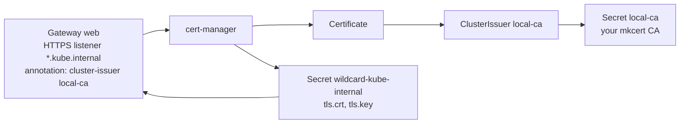

# 4. cert-manager and HTTPS

> You end up with: an HTTPS listener on the Gateway, a certificate for
> `*.kube.internal` renewed automatically, and Zen showing a padlock.

## What it is

cert-manager is a controller that gets certificates and keeps them renewed.
You describe the certificate you want; it asks an issuer to sign it and stores
the result in a Secret.

| Kind | Says |
| --- | --- |
| `ClusterIssuer` / `Issuer` | Who signs. A CA key pair, Let's Encrypt (ACME), Vault, AWS Private CA. Cluster-wide or one namespace. |
| `Certificate` | What you want: DNS names, lifetime, which issuer, which Secret to write. |
| `CertificateRequest` | One signing attempt. cert-manager makes these; you read them when something fails. |
| Secret (`kubernetes.io/tls`) | The result: `tls.crt` and `tls.key`, renewed before expiry. |

With Gateway API support on, you don't even write the `Certificate`:
cert-manager watches Gateways with a `cert-manager.io/cluster-issuer`
annotation and creates one per HTTPS listener.



### You don't need to own a CA

Public CAs won't issue for `.internal`, so you make a private one. A CA is just
a key pair your machine is told to trust. mkcert creates one on your machine;
cert-manager signs every certificate with it. The CA outlives cluster
rebuilds, so you trust it once.

> [!WARNING]
> Whoever holds the CA key can mint a certificate for any site your machine
> will believe. Never put `rootCA-key.pem` in Git unencrypted.

## On EKS

The same chart and values, with a `ClusterIssuer` for Let's Encrypt using
Route53 DNS-01 (authenticated with an IAM role), or AWS Private CA. Or skip
cert-manager and terminate TLS on the load balancer with ACM.

## Requirements

**In the cluster**: Flux and ExternalDNS (lesson 3), so names resolve.

**On your machine**: `mkcert`, `/usr/bin/trust`, `openssl`, `kubectl`,
`helm`, `flux`, `curl`, Zen, and `sofka` or `k9s` ([lesson 0](00-tools.md)).

## Trust the CA on Bazzite 44

This is once per machine, not per cluster. There are three trust stores here,
and each needs the CA:

| Store | Used by | How |
| --- | --- | --- |
| System (`/etc/pki/ca-trust`) | `/usr/bin/curl`, Podman, most system tools | `mkcert -install` |
| Homebrew bundle | brew's `curl` (first on your PATH), brew's OpenSSL | `brew postinstall ca-certificates` |
| Zen's profile | Zen | Import in settings |

1. `mkcert -install`. It asks for sudo, writes the CA into
   `/etc/pki/ca-trust/source/anchors/` and runs `update-ca-trust`. It warns
   that Firefox can't be configured; Zen is below.
2. Check: `/usr/bin/trust list | grep -i -A2 mkcert`.
3. Brew's bundle copies the system store only when it's installed, so rebuild
   it: `brew postinstall ca-certificates`.
4. Zen is a Flatpak that can only see `~/Downloads`:
   `cp "$(mkcert -CAROOT)/rootCA.pem" ~/Downloads/kube-local-ca.pem`.
5. In Zen: `about:preferences#privacy` > Certificates > View Certificates >
   Authorities > Import. Tick "Trust this CA to identify websites". Zen has two
   profiles here; do each one you use.
6. `rm ~/Downloads/kube-local-ca.pem`.

## Install by hand

### 1. cert-manager

```yaml
# scratch/04/values-base.yaml
crds:
  enabled: true
config:
  apiVersion: controller.config.cert-manager.io/v1alpha1
  kind: ControllerConfiguration
  enableGatewayAPI: true
```

```sh
helm --kube-context k3d-dev upgrade --install cert-manager oci://quay.io/jetstack/charts/cert-manager \
  --version v1.21.2 -n cert-manager --create-namespace -f scratch/04/values-base.yaml
```

```sh
kubectl --context k3d-dev get pods -n cert-manager
```

The controller, the webhook and cainjector.

sofka / k9s: `:pods -n cert-manager`

### 2. The CA as an issuer

```sh
kubectl --context k3d-dev -n cert-manager create secret tls local-ca \
  --cert="$(mkcert -CAROOT)/rootCA.pem" --key="$(mkcert -CAROOT)/rootCA-key.pem"
```

```yaml
# scratch/04/cluster-issuer.yaml
apiVersion: cert-manager.io/v1
kind: ClusterIssuer
metadata:
  name: local-ca
spec:
  ca:
    secretName: local-ca
```

```sh
kubectl --context k3d-dev apply -f scratch/04/cluster-issuer.yaml
```

```sh
kubectl --context k3d-dev get clusterissuers
```

`READY True`. A `ClusterIssuer` reads its Secret from cert-manager's own
namespace.

sofka / k9s: `:clusterissuers`

### 3. A certificate, by hand

```yaml
# scratch/04/certificate.yaml
apiVersion: cert-manager.io/v1
kind: Certificate
metadata:
  name: test
  namespace: default
spec:
  secretName: test-tls
  dnsNames: [test.kube.internal]
  duration: 24h
  renewBefore: 1h
  issuerRef:
    kind: ClusterIssuer
    name: local-ca
```

```sh
kubectl --context k3d-dev apply -f scratch/04/certificate.yaml
kubectl --context k3d-dev -n default get secret test-tls -o jsonpath='{.data.tls\.crt}' \
  | base64 -d | openssl x509 -noout -subject -issuer -dates -ext subjectAltName
```

sofka / k9s: `:secrets -n default`, `x` on `test-tls`

### 4. Iterate

Each step edits `scratch/04/certificate.yaml` and builds on the last. New or
changed lines sit between `# ── new ──` and `# ── end new ──`.

<details>
<summary>1. A second name</summary>

```yaml
# scratch/04/certificate.yaml
apiVersion: cert-manager.io/v1
kind: Certificate
metadata:
  name: test
  namespace: default
spec:
  secretName: test-tls
  # ── new ──
  dnsNames: [test.kube.internal, a.kube.internal]
  # ── end new ──
  duration: 24h
  renewBefore: 1h
  issuerRef:
    kind: ClusterIssuer
    name: local-ca
```

```sh
kubectl --context k3d-dev apply -f scratch/04/certificate.yaml
kubectl --context k3d-dev -n default get secret test-tls -o jsonpath='{.data.tls\.crt}' \
  | base64 -d | openssl x509 -noout -subject -issuer -dates -ext subjectAltName
```

The Secret is reissued, and `openssl` shows both names.

</details>

<details>
<summary>2. An issuer that doesn't exist</summary>

```yaml
# scratch/04/certificate.yaml
apiVersion: cert-manager.io/v1
kind: Certificate
metadata:
  name: test
  namespace: default
spec:
  secretName: test-tls
  dnsNames: [test.kube.internal, a.kube.internal]
  duration: 24h
  renewBefore: 1h
  issuerRef:
    kind: ClusterIssuer
    # ── new ──
    name: nope
    # ── end new ──
```

```sh
kubectl --context k3d-dev apply -f scratch/04/certificate.yaml
kubectl --context k3d-dev -n default describe certificate test
```

It waits, and says why. Put the issuer back:

```yaml
# scratch/04/certificate.yaml
apiVersion: cert-manager.io/v1
kind: Certificate
metadata:
  name: test
  namespace: default
spec:
  secretName: test-tls
  dnsNames: [test.kube.internal, a.kube.internal]
  duration: 24h
  renewBefore: 1h
  issuerRef:
    kind: ClusterIssuer
    # ── new ──
    name: local-ca
    # ── end new ──
```

```sh
kubectl --context k3d-dev apply -f scratch/04/certificate.yaml
kubectl --context k3d-dev -n default get certificate test
```

`READY True` again.

</details>

<details>
<summary>3. Renew every minute</summary>

```yaml
# scratch/04/certificate.yaml
apiVersion: cert-manager.io/v1
kind: Certificate
metadata:
  name: test
  namespace: default
spec:
  secretName: test-tls
  dnsNames: [test.kube.internal, a.kube.internal]
  # ── new ──
  duration: 1h
  renewBefore: 59m
  # ── end new ──
  issuerRef:
    kind: ClusterIssuer
    name: local-ca
```

```sh
kubectl --context k3d-dev apply -f scratch/04/certificate.yaml
kubectl --context k3d-dev get certificaterequests -n default -w
```

A new request every minute or so. Back to a day:

```yaml
# scratch/04/certificate.yaml
apiVersion: cert-manager.io/v1
kind: Certificate
metadata:
  name: test
  namespace: default
spec:
  secretName: test-tls
  dnsNames: [test.kube.internal, a.kube.internal]
  # ── new ──
  duration: 24h
  renewBefore: 1h
  # ── end new ──
  issuerRef:
    kind: ClusterIssuer
    name: local-ca
```

```sh
kubectl --context k3d-dev apply -f scratch/04/certificate.yaml
```

</details>

<details>
<summary>4. Delete the Secret</summary>

```sh
kubectl --context k3d-dev -n default delete secret test-tls
kubectl --context k3d-dev -n default get secret test-tls -w
```

cert-manager notices and issues again.

</details>

sofka / k9s: `d` on the Certificate, `:certificaterequests -n default`.
sofka extras ([lesson 0](00-tools.md)): `X` gives the Certificate's `Ready`
reason, and `u` then `c` walks to the requests it owns.

### 5. Clean up

```sh
kubectl --context k3d-dev delete -f scratch/04/certificate.yaml -f scratch/04/cluster-issuer.yaml
kubectl --context k3d-dev -n default delete secret test-tls
helm --kube-context k3d-dev uninstall cert-manager -n cert-manager
```

Keep the namespace and the `local-ca` Secret for the Flux part.

## Install with Flux

| Kind | Name | File |
| --- | --- | --- |
| Namespace | `cert-manager` | `infrastructure/base/cert-manager/namespace.yaml` |
| OCIRepository | `cert-manager` | `infrastructure/base/cert-manager/source.yaml` |
| HelmRelease | `cert-manager` | `infrastructure/base/cert-manager/release.yaml` |
| ConfigMap | `cert-manager-values-base` | `infrastructure/base/cert-manager/values.yaml` |
| Secret | `local-ca` | Still by hand; lesson 5 puts it in Git encrypted |
| Kustomization | `infra-local-config` | `clusters/dev/infrastructure.yaml` |
| ClusterIssuer | `local-ca` | `infrastructure/local-config/cert-manager/cluster-issuer.yaml` |
| Gateway, moved and extended | `gateway/web` | `infrastructure/local/gateway/gateway.yaml` |

1. **The chart.** Nothing about it is k3d-specific, so it's all in `base/`
   and the HelmRelease reads only the base ConfigMap. The ConfigMap holds
   `scratch/04/values-base.yaml` unchanged.
   <details>
   <summary>cert-manager as Flux files</summary>

   ```yaml
   # infrastructure/base/cert-manager/namespace.yaml
   apiVersion: v1
   kind: Namespace
   metadata:
     name: cert-manager
   ---
   # infrastructure/base/cert-manager/source.yaml
   apiVersion: source.toolkit.fluxcd.io/v1
   kind: OCIRepository
   metadata:
     name: cert-manager
     namespace: cert-manager
   spec:
     interval: 1h
     url: oci://quay.io/jetstack/charts/cert-manager
     ref:
       tag: v1.21.2
     layerSelector:
       mediaType: application/vnd.cncf.helm.chart.content.v1.tar+gzip
       operation: copy
   ---
   # infrastructure/base/cert-manager/release.yaml
   apiVersion: helm.toolkit.fluxcd.io/v2
   kind: HelmRelease
   metadata:
     name: cert-manager
     namespace: cert-manager
   spec:
     interval: 10m
     chartRef:
       kind: OCIRepository
       name: cert-manager
     valuesFrom:
       - kind: ConfigMap
         name: cert-manager-values-base
   ---
   # infrastructure/base/cert-manager/values.yaml
   apiVersion: v1
   kind: ConfigMap
   metadata:
     name: cert-manager-values-base
     namespace: cert-manager
     labels:
       reconcile.fluxcd.io/watch: Enabled
   data:
     values.yaml: |
       crds:
         enabled: true
       config:
         apiVersion: controller.config.cert-manager.io/v1alpha1
         kind: ControllerConfiguration
         enableGatewayAPI: true
   ```

   </details>

   Commit, push, and wait for `Ready`:
   ```sh
   git add infrastructure/
   git commit -m "cert-manager with Flux"
   git push
   flux --context k3d-dev reconcile kustomization flux-system --with-source
   kubectl --context k3d-dev get helmreleases -n cert-manager -w
   ```
2. **A layer for objects that need a chart's CRDs.** The `ClusterIssuer` kind
   only exists once the chart is installed. In `infra-local` it would fail,
   and block the ConfigMaps other charts are waiting for. So add a third
   layer:
   ```yaml
   # clusters/dev/infrastructure.yaml
   apiVersion: kustomize.toolkit.fluxcd.io/v1
   kind: Kustomization
   metadata:
     name: infra-base
     namespace: flux-system
   spec:
     interval: 10m
     retryInterval: 1m
     sourceRef:
       kind: GitRepository
       name: flux-system
     path: ./infrastructure/base
     prune: true
   ---
   apiVersion: kustomize.toolkit.fluxcd.io/v1
   kind: Kustomization
   metadata:
     name: infra-local
     namespace: flux-system
   spec:
     interval: 10m
     retryInterval: 1m
     dependsOn:
       - name: infra-base
     sourceRef:
       kind: GitRepository
       name: flux-system
     path: ./infrastructure/local
     prune: true
   # ── new ──
   ---
   apiVersion: kustomize.toolkit.fluxcd.io/v1
   kind: Kustomization
   metadata:
     name: infra-local-config
     namespace: flux-system
   spec:
     interval: 10m
     retryInterval: 1m
     dependsOn:
       - name: infra-local
     sourceRef:
       kind: GitRepository
       name: flux-system
     path: ./infrastructure/local-config
     prune: true
   # ── end new ──
   ```
   And the issuer, unchanged from `scratch/04/`:
   ```yaml
   # infrastructure/local-config/cert-manager/cluster-issuer.yaml
   apiVersion: cert-manager.io/v1
   kind: ClusterIssuer
   metadata:
     name: local-ca
   spec:
     ca:
       secretName: local-ca
   ```
3. **The Gateway becomes local.** It's about to name a local hostname and
   issuer: `git mv infrastructure/base/gateway infrastructure/local/gateway`.
   On EKS its file would name your real domain and an ACME issuer. Then:
   ```yaml
   # infrastructure/local/gateway/gateway.yaml
   apiVersion: v1
   kind: Namespace
   metadata:
     name: gateway
   ---
   apiVersion: gateway.networking.k8s.io/v1
   kind: Gateway
   metadata:
     name: web
     namespace: gateway
     # ── new ──
     annotations:
       cert-manager.io/cluster-issuer: local-ca
     # ── end new ──
   spec:
     gatewayClassName: cilium
     listeners:
       - name: http
         protocol: HTTP
         port: 80
         allowedRoutes:
           namespaces:
             from: All
       # ── new ──
       - name: https
         protocol: HTTPS
         port: 443
         hostname: "*.kube.internal"
         allowedRoutes:
           namespaces:
             from: All
         tls:
           mode: Terminate
           certificateRefs:
             - name: wildcard-kube-internal
       # ── end new ──
   ```
   The Secret `wildcard-kube-internal` doesn't exist yet; cert-manager creates
   it from the listener.
4. Commit, push, and wait for `READY True`:
   ```sh
   git add clusters/ infrastructure/
   git commit -m "HTTPS on the Gateway"
   git push
   flux --context k3d-dev reconcile kustomization flux-system --with-source
   kubectl --context k3d-dev get certificates -n gateway -w
   curl -s https://podinfo.kube.internal/ | jq .message
   ```
   Then open <https://podinfo.kube.internal/> in Zen. sofka / k9s:
   `:certificates -n gateway`.

## Exercises

1. Read the certificate Zen got (padlock > connection > more information) and
   match its issuer to `mkcert -CAROOT`.
2. Redirect HTTP to HTTPS: an HTTPRoute in
   `infrastructure/local/gateway/redirect.yaml` with `parentRefs` the Gateway
   and `sectionName: http`, hostname `*.kube.internal`, and one rule with a
   `RequestRedirect` filter (`scheme: https`, `statusCode: 301`). Then give
   each app route `sectionName: https`, or it still matches plain HTTP too.
   <details>
   <summary>Answer</summary>

   ```yaml
   # infrastructure/local/gateway/redirect.yaml
   apiVersion: gateway.networking.k8s.io/v1
   kind: HTTPRoute
   metadata:
     name: https-redirect
     namespace: gateway
   spec:
     parentRefs:
       - name: web
         sectionName: http
     hostnames: ["*.kube.internal"]
     rules:
       - filters:
           - type: RequestRedirect
             requestRedirect:
               scheme: https
               statusCode: 301
   ```

   ```yaml
   # apps/local/podinfo/route.yaml
   apiVersion: gateway.networking.k8s.io/v1
   kind: HTTPRoute
   metadata:
     name: podinfo
     namespace: podinfo
   spec:
     parentRefs:
       - name: web
         namespace: gateway
         # ── new ──
         sectionName: https
         # ── end new ──
     hostnames: [podinfo.kube.internal]
     rules:
       - backendRefs:
           - name: podinfo
             port: 9898
   ```

   </details>
3. Rebuild the cluster and bring HTTPS back without trusting anything again.
4. Harder: give a route the hostname `a.b.kube.internal`. Work out why Zen
   rejects the certificate, then fix it with a second HTTPS listener for
   `*.b.kube.internal`.

## Where it gets hard

- Brew's `curl` fails with "unable to get local issuer certificate" until the
  trust step 3. `/usr/bin/curl` works straight away.
- If Zen has DNS over HTTPS on, it asks the DoH provider, which has never heard
  of `kube.internal`. Add it under DNS over HTTPS > Manage Exceptions.
- cert-manager ignores listeners without a `hostname`, and Gateways entirely
  unless `enableGatewayAPI` is in its config. Either way: no Certificate, no
  error.
- `*.kube.internal` covers one level only: not `kube.internal`, not
  `a.b.kube.internal`.
- Moving the Gateway between layers deletes and recreates it, so routes drop
  for a moment. Fine here; on a real cluster you'd avoid it.

## Links

- <https://cert-manager.io/docs/usage/gateway/>
- <https://cert-manager.io/docs/configuration/ca/>
- <https://github.com/FiloSottile/mkcert>
- <https://docs.fedoraproject.org/en-US/quick-docs/using-shared-system-certificates/>
