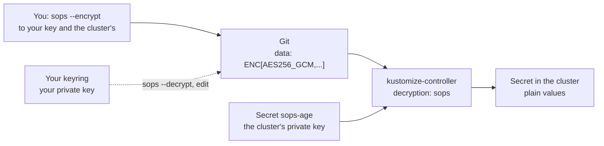

# 5. Secrets in Git with SOPS

> You end up with: the TSIG and CA Secrets stored encrypted in this public
> repo, and Flux decrypting them into the cluster.

## What it is

SOPS encrypts the *values* in a YAML file and leaves the keys readable, so a
Secret in Git still shows its name, namespace and field names, and diffs stay
meaningful. It encrypts to one or more **age** keys, a modern replacement
for GPG keys. Every file is encrypted to every recipient listed, and any one
private key opens it, so nobody shares a private key: you have yours, the
cluster has its own, and a colleague would add theirs.



| Piece | Lives | Note |
| --- | --- | --- |
| Your private key | The login keyring (oo7 on Fedora 45, through the Secret Service API), read by sops through `SOPS_AGE_KEY_CMD` | Never a file on disk, never shared |
| The cluster's private key | Only Secret `flux-system/sops-age` | Made new with each cluster |
| Public keys | `~/repos/personal/kube_local/.sops.yaml` in the repo | Anyone can encrypt with them |
| `~/repos/personal/kube_local/.sops.yaml` | Repo root | Which files to encrypt, which fields, to which keys |
| Encrypted Secret | `~/repos/personal/kube_local/secrets/dev/*.yaml` | Safe to commit |

Flux decrypts at apply time, in memory. The plaintext only ever exists in the
cluster's Secret.

## On EKS

SOPS with an AWS KMS key instead of age: `~/repos/personal/kube_local/.sops.yaml` names the KMS ARN, and
kustomize-controller gets an IAM role allowed to decrypt with it. Nothing to
copy into the cluster by hand. The other common choice is External Secrets
Operator reading AWS Secrets Manager, so secrets never touch Git at all.

In a team on KMS, who can decrypt is an IAM permission on the key, not a list
of age keys: joining and leaving happen in IAM. age keys stay for break-glass
access, or for people outside AWS.

## Requirements

**In the cluster**: lessons 0 to 4 done. This lesson moves their two
hand-made Secrets into Git: `external-dns/externaldns-tsig` (lesson 3) and
`cert-manager/local-ca` (lesson 4).

**On your machine**: `sops`, `age` and `age-keygen` (comes with `age`),
`secret-tool` (in the image), `kubectl`, `flux`, `git`, and `sofka` or `k9s`
([lesson 0](00-tools.md)). `SOPS_AGE_KEY_CMD` set to
`secret-tool lookup service sops-age`, from dotfiles: `echo $SOPS_AGE_KEY_CMD`
shows it.

## By hand, for comparison

> [!NOTE]
> Read this, don't run it. Flux does the decrypting below.

By hand, an encrypted Secret is decrypted in a pipe, so the plaintext never
touches disk:

**Example only: don't run it**
```sh
sops --decrypt secret.yaml | kubectl --context k3d-dev apply -f -
```

Whoever runs that needs one of the private keys. With Flux only the cluster
does.

## Install with Flux

| Kind | Name | File |
| --- | --- | --- |
| SOPS rules | | `~/repos/personal/kube_local/.sops.yaml` |
| Your key | The login keyring, `service sops-age` | By hand, once per machine |
| Secret | `flux-system/sops-age` | By hand, once per cluster: a new key each time |
| Kustomization | `secrets` | `~/repos/personal/kube_local/clusters/dev/secrets.yaml` |
| Secret, encrypted | `external-dns/externaldns-tsig` | `~/repos/personal/kube_local/secrets/dev/external-dns-tsig.yaml` |
| Secret, encrypted | `cert-manager/local-ca` | `~/repos/personal/kube_local/secrets/dev/cert-manager-local-ca.yaml` |

### 1. Your key, in the keyring

Only the `AGE-SECRET-KEY-` line is stored; the public key can always be
derived from it.

```sh
age-keygen 2>/dev/null | grep '^AGE-SECRET-KEY-' \
  | secret-tool store --label="sops age key" service sops-age
secret-tool lookup service sops-age | age-keygen -y
```

The second line prints your public key (`age1...`). sops runs
`$SOPS_AGE_KEY_CMD` whenever it needs to decrypt, so the private key is never
written to a file. To see the item: `secret-tool search --all service
sops-age`, or Key Rack (`app.drey.KeyRack`), the GNOME app for oo7.

> [!NOTE]
> No backup needed here. Your key is what re-keys the files after a rebuild;
> lose it with the cluster and make two new keys (steps 1 and 2), then redo
> step 4 from the sources: BIND has the TSIG key, `mkcert -CAROOT` the CA. In
> a team, a lost key means asking to be added again.

### 2. A key for the cluster

Generated straight into the Secret, and kept nowhere else:

```sh
age-keygen 2>/dev/null | grep '^AGE-SECRET-KEY-' \
  | kubectl --context k3d-dev -n flux-system create secret generic sops-age \
      --from-file=age.agekey=/dev/stdin
kubectl --context k3d-dev -n flux-system get secret sops-age \
  -o jsonpath='{.data.age\.agekey}' | base64 -d | age-keygen -y
```

The second command prints the cluster's public key. Flux only reads Secret
keys ending in `.agekey`.

### 3. Rules, so you don't pass flags each time

**Write `~/repos/personal/kube_local/.sops.yaml`**
```yaml
# ~/repos/personal/kube_local/.sops.yaml
creation_rules:
  - path_regex: secrets/.*\.yaml$
    encrypted_regex: ^(data|stringData)$
    # yours (step 1), then the cluster's (step 2)
    age: >-
      age1...,
      age1...
```

### 4. The hand-made Secrets as encrypted files

The TSIG Secret, encrypted before it's staged. `--config` points sops at the
rules, wherever you run it from:

```sh
mkdir -p ~/repos/personal/kube_local/secrets/dev
kubectl --context k3d-dev -n external-dns create secret generic externaldns-tsig \
  --from-literal=secret="$(kubectl --context k3d-dev -n dns get secret externaldns-tsig \
    -o jsonpath='{.data.secret}' | base64 -d)" \
  --dry-run=client -o yaml > ~/repos/personal/kube_local/secrets/dev/external-dns-tsig.yaml
sops --config ~/repos/personal/kube_local/.sops.yaml --encrypt --in-place ~/repos/personal/kube_local/secrets/dev/external-dns-tsig.yaml
```

The CA the same way:

```sh
kubectl --context k3d-dev -n cert-manager create secret tls local-ca \
  --cert="$(mkcert -CAROOT)/rootCA.pem" --key="$(mkcert -CAROOT)/rootCA-key.pem" \
  --dry-run=client -o yaml > ~/repos/personal/kube_local/secrets/dev/cert-manager-local-ca.yaml
sops --config ~/repos/personal/kube_local/.sops.yaml --encrypt --in-place ~/repos/personal/kube_local/secrets/dev/cert-manager-local-ca.yaml
cat ~/repos/personal/kube_local/secrets/dev/cert-manager-local-ca.yaml
```

`data` is ciphertext; `metadata` is readable; a `sops:` block at the end
records how to decrypt it.

### 5. The Kustomization that decrypts

**Write `~/repos/personal/kube_local/clusters/dev/secrets.yaml`**
```yaml
# ~/repos/personal/kube_local/clusters/dev/secrets.yaml
apiVersion: kustomize.toolkit.fluxcd.io/v1
kind: Kustomization
metadata:
  name: secrets
  namespace: flux-system
spec:
  dependsOn:
    - name: infra-base          # creates the namespaces
  interval: 10m
  sourceRef:
    kind: GitRepository
    name: flux-system
  path: ./secrets/dev
  prune: true
  decryption:
    provider: sops
    secretRef:
      name: sops-age
```

### 6. Push and look

```sh
git -C ~/repos/personal/kube_local add ~/repos/personal/kube_local/.sops.yaml ~/repos/personal/kube_local/clusters/dev/secrets.yaml ~/repos/personal/kube_local/secrets/
git -C ~/repos/personal/kube_local commit -m "Encrypted secrets with SOPS"
git -C ~/repos/personal/kube_local push
flux --context k3d-dev reconcile kustomization flux-system --with-source
kubectl --context k3d-dev -n flux-system get kustomization secrets
kubectl --context k3d-dev -n external-dns get secret externaldns-tsig -o yaml
```

`secrets` is `Ready`, and the Secret's value matches BIND's. Its
`kustomize.toolkit.fluxcd.io` labels show Flux has taken over the Secret you
made by hand.

sofka / k9s: `:kustomizations flux-system`, then
`:secrets external-dns`, `x`. Who owns it: sofka `:gitops` on the Secret;
k9s `Shift-q` (dotfiles plugin).

## Iterate

A throwaway Secret, committed encrypted and removed at the end.

```sh
kubectl --context k3d-dev -n default create secret generic demo \
  --from-literal=password=hunter2 --dry-run=client -o yaml > ~/repos/personal/kube_local/secrets/dev/demo.yaml
sops --config ~/repos/personal/kube_local/.sops.yaml --encrypt --in-place ~/repos/personal/kube_local/secrets/dev/demo.yaml
git -C ~/repos/personal/kube_local add ~/repos/personal/kube_local/secrets/dev/demo.yaml
git -C ~/repos/personal/kube_local commit -m "SOPS demo secret"
git -C ~/repos/personal/kube_local push
flux --context k3d-dev reconcile kustomization secrets --with-source
kubectl --context k3d-dev -n default get secret demo -o jsonpath='{.data.password}' | base64 -d
```

`hunter2`, decrypted by kustomize-controller.

sofka / k9s: `:secrets default`, `x` on `demo`

### Changes worth knowing

| Do | What happens |
| --- | --- |
| `sops set ~/repos/personal/kube_local/secrets/dev/demo.yaml '["data"]["password"]' "\"$(printf hunter3 \| base64)\""`, then `git diff` | Only that value's ciphertext and `sops.mac` change. `sops <file>` does the same in your editor, decrypted, and re-encrypts on save. |
| Encrypt a copy without `encrypted_regex`, in `~/repos/personal/scratch/05/` | Every value is encrypted, `metadata.name` too: Kubernetes rejects the file, and nobody reviewing it can tell what it is. |
| `env -u SOPS_AGE_KEY_CMD sops --decrypt ~/repos/personal/kube_local/secrets/dev/demo.yaml` | Fails, as on any machine without a key. The cluster doesn't notice: it has its own. |
| `SOPS_AGE_KEY="$(kubectl --context k3d-dev -n flux-system get secret sops-age -o jsonpath='{.data.age\.agekey}' \| base64 -d)" env -u SOPS_AGE_KEY_CMD sops --decrypt ~/repos/personal/kube_local/secrets/dev/demo.yaml` | Works too: the cluster's key alone opens the file, as yours does. |

### 1. Remove it

```sh
git -C ~/repos/personal/kube_local rm ~/repos/personal/kube_local/secrets/dev/demo.yaml
git -C ~/repos/personal/kube_local commit -m "Drop the SOPS demo secret"
git -C ~/repos/personal/kube_local push
flux --context k3d-dev reconcile kustomization secrets --with-source
kubectl --context k3d-dev -n default get secret demo
```

`prune` deletes it: `NotFound`.

## Exercises

1. Edit the TSIG Secret with `sops ~/repos/personal/kube_local/secrets/dev/external-dns-tsig.yaml`, push,
   and watch ExternalDNS's updates start failing. Put it back.
2. Rebuild the cluster. Its key went with it, and Git's files are still
   encrypted to the old one. Make a new key (step 2), replace the cluster's
   public key in `~/repos/personal/kube_local/.sops.yaml`, re-key every file
   with your own key, commit and push. Everything else comes back on its own.

   ```sh
   for f in ~/repos/personal/kube_local/secrets/dev/*.yaml; do
     sops --config ~/repos/personal/kube_local/.sops.yaml updatekeys -y "$f"
   done
   ```

3. Harder: a colleague joins, then leaves. Store a second key as
   `service sops-age-colleague` (step 1), add its public key to
   `~/repos/personal/kube_local/.sops.yaml`, re-key, and prove it decrypts on
   its own with
   `SOPS_AGE_KEY_CMD='secret-tool lookup service sops-age-colleague'`. Then
   remove it and re-key again. Why isn't that enough? Finish with
   `secret-tool clear service sops-age-colleague`.

   **Answer**: their key still opens every earlier commit in Git history.
   When someone leaves, rotate the values themselves, not just the keys.

## Where it gets hard

- `flux-system` applies everything under `~/repos/personal/kube_local/clusters/dev/` with no decryption,
  so an encrypted file there fails to apply. Secrets live under `~/repos/personal/kube_local/secrets/`.
- After a rebuild the cluster has no key, and the files are encrypted to the
  old one. Until step 2 and exercise 2's re-key are done, `secrets` fails
  with a decryption error:
  `kubectl --context k3d-dev -n flux-system describe kustomization secrets`
  shows it. In sofka or k9s, `ctrl-z` on `:kustomizations all`; sofka's `X`
  gives the message ([lesson 0](00-tools.md)).
- `bootstrap.sh` generates a new TSIG key for each new cluster. After a
  rebuild BIND has a key Git doesn't; redo step 4 and push.
- `sops --encrypt` on a file that's already encrypted fails; `sops` (edit) is
  for changing one.
- With `SOPS_AGE_KEY_CMD` unset, or the keyring locked (over SSH, say), sops
  falls back to `~/.config/sops/age/keys.txt`, finds nothing, and reports that
  no key could decrypt the file.
- sops runs `SOPS_AGE_KEY_CMD` without a shell: a pipe in it fails with the
  same "no key could decrypt" message. Keep it one command.

## Links

- <https://fluxcd.io/flux/guides/mozilla-sops/>
- <https://github.com/getsops/sops>
- <https://github.com/FiloSottile/age>
