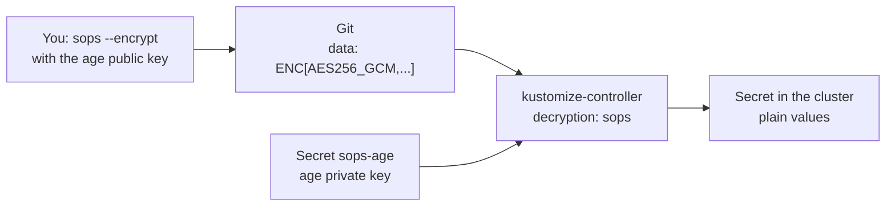

# 5. Secrets in Git with SOPS

> You end up with: the TSIG and CA Secrets stored encrypted in this public
> repo, and Flux decrypting them into the cluster.

## What it is

SOPS encrypts the *values* in a YAML file and leaves the keys readable, so a
Secret in Git still shows its name, namespace and field names, and diffs stay
meaningful. It encrypts to one or more keys: here an **age** key pair, a
modern replacement for GPG keys.



| Piece | Lives | Note |
| --- | --- | --- |
| age public key | `~/repos/personal/kube_local/.sops.yaml` in the repo | Anyone can encrypt with it |
| age private key | `~/.config/sops/age/keys.txt`, and Secret `flux-system/sops-age` | The one thing never in Git |
| `~/repos/personal/kube_local/.sops.yaml` | Repo root | Which files to encrypt, which fields, to which keys |
| Encrypted Secret | `~/repos/personal/kube_local/secrets/dev/*.yaml` | Safe to commit |

Flux decrypts at apply time, in memory. The plaintext only ever exists in the
cluster's Secret.

## On EKS

SOPS with an AWS KMS key instead of age: `~/repos/personal/kube_local/.sops.yaml` names the KMS ARN, and
kustomize-controller gets an IAM role allowed to decrypt with it. Nothing to
copy into the cluster by hand. The other common choice is External Secrets
Operator reading AWS Secrets Manager, so secrets never touch Git at all.

## Requirements

**In the cluster**: Flux (lesson 2). The hand-made Secrets
`external-dns/externaldns-tsig` (lesson 3) and `cert-manager/local-ca`
(lesson 4), if you did those lessons.

**On your machine**: `sops`, `age` and `age-keygen` (comes with `age`),
`kubectl`, `flux`, `git`, and `sofka` or `k9s` ([lesson 0](00-tools.md)).

## By hand, for comparison

> [!NOTE]
> Read this, don't run it. Flux does the decrypting below.

By hand, an encrypted Secret is decrypted in a pipe, so the plaintext never
touches disk:

**Example only: don't run it**
```sh
sops --decrypt secret.yaml | kubectl --context k3d-dev apply -f -
```

Whoever runs that needs the private key. With Flux only the cluster does.

## Install with Flux

| Kind | Name | File |
| --- | --- | --- |
| SOPS rules | | `~/repos/personal/kube_local/.sops.yaml` |
| Secret | `flux-system/sops-age` | By hand only: it's the key to everything else |
| Kustomization | `secrets` | `~/repos/personal/kube_local/clusters/dev/secrets.yaml` |
| Secret, encrypted | `external-dns/externaldns-tsig` | `~/repos/personal/kube_local/secrets/dev/external-dns-tsig.yaml` |
| Secret, encrypted | `cert-manager/local-ca` | `~/repos/personal/kube_local/secrets/dev/cert-manager-local-ca.yaml` |

### 1. A key pair

```sh
mkdir -p ~/.config/sops/age
age-keygen -o ~/.config/sops/age/keys.txt
```

It prints the public key (`age1...`). sops finds the private key at that path
on Linux; on macOS set `SOPS_AGE_KEY_FILE` to it.

> [!CAUTION]
> Back `keys.txt` up somewhere outside this machine. Lose it and nothing in
> Git can be decrypted.

### 2. Rules, so you don't pass flags each time

**Write `~/repos/personal/kube_local/.sops.yaml`**
```yaml
# ~/repos/personal/kube_local/.sops.yaml
creation_rules:
  - path_regex: secrets/.*\.yaml$
    encrypted_regex: ^(data|stringData)$
    age: age1...   # yours: age-keygen -y ~/.config/sops/age/keys.txt
```

### 3. Give Flux the private key

```sh
kubectl --context k3d-dev -n flux-system create secret generic sops-age \
  --from-file=age.agekey="$HOME/.config/sops/age/keys.txt"
```

### 4. The hand-made Secrets as encrypted files

The TSIG Secret, encrypted before it's staged. `--config` points sops at the
rules, wherever you run it from:

```sh
mkdir -p ~/repos/personal/kube_local/secrets/dev
kubectl --context k3d-dev -n external-dns create secret generic externaldns-tsig \
  --from-literal=secret="$(kubectl --context k3d-dev -n dns get secret externaldns-tsig \
    -o jsonpath='{.data.secret}' | base64 -d)" \
  --dry-run=client -o yaml > ~/repos/personal/kube_local/secrets/dev/external-dns-tsig.yaml
sops --config ~/repos/personal/kube_local/.sops.yaml --encrypt --in-place ~/repos/personal/kube_local/secrets/dev/external-dns-tsig.yaml
```

The CA the same way:

```sh
kubectl --context k3d-dev -n cert-manager create secret tls local-ca \
  --cert="$(mkcert -CAROOT)/rootCA.pem" --key="$(mkcert -CAROOT)/rootCA-key.pem" \
  --dry-run=client -o yaml > ~/repos/personal/kube_local/secrets/dev/cert-manager-local-ca.yaml
sops --config ~/repos/personal/kube_local/.sops.yaml --encrypt --in-place ~/repos/personal/kube_local/secrets/dev/cert-manager-local-ca.yaml
cat ~/repos/personal/kube_local/secrets/dev/cert-manager-local-ca.yaml
```

`data` is ciphertext; `metadata` is readable; a `sops:` block at the end
records how to decrypt it.

### 5. The Kustomization that decrypts

**Write `~/repos/personal/kube_local/clusters/dev/secrets.yaml`**
```yaml
# ~/repos/personal/kube_local/clusters/dev/secrets.yaml
apiVersion: kustomize.toolkit.fluxcd.io/v1
kind: Kustomization
metadata:
  name: secrets
  namespace: flux-system
spec:
  dependsOn:
    - name: infra-base          # creates the namespaces
  interval: 10m
  sourceRef:
    kind: GitRepository
    name: flux-system
  path: ./secrets/dev
  prune: true
  decryption:
    provider: sops
    secretRef:
      name: sops-age
```

### 6. Push and look

```sh
git -C ~/repos/personal/kube_local add ~/repos/personal/kube_local/.sops.yaml ~/repos/personal/kube_local/clusters/dev/secrets.yaml ~/repos/personal/kube_local/secrets/
git -C ~/repos/personal/kube_local commit -m "Encrypted secrets with SOPS"
git -C ~/repos/personal/kube_local push
flux --context k3d-dev reconcile kustomization flux-system --with-source
kubectl --context k3d-dev -n flux-system get kustomization secrets
kubectl --context k3d-dev -n external-dns get secret externaldns-tsig -o yaml
```

`secrets` is `Ready`, and the Secret's value matches BIND's. Its
`kustomize.toolkit.fluxcd.io` labels show Flux has taken over the Secret you
made by hand.

sofka / k9s: `:kustomizations flux-system`, then
`:secrets external-dns`, `x`. Who owns it: sofka `:gitops` on the Secret;
k9s `Shift-q` (dotfiles plugin).

## Iterate

A throwaway Secret, committed encrypted and removed at the end.

```sh
kubectl --context k3d-dev -n default create secret generic demo \
  --from-literal=password=hunter2 --dry-run=client -o yaml > ~/repos/personal/kube_local/secrets/dev/demo.yaml
sops --config ~/repos/personal/kube_local/.sops.yaml --encrypt --in-place ~/repos/personal/kube_local/secrets/dev/demo.yaml
git -C ~/repos/personal/kube_local add ~/repos/personal/kube_local/secrets/dev/demo.yaml
git -C ~/repos/personal/kube_local commit -m "SOPS demo secret"
git -C ~/repos/personal/kube_local push
flux --context k3d-dev reconcile kustomization secrets --with-source
kubectl --context k3d-dev -n default get secret demo -o jsonpath='{.data.password}' | base64 -d
```

`hunter2`, decrypted by kustomize-controller.

sofka / k9s: `:secrets default`, `x` on `demo`

### Changes worth knowing

| Do | What happens |
| --- | --- |
| `sops set ~/repos/personal/kube_local/secrets/dev/demo.yaml '["data"]["password"]' "\"$(printf hunter3 \| base64)\""`, then `git diff` | Only that value's ciphertext and `sops.mac` change. `sops <file>` does the same in your editor, decrypted, and re-encrypts on save. |
| Encrypt a copy without `encrypted_regex`, in `~/repos/personal/scratch/05/` | Every value is encrypted, `metadata.name` too: Kubernetes rejects the file, and nobody reviewing it can tell what it is. |
| Move `~/.config/sops/age/keys.txt` aside, then `sops --decrypt` | Fails, as on any machine without the key. The cluster doesn't notice: it has its own copy in `sops-age`. |

### 1. Remove it

```sh
git -C ~/repos/personal/kube_local rm ~/repos/personal/kube_local/secrets/dev/demo.yaml
git -C ~/repos/personal/kube_local commit -m "Drop the SOPS demo secret"
git -C ~/repos/personal/kube_local push
flux --context k3d-dev reconcile kustomization secrets --with-source
kubectl --context k3d-dev -n default get secret demo
```

`prune` deletes it: `NotFound`.

## Exercises

1. Edit the TSIG Secret with `sops ~/repos/personal/kube_local/secrets/dev/external-dns-tsig.yaml`, push,
   and watch ExternalDNS's updates start failing. Put it back.
2. Rebuild the cluster. Recreate `sops-age` (step 3) before Flux syncs
   `secrets`, and see everything else come back on its own.
3. Harder: add a second age recipient (a key for "CI") to `~/repos/personal/kube_local/.sops.yaml`, then
   `sops updatekeys` each file. Prove either key alone can decrypt.

## Where it gets hard

- `flux-system` applies everything under `~/repos/personal/kube_local/clusters/dev/` with no decryption,
  so an encrypted file there fails to apply. Secrets live under `~/repos/personal/kube_local/secrets/`.
- `sops-age` is the one Secret recreated by hand after every rebuild. Until it
  exists, `secrets` fails with a decryption error:
  `kubectl --context k3d-dev -n flux-system describe kustomization secrets`
  shows it. In sofka or k9s, `ctrl-z` on `:kustomizations all`; sofka's `X`
  gives the message ([lesson 0](00-tools.md)).
- `bootstrap.sh` generates a new TSIG key for each new cluster. After a
  rebuild BIND has a key Git doesn't; redo step 4 and push.
- `sops --encrypt` on a file that's already encrypted fails; `sops` (edit) is
  for changing one.

## Links

- <https://fluxcd.io/flux/guides/mozilla-sops/>
- <https://github.com/getsops/sops>
- <https://github.com/FiloSottile/age>
