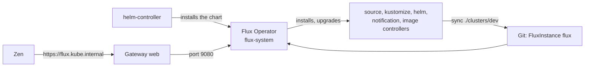
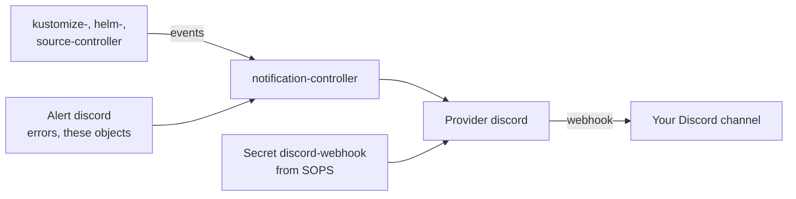

# 6. Flux Operator, the Web UI and Discord alerts

> You end up with: Flux managed by Flux Operator from a `FluxInstance` in
> Git, the bootstrap files gone, the Flux Web UI at
> `https://flux.kube.internal`, and every Flux failure posted to a Discord
> channel.

## What it is

Lesson 2 installed Flux with `flux bootstrap`: the CLI wrote
`gotk-components.yaml` and `gotk-sync.yaml` into Git, and upgrading means
running it again. **Flux Operator** replaces that. It's a controller you
install once; you describe the Flux you want in a **`FluxInstance`**, and it
installs, upgrades and repairs the Flux controllers to match. The same
operator serves the **Web UI**: a dashboard of every Flux object, its
dependencies, events and history.



Flux installs the operator, and the operator runs Flux. The loop is
intended: each can repair the other.

| Kind | What it is |
| --- | --- |
| `FluxInstance` | The Flux install: version, components, cluster settings, and what to sync. One per cluster, named `flux`, in `flux-system` |
| `FluxReport` | Written by the operator: what's installed, its health, and counts of every Flux object. Read it, don't write it |
| `ResourceSet` | Templates a group of objects from inputs. Not used here |

| Without the operator | With it |
| --- | --- |
| `flux bootstrap` writes the controllers into Git | A `FluxInstance` names a version; the controllers aren't in Git |
| Upgrade: rerun `flux bootstrap` with a newer CLI | Change `distribution.version` and push |
| Add the image controllers: bootstrap again with `--components-extra` | Add them to `components` and push |
| Health: `flux check` | Also the `FluxInstance` status, the `FluxReport` and the Web UI |

### The Web UI's access

| Setting in `web.config` | Who gets in | What they can do |
| --- | --- | --- |
| None (this lesson) | Anyone who reaches the page | Read every Flux object, events and logs. Secrets and ConfigMaps hidden |
| `authentication.type: Anonymous` with a group | Anyone, as that one identity | Whatever RBAC grants the group: `flux-web-user` reads everything, Secrets included; `flux-web-admin` adds reconcile, suspend, resume and restarts |
| `authentication.type: OAuth2` (OIDC) | Each person through your identity provider | RBAC per user or group from the IdP |

The chart creates both ClusterRoles. Locally, the default is the safest
choice: read-only, and only your machine can reach the Gateway.

### Alerts to Discord

The UI shows a failure when you look. The **notification-controller**, part
of Flux since lesson 2, tells you without looking: every Flux controller
sends it events, and it forwards the ones you select.

| Kind | Says |
| --- | --- |
| `Provider` | Where to send: `type: discord`, and a Secret holding the webhook URL |
| `Alert` | What to send: which objects (`eventSources`), which severity, to which Provider |
| `Receiver` | The other way: a webhook that triggers a reconcile, such as a GitHub push. Not used here |



The webhook URL is a credential: anyone who has it can post to the channel.
It goes in Git through SOPS (lesson 5), like the TSIG key.

## On EKS

The same chart and the same `FluxInstance`, which is why it's worth learning
here: it's how Flux is increasingly installed in production. What differs:

| | Here | On EKS |
| --- | --- | --- |
| Web UI access | Default: read-only, no login | `OAuth2` with OIDC (Entra, Okta, Keycloak, Dex), `baseURL` set, IdP groups bound to `flux-web-user` / `flux-web-admin` |
| Exposure | HTTPRoute on Gateway `web`, mkcert TLS | An internal ALB through the AWS Load Balancer Controller, an ACM certificate |
| Sync source | GitRepository with a deploy key | The same, or an OCI artifact in ECR (`sync.kind: OCIRepository`, `sync.provider: aws`) with no key in the cluster |
| Reaching the UI pod | A CiliumNetworkPolicy for the Gateway (below) | The ALB targets pod IPs from the VPC, so the policy allows the VPC's CIDR instead |
| Alerts | A Discord webhook, its URL in a SOPS Secret | Slack, Teams or PagerDuty; the URL from SOPS with KMS, or External Secrets. `eventMetadata.cluster` tells the clusters apart in one channel |

## Requirements

**In the cluster**: lessons 0 to 5 done. This lesson uses the HTTPS Gateway
(lesson 4), its DNS name (lesson 3), the `infra-dev-config` layer
(lesson 4) for the `FluxInstance`, and SOPS (lesson 5) for the webhook URL.

Check the version Flux runs now. The `FluxInstance` pins the same minor, so
the hand-over isn't also an upgrade:

```sh
flux --context k3d-dev version
```

**On your machine**: `kubectl`, `helm`, `flux`, `hubble`, `git`, `curl`,
`sops`, and `sofka` or `k9s` ([lesson 0](00-tools.md)).

**In Discord**: a server where you can manage webhooks, and a channel for the
alerts. Server Settings > Integrations > Webhooks > New Webhook, pick the
channel, then Copy Webhook URL. Keep it on the clipboard for step 4.

## By hand, for comparison

> [!NOTE]
> Read this, don't run it. Flux does the same from Git below.

The upstream migration is a `helm install` and a `kubectl apply`:

**Example only: don't run it**
```sh
helm --kube-context k3d-dev upgrade --install flux-operator oci://ghcr.io/controlplaneio-fluxcd/charts/flux-operator --version 0.62.1 \
  -n flux-system -f values-base.yaml -f values-dev.yaml
kubectl --context k3d-dev apply -f instance.yaml
```

Then, once the operator owns everything, delete the bootstrap files from Git.
Each values file becomes a ConfigMap below. `helm show values
oci://ghcr.io/controlplaneio-fluxcd/charts/flux-operator --version 0.62.1`
lists every key.

## Install with Flux

| Kind | Name | File |
| --- | --- | --- |
| OCIRepository | `flux-system/flux-operator` | `~/repos/personal/kube_local/infrastructure/base/flux-operator/source.yaml` |
| HelmRelease | `flux-system/flux-operator` | `~/repos/personal/kube_local/infrastructure/base/flux-operator/release.yaml` |
| ConfigMap | `flux-operator-values-base` | `~/repos/personal/kube_local/infrastructure/base/flux-operator/values.yaml` |
| ConfigMap | `flux-operator-values-dev` | `~/repos/personal/kube_local/infrastructure/dev/flux-operator/values.yaml` |
| HTTPRoute | `flux-system/flux` | `~/repos/personal/kube_local/infrastructure/base/flux-operator/route.yaml` |
| CiliumNetworkPolicy | `flux-system/flux-web-from-gateway` | `~/repos/personal/kube_local/infrastructure/dev/flux-operator/gateway-policy.yaml` |
| FluxInstance | `flux-system/flux` | `~/repos/personal/kube_local/infrastructure/dev-config/flux/instance.yaml` |
| Removed | The bootstrap files | `~/repos/personal/kube_local/clusters/dev/flux-system/` |
| Secret, encrypted | `flux-system/discord-webhook` | `~/repos/personal/kube_local/secrets/dev/flux-discord-webhook.yaml` |
| Provider, Alert | `flux-system/discord` | `~/repos/personal/kube_local/infrastructure/dev-config/flux/notifications.yaml` |

Four commits, in this order: the operator and the UI, then the
`FluxInstance`, then the bootstrap files' removal, then the Discord alerts.
Each is checked before the next.

### 1. The operator and the UI

The chart is published as OCI, so the release uses `chartRef` with an
`OCIRepository`, as podinfo does.

```sh
mkdir -p ~/repos/personal/kube_local/infrastructure/base/flux-operator ~/repos/personal/kube_local/infrastructure/dev/flux-operator
```

**Write `~/repos/personal/kube_local/infrastructure/base/flux-operator/source.yaml`**
```yaml
# ~/repos/personal/kube_local/infrastructure/base/flux-operator/source.yaml
apiVersion: source.toolkit.fluxcd.io/v1
kind: OCIRepository
metadata:
  name: flux-operator
  namespace: flux-system
spec:
  interval: 1h
  url: oci://ghcr.io/controlplaneio-fluxcd/charts/flux-operator
  ref:
    tag: 0.62.1
  layerSelector:
    mediaType: application/vnd.cncf.helm.chart.content.v1.tar+gzip
    operation: copy
```

**Write `~/repos/personal/kube_local/infrastructure/base/flux-operator/release.yaml`**
```yaml
# ~/repos/personal/kube_local/infrastructure/base/flux-operator/release.yaml
apiVersion: helm.toolkit.fluxcd.io/v2
kind: HelmRelease
metadata:
  name: flux-operator
  namespace: flux-system
spec:
  interval: 10m
  chartRef:
    kind: OCIRepository
    name: flux-operator
  valuesFrom:
    - kind: ConfigMap
      name: flux-operator-values-base
    - kind: ConfigMap
      name: flux-operator-values-${CLUSTER_NAME}
```

What every cluster gets: the CRDs, the Web UI on port 9080, and its two
ClusterRoles.

**Write `~/repos/personal/kube_local/infrastructure/base/flux-operator/values.yaml`**
```yaml
# ~/repos/personal/kube_local/infrastructure/base/flux-operator/values.yaml
apiVersion: v1
kind: ConfigMap
metadata:
  name: flux-operator-values-base
  namespace: flux-system
  labels:
    reconcile.fluxcd.io/watch: Enabled
data:
  values.yaml: |
    installCRDs: true
    web:
      enabled: true
      rbac:
        createRoles: true
```

What's this cluster's: the UI's access. Empty means the default, read-only
with Secrets hidden. On EKS this file holds the OIDC settings.

**Write `~/repos/personal/kube_local/infrastructure/dev/flux-operator/values.yaml`**
```yaml
# ~/repos/personal/kube_local/infrastructure/dev/flux-operator/values.yaml
apiVersion: v1
kind: ConfigMap
metadata:
  name: flux-operator-values-dev
  namespace: flux-system
  labels:
    reconcile.fluxcd.io/watch: Enabled
data:
  values.yaml: |
    # No authentication block: anyone who reaches the UI can read, nobody can act.
    web:
      config: {}
```

The route, in base like Grafana's will be: every cluster has the UI, and the
domain is a variable. The Service is named after the release.

**Write `~/repos/personal/kube_local/infrastructure/base/flux-operator/route.yaml`**
```yaml
# ~/repos/personal/kube_local/infrastructure/base/flux-operator/route.yaml
apiVersion: gateway.networking.k8s.io/v1
kind: HTTPRoute
metadata:
  name: flux
  namespace: flux-system
spec:
  parentRefs:
    - name: web
      namespace: gateway
  hostnames: ["flux.${CLUSTER_DOMAIN}"]
  rules:
    - backendRefs:
        - name: flux-operator
          port: 9080
```

`flux-system` is the one namespace here with NetworkPolicies, from
bootstrap: every pod in it accepts traffic only on the ports they list, and
only from pods. The chart adds one for port 9080, also from pods. Cilium's
Gateway isn't a pod: its traffic to a backend carries Cilium's reserved
`ingress` identity, which a plain NetworkPolicy can't name. So this cluster
adds a Cilium policy for it:

**Write `~/repos/personal/kube_local/infrastructure/dev/flux-operator/gateway-policy.yaml`**
```yaml
# ~/repos/personal/kube_local/infrastructure/dev/flux-operator/gateway-policy.yaml
apiVersion: cilium.io/v2
kind: CiliumNetworkPolicy
metadata:
  name: flux-web-from-gateway
  namespace: flux-system
spec:
  endpointSelector:
    matchLabels:
      app.kubernetes.io/name: flux-operator
  ingress:
    - fromEntities: [ingress]
      toPorts:
        - ports:
            - port: "9080"
              protocol: TCP
```

```sh
git -C ~/repos/personal/kube_local add ~/repos/personal/kube_local/infrastructure/
git -C ~/repos/personal/kube_local commit -m "Flux Operator and the Web UI"
git -C ~/repos/personal/kube_local push
flux --context k3d-dev reconcile kustomization flux-system --with-source
kubectl --context k3d-dev get helmreleases -n flux-system -w
```

sofka / k9s: `:helmreleases flux-system`

The operator runs, but with no `FluxInstance` it leaves Flux alone. The UI
already works:

```sh
curl -s -o /dev/null -w '%{http_code}\n' https://flux.kube.internal/
```

`200`, then open `https://flux.kube.internal` in Zen. If it hangs or returns
`503`, the Gateway's traffic is being dropped:

```sh
hubble observe --namespace flux-system --verdict DROPPED --last 20
```

Run `cilium --context k3d-dev hubble port-forward` first if `hubble` can't
connect.

### 2. Hand Flux to the operator

The `FluxInstance` says what `flux bootstrap` said in lesson 2, as fields:
the same components, the same repo, branch, path and deploy key Secret, and
the version Flux runs now. Its kind comes from the chart, so it goes in
`infra-dev-config`, which lesson 4 made for exactly that. It's in `dev-config`
rather than base because the sync path is this cluster's.

```sh
mkdir -p ~/repos/personal/kube_local/infrastructure/dev-config/flux
```

**Write `~/repos/personal/kube_local/infrastructure/dev-config/flux/instance.yaml`**
```yaml
# ~/repos/personal/kube_local/infrastructure/dev-config/flux/instance.yaml
apiVersion: fluxcd.controlplane.io/v1
kind: FluxInstance
metadata:
  name: flux
  namespace: flux-system
spec:
  distribution:
    # The minor Flux runs now (`flux version`); bump it in Iterate
    version: "2.9.x"
    registry: ghcr.io/fluxcd
  components:
    - source-controller
    - kustomize-controller
    - helm-controller
    - notification-controller
    - image-reflector-controller
    - image-automation-controller
  cluster:
    type: kubernetes
    multitenant: false
    networkPolicy: true
    domain: cluster.local
  sync:
    kind: GitRepository
    url: ssh://git@github.com/bourbonfgiles/kube_local
    ref: refs/heads/master
    path: clusters/dev
    pullSecret: flux-system
    interval: 1m
```

| Field | Was, in lesson 2 |
| --- | --- |
| `components` | The four defaults plus `--components-extra` |
| `cluster.networkPolicy: true` | The three NetworkPolicies bootstrap created |
| `sync.url`, `ref`, `path` | `--owner`, `--repository`, `--branch`, `--path` |
| `sync.pullSecret` | The deploy key Secret `flux-system` bootstrap made with `--read-write-key` |
| `sync.interval` | The GitRepository's 1m |

```sh
git -C ~/repos/personal/kube_local add ~/repos/personal/kube_local/infrastructure/dev-config/
git -C ~/repos/personal/kube_local commit -m "Flux managed by Flux Operator"
git -C ~/repos/personal/kube_local push
flux --context k3d-dev reconcile kustomization flux-system --with-source
kubectl --context k3d-dev -n flux-system get fluxinstance flux -w
```

`READY True`. If `2.9.x` resolves to a newer patch than `flux version`
showed, the controllers roll one by one; Kustomizations carry on where they
were. sofka / k9s: `:fluxinstances flux-system`, `d`

Now the gate for step 3. The operator has taken over the bootstrap objects
when the Kustomization that used to own the controllers no longer does:

```sh
flux --context k3d-dev trace -n flux-system deployment kustomize-controller
kubectl --context k3d-dev get fluxreport -n flux-system flux -o yaml
```

The trace should say it's not managed by a Flux Kustomization. If it still
names `flux-system`, wait a reconcile and check again: don't go on until it
doesn't.

> [!CAUTION]
> Step 3 deletes the files the `flux-system` Kustomization built the
> controllers from. While it still owns them, removing the files means
> pruning Flux itself.

### 3. Remove the bootstrap files

The operator now writes the `flux-system` GitRepository and Kustomization
itself, so the files in Git would only fight it.

```sh
git -C ~/repos/personal/kube_local rm -r ~/repos/personal/kube_local/clusters/dev/flux-system
git -C ~/repos/personal/kube_local commit -m "Remove the flux bootstrap files"
git -C ~/repos/personal/kube_local push
flux --context k3d-dev reconcile kustomization flux-system --with-source
flux --context k3d-dev check
kubectl --context k3d-dev get kustomizations,helmreleases -A
```

Every Kustomization and HelmRelease `Ready`, every controller still running.

### 4. Failures to Discord

The webhook URL, encrypted on its way to disk as in lesson 5. `read -s`
keeps it out of your shell history and off the screen:

```sh
read -rs 'url?Discord webhook URL: '; echo
f=~/repos/personal/kube_local/secrets/dev/flux-discord-webhook.yaml
kubectl --context k3d-dev -n flux-system create secret generic discord-webhook \
  --from-literal=address="$url" --dry-run=client -o yaml \
  | sops --config ~/repos/personal/kube_local/.sops.yaml encrypt --filename-override "$f" > "$f"
unset url
grep -c '^sops:' "$f"
```

`1`: it's encrypted. Flux's Discord provider reads the URL from the `address`
key.

The Provider and the Alert are this cluster's: its channel, its name in each
message. `*` selects every object of a kind, but only in one namespace, so
each namespace with a HelmRelease or a chart source gets its own lines.
Errors only: `info` would post every successful reconcile too.

**Write `~/repos/personal/kube_local/infrastructure/dev-config/flux/notifications.yaml`**
```yaml
# ~/repos/personal/kube_local/infrastructure/dev-config/flux/notifications.yaml
apiVersion: notification.toolkit.fluxcd.io/v1beta3
kind: Provider
metadata:
  name: discord
  namespace: flux-system
spec:
  type: discord
  username: flux-dev
  secretRef:
    name: discord-webhook
---
apiVersion: notification.toolkit.fluxcd.io/v1beta3
kind: Alert
metadata:
  name: discord
  namespace: flux-system
spec:
  providerRef:
    name: discord
  eventSeverity: error
  eventMetadata:
    cluster: dev
  eventSources:
    # No namespace: the Alert's own, flux-system
    - { kind: GitRepository, name: '*' }
    - { kind: Kustomization, name: '*' }
    - { kind: HelmRelease, name: '*' }
    - { kind: OCIRepository, name: '*' }
    - { kind: HelmRelease, name: '*', namespace: kube-system }
    - { kind: HelmRepository, name: '*', namespace: kube-system }
    - { kind: HelmRelease, name: '*', namespace: cert-manager }
    - { kind: OCIRepository, name: '*', namespace: cert-manager }
    - { kind: HelmRelease, name: '*', namespace: external-dns }
    - { kind: HelmRepository, name: '*', namespace: external-dns }
    - { kind: HelmRelease, name: '*', namespace: podinfo }
    - { kind: OCIRepository, name: '*', namespace: podinfo }
```

```sh
git -C ~/repos/personal/kube_local add ~/repos/personal/kube_local/secrets/ ~/repos/personal/kube_local/infrastructure/dev-config/
git -C ~/repos/personal/kube_local commit -m "Flux alerts to Discord"
git -C ~/repos/personal/kube_local push
flux --context k3d-dev reconcile kustomization flux-system --with-source
flux --context k3d-dev get alert-providers -n flux-system
flux --context k3d-dev get alerts -n flux-system
```

Both `Ready`. Nothing posts until something fails: exercise 1 is the test.
sofka / k9s: `:providers flux-system`, `:alerts flux-system`

### 5. Look at it

`https://flux.kube.internal`:

| Look at | Where | Compare with |
| --- | --- | --- |
| Everything not Ready | The front page | `flux --context k3d-dev get all -A --status-selector ready=false`; sofka `ctrl-z` |
| What podinfo depends on | `podinfo` HelmRelease, its graph | sofka `:gitops`; `flux --context k3d-dev trace` |
| What changed, in order | A Kustomization's history | `flux --context k3d-dev events -A` |
| The Flux install itself | The `FluxInstance` and report | `kubectl --context k3d-dev get fluxreport -n flux-system flux -o yaml` |

The UI is good at the whole estate and what depends on what. sofka stays
faster for one broken thing.

## Iterate

Every change is a commit. New or changed lines sit between `# ── new ──` and
`# ── end new ──`.

### Changes worth knowing

Each row is one commit, then its revert unless it says otherwise. Try any you like.

| Change | File | What happens |
| --- | --- | --- |
| `distribution.version: "2.10.x"` | `~/repos/personal/kube_local/infrastructure/dev-config/flux/instance.yaml` | A Flux upgrade as a commit: the operator rolls the controllers to 2.10, and `flux --context k3d-dev version` shows it. Keep this one; your CLI is 2.10 |
| `eventSeverity: info` | `~/repos/personal/kube_local/infrastructure/dev-config/flux/notifications.yaml` | Every reconcile that changes something posts too: upgrades, applies, new artifacts. Useful for a deploy log, noisy as an alarm |
| `suspend: true` on the Alert | `~/repos/personal/kube_local/infrastructure/dev-config/flux/notifications.yaml` | Silence while you break things on purpose. Events during it are dropped, not queued |
| Delete `gateway-policy.yaml` | `~/repos/personal/kube_local/infrastructure/dev/flux-operator/gateway-policy.yaml` | The UI hangs, then `503`. `hubble observe --namespace flux-system --verdict DROPPED` shows `ingress` → `flux-operator` dropped. Put it back |
| Remove `image-automation-controller` from `components` | `~/repos/personal/kube_local/infrastructure/dev-config/flux/instance.yaml` | The operator deletes that Deployment within a reconcile. Put it back before lesson 9 |
| `web.config` with `authentication.type: Anonymous`, `anonymous.groups: [flux-web-admins]`, plus a ClusterRoleBinding of `flux-web-admins` to `flux-web-admin` | `~/repos/personal/kube_local/infrastructure/dev/flux-operator/values.yaml`, a new file beside it | Reconcile, suspend and resume buttons appear for everyone who reaches the page. Bound to `flux-web-user` instead, it can read Secrets, which the default can't |

## Exercises

1. Break podinfo's chart: set `ref.tag` in
   `~/repos/personal/kube_local/apps/base/podinfo/source.yaml` to a tag that
   doesn't exist and push. Discord gets the `OCIRepository` error with
   `cluster: dev`; find the same failure in the UI, then sofka. Revert.
2. Write down how this cluster now comes back after `kube-delete` /
   `kube-create`: no `flux bootstrap`, so what creates the deploy key Secret,
   the operator and the `FluxInstance`, in what order? Compare with the
   **Example only** under Where it gets hard.
3. Rotate the webhook: delete it in Discord, make a new one, and rerun step
   4's first block with the new URL. It overwrites the encrypted file. Push,
   then break something to prove the new one works and the old one doesn't.
4. Harder: with the Anonymous admin row applied, suspend `podinfo` from the
   UI. Find in `kubectl --context k3d-dev get helmrelease podinfo -n podinfo
   -o yaml` what that did, and why Flux doesn't undo it from Git.

## Where it gets hard

- Removing `clusters/dev/flux-system/` before the operator owns the
  controllers prunes Flux. The `flux trace` gate in step 2 is the check.
- A `distribution.version` older than what runs is a downgrade. Match the
  minor first, upgrade as its own commit.
- The loop: Flux installs the operator, the operator runs Flux. If
  helm-controller is broken, upgrade the operator with the **Example only**
  `helm` command above; the HelmRelease adopts the release again afterwards.
- An Alert's `*` doesn't cross namespaces. Each later lesson that adds a
  namespace with a HelmRelease needs its lines in `notifications.yaml`, and
  podinfo's go when it's retired in lesson 10. A failure in a namespace the
  Alert doesn't list is silent.
- Silence isn't health. If Flux itself, or the notification-controller, is
  down, nothing posts. Something outside Flux has to watch Flux: lesson 7's
  Alertmanager can.
- Errors only: something stuck without failing, such as a `dependsOn` that's
  never met, posts nothing.
- `flux-system` NetworkPolicies drop anything that isn't a pod, so the UI
  behind the Gateway needs the Cilium policy. The symptom is a hang, not an
  error.
- A rebuild no longer uses `flux bootstrap`. The deploy key Secret is the one
  piece made by hand: `flux create secret git` generates a key and prints the
  public half to add to GitHub with write access. Then the operator and the
  instance:

  **Example only: after a rebuild**
  ```sh
  flux --context k3d-dev create secret git flux-system -n flux-system \
    --url=ssh://git@github.com/bourbonfgiles/kube_local
  helm --kube-context k3d-dev install flux-operator oci://ghcr.io/controlplaneio-fluxcd/charts/flux-operator \
    --version 0.62.1 -n flux-system
  kubectl --context k3d-dev apply -f ~/repos/personal/kube_local/infrastructure/dev-config/flux/instance.yaml
  ```

## Coming from Argo CD

| Argo CD | Flux with the operator |
| --- | --- |
| Argo CD Operator and the `ArgoCD` resource | Flux Operator and the `FluxInstance` |
| The Argo CD UI | The Flux Web UI |
| App tree view | A HelmRelease or Kustomization's dependency graph |
| Sync and refresh buttons | Reconcile; behind RBAC (`flux-web-admin`) |
| Projects and RBAC in `argocd-rbac-cm` | Kubernetes RBAC: the UI acts as the signed-in user, or the anonymous identity |
| Dex built in for SSO | OIDC to any provider; Dex only if you run it |

How they differ: the Argo CD UI is also where you create and edit
applications. The Flux UI only shows and nudges: every change is still a
commit.

## Links

- <https://fluxoperator.dev/web-ui/>
- <https://fluxoperator.dev/docs/guides/migration/>
- <https://fluxoperator.dev/docs/instance/controllers/>
- <https://fluxoperator.dev/docs/web-ui/user-management/>
- <https://fluxoperator.dev/docs/web-ui/web-config-api/>
- <https://fluxcd.io/flux/components/notification/providers/#discord>
- <https://fluxcd.io/flux/components/notification/alerts/>
