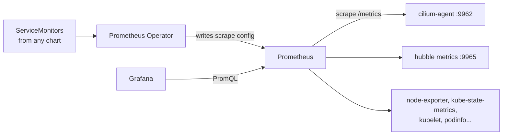

# 6. Monitoring

> You end up with: Prometheus scraping the cluster, Cilium and Hubble, and
> Grafana at `grafana.kube.internal` with the network as graphs as well as
> flows.

## What it is

**Prometheus** pulls metrics: every scrape interval it fetches `/metrics` from
each target and stores the samples. **Grafana** queries it and draws
dashboards. The **Prometheus Operator** runs Prometheus for you and finds
targets through custom resources, so a chart can ship "scrape me" alongside
its app.

| Kind | Says |
| --- | --- |
| `Prometheus` | Run a Prometheus server, and which monitors and rules to pick up |
| `ServiceMonitor` | Scrape the endpoints behind Services matching these labels, on this port and path |
| `PodMonitor` | The same, selecting pods directly |
| `PrometheusRule` | Recording and alerting rules |

**kube-prometheus-stack** is one chart with the operator, a `Prometheus`,
Alertmanager, Grafana, node-exporter (node metrics) and kube-state-metrics
(object state as metrics), plus dashboards and alerts for all of it.



The CRDs come in their own small chart, `prometheus-operator-crds`, so other
charts (Cilium's, for its `ServiceMonitor`s) can depend on them without
waiting for the whole stack.

## On EKS

The same chart, or Amazon Managed Service for Prometheus with Amazon Managed
Grafana, where an in-cluster agent writes to AWS instead of storing locally.
The control-plane targets disabled below exist on EKS only as what AWS
exposes.

## Requirements

**In the cluster**: Flux, with Cilium adopted (end of lesson 2), since
Cilium's metrics are turned on through its values. Roughly 2 GB of spare
memory.

**On your machine**: `kubectl`, `helm`, `flux`, `hubble`, and `sofka`
or `k9s` ([lesson 0](00-tools.md)).

## By hand, for comparison

> [!NOTE]
> Read this, don't run it. Flux does the same from Git below.

By hand, the stack is two `helm` commands: the CRDs first, then the stack
with a base and a local values file.

**Example only: don't run it**
```sh
helm --kube-context k3d-dev upgrade --install prometheus-operator-crds prometheus-operator-crds \
  --repo https://prometheus-community.github.io/helm-charts --version 32.0.1 \
  -n monitoring --create-namespace
helm --kube-context k3d-dev upgrade --install kube-prometheus-stack kube-prometheus-stack \
  --repo https://prometheus-community.github.io/helm-charts --version 92.10.1 \
  -n monitoring -f values-base.yaml -f values-local.yaml
```

With Flux the order becomes `dependsOn`.

## Install with Flux

| Kind | Name | File |
| --- | --- | --- |
| Namespace | `monitoring` | `infrastructure/base/monitoring/namespace.yaml` |
| HelmRepository | `prometheus-community` | `infrastructure/base/monitoring/source.yaml` |
| HelmRelease | `prometheus-operator-crds` | `infrastructure/base/monitoring/crds.yaml` |
| HelmRelease | `kube-prometheus-stack` | `infrastructure/base/monitoring/release.yaml` |
| ConfigMap | `kube-prometheus-stack-values-base` | `infrastructure/base/monitoring/values.yaml` |
| ConfigMap | `kube-prometheus-stack-values-local` | `infrastructure/local/monitoring/values.yaml` |
| ServiceMonitor | `podinfo/podinfo` | `apps/base/podinfo/monitor.yaml` |
| HTTPRoute | `grafana` | `infrastructure/local/monitoring/route.yaml` |
| ConfigMap, changed | `kube-system/cilium-values-base` | `infrastructure/base/cilium/values.yaml` |
| HelmRelease, changed | `kube-system/cilium` | `infrastructure/base/cilium/release.yaml` |

### 1. The charts

One HelmRepository for both charts. The stack waits for the CRDs release.

```sh
mkdir -p infrastructure/base/monitoring infrastructure/local/monitoring
```

**Write `infrastructure/base/monitoring/namespace.yaml`**
```yaml
# infrastructure/base/monitoring/namespace.yaml
apiVersion: v1
kind: Namespace
metadata:
  name: monitoring
```

**Write `infrastructure/base/monitoring/source.yaml`**
```yaml
# infrastructure/base/monitoring/source.yaml
apiVersion: source.toolkit.fluxcd.io/v1
kind: HelmRepository
metadata:
  name: prometheus-community
  namespace: monitoring
spec:
  interval: 1h
  url: https://prometheus-community.github.io/helm-charts
```

**Write `infrastructure/base/monitoring/crds.yaml`**
```yaml
# infrastructure/base/monitoring/crds.yaml
apiVersion: helm.toolkit.fluxcd.io/v2
kind: HelmRelease
metadata:
  name: prometheus-operator-crds
  namespace: monitoring
spec:
  interval: 10m
  chart:
    spec:
      chart: prometheus-operator-crds
      version: 32.0.1
      sourceRef:
        kind: HelmRepository
        name: prometheus-community
```

**Write `infrastructure/base/monitoring/release.yaml`**
```yaml
# infrastructure/base/monitoring/release.yaml
apiVersion: helm.toolkit.fluxcd.io/v2
kind: HelmRelease
metadata:
  name: kube-prometheus-stack
  namespace: monitoring
spec:
  interval: 10m
  dependsOn:
    - name: prometheus-operator-crds
  chart:
    spec:
      chart: kube-prometheus-stack
      version: 92.10.1
      sourceRef:
        kind: HelmRepository
        name: prometheus-community
  valuesFrom:
    - kind: ConfigMap
      name: kube-prometheus-stack-values-base
    - kind: ConfigMap
      name: kube-prometheus-stack-values-local
```

**Write `infrastructure/base/monitoring/values.yaml`**
```yaml
# infrastructure/base/monitoring/values.yaml
apiVersion: v1
kind: ConfigMap
metadata:
  name: kube-prometheus-stack-values-base
  namespace: monitoring
  labels:
    reconcile.fluxcd.io/watch: Enabled
data:
  values.yaml: |
    crds:
      enabled: false        # the other release owns them
    prometheus:
      prometheusSpec:
        serviceMonitorSelectorNilUsesHelmValues: false
        podMonitorSelectorNilUsesHelmValues: false
```

**Write `infrastructure/local/monitoring/values.yaml`**
```yaml
# infrastructure/local/monitoring/values.yaml
apiVersion: v1
kind: ConfigMap
metadata:
  name: kube-prometheus-stack-values-local
  namespace: monitoring
  labels:
    reconcile.fluxcd.io/watch: Enabled
data:
  values.yaml: |
    kubeProxy:
      enabled: false        # there's no kube-proxy
    kubeEtcd:
      enabled: false        # k3s runs these in one process bound to localhost,
    kubeControllerManager:  # so their targets would only ever show as down
      enabled: false
    kubeScheduler:
      enabled: false
```

### 2. Grafana's route

**Write `infrastructure/local/monitoring/route.yaml`**
```yaml
# infrastructure/local/monitoring/route.yaml
apiVersion: gateway.networking.k8s.io/v1
kind: HTTPRoute
metadata:
  name: grafana
  namespace: monitoring
spec:
  parentRefs:
    - name: web
      namespace: gateway
  hostnames: [grafana.kube.internal]
  rules:
    - backendRefs:
        - name: kube-prometheus-stack-grafana
          port: 80
```

### 3. Cilium's metrics

In `cilium-values-base`, since you'd want these on EKS too:

**Replace `infrastructure/base/cilium/values.yaml`**
```yaml
# infrastructure/base/cilium/values.yaml
apiVersion: v1
kind: ConfigMap
metadata:
  name: cilium-values-base
  namespace: kube-system
  labels:
    reconcile.fluxcd.io/watch: Enabled
data:
  values.yaml: |
    kubeProxyReplacement: true

    hubble:
      enabled: true
      relay:
        enabled: true
      ui:
        enabled: true
      # ── new ──
      metrics:
        enabled:
          - dns
          - drop
          - tcp
          - flow
          - "httpV2:labelsContext=source_namespace,source_workload,destination_namespace,destination_workload"
        serviceMonitor:
          enabled: true
      # ── end new ──

    bpf:
      monitorAggregation: none

    gatewayAPI:
      enabled: true

    # ── new ──
    prometheus:
      enabled: true
      serviceMonitor:
        enabled: true
    operator:
      prometheus:
        enabled: true
        serviceMonitor:
          enabled: true
    # ── end new ──
```

`labelsContext` adds who-talked-to-whom labels to the HTTP metrics; lesson
9's canary checks need them. `cilium/values.yaml` gets the same new lines,
so `bootstrap.sh` stays in step (lesson 2). And make Cilium wait for the
CRDs:

**Replace `infrastructure/base/cilium/release.yaml`**
```yaml
# infrastructure/base/cilium/release.yaml
apiVersion: helm.toolkit.fluxcd.io/v2
kind: HelmRelease
metadata:
  name: cilium
  namespace: kube-system
spec:
  interval: 10m
  chart:
    spec:
      chart: cilium
      version: 1.20.3
      sourceRef:
        kind: HelmRepository
        name: cilium
  # ── new ──
  dependsOn:
    - name: prometheus-operator-crds
      namespace: monitoring
  # ── end new ──
  valuesFrom:
    - kind: ConfigMap
      name: cilium-values-base
    - kind: ConfigMap
      name: cilium-values-local
```

### 4. Push and watch

```sh
git add cilium/ infrastructure/
git commit -m "Monitoring with Flux"
git push
flux --context k3d-dev reconcile kustomization flux-system --with-source
kubectl --context k3d-dev get helmreleases -A -w
```

sofka / k9s: `ctrl-z` on
`:helmreleases -A` leaves only the ones not ready.

### 5. Look at it

Grafana is at <https://grafana.kube.internal>, user `admin`. Its password, and
a forward to Prometheus, which has no route:

```sh
kubectl --context k3d-dev -n monitoring get secret kube-prometheus-stack-grafana \
  -o jsonpath='{.data.admin-password}' | base64 -d
kubectl --context k3d-dev -n monitoring port-forward svc/kube-prometheus-stack-prometheus 9090
```

<http://localhost:9090/targets> lists `cilium-agent`, `cilium-operator` and
`hubble`, all `UP`. Leave the forward running for the rest of the lesson.

sofka / k9s: `:svc -n monitoring`, then forward on the Service (sofka `f`,
k9s `Shift-f`); `:pf` lists running forwards. The password:
`:secrets -n monitoring`, `x`.

### 6. Your own ServiceMonitor

podinfo serves Prometheus metrics on its HTTP port. Scrape it. It goes with
podinfo, so it leaves with podinfo in lesson 9:

**Write `apps/base/podinfo/monitor.yaml`**
```yaml
# apps/base/podinfo/monitor.yaml
apiVersion: monitoring.coreos.com/v1
kind: ServiceMonitor
metadata:
  name: podinfo
  namespace: podinfo
spec:
  selector:
    matchLabels:
      app.kubernetes.io/name: podinfo
  endpoints:
    - port: http
      path: /metrics
      interval: 15s
```

```sh
git add apps/base/podinfo/monitor.yaml
git commit -m "podinfo: ServiceMonitor"
git push
flux --context k3d-dev reconcile kustomization apps-base --with-source
```

Within a minute `podinfo` is on the targets page. In Prometheus, query
`rate(http_requests_total{namespace="podinfo"}[1m])` while you `curl` it.

`kubectl --context k3d-dev get servicemonitors -A` lists what Prometheus can
pick up. sofka / k9s: `:servicemonitors -A`

## Iterate

With the Prometheus forward running, this lists what it scrapes:

```sh
curl -s 'http://localhost:9090/api/v1/targets?state=active' \
  | jq -r '.data.activeTargets[].scrapePool' | sort -u
```

Each step changes one file in Git and then puts it back. New or changed lines
sit between `# ── new ──` and `# ── end new ──`.

### 1. A selector that matches nothing

**Replace `apps/base/podinfo/monitor.yaml`**
```yaml
# apps/base/podinfo/monitor.yaml
apiVersion: monitoring.coreos.com/v1
kind: ServiceMonitor
metadata:
  name: podinfo
  namespace: podinfo
spec:
  selector:
    matchLabels:
      # ── new ──
      app.kubernetes.io/name: nope
      # ── end new ──
  endpoints:
    - port: http
      path: /metrics
      interval: 15s
```

```sh
git add apps/base/podinfo/monitor.yaml
git commit -m "podinfo: ServiceMonitor matches nothing"
git push
flux --context k3d-dev reconcile kustomization apps-base --with-source
curl -s 'http://localhost:9090/api/v1/targets?state=active' \
  | jq -r '.data.activeTargets[].scrapePool' | sort -u
```

Within a minute `serviceMonitor/podinfo/podinfo/0` is gone, and nothing
errors: Flux applied a valid object, Prometheus found no targets. Put it back:

**Replace `apps/base/podinfo/monitor.yaml`**
```yaml
# apps/base/podinfo/monitor.yaml
apiVersion: monitoring.coreos.com/v1
kind: ServiceMonitor
metadata:
  name: podinfo
  namespace: podinfo
spec:
  selector:
    matchLabels:
      # ── new ──
      app.kubernetes.io/name: podinfo
      # ── end new ──
  endpoints:
    - port: http
      path: /metrics
      interval: 15s
```

```sh
git add apps/base/podinfo/monitor.yaml
git commit -m "podinfo: ServiceMonitor back"
git push
flux --context k3d-dev reconcile kustomization apps-base --with-source
curl -s 'http://localhost:9090/api/v1/targets?state=active' \
  | jq -r '.data.activeTargets[].scrapePool' | sort -u
```

### 2. Only the chart's own ServiceMonitors

**Replace `infrastructure/base/monitoring/values.yaml`**
```yaml
# infrastructure/base/monitoring/values.yaml
apiVersion: v1
kind: ConfigMap
metadata:
  name: kube-prometheus-stack-values-base
  namespace: monitoring
  labels:
    reconcile.fluxcd.io/watch: Enabled
data:
  values.yaml: |
    crds:
      enabled: false        # the other release owns them
    prometheus:
      prometheusSpec:
        # ── new ──
        serviceMonitorSelectorNilUsesHelmValues: true
        # ── end new ──
        podMonitorSelectorNilUsesHelmValues: false
```

```sh
git add infrastructure/base/monitoring/values.yaml
git commit -m "Monitoring: chart ServiceMonitors only"
git push
flux --context k3d-dev reconcile kustomization infra-base --with-source
curl -s 'http://localhost:9090/api/v1/targets?state=active' \
  | jq -r '.data.activeTargets[].scrapePool' | sort -u
```

Your ServiceMonitor is ignored, and so are Cilium's: Prometheus only picks up
the chart's own. Put it back:

**Replace `infrastructure/base/monitoring/values.yaml`**
```yaml
# infrastructure/base/monitoring/values.yaml
apiVersion: v1
kind: ConfigMap
metadata:
  name: kube-prometheus-stack-values-base
  namespace: monitoring
  labels:
    reconcile.fluxcd.io/watch: Enabled
data:
  values.yaml: |
    crds:
      enabled: false        # the other release owns them
    prometheus:
      prometheusSpec:
        # ── new ──
        serviceMonitorSelectorNilUsesHelmValues: false
        # ── end new ──
        podMonitorSelectorNilUsesHelmValues: false
```

```sh
git add infrastructure/base/monitoring/values.yaml
git commit -m "Monitoring: every ServiceMonitor"
git push
flux --context k3d-dev reconcile kustomization infra-base --with-source
curl -s 'http://localhost:9090/api/v1/targets?state=active' \
  | jq -r '.data.activeTargets[].scrapePool' | sort -u
```

### 3. Scrape every 5 seconds

**Replace `apps/base/podinfo/monitor.yaml`**
```yaml
# apps/base/podinfo/monitor.yaml
apiVersion: monitoring.coreos.com/v1
kind: ServiceMonitor
metadata:
  name: podinfo
  namespace: podinfo
spec:
  selector:
    matchLabels:
      app.kubernetes.io/name: podinfo
  endpoints:
    - port: http
      path: /metrics
      # ── new ──
      interval: 5s
      # ── end new ──
```

```sh
git add apps/base/podinfo/monitor.yaml
git commit -m "podinfo: scrape every 5s"
git push
flux --context k3d-dev reconcile kustomization apps-base --with-source
curl -s 'http://localhost:9090/api/v1/targets?state=active' \
  | jq -r '.data.activeTargets[].scrapePool' | sort -u
```

Smoother graphs, more samples. Back to 15 seconds:

**Replace `apps/base/podinfo/monitor.yaml`**
```yaml
# apps/base/podinfo/monitor.yaml
apiVersion: monitoring.coreos.com/v1
kind: ServiceMonitor
metadata:
  name: podinfo
  namespace: podinfo
spec:
  selector:
    matchLabels:
      app.kubernetes.io/name: podinfo
  endpoints:
    - port: http
      path: /metrics
      # ── new ──
      interval: 15s
      # ── end new ──
```

```sh
git add apps/base/podinfo/monitor.yaml
git commit -m "podinfo: scrape every 15s"
git push
flux --context k3d-dev reconcile kustomization apps-base --with-source
curl -s 'http://localhost:9090/api/v1/targets?state=active' \
  | jq -r '.data.activeTargets[].scrapePool' | sort -u
```

## Exercises

1. Find node CPU in Grafana's "Node Exporter / Nodes" dashboard, then the same
   number with PromQL.
2. Dashboards for Cilium: the chart can ship them as ConfigMaps for Grafana's
   sidecar (`dashboards.enabled`, `operator.dashboards.enabled`,
   `hubble.metrics.dashboards.enabled`), or import them by ID from the Cilium
   docs.
3. Generate traffic through the Gateway and find it in the Hubble dashboard:
   status codes, latency.
4. Harder: drop traffic on purpose with a NetworkPolicy and find the same drop
   in `hubble observe`, in `hubble_drop_total` and in Grafana.

## Where it gets hard

- Without the selector settings, Prometheus only scrapes the chart's own
  ServiceMonitors, and every other chart's are silently ignored.
- Cilium's chart refuses to render ServiceMonitors until their CRD exists.
  That's what its `dependsOn` is for. A sofka extra
  ([lesson 0](00-tools.md)): `:gitops` on the `cilium` HelmRelease shows the
  edge and whether it's met.
- HTTP metrics (`httpV2`) only exist for traffic Cilium parses at L7: traffic
  through the Gateway, or pods with an L7 CiliumNetworkPolicy.
- Upgrading `prometheus-operator-crds` across a major version can need manual
  steps; read the chart's upgrade notes first.
- Scraping the k3s control plane needs bind-address flags on the server, which
  is a dotfiles change.

## Links

- <https://prometheus-operator.dev/docs/developer/getting-started/>
- <https://github.com/prometheus-community/helm-charts/tree/main/charts/kube-prometheus-stack>
- <https://docs.cilium.io/en/stable/observability/metrics/>
