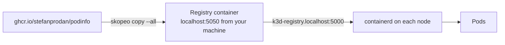

# 7. The registry (ECR stand-in)

> You end up with: upstream images mirrored into the local registry, podinfo
> pulling from it, and a clear picture of tags versus digests.

## What it is

A container registry stores images under names and serves them over the OCI
distribution API. The dotfiles create one next to the cluster: a CNCF
Distribution (`registry:2`) container outside k3d, so images survive
`k3d cluster delete`. You fill it the way many teams fill ECR: by mirroring
vendor images into it, so clusters never pull from the internet directly.

| Idea | Means |
| --- | --- |
| Repository | A name, such as `podinfo` |
| Tag | A movable label on an image (`6.7.1`). Can be re-pointed. |
| Digest | The content hash (`sha256:...`). Can't change. |
| Manifest list | One digest standing for several architectures; the client picks its own |



One registry, two names: your machine reaches it as `localhost:5050`; nodes
and pods reach it as `k3d-registry.localhost:5000`.

| ECR | Here |
| --- | --- |
| `<acct>.dkr.ecr.<region>.amazonaws.com/<repo>` | `localhost:5050/<repo>`, or `k3d-registry.localhost:5000/<repo>` in the cluster |
| IAM auth | None |
| TLS | Plain HTTP |
| Tag immutability | Not available |
| Scan on push, lifecycle policies | Not available |
| Pull-through cache | Not configured; you mirror by hand |

## On EKS

ECR, with nodes pulling through their instance role and CI pushing through an
IAM role. Mirroring vendor images is usually an ECR pull-through cache rule
or a pipeline running the same `skopeo copy`.

## Requirements

**In the cluster**: the registry container (dotfiles creates it with the
cluster). podinfo from lesson 2.

**On your machine**: `skopeo` (Bazzite base image; `brew install skopeo` on
macOS), `curl`, `jq`, `kubectl`, and `sofka` or `k9s` ([lesson 0](00-tools.md)).

## By hand, for comparison

> [!NOTE]
> Read this, don't run it. Below, podinfo's values in Git point at the mirror.

Nothing to install: the registry is already there. By hand you'd point a
workload at it with `--set`:

**Example only: don't run it**
```sh
helm --kube-context k3d-dev upgrade podinfo oci://ghcr.io/stefanprodan/charts/podinfo \
  -n podinfo --reuse-values --set image.repository=k3d-registry.localhost:5000/podinfo
```

Flux would revert that at its next reconcile; the change belongs in Git.

## Install with Flux

### 1. Mirror

Pushing images is outside Kubernetes, so it stays a command:

```sh
for t in 6.7.0 6.7.1; do
  skopeo copy --all --dest-tls-verify=false \
    docker://ghcr.io/stefanprodan/podinfo:$t \
    docker://localhost:5050/podinfo:$t
done
```

`--all` copies every architecture, so the digest stays the same as upstream.

```sh
curl -s localhost:5050/v2/_catalog | jq
skopeo list-tags --tls-verify=false docker://localhost:5050/podinfo
skopeo inspect --format '{{.Digest}}' docker://ghcr.io/stefanprodan/podinfo:6.7.0
skopeo inspect --tls-verify=false --format '{{.Digest}}' docker://localhost:5050/podinfo:6.7.0
```

The two digests match: it's the same image.

### 2. podinfo from the mirror

No new objects: podinfo's values change to pull from the mirror. The image
location is local; on EKS the same keys would name your ECR repo.

| Kind | Name | File |
| --- | --- | --- |
| ConfigMap, changed | `podinfo/podinfo-values-local` | `apps/local/podinfo/values.yaml` |

**Replace `apps/local/podinfo/values.yaml`**
```yaml
# apps/local/podinfo/values.yaml
apiVersion: v1
kind: ConfigMap
metadata:
  name: podinfo-values-local
  namespace: podinfo
  labels:
    reconcile.fluxcd.io/watch: Enabled
data:
  values.yaml: |
    ui:
      message: k3d
    # ── new ──
    image:
      repository: k3d-registry.localhost:5000/podinfo
      tag: 6.7.0
    # ── end new ──
```

```sh
git add apps/local/podinfo/values.yaml
git commit -m "podinfo from the local mirror"
git push
flux --context k3d-dev reconcile kustomization apps-local --with-source
kubectl --context k3d-dev -n podinfo get pods -o jsonpath='{range .items[*]}{.metadata.name}{"\t"}{.status.containerStatuses[0].imageID}{"\n"}{end}'
```

Each pod's `Image ID` is the digest it resolved. When a pull fails,
`kubectl --context k3d-dev -n podinfo describe pod` has the reason under
Events.

sofka / k9s: `:pods -n podinfo`, `d`, the `Image ID` line. sofka extra
([lesson 0](00-tools.md)): `X` names `ErrImagePull` and the event behind it.

## Iterate

Each step changes `apps/local/podinfo/values.yaml` and ends where it started:
the mirror, tag `6.7.0`. New or changed lines sit between `# ── new ──` and
`# ── end new ──`.

### 1. `localhost` from inside the cluster

**Replace `apps/local/podinfo/values.yaml`**
```yaml
# apps/local/podinfo/values.yaml
apiVersion: v1
kind: ConfigMap
metadata:
  name: podinfo-values-local
  namespace: podinfo
  labels:
    reconcile.fluxcd.io/watch: Enabled
data:
  values.yaml: |
    ui:
      message: k3d
    image:
      # ── new ──
      repository: localhost:5050/podinfo
      # ── end new ──
      tag: 6.7.0
```

```sh
git add apps/local/podinfo/values.yaml
git commit -m "podinfo: pull from localhost"
git push
flux --context k3d-dev reconcile kustomization apps-local --with-source
kubectl --context k3d-dev -n podinfo get pods
```

The new pod is stuck in `ErrImagePull`: inside the cluster, `localhost` is the
node itself. The old pods keep serving, because the rollout never got a new
pod ready. Put it back:

**Replace `apps/local/podinfo/values.yaml`**
```yaml
# apps/local/podinfo/values.yaml
apiVersion: v1
kind: ConfigMap
metadata:
  name: podinfo-values-local
  namespace: podinfo
  labels:
    reconcile.fluxcd.io/watch: Enabled
data:
  values.yaml: |
    ui:
      message: k3d
    image:
      # ── new ──
      repository: k3d-registry.localhost:5000/podinfo
      # ── end new ──
      tag: 6.7.0
```

```sh
git add apps/local/podinfo/values.yaml
git commit -m "podinfo: pull from the mirror"
git push
flux --context k3d-dev reconcile kustomization apps-local --with-source
kubectl --context k3d-dev -n podinfo get pods
```

### 2. Pin by digest

The digest from the mirror, the same as upstream:

```sh
skopeo inspect --tls-verify=false --format '{{.Digest}}' docker://localhost:5050/podinfo:6.7.0
```

The chart builds `repository:tag`, so the digest goes after the tag:

**Replace `apps/local/podinfo/values.yaml`**
```yaml
# apps/local/podinfo/values.yaml
apiVersion: v1
kind: ConfigMap
metadata:
  name: podinfo-values-local
  namespace: podinfo
  labels:
    reconcile.fluxcd.io/watch: Enabled
data:
  values.yaml: |
    ui:
      message: k3d
    image:
      repository: k3d-registry.localhost:5000/podinfo
      # ── new ──
      tag: 6.7.0@sha256:d2b3cd93a48acdc91327533ce28fcb3169b2d9feaf73817dc2eb68858df64edb
      # ── end new ──
```

```sh
git add apps/local/podinfo/values.yaml
git commit -m "podinfo: pin by digest"
git push
flux --context k3d-dev reconcile kustomization apps-local --with-source
kubectl --context k3d-dev -n podinfo get pods -o jsonpath='{range .items[*]}{.metadata.name}{"\t"}{.status.containerStatuses[0].imageID}{"\n"}{end}'
```

It works, and can never change under you, whatever happens to the tag.

### 3. Move a tag under running pods

Back to the bare tag, pulled every time a pod starts:

**Replace `apps/local/podinfo/values.yaml`**
```yaml
# apps/local/podinfo/values.yaml
apiVersion: v1
kind: ConfigMap
metadata:
  name: podinfo-values-local
  namespace: podinfo
  labels:
    reconcile.fluxcd.io/watch: Enabled
data:
  values.yaml: |
    ui:
      message: k3d
    image:
      repository: k3d-registry.localhost:5000/podinfo
      # ── new ──
      tag: 6.7.0
      pullPolicy: Always
      # ── end new ──
```

```sh
git add apps/local/podinfo/values.yaml
git commit -m "podinfo: tag, always pull"
git push
flux --context k3d-dev reconcile kustomization apps-local --with-source
kubectl --context k3d-dev -n podinfo get pods -o jsonpath='{range .items[*]}{.metadata.name}{"\t"}{.status.containerStatuses[0].imageID}{"\n"}{end}'
```

Now copy `6.7.1` over the `6.7.0` tag and restart the pods:

```sh
skopeo copy --all --dest-tls-verify=false \
  docker://ghcr.io/stefanprodan/podinfo:6.7.1 \
  docker://localhost:5050/podinfo:6.7.0
kubectl --context k3d-dev -n podinfo rollout restart deploy podinfo
kubectl --context k3d-dev -n podinfo rollout status deploy podinfo
kubectl --context k3d-dev -n podinfo get pods -o jsonpath='{range .items[*]}{.metadata.name}{"\t"}{.status.containerStatuses[0].imageID}{"\n"}{end}'
```

Same tag, same Git, different `Image ID`: Git no longer says what's running.
That's what ECR's tag immutability prevents. Put `6.7.0` back from upstream,
and the pull policy:

```sh
skopeo copy --all --dest-tls-verify=false \
  docker://ghcr.io/stefanprodan/podinfo:6.7.0 \
  docker://localhost:5050/podinfo:6.7.0
kubectl --context k3d-dev -n podinfo rollout restart deploy podinfo
kubectl --context k3d-dev -n podinfo rollout status deploy podinfo
```

The restart pulls the real `6.7.0` while `Always` is still set; with the
default policy the nodes would keep the copy they cached. Then drop
`pullPolicy`:

**Replace `apps/local/podinfo/values.yaml`**
```yaml
# apps/local/podinfo/values.yaml
apiVersion: v1
kind: ConfigMap
metadata:
  name: podinfo-values-local
  namespace: podinfo
  labels:
    reconcile.fluxcd.io/watch: Enabled
data:
  values.yaml: |
    ui:
      message: k3d
    image:
      repository: k3d-registry.localhost:5000/podinfo
      tag: 6.7.0
```

```sh
git add apps/local/podinfo/values.yaml
git commit -m "podinfo: default pull policy"
git push
flux --context k3d-dev reconcile kustomization apps-local --with-source
kubectl --context k3d-dev -n podinfo get pods
```

### 4. Copy one architecture only

Registry only, nothing in Git:

```sh
skopeo copy --dest-tls-verify=false \
  docker://ghcr.io/stefanprodan/podinfo:6.7.0 \
  docker://localhost:5050/podinfo:6.7.0-single
skopeo inspect --format '{{.Digest}}' docker://ghcr.io/stefanprodan/podinfo:6.7.0
skopeo inspect --tls-verify=false --format '{{.Digest}}' docker://localhost:5050/podinfo:6.7.0-single
```

Different digests: without `--all`, only your architecture was copied.

## Exercises

1. Mirror an image you'll need later (`registry.k8s.io/pause:3.10` for lesson
   12).
2. Find a multi-arch image's manifest list:
   `skopeo inspect --raw docker://localhost:5050/podinfo:6.7.1 | jq`.
3. Harder: run Zot as a HelmRelease (built-in auth, RBAC, scanning) as a
   second, ECR-like registry. Pods then need an `imagePullSecret`, and Flux's
   ImageRepository a `secretRef` in lesson 8.

## Where it gets hard

- Pods can't use `localhost:5050`. Always `k3d-registry.localhost:5000` inside
  the cluster.
- `curl` from a pod to `k3d-registry.localhost` is refused: curl maps every
  `*.localhost` name to `127.0.0.1`. Use `wget` or `curl --resolve`.
  containerd and Flux resolve it normally.
- Plain HTTP means `--tls-verify=false` for skopeo and `insecure: true` for
  Flux.
- Without tag immutability, semver promotion (lesson 8) trusts that tags never
  change, and nothing here enforces it.

## Links

- <https://k3d.io/stable/usage/registries/>
- <https://github.com/containers/skopeo>
- <https://distribution.github.io/distribution/>
