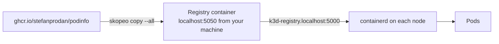

# 7. The registry (ECR stand-in)

> You end up with: upstream images mirrored into the local registry, podinfo
> pulling from it, and a clear picture of tags versus digests.

## What it is

A container registry stores images under names and serves them over the OCI
distribution API. The dotfiles create one next to the cluster: a CNCF
Distribution (`registry:2`) container outside k3d, so images survive
`k3d cluster delete`. You fill it the way many teams fill ECR: by mirroring
vendor images into it, so clusters never pull from the internet directly.

| Idea | Means |
| --- | --- |
| Repository | A name, such as `podinfo` |
| Tag | A movable label on an image (`6.7.1`). Can be re-pointed. |
| Digest | The content hash (`sha256:...`). Can't change. |
| Manifest list | One digest standing for several architectures; the client picks its own |



One registry, two names: your machine reaches it as `localhost:5050`; nodes
and pods reach it as `k3d-registry.localhost:5000`.

| ECR | Here |
| --- | --- |
| `<acct>.dkr.ecr.<region>.amazonaws.com/<repo>` | `localhost:5050/<repo>`, or `k3d-registry.localhost:5000/<repo>` in the cluster |
| IAM auth | None |
| TLS | Plain HTTP |
| Tag immutability | Not available |
| Scan on push, lifecycle policies | Not available |
| Pull-through cache | Not configured; you mirror by hand |

## On EKS

ECR, with nodes pulling through their instance role and CI pushing through an
IAM role. Mirroring vendor images is usually an ECR pull-through cache rule
or a pipeline running the same `skopeo copy`.

## Requirements

**In the cluster**: the registry container (dotfiles creates it with the
cluster). podinfo from lesson 2, for the Flux part.

**On your machine**: `skopeo` (Bazzite base image; `brew install skopeo` on
macOS), `curl`, `jq`, `kubectl`, and `sofka` or `k9s` ([lesson 0](00-tools.md)).

## Install by hand

Nothing to install: the registry is already there. This part is about using
it.

### 1. Mirror

```sh
for t in 6.7.0 6.7.1; do
  skopeo copy --all --dest-tls-verify=false \
    docker://ghcr.io/stefanprodan/podinfo:$t \
    docker://localhost:5050/podinfo:$t
done
```

`--all` copies every architecture, so the digest stays the same as upstream.

### 2. Look

```sh
curl -s localhost:5050/v2/_catalog | jq
skopeo list-tags --tls-verify=false docker://localhost:5050/podinfo
skopeo inspect --format '{{.Digest}}' docker://ghcr.io/stefanprodan/podinfo:6.7.0
skopeo inspect --tls-verify=false --format '{{.Digest}}' docker://localhost:5050/podinfo:6.7.0
```

The two digests match: it's the same image.

### 3. Pull it from a pod, by tag and by digest

**Write `scratch/07/pod.yaml`**
```yaml
# scratch/07/pod.yaml
apiVersion: v1
kind: Pod
metadata:
  name: mirror-test
  namespace: default
spec:
  containers:
    - name: podinfo
      image: k3d-registry.localhost:5000/podinfo:6.7.0
```

```sh
kubectl --context k3d-dev apply -f scratch/07/pod.yaml
```

```sh
kubectl --context k3d-dev -n default get pod mirror-test \
  -o jsonpath='{.status.containerStatuses[0].imageID}'
```

The digest it resolved. When a pull fails,
`kubectl --context k3d-dev -n default describe pod mirror-test` has the
reason under Events.

sofka / k9s: `:pods -n default`, `d`, the `Image ID` line. sofka extra
([lesson 0](00-tools.md)): `X` names `ErrImagePull` and the event behind it.

### 4. Iterate

Each step edits `scratch/07/pod.yaml` and re-creates the pod: a pod's spec
can't be changed in place. New or changed lines sit between `# ── new ──` and
`# ── end new ──`.

<details>
<summary>1. <code>localhost</code> from inside the cluster</summary>

**Replace `scratch/07/pod.yaml`**
```yaml
# scratch/07/pod.yaml
apiVersion: v1
kind: Pod
metadata:
  name: mirror-test
  namespace: default
spec:
  containers:
    - name: podinfo
      # ── new ──
      image: localhost:5050/podinfo:6.7.0
      # ── end new ──
```

```sh
kubectl --context k3d-dev delete -f scratch/07/pod.yaml
kubectl --context k3d-dev apply -f scratch/07/pod.yaml
kubectl --context k3d-dev -n default describe pod mirror-test
```

`ErrImagePull`: inside the cluster, `localhost` is the node itself.

</details>

<details>
<summary>2. Pin by digest</summary>

The digest from step 2, the same upstream and in the mirror:

```sh
skopeo inspect --tls-verify=false --format '{{.Digest}}' docker://localhost:5050/podinfo:6.7.0
```

**Replace `scratch/07/pod.yaml`**
```yaml
# scratch/07/pod.yaml
apiVersion: v1
kind: Pod
metadata:
  name: mirror-test
  namespace: default
spec:
  containers:
    - name: podinfo
      # ── new ──
      image: k3d-registry.localhost:5000/podinfo@sha256:d2b3cd93a48acdc91327533ce28fcb3169b2d9feaf73817dc2eb68858df64edb
      # ── end new ──
```

```sh
kubectl --context k3d-dev delete -f scratch/07/pod.yaml
kubectl --context k3d-dev apply -f scratch/07/pod.yaml
kubectl --context k3d-dev -n default get pod mirror-test \
  -o jsonpath='{.status.containerStatuses[0].imageID}'
```

It works, and can never change under you.

</details>

<details>
<summary>3. Move a tag under a running pod</summary>

Copy `6.7.1` over the `6.7.0` tag, and make the kubelet pull again rather than
use the image it already has:

```sh
skopeo copy --all --dest-tls-verify=false \
  docker://ghcr.io/stefanprodan/podinfo:6.7.1 \
  docker://localhost:5050/podinfo:6.7.0
```

**Replace `scratch/07/pod.yaml`**
```yaml
# scratch/07/pod.yaml
apiVersion: v1
kind: Pod
metadata:
  name: mirror-test
  namespace: default
spec:
  containers:
    - name: podinfo
      # ── new ──
      image: k3d-registry.localhost:5000/podinfo:6.7.0
      imagePullPolicy: Always
      # ── end new ──
```

```sh
kubectl --context k3d-dev delete -f scratch/07/pod.yaml
kubectl --context k3d-dev apply -f scratch/07/pod.yaml
kubectl --context k3d-dev -n default get pod mirror-test \
  -o jsonpath='{.status.containerStatuses[0].imageID}'
```

Same tag, different `Image ID`. That's what ECR's tag immutability prevents.
Put `6.7.0` back from upstream:

```sh
skopeo copy --all --dest-tls-verify=false \
  docker://ghcr.io/stefanprodan/podinfo:6.7.0 \
  docker://localhost:5050/podinfo:6.7.0
```

</details>

<details>
<summary>4. Copy one architecture only</summary>

```sh
skopeo copy --dest-tls-verify=false \
  docker://ghcr.io/stefanprodan/podinfo:6.7.0 \
  docker://localhost:5050/podinfo:6.7.0-single
skopeo inspect --format '{{.Digest}}' docker://ghcr.io/stefanprodan/podinfo:6.7.0
skopeo inspect --tls-verify=false --format '{{.Digest}}' docker://localhost:5050/podinfo:6.7.0-single
```

Different digests: without `--all`, only your architecture was copied.

</details>

### 5. Clean up

```sh
kubectl --context k3d-dev delete -f scratch/07/pod.yaml
```

Leave the mirrored images; lesson 8 uses them.

## Install with Flux

No new objects: podinfo's values change to pull from the mirror. The image
location is local; on EKS the same keys would name your ECR repo.

| Kind | Name | File |
| --- | --- | --- |
| ConfigMap, changed | `podinfo/podinfo-values-local` | `apps/local/podinfo/values.yaml` |

**Replace `apps/local/podinfo/values.yaml`**
```yaml
# apps/local/podinfo/values.yaml
apiVersion: v1
kind: ConfigMap
metadata:
  name: podinfo-values-local
  namespace: podinfo
  labels:
    reconcile.fluxcd.io/watch: Enabled
data:
  values.yaml: |
    ui:
      message: k3d
    # ── new ──
    image:
      repository: k3d-registry.localhost:5000/podinfo
      tag: 6.7.0
    # ── end new ──
```

Commit, push, and check the image:

```sh
git add apps/
git commit -m "podinfo from the local mirror"
git push
flux --context k3d-dev reconcile kustomization flux-system --with-source
kubectl --context k3d-dev -n podinfo get deploy podinfo -o jsonpath='{..image}'
```

The local image.

sofka / k9s: `:deploy -n podinfo`, `y`

## Exercises

1. Mirror an image you'll need later (`registry.k8s.io/pause:3.10` for lesson
   12) and use it from a pod.
2. Find a multi-arch image's manifest list:
   `skopeo inspect --raw docker://localhost:5050/podinfo:6.7.1 | jq`.
3. Harder: run Zot as a HelmRelease (built-in auth, RBAC, scanning) as a
   second, ECR-like registry. Pods then need an `imagePullSecret`, and Flux's
   ImageRepository a `secretRef` in lesson 8.

## Where it gets hard

- Pods can't use `localhost:5050`. Always `k3d-registry.localhost:5000` inside
  the cluster.
- `curl` from a pod to `k3d-registry.localhost` is refused: curl maps every
  `*.localhost` name to `127.0.0.1`. Use `wget` or `curl --resolve`.
  containerd and Flux resolve it normally.
- Plain HTTP means `--tls-verify=false` for skopeo and `insecure: true` for
  Flux.
- Without tag immutability, semver promotion (lesson 8) trusts that tags never
  change, and nothing here enforces it.

## Links

- <https://k3d.io/stable/usage/registries/>
- <https://github.com/containers/skopeo>
- <https://distribution.github.io/distribution/>
