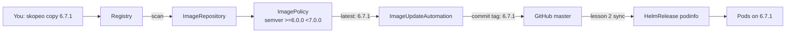

# 8. Image promotion with Git writeback

> You end up with: mirroring a tag is the only thing you do by hand. Flux
> notices it, commits the new tag to this repo, and rolls it out.

## What it is

Two Flux controllers, installed by lesson 2's `--components-extra`:

| Controller | Kind | Does |
| --- | --- | --- |
| image-reflector-controller | `ImageRepository` | Lists a registry repository's tags on an interval |
| image-reflector-controller | `ImagePolicy` | Picks one of those tags: newest semver in a range, newest by a regex, alphabetical |
| image-automation-controller | `ImageUpdateAutomation` | Checks out Git, rewrites every line marked with a policy, commits and pushes |



The marker is a comment on the line to rewrite, naming a policy:

```yaml
tag: 6.7.0 # {"$imagepolicy": "podinfo:podinfo:tag"}
```

`podinfo:podinfo` is the policy's namespace and name; `:tag` means "write only
the tag".

The commit is the deployment: Git history becomes the record of every
release.

## On EKS

The same objects pointed at ECR, with an IAM role for the
image-reflector-controller to list tags. Promotion between environments is
usually separate clusters reading separate paths or branches, which step 6
below mirrors.

## Requirements

**In the cluster**

- Flux bootstrapped with
  `--components-extra image-reflector-controller,image-automation-controller`
  and `--read-write-key` (lesson 2).
  `kubectl --context k3d-dev get deploy -n flux-system` lists both image
  controllers. If they're missing, a read-only deploy key can't be
  upgraded in place:
  ```sh
  kubectl --context k3d-dev -n flux-system delete secret flux-system
  ```
  then rerun lesson 2's bootstrap command with both flags.
- podinfo `6.7.0` running from the local registry (lesson 7).

**On your machine**: `skopeo`, `flux`, `kubectl`, `git`, and `sofka`
or `k9s` ([lesson 0](00-tools.md)).

## Install by hand

The reflector half is read-only, so it's safe to explore by hand. Nothing
writes to Git until the automation exists.

```yaml
# scratch/08/image.yaml
apiVersion: image.toolkit.fluxcd.io/v1
kind: ImageRepository
metadata:
  name: podinfo-test
  namespace: flux-system
spec:
  image: k3d-registry.localhost:5000/podinfo
  interval: 1m
  insecure: true
---
apiVersion: image.toolkit.fluxcd.io/v1
kind: ImagePolicy
metadata:
  name: podinfo-test
  namespace: flux-system
spec:
  imageRepositoryRef:
    name: podinfo-test
  policy:
    semver:
      range: ">=6.0.0 <7.0.0"
```

```sh
kubectl --context k3d-dev apply -f scratch/08/image.yaml
flux --context k3d-dev get images all -n flux-system
```

The tags it found, and the one each policy picked. To scan again now:
`flux --context k3d-dev reconcile image repository podinfo-test -n flux-system`.

sofka / k9s: `:imagerepositories -n flux-system`, `d` for the tags;
`:imagepolicies -n flux-system` for the pick. Scan now: sofka `t`; k9s
`Shift-r` (dotfiles plugin).

### Iterate

| Try | Then look at |
| --- | --- |
| `range: "6.7.0"` | Pinned: it picks `6.7.0` even though `6.7.1` exists |
| Mirror a prerelease (below), keep `>=6.0.0 <7.0.0` | Ignored: semver ranges skip prereleases |
| `range: ">=6.0.0-0"` | Now the prerelease wins |
| Replace `semver` with `alphabetical: {order: asc}` | Why semver exists |

A prerelease to play with, re-tagged from an upstream image while mirroring:

```sh
skopeo copy --all --dest-tls-verify=false \
  docker://ghcr.io/stefanprodan/podinfo:6.7.1 \
  docker://localhost:5050/podinfo:6.8.0-rc.1
```

### Clean up

```sh
kubectl --context k3d-dev delete -f scratch/08/image.yaml
```

## Install with Flux

All in namespace `podinfo`. An automation only uses policies in its own
namespace, so they live together. They're local because they name the local
registry and this cluster's branch.

| Kind | Name | File |
| --- | --- | --- |
| ImageRepository, ImagePolicy, ImageUpdateAutomation | `podinfo` | `apps/local/podinfo/image.yaml` |
| HelmRelease, changed | `podinfo` | `apps/base/podinfo/release.yaml`: the tag moves to `spec.values` |
| ConfigMap, changed | `podinfo-values-local` | `apps/local/podinfo/values.yaml`: `image.tag` removed |

1. **Move the tag where Flux can rewrite it.** A marker inside a ConfigMap's
   `values.yaml` string is invisible to Flux, so the tag goes in the
   HelmRelease's `spec.values`, which also overrides every ConfigMap:
   ```yaml
   # apps/base/podinfo/release.yaml
   spec:
     values:
       image:
         tag: 6.7.0 # {"$imagepolicy": "podinfo:podinfo:tag"}
   ```
   Delete `image.tag` from `podinfo-values-local`.
2. **The objects**: `scratch/08/image.yaml` with `name: podinfo` and
   `namespace: podinfo`, plus the automation:
   ```yaml
   ---
   apiVersion: image.toolkit.fluxcd.io/v1
   kind: ImageUpdateAutomation
   metadata:
     name: podinfo
     namespace: podinfo
   spec:
     interval: 5m
     sourceRef:
       kind: GitRepository
       name: flux-system
       namespace: flux-system
     git:
       checkout:
         ref:
           branch: master
       commit:
         author:
           name: fluxcdbot
           email: fluxcdbot@users.noreply.github.com
       push:
         branch: master
     update:
       path: ./apps
       strategy: Setters
   ```
3. Push. From now on, `git pull` before every commit: Flux commits too.
4. **Release**: mirror `6.7.1` (lesson 7). Watch
   `kubectl --context k3d-dev get imagepolicies -n podinfo -w`, then Flux's
   commit on GitHub, then
   `kubectl --context k3d-dev -n podinfo rollout status deploy/podinfo`.
   sofka / k9s: `:imagepolicies -n podinfo`, then `:pods -n podinfo`. sofka
   extra ([lesson 0](00-tools.md)): `:rollout-history` on the Deployment has
   one revision per Flux commit.

## Exercises

1. Read Flux's commit: what changed, and who's the author.
2. Two environments: namespaces `podinfo-dev` and `podinfo-prod`, each with
   its own HelmRelease, policy and automation (automations only see their own
   namespace's policies). `dev` takes prereleases (`>=6.0.0-0`); `prod` only
   stable.
3. Promote: mirror `6.8.0-rc.1`. Only `dev` moves. Mirror the same image as
   `6.8.0`; `prod` follows.
4. Harder: gate `prod` with review. Set its automation's `git.push.branch:
   flux-image-updates`, so Flux pushes there instead, and promotion becomes
   merging a PR.

## Where it gets hard

- The marker must be on the same line as the value, and name the policy's
  namespace and name exactly. A typo means nothing happens, with no error.
- A tag left in a values ConfigMap is silently overridden by `spec.values`.
- The reflector polls on its `interval`; nothing happens instantly.
  `flux --context k3d-dev reconcile image repository podinfo -n podinfo`
  forces a scan.
- With no tag immutability, overwriting a tag deploys new content with no
  commit at all.

## Links

- <https://fluxcd.io/flux/guides/image-update/>
- <https://fluxcd.io/flux/components/image/imagepolicies/>
- <https://fluxcd.io/flux/components/image/imageupdateautomations/>
