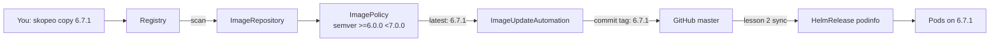

# 8. Image promotion with Git writeback

> You end up with: mirroring a tag is the only thing you do by hand. Flux
> notices it, commits the new tag to this repo, and rolls it out.

## What it is

Two Flux controllers, installed by lesson 2's `--components-extra`:

| Controller | Kind | Does |
| --- | --- | --- |
| image-reflector-controller | `ImageRepository` | Lists a registry repository's tags on an interval |
| image-reflector-controller | `ImagePolicy` | Picks one of those tags: newest semver in a range, newest by a regex, alphabetical |
| image-automation-controller | `ImageUpdateAutomation` | Checks out Git, rewrites every line marked with a policy, commits and pushes |



The marker is a comment on the line to rewrite, naming a policy. Here it's
the one line of podinfo's HelmRelease that Flux will own:

**Example only: you write the whole file below**
```yaml
# ~/repos/personal/kube_local/apps/base/podinfo/release.yaml, one line of it
tag: 6.7.0 # {"$imagepolicy": "podinfo:podinfo:tag"}
```

`podinfo:podinfo` is the policy's namespace and name; `:tag` means "write only
the tag".

The commit is the deployment: Git history becomes the record of every
release.

## On EKS

The same objects pointed at ECR, with an IAM role for the
image-reflector-controller to list tags. Promotion between environments is
usually separate clusters reading separate paths or branches, which
exercises 2 to 4 mirror.

## Requirements

**In the cluster**

- Flux bootstrapped with
  `--components-extra image-reflector-controller,image-automation-controller`
  and `--read-write-key` (lesson 2).
  `kubectl --context k3d-dev get deploy -n flux-system` lists both image
  controllers. If they're missing, a read-only deploy key can't be
  upgraded in place:
  ```sh
  kubectl --context k3d-dev -n flux-system delete secret flux-system
  ```
  then rerun lesson 2's bootstrap command with both flags.
- podinfo `6.7.0` running from the local registry (lesson 7).

**On your machine**: `skopeo`, `flux`, `kubectl`, `git`, and `sofka`
or `k9s` ([lesson 0](00-tools.md)).

## By hand, for comparison

> [!NOTE]
> Read this, don't run it. Below, Flux does the promoting and commits it.

By hand, a release is someone noticing a new tag and running:

**Example only: don't run it**
```sh
skopeo list-tags --tls-verify=false docker://localhost:5050/podinfo
helm --kube-context k3d-dev upgrade podinfo oci://ghcr.io/stefanprodan/charts/podinfo \
  -n podinfo --reuse-values --set image.tag=6.7.1
```

Git never hears about it, and Flux would undo it. Image automation makes the
same decision from a policy and writes it to Git instead.

## Install with Flux

All in namespace `podinfo`. An automation only uses policies in its own
namespace, so they live together. They're local because they name the local
registry and this cluster's branch.

| Kind | Name | File |
| --- | --- | --- |
| ImageRepository, ImagePolicy, ImageUpdateAutomation | `podinfo` | `~/repos/personal/kube_local/apps/local/podinfo/image.yaml` |
| HelmRelease, changed | `podinfo` | `~/repos/personal/kube_local/apps/base/podinfo/release.yaml`: the tag moves to `spec.values` |
| ConfigMap, changed | `podinfo-values-local` | `~/repos/personal/kube_local/apps/local/podinfo/values.yaml`: `image.tag` removed |

### 1. Move the tag where Flux can rewrite it

A marker inside a ConfigMap's `values.yaml` string is invisible to Flux, so the
tag goes in the HelmRelease's `spec.values`, which also overrides every
ConfigMap:

**Replace `~/repos/personal/kube_local/apps/base/podinfo/release.yaml`**
```yaml
# ~/repos/personal/kube_local/apps/base/podinfo/release.yaml
apiVersion: helm.toolkit.fluxcd.io/v2
kind: HelmRelease
metadata:
  name: podinfo
  namespace: podinfo
spec:
  interval: 10m
  driftDetection:
    mode: enabled
  chartRef:
    kind: OCIRepository
    name: podinfo
  valuesFrom:
    - kind: ConfigMap
      name: podinfo-values-base
    - kind: ConfigMap
      name: podinfo-values-local
  # ── new ──
  values:
    image:
      tag: 6.7.0 # {"$imagepolicy": "podinfo:podinfo:tag"}
  # ── end new ──
```

And take `tag` out of `podinfo-values-local`, leaving the repository:

**Replace `~/repos/personal/kube_local/apps/local/podinfo/values.yaml`**
```yaml
# ~/repos/personal/kube_local/apps/local/podinfo/values.yaml
apiVersion: v1
kind: ConfigMap
metadata:
  name: podinfo-values-local
  namespace: podinfo
  labels:
    reconcile.fluxcd.io/watch: Enabled
data:
  values.yaml: |
    ui:
      message: k3d
    image:
      repository: k3d-registry.localhost:5000/podinfo
```

### 2. Scan, pick, commit

The ImageRepository lists the registry's tags, the ImagePolicy picks one, and
the ImageUpdateAutomation writes it over the marker and pushes:

**Write `~/repos/personal/kube_local/apps/local/podinfo/image.yaml`**
```yaml
# ~/repos/personal/kube_local/apps/local/podinfo/image.yaml
apiVersion: image.toolkit.fluxcd.io/v1
kind: ImageRepository
metadata:
  name: podinfo
  namespace: podinfo
spec:
  image: k3d-registry.localhost:5000/podinfo
  interval: 1m
  insecure: true
---
apiVersion: image.toolkit.fluxcd.io/v1
kind: ImagePolicy
metadata:
  name: podinfo
  namespace: podinfo
spec:
  imageRepositoryRef:
    name: podinfo
  policy:
    semver:
      range: ">=6.0.0 <7.0.0"
---
apiVersion: image.toolkit.fluxcd.io/v1
kind: ImageUpdateAutomation
metadata:
  name: podinfo
  namespace: podinfo
spec:
  interval: 5m
  sourceRef:
    kind: GitRepository
    name: flux-system
    namespace: flux-system
  git:
    checkout:
      ref:
        branch: master
    commit:
      author:
        name: fluxcdbot
        email: fluxcdbot@users.noreply.github.com
    push:
      branch: master
  update:
    path: ./apps
    strategy: Setters
```

### 3. Push, and watch Flux promote

```sh
git -C ~/repos/personal/kube_local add ~/repos/personal/kube_local/apps/
git -C ~/repos/personal/kube_local commit -m "Image automation for podinfo"
git -C ~/repos/personal/kube_local push
flux --context k3d-dev reconcile kustomization flux-system --with-source
flux --context k3d-dev get images all -n podinfo
```

The tags it found, and the pick: `6.7.1`, which lesson 7 mirrored. Within the
automation's interval Flux commits it:

```sh
flux --context k3d-dev reconcile image update podinfo -n podinfo
git -C ~/repos/personal/kube_local pull
git -C ~/repos/personal/kube_local log -1
kubectl --context k3d-dev -n podinfo rollout status deploy/podinfo
```

A commit by `fluxcdbot` that changes `6.7.0` to `6.7.1` in `release.yaml`, and
the rollout it caused. From now on, `git -C ~/repos/personal/kube_local pull` before every commit: Flux
commits too.

sofka / k9s: `:imagerepositories -n podinfo`, `d` for the tags;
`:imagepolicies -n podinfo` for the pick. Scan now: sofka `t`; k9s `Shift-r`
(dotfiles plugin). sofka extra ([lesson 0](00-tools.md)): `:rollout-history`
on the Deployment has one revision per Flux commit.

## Iterate

Each step changes the policy in Git, and Flux answers with its own commit.
New or changed lines sit between `# ── new ──` and `# ── end new ──`.

### 1. Pin one version

**Replace `~/repos/personal/kube_local/apps/local/podinfo/image.yaml`**
```yaml
# ~/repos/personal/kube_local/apps/local/podinfo/image.yaml
apiVersion: image.toolkit.fluxcd.io/v1
kind: ImageRepository
metadata:
  name: podinfo
  namespace: podinfo
spec:
  image: k3d-registry.localhost:5000/podinfo
  interval: 1m
  insecure: true
---
apiVersion: image.toolkit.fluxcd.io/v1
kind: ImagePolicy
metadata:
  name: podinfo
  namespace: podinfo
spec:
  imageRepositoryRef:
    name: podinfo
  policy:
    # ── new ──
    semver:
      range: "6.7.0"
    # ── end new ──
---
apiVersion: image.toolkit.fluxcd.io/v1
kind: ImageUpdateAutomation
metadata:
  name: podinfo
  namespace: podinfo
spec:
  interval: 5m
  sourceRef:
    kind: GitRepository
    name: flux-system
    namespace: flux-system
  git:
    checkout:
      ref:
        branch: master
    commit:
      author:
        name: fluxcdbot
        email: fluxcdbot@users.noreply.github.com
    push:
      branch: master
  update:
    path: ./apps
    strategy: Setters
```

```sh
git -C ~/repos/personal/kube_local pull
git -C ~/repos/personal/kube_local add ~/repos/personal/kube_local/apps/local/podinfo/image.yaml
git -C ~/repos/personal/kube_local commit -m "podinfo: pin 6.7.0"
git -C ~/repos/personal/kube_local push
flux --context k3d-dev reconcile kustomization apps-local --with-source
flux --context k3d-dev get images policy podinfo -n podinfo
flux --context k3d-dev reconcile image update podinfo -n podinfo
git -C ~/repos/personal/kube_local pull
git -C ~/repos/personal/kube_local log -1 --oneline
kubectl --context k3d-dev -n podinfo get deploy podinfo -o jsonpath='{..image}'
```

Pinned: Flux commits `6.7.0` even though `6.7.1` exists, and podinfo rolls
back. A rollback is just another policy.

### 2. A prerelease, and the original range

Mirror a prerelease, re-tagged from an upstream image, and scan for it now:

```sh
skopeo copy --all --dest-tls-verify=false \
  docker://ghcr.io/stefanprodan/podinfo:6.7.1 \
  docker://localhost:5050/podinfo:6.8.0-rc.1
flux --context k3d-dev reconcile image repository podinfo -n podinfo
```

**Replace `~/repos/personal/kube_local/apps/local/podinfo/image.yaml`**
```yaml
# ~/repos/personal/kube_local/apps/local/podinfo/image.yaml
apiVersion: image.toolkit.fluxcd.io/v1
kind: ImageRepository
metadata:
  name: podinfo
  namespace: podinfo
spec:
  image: k3d-registry.localhost:5000/podinfo
  interval: 1m
  insecure: true
---
apiVersion: image.toolkit.fluxcd.io/v1
kind: ImagePolicy
metadata:
  name: podinfo
  namespace: podinfo
spec:
  imageRepositoryRef:
    name: podinfo
  policy:
    # ── new ──
    semver:
      range: ">=6.0.0 <7.0.0"
    # ── end new ──
---
apiVersion: image.toolkit.fluxcd.io/v1
kind: ImageUpdateAutomation
metadata:
  name: podinfo
  namespace: podinfo
spec:
  interval: 5m
  sourceRef:
    kind: GitRepository
    name: flux-system
    namespace: flux-system
  git:
    checkout:
      ref:
        branch: master
    commit:
      author:
        name: fluxcdbot
        email: fluxcdbot@users.noreply.github.com
    push:
      branch: master
  update:
    path: ./apps
    strategy: Setters
```

```sh
git -C ~/repos/personal/kube_local pull
git -C ~/repos/personal/kube_local add ~/repos/personal/kube_local/apps/local/podinfo/image.yaml
git -C ~/repos/personal/kube_local commit -m "podinfo: semver 6.x"
git -C ~/repos/personal/kube_local push
flux --context k3d-dev reconcile kustomization apps-local --with-source
flux --context k3d-dev get images policy podinfo -n podinfo
flux --context k3d-dev reconcile image update podinfo -n podinfo
git -C ~/repos/personal/kube_local pull
git -C ~/repos/personal/kube_local log -1 --oneline
kubectl --context k3d-dev -n podinfo get deploy podinfo -o jsonpath='{..image}'
```

`6.7.1` again: semver ranges skip prereleases.

### 3. Let prereleases in

**Replace `~/repos/personal/kube_local/apps/local/podinfo/image.yaml`**
```yaml
# ~/repos/personal/kube_local/apps/local/podinfo/image.yaml
apiVersion: image.toolkit.fluxcd.io/v1
kind: ImageRepository
metadata:
  name: podinfo
  namespace: podinfo
spec:
  image: k3d-registry.localhost:5000/podinfo
  interval: 1m
  insecure: true
---
apiVersion: image.toolkit.fluxcd.io/v1
kind: ImagePolicy
metadata:
  name: podinfo
  namespace: podinfo
spec:
  imageRepositoryRef:
    name: podinfo
  policy:
    # ── new ──
    semver:
      range: ">=6.0.0-0"
    # ── end new ──
---
apiVersion: image.toolkit.fluxcd.io/v1
kind: ImageUpdateAutomation
metadata:
  name: podinfo
  namespace: podinfo
spec:
  interval: 5m
  sourceRef:
    kind: GitRepository
    name: flux-system
    namespace: flux-system
  git:
    checkout:
      ref:
        branch: master
    commit:
      author:
        name: fluxcdbot
        email: fluxcdbot@users.noreply.github.com
    push:
      branch: master
  update:
    path: ./apps
    strategy: Setters
```

```sh
git -C ~/repos/personal/kube_local pull
git -C ~/repos/personal/kube_local add ~/repos/personal/kube_local/apps/local/podinfo/image.yaml
git -C ~/repos/personal/kube_local commit -m "podinfo: allow prereleases"
git -C ~/repos/personal/kube_local push
flux --context k3d-dev reconcile kustomization apps-local --with-source
flux --context k3d-dev get images policy podinfo -n podinfo
flux --context k3d-dev reconcile image update podinfo -n podinfo
git -C ~/repos/personal/kube_local pull
git -C ~/repos/personal/kube_local log -1 --oneline
kubectl --context k3d-dev -n podinfo get deploy podinfo -o jsonpath='{..image}'
```

Now `6.8.0-rc.1` wins, and it's what runs.

### 4. Alphabetical instead of semver

**Replace `~/repos/personal/kube_local/apps/local/podinfo/image.yaml`**
```yaml
# ~/repos/personal/kube_local/apps/local/podinfo/image.yaml
apiVersion: image.toolkit.fluxcd.io/v1
kind: ImageRepository
metadata:
  name: podinfo
  namespace: podinfo
spec:
  image: k3d-registry.localhost:5000/podinfo
  interval: 1m
  insecure: true
---
apiVersion: image.toolkit.fluxcd.io/v1
kind: ImagePolicy
metadata:
  name: podinfo
  namespace: podinfo
spec:
  imageRepositoryRef:
    name: podinfo
  policy:
    # ── new ──
    alphabetical:
      order: asc
    # ── end new ──
---
apiVersion: image.toolkit.fluxcd.io/v1
kind: ImageUpdateAutomation
metadata:
  name: podinfo
  namespace: podinfo
spec:
  interval: 5m
  sourceRef:
    kind: GitRepository
    name: flux-system
    namespace: flux-system
  git:
    checkout:
      ref:
        branch: master
    commit:
      author:
        name: fluxcdbot
        email: fluxcdbot@users.noreply.github.com
    push:
      branch: master
  update:
    path: ./apps
    strategy: Setters
```

```sh
git -C ~/repos/personal/kube_local pull
git -C ~/repos/personal/kube_local add ~/repos/personal/kube_local/apps/local/podinfo/image.yaml
git -C ~/repos/personal/kube_local commit -m "podinfo: alphabetical"
git -C ~/repos/personal/kube_local push
flux --context k3d-dev reconcile kustomization apps-local --with-source
flux --context k3d-dev get images policy podinfo -n podinfo
flux --context k3d-dev reconcile image update podinfo -n podinfo
git -C ~/repos/personal/kube_local pull
git -C ~/repos/personal/kube_local log -1 --oneline
kubectl --context k3d-dev -n podinfo get deploy podinfo -o jsonpath='{..image}'
```

It sorts tags as strings, so whichever sorts last wins. That's why semver
exists.

### 5. Back to the original range

**Replace `~/repos/personal/kube_local/apps/local/podinfo/image.yaml`**
```yaml
# ~/repos/personal/kube_local/apps/local/podinfo/image.yaml
apiVersion: image.toolkit.fluxcd.io/v1
kind: ImageRepository
metadata:
  name: podinfo
  namespace: podinfo
spec:
  image: k3d-registry.localhost:5000/podinfo
  interval: 1m
  insecure: true
---
apiVersion: image.toolkit.fluxcd.io/v1
kind: ImagePolicy
metadata:
  name: podinfo
  namespace: podinfo
spec:
  imageRepositoryRef:
    name: podinfo
  policy:
    # ── new ──
    semver:
      range: ">=6.0.0 <7.0.0"
    # ── end new ──
---
apiVersion: image.toolkit.fluxcd.io/v1
kind: ImageUpdateAutomation
metadata:
  name: podinfo
  namespace: podinfo
spec:
  interval: 5m
  sourceRef:
    kind: GitRepository
    name: flux-system
    namespace: flux-system
  git:
    checkout:
      ref:
        branch: master
    commit:
      author:
        name: fluxcdbot
        email: fluxcdbot@users.noreply.github.com
    push:
      branch: master
  update:
    path: ./apps
    strategy: Setters
```

```sh
git -C ~/repos/personal/kube_local pull
git -C ~/repos/personal/kube_local add ~/repos/personal/kube_local/apps/local/podinfo/image.yaml
git -C ~/repos/personal/kube_local commit -m "podinfo: semver 6.x"
git -C ~/repos/personal/kube_local push
flux --context k3d-dev reconcile kustomization apps-local --with-source
flux --context k3d-dev get images policy podinfo -n podinfo
flux --context k3d-dev reconcile image update podinfo -n podinfo
git -C ~/repos/personal/kube_local pull
git -C ~/repos/personal/kube_local log -1 --oneline
kubectl --context k3d-dev -n podinfo get deploy podinfo -o jsonpath='{..image}'
```

`6.7.1`, the latest stable.

## Exercises

1. Read Flux's commit: what changed, and who's the author.
2. Two environments: namespaces `podinfo-dev` and `podinfo-prod`, each with
   its own HelmRelease, policy and automation (automations only see their own
   namespace's policies). `dev` takes prereleases (`>=6.0.0-0`); `prod` only
   stable.
3. Promote: mirror `6.8.0-rc.1`. Only `dev` moves. Mirror the same image as
   `6.8.0`; `prod` follows.
4. Harder: gate `prod` with review. Set its automation's `git.push.branch:
   flux-image-updates`, so Flux pushes there instead, and promotion becomes
   merging a PR.

## Where it gets hard

- The marker must be on the same line as the value, and name the policy's
  namespace and name exactly. A typo means nothing happens, with no error.
- A tag left in a values ConfigMap is silently overridden by `spec.values`.
- The reflector polls on its `interval`; nothing happens instantly.
  `flux --context k3d-dev reconcile image repository podinfo -n podinfo`
  forces a scan.
- With no tag immutability, overwriting a tag deploys new content with no
  commit at all.

## Links

- <https://fluxcd.io/flux/guides/image-update/>
- <https://fluxcd.io/flux/components/image/imagepolicies/>
- <https://fluxcd.io/flux/components/image/imageupdateautomations/>
