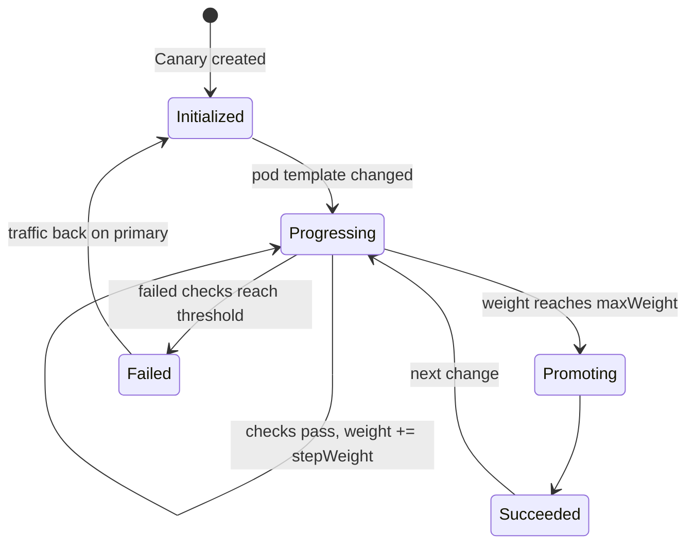

# 9. Progressive delivery with Flagger

> You end up with: a new podinfo version taking 10%, then 20%... of traffic
> through the Gateway, promoted if healthy and rolled back if not. With lesson
> 8, a mirrored tag becomes a canary release with no hands involved.

## What it is

Flagger is a controller from the Flux project. You point a `Canary` at a
Deployment, and from then on Flagger owns how changes to it reach traffic:

1. On the first run it copies your Deployment to `<name>-primary`, creates
   Services `<name>`, `<name>-primary` and `<name>-canary`, and an `HTTPRoute`
   sending everything to primary. Your own Deployment is scaled to zero.
2. When the pod template changes (a new image tag), Flagger scales your
   Deployment back up as the canary and shifts route weight to it in steps.
3. At each step it runs **webhooks** (load tests, smoke tests) and checks
   **metrics** against thresholds. Too many failures and it rolls back.
4. At `maxWeight` it copies the canary's spec to primary, sends all traffic
   there, and scales the canary to zero again.



| Kind | Says |
| --- | --- |
| `Canary` | Which Deployment, which Gateway and hostname, and the analysis: interval, steps, threshold, webhooks, metrics |
| `MetricTemplate` | A Prometheus query returning one number, such as the canary's error rate |

The **loadtester** is a small service from the same chart repository that
runs `hey` when a webhook calls it, so there's traffic to measure.

## On EKS

The same, against whatever implements Gateway API there (Cilium, or the AWS
Load Balancer Controller). Argo Rollouts is the Argo-world equivalent.

## Requirements

**In the cluster**: the Gateway (lesson 2), Prometheus from lesson 6 with
Hubble's `httpV2` metrics, and podinfo from the local registry with image
automation (lessons 7 and 8).

**On your machine**: `kubectl`, `helm`, `flux`, `curl`, and `sofka`
or `k9s` ([lesson 0](00-tools.md)).

## By hand, for comparison

> [!NOTE]
> Read this, don't run it. Below, every release is a Git commit and Flagger
> does the rolling out.

By hand, Flagger and its loadtester are two `helm` commands, and a release is
a `helm upgrade` you watch yourself:

**Example only: don't run it**
```sh
helm --kube-context k3d-dev upgrade --install flagger flagger --repo https://flagger.app \
  --version 1.45.0 -n flagger-system --create-namespace -f values.yaml
helm --kube-context k3d-dev upgrade --install loadtester loadtester --repo https://flagger.app \
  --version 0.39.0 -n podinfo
kubectl --context k3d-dev apply -f canary.yaml
helm --kube-context k3d-dev upgrade podinfo oci://ghcr.io/stefanprodan/charts/podinfo \
  -n podinfo --reuse-values --set image.tag=6.7.1
```

## Install with Flux

For the real podinfo, so lesson 8's commits become canaries.

| Kind | Name | File |
| --- | --- | --- |
| Namespace | `flagger-system` | `~/repos/personal/kube_local/infrastructure/base/flagger/namespace.yaml` |
| HelmRepository | `flagger` | `~/repos/personal/kube_local/infrastructure/base/flagger/source.yaml` |
| HelmRelease | `flagger` | `~/repos/personal/kube_local/infrastructure/base/flagger/release.yaml` |
| ConfigMap | `flagger-values-base` | `~/repos/personal/kube_local/infrastructure/base/flagger/values.yaml` |
| HelmRelease | `podinfo/loadtester` | `~/repos/personal/kube_local/apps/base/podinfo/loadtester.yaml` |
| Canary | `podinfo/podinfo` | `~/repos/personal/kube_local/apps/base/podinfo/canary.yaml` |
| HTTPRoute, deleted | `podinfo/podinfo` | `~/repos/personal/kube_local/apps/base/podinfo/route.yaml`: Flagger owns the route now |
| ConfigMap, changed | `podinfo-values-base` | `~/repos/personal/kube_local/apps/base/podinfo/values.yaml`: `service.enabled: false` |
| HelmRelease, changed | `podinfo` | `~/repos/personal/kube_local/apps/base/podinfo/release.yaml`: drift detection ignores replicas |

### 1. Flagger

```sh
mkdir -p ~/repos/personal/kube_local/infrastructure/base/flagger
```

**Write `~/repos/personal/kube_local/infrastructure/base/flagger/namespace.yaml`**
```yaml
# ~/repos/personal/kube_local/infrastructure/base/flagger/namespace.yaml
apiVersion: v1
kind: Namespace
metadata:
  name: flagger-system
```

**Write `~/repos/personal/kube_local/infrastructure/base/flagger/source.yaml`**
```yaml
# ~/repos/personal/kube_local/infrastructure/base/flagger/source.yaml
apiVersion: source.toolkit.fluxcd.io/v1
kind: HelmRepository
metadata:
  name: flagger
  namespace: flagger-system
spec:
  interval: 1h
  url: https://flagger.app
```

**Write `~/repos/personal/kube_local/infrastructure/base/flagger/release.yaml`**
```yaml
# ~/repos/personal/kube_local/infrastructure/base/flagger/release.yaml
apiVersion: helm.toolkit.fluxcd.io/v2
kind: HelmRelease
metadata:
  name: flagger
  namespace: flagger-system
spec:
  interval: 10m
  chart:
    spec:
      chart: flagger
      version: 1.45.0
      sourceRef:
        kind: HelmRepository
        name: flagger
  valuesFrom:
    - kind: ConfigMap
      name: flagger-values-base
```

**Write `~/repos/personal/kube_local/infrastructure/base/flagger/values.yaml`**
```yaml
# ~/repos/personal/kube_local/infrastructure/base/flagger/values.yaml
apiVersion: v1
kind: ConfigMap
metadata:
  name: flagger-values-base
  namespace: flagger-system
  labels:
    reconcile.fluxcd.io/watch: Enabled
data:
  values.yaml: |
    meshProvider: gatewayapi:v1
    prometheus:
      install: false
    metricsServer: http://kube-prometheus-stack-prometheus.monitoring:9090
```

Push it first and wait for `Ready`: the Canary and MetricTemplate kinds come
from its chart.

```sh
git -C ~/repos/personal/kube_local pull
git -C ~/repos/personal/kube_local add ~/repos/personal/kube_local/infrastructure/
git -C ~/repos/personal/kube_local commit -m "Flagger with Flux"
git -C ~/repos/personal/kube_local push
flux --context k3d-dev reconcile kustomization flux-system --with-source
kubectl --context k3d-dev get helmreleases -n flagger-system -w
```

### 2. podinfo's side

The loadtester's `sourceRef` names the HelmRepository in Flagger's namespace:

**Write `~/repos/personal/kube_local/apps/base/podinfo/loadtester.yaml`**
```yaml
# ~/repos/personal/kube_local/apps/base/podinfo/loadtester.yaml
apiVersion: helm.toolkit.fluxcd.io/v2
kind: HelmRelease
metadata:
  name: loadtester
  namespace: podinfo
spec:
  interval: 10m
  chart:
    spec:
      chart: loadtester
      version: 0.39.0
      sourceRef:
        kind: HelmRepository
        name: flagger
        namespace: flagger-system
```

The Canary. The load goes through the Gateway, not straight to the canary
Service: Hubble only records HTTP metrics for traffic Cilium's Envoy handles,
and the weighted split only happens there.

**Write `~/repos/personal/kube_local/apps/base/podinfo/canary.yaml`**
```yaml
# ~/repos/personal/kube_local/apps/base/podinfo/canary.yaml
apiVersion: flagger.app/v1beta1
kind: Canary
metadata:
  name: podinfo
  namespace: podinfo
spec:
  targetRef:
    apiVersion: apps/v1
    kind: Deployment
    name: podinfo
  service:
    port: 9898
    hosts: ["podinfo.${CLUSTER_DOMAIN}"]
    gatewayRefs:
      - name: web
        namespace: gateway
  analysis:
    interval: 30s
    threshold: 3
    stepWeight: 10
    maxWeight: 50
    webhooks:
      - name: load
        url: http://loadtester.podinfo/
        metadata:
          cmd: "hey -z 1m -q 10 -c 2 -host podinfo.${CLUSTER_DOMAIN} http://cilium-gateway-web.gateway/"
```

Flagger creates the Services, so podinfo's own is off:

**Replace `~/repos/personal/kube_local/apps/base/podinfo/values.yaml`**
```yaml
# ~/repos/personal/kube_local/apps/base/podinfo/values.yaml
apiVersion: v1
kind: ConfigMap
metadata:
  name: podinfo-values-base
  namespace: podinfo
  labels:
    reconcile.fluxcd.io/watch: Enabled
data:
  values.yaml: |
    replicaCount: 2
    # ── new ──
    service:
      enabled: false
    # ── end new ──
```

Drift detection would fight Flagger over replicas, so it ignores them:

**Replace `~/repos/personal/kube_local/apps/base/podinfo/release.yaml`**
```yaml
# ~/repos/personal/kube_local/apps/base/podinfo/release.yaml
apiVersion: helm.toolkit.fluxcd.io/v2
kind: HelmRelease
metadata:
  name: podinfo
  namespace: podinfo
spec:
  interval: 10m
  chartRef:
    kind: OCIRepository
    name: podinfo
  driftDetection:
    mode: enabled
    # ── new ──
    ignore:
      - paths: ["/spec/replicas"]
        target:
          kind: Deployment
    # ── end new ──
  valuesFrom:
    - kind: ConfigMap
      name: podinfo-values-base
    - kind: ConfigMap
      name: podinfo-values-${CLUSTER_NAME}
  values:
    image:
      tag: 6.7.1 # {"$imagepolicy": "podinfo:podinfo:tag"}
```

Flagger owns the route now:

```sh
git -C ~/repos/personal/kube_local rm ~/repos/personal/kube_local/apps/base/podinfo/route.yaml
```

### 3. Push and check

```sh
git -C ~/repos/personal/kube_local pull
git -C ~/repos/personal/kube_local add ~/repos/personal/kube_local/apps/
git -C ~/repos/personal/kube_local commit -m "Canary releases for podinfo"
git -C ~/repos/personal/kube_local push
flux --context k3d-dev reconcile kustomization apps-base --with-source
flux --context k3d-dev reconcile kustomization apps-dev --with-source
kubectl --context k3d-dev get canaries -n podinfo -w
```

Once it's `Initialized`:

```sh
kubectl --context k3d-dev get deploy,httproutes -n podinfo
```

`podinfo` is at 0, `podinfo-primary` serves, and the route is Flagger's.

sofka / k9s: `:canaries podinfo`, `:deploy podinfo`,
`:httproutes podinfo`

## Iterate

Flagger starts a canary whenever the Deployment's pod template changes, so
each release below changes a value in Git. In a second terminal, keep this
running to see which version answers:

```sh
while true; do curl -s https://podinfo.kube.internal/ | jq -r .message; sleep 1; done
```

New or changed lines sit between `# ── new ──` and `# ── end new ──`.

### 1. A release

**Replace `~/repos/personal/kube_local/apps/dev/podinfo/values.yaml`**
```yaml
# ~/repos/personal/kube_local/apps/dev/podinfo/values.yaml
apiVersion: v1
kind: ConfigMap
metadata:
  name: podinfo-values-dev
  namespace: podinfo
  labels:
    reconcile.fluxcd.io/watch: Enabled
data:
  values.yaml: |
    # ── new ──
    ui:
      message: release one
    # ── end new ──
    image:
      repository: k3d-registry.localhost:5000/podinfo
```

```sh
git -C ~/repos/personal/kube_local pull
git -C ~/repos/personal/kube_local add ~/repos/personal/kube_local/apps/dev/podinfo/values.yaml
git -C ~/repos/personal/kube_local commit -m "podinfo: release one"
git -C ~/repos/personal/kube_local push
flux --context k3d-dev reconcile kustomization apps-dev --with-source
kubectl --context k3d-dev get canaries -n podinfo -w
```

The weights move 10% at a time, and the loop answers with both messages until
it promotes. Watch the weights with
`kubectl --context k3d-dev -n podinfo get httproute podinfo -o yaml`
(sofka / k9s: `d` on the route).

### 2. Bigger steps

**Replace `~/repos/personal/kube_local/apps/base/podinfo/canary.yaml`**
```yaml
# ~/repos/personal/kube_local/apps/base/podinfo/canary.yaml
apiVersion: flagger.app/v1beta1
kind: Canary
metadata:
  name: podinfo
  namespace: podinfo
spec:
  targetRef:
    apiVersion: apps/v1
    kind: Deployment
    name: podinfo
  service:
    port: 9898
    hosts: ["podinfo.${CLUSTER_DOMAIN}"]
    gatewayRefs:
      - name: web
        namespace: gateway
  analysis:
    interval: 30s
    threshold: 3
    # ── new ──
    stepWeight: 25
    # ── end new ──
    maxWeight: 50
    webhooks:
      - name: load
        url: http://loadtester.podinfo/
        metadata:
          cmd: "hey -z 1m -q 10 -c 2 -host podinfo.${CLUSTER_DOMAIN} http://cilium-gateway-web.gateway/"
```

**Replace `~/repos/personal/kube_local/apps/dev/podinfo/values.yaml`**
```yaml
# ~/repos/personal/kube_local/apps/dev/podinfo/values.yaml
apiVersion: v1
kind: ConfigMap
metadata:
  name: podinfo-values-dev
  namespace: podinfo
  labels:
    reconcile.fluxcd.io/watch: Enabled
data:
  values.yaml: |
    # ── new ──
    ui:
      message: release two
    # ── end new ──
    image:
      repository: k3d-registry.localhost:5000/podinfo
```

```sh
git -C ~/repos/personal/kube_local pull
git -C ~/repos/personal/kube_local add ~/repos/personal/kube_local/apps/base/podinfo/canary.yaml ~/repos/personal/kube_local/apps/dev/podinfo/values.yaml
git -C ~/repos/personal/kube_local commit -m "podinfo: bigger steps, release two"
git -C ~/repos/personal/kube_local push
flux --context k3d-dev reconcile kustomization apps-base --with-source
flux --context k3d-dev reconcile kustomization apps-dev --with-source
kubectl --context k3d-dev get canaries -n podinfo -w
```

Fewer, bigger steps. Back to 10:

**Replace `~/repos/personal/kube_local/apps/base/podinfo/canary.yaml`**
```yaml
# ~/repos/personal/kube_local/apps/base/podinfo/canary.yaml
apiVersion: flagger.app/v1beta1
kind: Canary
metadata:
  name: podinfo
  namespace: podinfo
spec:
  targetRef:
    apiVersion: apps/v1
    kind: Deployment
    name: podinfo
  service:
    port: 9898
    hosts: ["podinfo.${CLUSTER_DOMAIN}"]
    gatewayRefs:
      - name: web
        namespace: gateway
  analysis:
    interval: 30s
    threshold: 3
    # ── new ──
    stepWeight: 10
    # ── end new ──
    maxWeight: 50
    webhooks:
      - name: load
        url: http://loadtester.podinfo/
        metadata:
          cmd: "hey -z 1m -q 10 -c 2 -host podinfo.${CLUSTER_DOMAIN} http://cilium-gateway-web.gateway/"
```

```sh
git -C ~/repos/personal/kube_local pull
git -C ~/repos/personal/kube_local add ~/repos/personal/kube_local/apps/base/podinfo/canary.yaml
git -C ~/repos/personal/kube_local commit -m "podinfo: steps of 10"
git -C ~/repos/personal/kube_local push
flux --context k3d-dev reconcile kustomization apps-base --with-source
```

### 3. A faulty release, with nothing watching

**Replace `~/repos/personal/kube_local/apps/dev/podinfo/values.yaml`**
```yaml
# ~/repos/personal/kube_local/apps/dev/podinfo/values.yaml
apiVersion: v1
kind: ConfigMap
metadata:
  name: podinfo-values-dev
  namespace: podinfo
  labels:
    reconcile.fluxcd.io/watch: Enabled
data:
  values.yaml: |
    ui:
      message: release two
    # ── new ──
    faults:
      error: true
    # ── end new ──
    image:
      repository: k3d-registry.localhost:5000/podinfo
```

```sh
git -C ~/repos/personal/kube_local pull
git -C ~/repos/personal/kube_local add ~/repos/personal/kube_local/apps/dev/podinfo/values.yaml
git -C ~/repos/personal/kube_local commit -m "podinfo: faulty release"
git -C ~/repos/personal/kube_local push
flux --context k3d-dev reconcile kustomization apps-dev --with-source
kubectl --context k3d-dev get canaries -n podinfo -w
```

No metrics yet, so nothing notices: it promotes, and the loop prints nothing
but errors. Revert the commit, the way you would in real life:

```sh
git -C ~/repos/personal/kube_local pull
git -C ~/repos/personal/kube_local revert --no-edit HEAD
git -C ~/repos/personal/kube_local push
flux --context k3d-dev reconcile kustomization apps-dev --with-source
kubectl --context k3d-dev get canaries -n podinfo -w
```

Wait for `Succeeded`.

### 4. A metric check, and the faulty release again

A MetricTemplate using Hubble's HTTP metrics. `destination_workload` and
`destination_namespace` only exist with the `labelsContext` option from lesson
6. It counts the canary's share of traffic: Flagger's canary pods run as
Deployment `podinfo`, primary as `podinfo-primary`. Run the query in
Prometheus first.

**Write `~/repos/personal/kube_local/apps/base/podinfo/metric-template.yaml`**
```yaml
# ~/repos/personal/kube_local/apps/base/podinfo/metric-template.yaml
apiVersion: flagger.app/v1beta1
kind: MetricTemplate
metadata:
  name: error-rate
  namespace: podinfo
spec:
  provider:
    type: prometheus
    address: http://kube-prometheus-stack-prometheus.monitoring:9090
  query: |
    100 * sum(rate(hubble_http_requests_total{destination_namespace="podinfo",destination_workload="podinfo",status=~"5.."}[1m]))
      /
    sum(rate(hubble_http_requests_total{destination_namespace="podinfo",destination_workload="podinfo"}[1m]))
```

**Replace `~/repos/personal/kube_local/apps/base/podinfo/canary.yaml`**
```yaml
# ~/repos/personal/kube_local/apps/base/podinfo/canary.yaml
apiVersion: flagger.app/v1beta1
kind: Canary
metadata:
  name: podinfo
  namespace: podinfo
spec:
  targetRef:
    apiVersion: apps/v1
    kind: Deployment
    name: podinfo
  service:
    port: 9898
    hosts: ["podinfo.${CLUSTER_DOMAIN}"]
    gatewayRefs:
      - name: web
        namespace: gateway
  analysis:
    interval: 30s
    threshold: 3
    stepWeight: 10
    maxWeight: 50
    # ── new ──
    metrics:
      - name: error-rate
        templateRef:
          name: error-rate
        thresholdRange:
          max: 1
        interval: 1m
    # ── end new ──
    webhooks:
      - name: load
        url: http://loadtester.podinfo/
        metadata:
          cmd: "hey -z 1m -q 10 -c 2 -host podinfo.${CLUSTER_DOMAIN} http://cilium-gateway-web.gateway/"
```

```sh
git -C ~/repos/personal/kube_local pull
git -C ~/repos/personal/kube_local add ~/repos/personal/kube_local/apps/
git -C ~/repos/personal/kube_local commit -m "podinfo: error-rate check"
git -C ~/repos/personal/kube_local push
flux --context k3d-dev reconcile kustomization apps-base --with-source
flux --context k3d-dev reconcile kustomization apps-dev --with-source
```

Now the same faulty release:

**Replace `~/repos/personal/kube_local/apps/dev/podinfo/values.yaml`**
```yaml
# ~/repos/personal/kube_local/apps/dev/podinfo/values.yaml
apiVersion: v1
kind: ConfigMap
metadata:
  name: podinfo-values-dev
  namespace: podinfo
  labels:
    reconcile.fluxcd.io/watch: Enabled
data:
  values.yaml: |
    ui:
      message: release two
    # ── new ──
    faults:
      error: true
    # ── end new ──
    image:
      repository: k3d-registry.localhost:5000/podinfo
```

```sh
git -C ~/repos/personal/kube_local pull
git -C ~/repos/personal/kube_local add ~/repos/personal/kube_local/apps/dev/podinfo/values.yaml
git -C ~/repos/personal/kube_local commit -m "podinfo: faulty release again"
git -C ~/repos/personal/kube_local push
flux --context k3d-dev reconcile kustomization apps-dev --with-source
kubectl --context k3d-dev get canaries -n podinfo -w
```

It rolls back after `threshold` failed checks, and the primary keeps serving.
But Git still says broken: a rollback reverts the cluster, not Git. Ask why it
failed, then revert:

```sh
kubectl --context k3d-dev -n podinfo events --for canary/podinfo
kubectl --context k3d-dev -n flagger-system logs deploy/flagger --tail 50
git -C ~/repos/personal/kube_local pull
git -C ~/repos/personal/kube_local revert --no-edit HEAD
git -C ~/repos/personal/kube_local push
flux --context k3d-dev reconcile kustomization apps-dev --with-source
```

sofka / k9s: `d` on the Canary; `:pods flagger-system`, `l`.

> [!TIP]
> A sofka extra ([lesson 0](00-tools.md)): open `:canaries podinfo` before
> the faulty release. `T` on the Canary records each condition change with a
> timestamp, `E` gives Flagger's events for each failed check, and `T` on
> Deployment `podinfo` shows the canary scaling up and back to zero.

## Exercises

1. Mirror a new tag (lesson 8 commits it) and watch the whole chain: commit,
   HelmRelease upgrade, canary analysis, promotion.
2. Add a latency check from `hubble_http_request_duration_seconds`.
3. Harder: replace the weighted rollout with header-based A/B testing
   (`analysis.match` on a header, `iterations` instead of `maxWeight`), and
   route only `x-canary: true` traffic to the new version.

## Retire podinfo

podinfo was the example workload for lessons 2 to 9; nothing after this needs
it. Flagger stays, and so do the app layers, for the next apps. Git can't hold
an empty folder, so each keeps a `.gitkeep`:

```sh
git -C ~/repos/personal/kube_local pull
git -C ~/repos/personal/kube_local rm -r ~/repos/personal/kube_local/apps/base/podinfo ~/repos/personal/kube_local/apps/dev/podinfo
touch ~/repos/personal/kube_local/apps/base/.gitkeep ~/repos/personal/kube_local/apps/dev/.gitkeep
git -C ~/repos/personal/kube_local add ~/repos/personal/kube_local/apps/
git -C ~/repos/personal/kube_local commit -m "Retire podinfo"
git -C ~/repos/personal/kube_local push
flux --context k3d-dev reconcile kustomization flux-system --with-source
flux --context k3d-dev reconcile kustomization apps-dev
flux --context k3d-dev reconcile kustomization apps-base
kubectl --context k3d-dev get namespace podinfo
```

`prune` deletes everything podinfo had: the namespace, the HelmReleases, the
image automation and the Canary. `NotFound` once it's done.

## Where it gets hard

- Flagger takes over the Deployment: traffic goes to `podinfo-primary`, and the
  Deployment you manage sits at zero replicas between releases. Expect that in
  every view of it.
- Flagger's built-in metrics for `gatewayapi` are written for Envoy's own
  metrics, which Cilium doesn't export. You write your own against Hubble's.
- Without traffic there's nothing to measure and analysis fails. That's the
  loadtester's job.
- A rollback reverts the cluster, not Git. Git still holds the bad version
  until you revert it.

## Links

- <https://docs.flagger.app/tutorials/gatewayapi-progressive-delivery>
- <https://docs.flagger.app/usage/metrics>
- <https://docs.cilium.io/en/stable/observability/metrics/>
