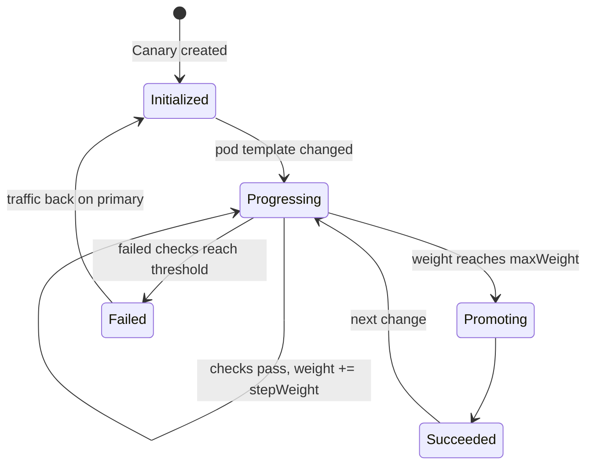

# 9. Progressive delivery with Flagger

> You end up with: a new podinfo version taking 10%, then 20%... of traffic
> through the Gateway, promoted if healthy and rolled back if not. With lesson
> 8, a mirrored tag becomes a canary release with no hands involved.

## What it is

Flagger is a controller from the Flux project. You point a `Canary` at a
Deployment, and from then on Flagger owns how changes to it reach traffic:

1. On the first run it copies your Deployment to `<name>-primary`, creates
   Services `<name>`, `<name>-primary` and `<name>-canary`, and an `HTTPRoute`
   sending everything to primary. Your own Deployment is scaled to zero.
2. When the pod template changes (a new image tag), Flagger scales your
   Deployment back up as the canary and shifts route weight to it in steps.
3. At each step it runs **webhooks** (load tests, smoke tests) and checks
   **metrics** against thresholds. Too many failures and it rolls back.
4. At `maxWeight` it copies the canary's spec to primary, sends all traffic
   there, and scales the canary to zero again.



| Kind | Says |
| --- | --- |
| `Canary` | Which Deployment, which Gateway and hostname, and the analysis: interval, steps, threshold, webhooks, metrics |
| `MetricTemplate` | A Prometheus query returning one number, such as the canary's error rate |

The **loadtester** is a small service from the same chart repository that
runs `hey` when a webhook calls it, so there's traffic to measure.

## On EKS

The same, against whatever implements Gateway API there (Cilium, or the AWS
Load Balancer Controller). Argo Rollouts is the Argo-world equivalent.

## Requirements

**In the cluster**: the Gateway (lesson 2), Prometheus from lesson 6 with
Hubble's `httpV2` metrics, and two podinfo tags in the local registry
(lesson 7).

**On your machine**: `kubectl`, `helm`, `flux`, `curl`, and `sofka`
or `k9s` ([lesson 0](00-tools.md)).

## Install by hand

A separate podinfo in namespace `canary-demo`, so the Flux-managed one isn't
touched.

### 1. Flagger and the loadtester

```yaml
# scratch/09/flagger-values.yaml
meshProvider: gatewayapi:v1
prometheus:
  install: false
metricsServer: http://kube-prometheus-stack-prometheus.monitoring:9090
```

```sh
helm --kube-context k3d-dev upgrade --install flagger flagger --repo https://flagger.app \
  --version 1.45.0 -n flagger-system --create-namespace -f scratch/09/flagger-values.yaml
helm --kube-context k3d-dev upgrade --install loadtester loadtester --repo https://flagger.app \
  --version 0.39.0 -n canary-demo --create-namespace
```

### 2. Something to canary

Flagger creates the Services, so podinfo's own is off:

```sh
helm --kube-context k3d-dev upgrade --install podinfo oci://ghcr.io/stefanprodan/charts/podinfo \
  --version 6.7.1 -n canary-demo --set service.enabled=false \
  --set image.repository=k3d-registry.localhost:5000/podinfo --set image.tag=6.7.0
```

### 3. The Canary

```yaml
# scratch/09/canary.yaml
apiVersion: flagger.app/v1beta1
kind: Canary
metadata:
  name: podinfo
  namespace: canary-demo
spec:
  targetRef:
    apiVersion: apps/v1
    kind: Deployment
    name: podinfo
  service:
    port: 9898
    hosts: [canary.kube.internal]
    gatewayRefs:
      - name: web
        namespace: gateway
  analysis:
    interval: 30s
    threshold: 3
    stepWeight: 10
    maxWeight: 50
    webhooks:
      - name: load
        url: http://loadtester.canary-demo/
        metadata:
          cmd: "hey -z 1m -q 10 -c 2 -host canary.kube.internal http://cilium-gateway-web.gateway/"
```

The load goes through the Gateway, not straight to the canary Service: Hubble
only records HTTP metrics for traffic Cilium's Envoy handles, and the
weighted split only happens there.

```sh
kubectl --context k3d-dev apply -f scratch/09/canary.yaml
```

```sh
kubectl --context k3d-dev get canaries -n canary-demo -w
kubectl --context k3d-dev get deploy,httproutes -n canary-demo
```

Wait for `Initialized`. Then `podinfo` is at 0, `podinfo-primary` is running,
and the route is Flagger's.

sofka / k9s: `:canaries -n canary-demo`, `:deploy -n canary-demo`,
`:httproutes -n canary-demo`

### 4. Release

```sh
helm --kube-context k3d-dev upgrade podinfo oci://ghcr.io/stefanprodan/charts/podinfo \
  --version 6.7.1 -n canary-demo --reuse-values --set image.tag=6.7.1
```

Watch the Canary progress with the `get canaries -w` above, and the weights
move with `kubectl --context k3d-dev -n canary-demo get httproute podinfo -o yaml`
(sofka / k9s: `d` on the route). In a second terminal:

```sh
while true; do curl -s -H 'Host: canary.kube.internal' http://10.89.0.200/ | jq -r .version; sleep 1; done
```

### 5. Iterate

| Try | Then look at |
| --- | --- |
| `stepWeight: 25`, release again | Fewer, bigger steps |
| Release with `--set faults.error=true` | No metrics yet, so nothing notices: it promotes. That's why step 6 exists. |
| A `MetricTemplate` (below) in `analysis.metrics`, then the faulty release again | Rolls back after `threshold` failed checks |

<details>
<summary>A MetricTemplate using Hubble's HTTP metrics</summary>

```yaml
# scratch/09/error-rate.yaml
apiVersion: flagger.app/v1beta1
kind: MetricTemplate
metadata:
  name: error-rate
  namespace: canary-demo
spec:
  provider:
    type: prometheus
    address: http://kube-prometheus-stack-prometheus.monitoring:9090
  query: |
    100 * sum(rate(hubble_http_requests_total{destination_namespace="canary-demo",destination_workload="podinfo",status=~"5.."}[1m]))
      /
    sum(rate(hubble_http_requests_total{destination_namespace="canary-demo",destination_workload="podinfo"}[1m]))
```

And in the Canary's `analysis`:

```yaml
    metrics:
      - name: error-rate
        templateRef:
          name: error-rate
        thresholdRange:
          max: 1
        interval: 1m
```

`destination_workload` and `destination_namespace` only exist with the
`labelsContext` option from lesson 6. Run the query in Prometheus first. It
counts the canary's share of traffic: Flagger's canary pods run as Deployment
`podinfo`, primary as `podinfo-primary`.

</details>

When it rolls back, ask why:

```sh
kubectl --context k3d-dev -n canary-demo events --for canary/podinfo
kubectl --context k3d-dev -n flagger-system logs deploy/flagger -f
```

sofka / k9s: `d` on the Canary; `:pods -n flagger-system`, `l`.

> [!TIP]
> A sofka extra ([lesson 0](00-tools.md)): open `:canaries -n canary-demo`
> before the faulty release. `T` on the Canary records each condition change
> with a timestamp, `E` gives Flagger's events for each failed check, and `T`
> on Deployment `podinfo` shows the canary scaling up and back to zero.

### 6. Clean up

```sh
kubectl --context k3d-dev delete -f scratch/09/
helm --kube-context k3d-dev uninstall -n canary-demo podinfo loadtester
helm --kube-context k3d-dev uninstall -n flagger-system flagger
kubectl --context k3d-dev delete namespace canary-demo
```

## Install with Flux

Now for the real podinfo, so lesson 8's commits become canaries.

| Kind | Name | File |
| --- | --- | --- |
| Namespace | `flagger-system` | `infrastructure/base/flagger/namespace.yaml` |
| HelmRepository | `flagger` | `infrastructure/base/flagger/source.yaml` |
| HelmRelease | `flagger` | `infrastructure/base/flagger/release.yaml` |
| ConfigMap | `flagger-values-base` | `infrastructure/base/flagger/values.yaml` |
| HelmRelease | `podinfo/loadtester` | `apps/base/podinfo/loadtester.yaml` |
| MetricTemplate | `podinfo/error-rate` | `apps/base/podinfo/metric-template.yaml` |
| Canary | `podinfo/podinfo` | `apps/local/podinfo/canary.yaml` (names the local hostname) |
| HTTPRoute, deleted | `podinfo/podinfo` | `apps/local/podinfo/route.yaml`: Flagger owns the route now |
| ConfigMap, changed | `podinfo-values-base` | `service.enabled: false` |

1. Flagger's values ConfigMap holds `scratch/09/flagger-values.yaml`.
2. The loadtester HelmRelease's `chart.spec.sourceRef` names the
   HelmRepository in another namespace: `{kind: HelmRepository, name:
   flagger, namespace: flagger-system}`.
3. The Canary is `scratch/09/canary.yaml` with namespace `podinfo`, host
   `podinfo.kube.internal`, the loadtester URL `http://loadtester.podinfo/`,
   and `-host podinfo.kube.internal` in its `cmd`. The MetricTemplate's query
   names namespace `podinfo`.
4. If podinfo's HelmRelease has drift detection on, stop it fighting Flagger
   over replicas:
   ```yaml
   spec:
     driftDetection:
       mode: enabled
       ignore:
         - paths: ["/spec/replicas"]
           target:
             kind: Deployment
   ```
5. Push Flagger first and wait for it to be `Ready`: the Canary and
   MetricTemplate kinds come from its chart.

## Exercises

1. Mirror a new tag (lesson 8 commits it) and watch the whole chain: commit,
   HelmRelease upgrade, canary analysis, promotion.
2. Ship `faults.error: true` through Git and watch the rollback. Then notice
   Git still says broken, and revert the commit.
3. Add a latency check from `hubble_http_request_duration_seconds`.
4. Harder: replace the weighted rollout with header-based A/B testing
   (`analysis.match` on a header, `iterations` instead of `maxWeight`), and
   route only `x-canary: true` traffic to the new version.

## Where it gets hard

- Flagger takes over the Deployment: traffic goes to `podinfo-primary`, and the
  Deployment you manage sits at zero replicas between releases. Expect that in
  every view of it.
- Flagger's built-in metrics for `gatewayapi` are written for Envoy's own
  metrics, which Cilium doesn't export. You write your own against Hubble's.
- Without traffic there's nothing to measure and analysis fails. That's the
  loadtester's job.
- A rollback reverts the cluster, not Git. Git still holds the bad version
  until you revert it.

## Links

- <https://docs.flagger.app/tutorials/gatewayapi-progressive-delivery>
- <https://docs.flagger.app/usage/metrics>
- <https://docs.cilium.io/en/stable/observability/metrics/>
