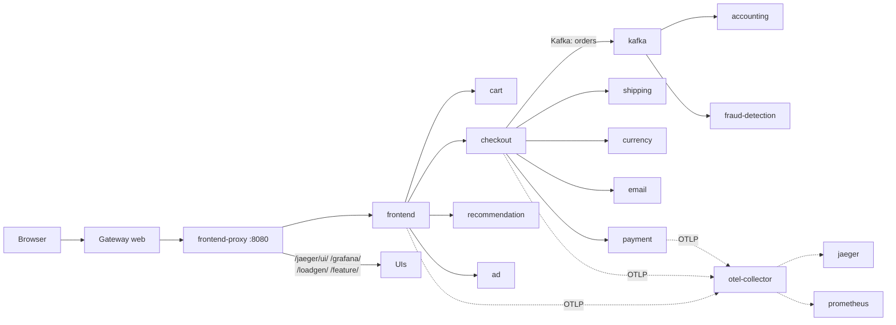

# 10. OpenTelemetry Demo (microservices)

> You end up with: a 20-service shop at `otel.kube.internal`, every request
> traceable from the browser through gRPC calls and a Kafka hop, and the same
> calls visible in Hubble.

## What it is

The OpenTelemetry community's demo shop. It exists to show a realistic
microservices estate with telemetry everywhere, so it's ideal to deploy and
take apart. One Helm chart installs:

| Part | What |
| --- | --- |
| Services | About 20, in a dozen languages: frontend, cart, checkout, payment, shipping, currency, recommendation, ad, email, quote, accounting, fraud-detection... |
| Protocols | HTTP and gRPC between services; Kafka topic `orders` from checkout to `accounting` and `fraud-detection` |
| `frontend-proxy` | Envoy in front of everything on port 8080, serving the shop and every UI under one hostname |
| `load-generator` | Locust, simulating shoppers |
| `flagd` | Feature flags that inject faults on demand |
| Telemetry | An OpenTelemetry Collector receiving traces, metrics and logs, with bundled Jaeger, Prometheus, Grafana and OpenSearch |



Every service sends **traces** to the collector over OTLP. A trace follows one
request across every service it touches; each hop is a span. That's what
makes this the right thing to learn microservices on: you can see them.

## On EKS

Any microservices estate, with the collector sending to AWS X-Ray, Amazon
Managed Prometheus or a vendor backend instead of the bundled Jaeger and
Prometheus.

## Requirements

**In the cluster**: Flux, the Gateway and ExternalDNS (lessons 2-3). About 6 GB
of free memory.

**On your machine**: `kubectl`, `helm`, `flux`, `hubble`, `curl`, and `sofka` or `k9s`
([lesson 0](00-tools.md)).

## By hand, for comparison

> [!NOTE]
> Read this, don't run it. Flux does the same from Git below.

By hand, the demo is one `helm` command with the chart's defaults, and a
route applied next to it:

**Example only: don't run it**
```sh
helm --kube-context k3d-dev upgrade --install otel-demo opentelemetry-demo \
  --repo https://open-telemetry.github.io/opentelemetry-helm-charts --version 0.42.4 \
  -n otel-demo --create-namespace
kubectl --context k3d-dev apply -f route.yaml
```

## Install with Flux

| Kind | Name | File |
| --- | --- | --- |
| Namespace | `otel-demo` | `~/repos/personal/kube_local/apps/base/otel-demo/namespace.yaml` |
| HelmRepository | `open-telemetry` | `~/repos/personal/kube_local/apps/base/otel-demo/source.yaml` |
| HelmRelease | `otel-demo` | `~/repos/personal/kube_local/apps/base/otel-demo/release.yaml` |
| ConfigMap | `otel-demo-values-base` | `~/repos/personal/kube_local/apps/base/otel-demo/values.yaml` |
| ConfigMap | `otel-demo-values-dev` | `~/repos/personal/kube_local/apps/dev/otel-demo/values.yaml` |
| HTTPRoute | `otel` | `~/repos/personal/kube_local/apps/base/otel-demo/route.yaml` |

### 1. The demo

Values you'd keep anywhere (components off, resources) go in base; hostnames,
root URLs and load in local. Both start empty: the chart's defaults.

```sh
mkdir -p ~/repos/personal/kube_local/apps/base/otel-demo ~/repos/personal/kube_local/apps/dev/otel-demo
```

**Write `~/repos/personal/kube_local/apps/base/otel-demo/namespace.yaml`**
```yaml
# ~/repos/personal/kube_local/apps/base/otel-demo/namespace.yaml
apiVersion: v1
kind: Namespace
metadata:
  name: otel-demo
```

**Write `~/repos/personal/kube_local/apps/base/otel-demo/source.yaml`**
```yaml
# ~/repos/personal/kube_local/apps/base/otel-demo/source.yaml
apiVersion: source.toolkit.fluxcd.io/v1
kind: HelmRepository
metadata:
  name: open-telemetry
  namespace: otel-demo
spec:
  interval: 1h
  url: https://open-telemetry.github.io/opentelemetry-helm-charts
```

**Write `~/repos/personal/kube_local/apps/base/otel-demo/release.yaml`**
```yaml
# ~/repos/personal/kube_local/apps/base/otel-demo/release.yaml
apiVersion: helm.toolkit.fluxcd.io/v2
kind: HelmRelease
metadata:
  name: otel-demo
  namespace: otel-demo
spec:
  interval: 10m
  chart:
    spec:
      chart: opentelemetry-demo
      version: 0.42.4
      sourceRef:
        kind: HelmRepository
        name: open-telemetry
  valuesFrom:
    - kind: ConfigMap
      name: otel-demo-values-base
    - kind: ConfigMap
      name: otel-demo-values-${CLUSTER_NAME}
```

**Write `~/repos/personal/kube_local/apps/base/otel-demo/values.yaml`**
```yaml
# ~/repos/personal/kube_local/apps/base/otel-demo/values.yaml
apiVersion: v1
kind: ConfigMap
metadata:
  name: otel-demo-values-base
  namespace: otel-demo
  labels:
    reconcile.fluxcd.io/watch: Enabled
data:
  values.yaml: "{}"
```

**Write `~/repos/personal/kube_local/apps/dev/otel-demo/values.yaml`**
```yaml
# ~/repos/personal/kube_local/apps/dev/otel-demo/values.yaml
apiVersion: v1
kind: ConfigMap
metadata:
  name: otel-demo-values-dev
  namespace: otel-demo
  labels:
    reconcile.fluxcd.io/watch: Enabled
data:
  values.yaml: "{}"
```

**Write `~/repos/personal/kube_local/apps/base/otel-demo/route.yaml`**
```yaml
# ~/repos/personal/kube_local/apps/base/otel-demo/route.yaml
apiVersion: gateway.networking.k8s.io/v1
kind: HTTPRoute
metadata:
  name: otel
  namespace: otel-demo
spec:
  parentRefs:
    - name: web
      namespace: gateway
  hostnames: [otel.${CLUSTER_DOMAIN}]
  rules:
    - backendRefs:
        - name: frontend-proxy
          port: 8080
```

### 2. Push and watch it come up

```sh
git -C ~/repos/personal/kube_local pull
git -C ~/repos/personal/kube_local add ~/repos/personal/kube_local/apps/
git -C ~/repos/personal/kube_local commit -m "OpenTelemetry demo"
git -C ~/repos/personal/kube_local push
flux --context k3d-dev reconcile kustomization flux-system --with-source
kubectl --context k3d-dev get pods -n otel-demo -w
```

A few minutes; Kafka is slowest.

```sh
kubectl --context k3d-dev get deploy,sts,jobs,svc -n otel-demo
```

The shape: every workload, and the Services between them. A `Pending` pod
says why in
`kubectl --context k3d-dev get events -n otel-demo --field-selector reason=FailedScheduling`.

sofka / k9s: `:pods otel-demo`, `ctrl-z` for stragglers, `d` on one. They
differ on the shape:

- sofka: `:workloads otel-demo` for every workload in one list; `:xray` from
  `:deploy otel-demo`. `X` on a `Pending` pod ([lesson 0](00-tools.md)).
- k9s: `:xray deploy otel-demo`.

ExternalDNS names the route. Open `https://otel.kube.internal/` for the shop,
and `/jaeger/ui/`, `/grafana/`, `/loadgen/`, `/feature/` for the rest.

## Iterate

First, look around; nothing here changes Git:

| Try | Then look at |
| --- | --- |
| In Jaeger, pick service `frontend`, find a `checkout` trace | Every span, including the Kafka hop to `accounting` |
| Turn on `paymentFailure` in `/feature/` | Red spans in Jaeger, errors in Grafana. Turn it off again there. |

The same calls from the network's side, with Hubble's port-forward running in
another terminal:

```sh
cilium --context k3d-dev hubble port-forward     # terminal 1, leave running
hubble observe -n otel-demo -f                    # terminal 2
```

`paymentFailure` from the inside:

```sh
kubectl --context k3d-dev -n otel-demo logs deploy/payment -f
```

sofka / k9s: `l` on `payment`. sofka extra: in the logs view, `J` cycles the
JSON lines through raw, record and pretty, and `ctrl-z` leaves only the errors.

Then change it through Git. New or changed lines sit between `# ── new ──` and
`# ── end new ──`.

### 1. Jaeger on its own hostname

Jaeger's Service is `jaeger`, port `16686`, and it serves under `/jaeger/ui`
because the chart sets that base path for the proxy. A second route in the
same file, kept from here on:

**Replace `~/repos/personal/kube_local/apps/base/otel-demo/route.yaml`**
```yaml
# ~/repos/personal/kube_local/apps/base/otel-demo/route.yaml
apiVersion: gateway.networking.k8s.io/v1
kind: HTTPRoute
metadata:
  name: otel
  namespace: otel-demo
spec:
  parentRefs:
    - name: web
      namespace: gateway
  hostnames: [otel.${CLUSTER_DOMAIN}]
  rules:
    - backendRefs:
        - name: frontend-proxy
          port: 8080
# ── new ──
---
apiVersion: gateway.networking.k8s.io/v1
kind: HTTPRoute
metadata:
  name: jaeger
  namespace: otel-demo
spec:
  parentRefs:
    - name: web
      namespace: gateway
  hostnames: [jaeger.otel.${CLUSTER_DOMAIN}]
  rules:
    - backendRefs:
        - name: jaeger
          port: 16686
# ── end new ──
```

```sh
git -C ~/repos/personal/kube_local pull
git -C ~/repos/personal/kube_local add ~/repos/personal/kube_local/apps/base/otel-demo/route.yaml
git -C ~/repos/personal/kube_local commit -m "otel-demo: Jaeger route"
git -C ~/repos/personal/kube_local push
flux --context k3d-dev reconcile kustomization apps-base --with-source
curl -s -o /dev/null -w '%{http_code}\n' http://jaeger.otel.kube.internal/jaeger/ui/
```

`200` once ExternalDNS has the name. `/` on its own 404s: the base path stays
`/jaeger/ui` unless you change it in values. It's plain HTTP: the wildcard
certificate covers one level, not `*.otel.kube.internal` (lesson 4).

### 2. More load

**Replace `~/repos/personal/kube_local/apps/dev/otel-demo/values.yaml`**
```yaml
# ~/repos/personal/kube_local/apps/dev/otel-demo/values.yaml
apiVersion: v1
kind: ConfigMap
metadata:
  name: otel-demo-values-dev
  namespace: otel-demo
  labels:
    reconcile.fluxcd.io/watch: Enabled
data:
  values.yaml: |
    # ── new ──
    components:
      load-generator:
        envOverrides:
          - name: LOCUST_USERS
            value: "50"
    # ── end new ──
```

```sh
git -C ~/repos/personal/kube_local pull
git -C ~/repos/personal/kube_local add ~/repos/personal/kube_local/apps/dev/otel-demo/values.yaml
git -C ~/repos/personal/kube_local commit -m "otel-demo: 50 users"
git -C ~/repos/personal/kube_local push
flux --context k3d-dev reconcile kustomization apps-dev --with-source
kubectl --context k3d-dev -n otel-demo set env deploy/load-generator --list | grep LOCUST_USERS
```

`LOCUST_USERS=50`, and more traffic everywhere. Back to the chart's 5:

**Replace `~/repos/personal/kube_local/apps/dev/otel-demo/values.yaml`**
```yaml
# ~/repos/personal/kube_local/apps/dev/otel-demo/values.yaml
apiVersion: v1
kind: ConfigMap
metadata:
  name: otel-demo-values-dev
  namespace: otel-demo
  labels:
    reconcile.fluxcd.io/watch: Enabled
data:
  # ── new ──
  values.yaml: "{}"
  # ── end new ──
```

```sh
git -C ~/repos/personal/kube_local pull
git -C ~/repos/personal/kube_local add ~/repos/personal/kube_local/apps/dev/otel-demo/values.yaml
git -C ~/repos/personal/kube_local commit -m "otel-demo: default load"
git -C ~/repos/personal/kube_local push
flux --context k3d-dev reconcile kustomization apps-dev --with-source
kubectl --context k3d-dev -n otel-demo set env deploy/load-generator --list | grep LOCUST_USERS
```

## Exercises

1. Take one page load and explain every service it touched, from the trace
   and from Hubble.
2. Turn on `kafkaQueueProblems` and find the lag in Grafana. Lesson 11 builds
   on this.
3. Once lesson 6 is in: turn off the bundled Prometheus and Grafana in base
   values and point the collector at yours.
4. Harder: lock the namespace down with CiliumNetworkPolicies, one service at a
   time, using Hubble to see what each one needs. Allow the `ingress` entity
   into `frontend-proxy`. Finish with a default-deny that the shop still works
   behind.

## Where it gets hard

- Check Service names with `get svc` rather than guessing; some depend on the
  release name.
- Grafana and Jaeger expect to be served under the proxy's paths. On their own
  hostname they may need root-URL settings in the values.
- Memory: OpenSearch and Kafka are the heavy ones. If pods are `Pending`, check
  `kubectl --context k3d-dev top nodes`. That's usage, but the scheduler places
  pods by requests: sofka's `:nodes` ([lesson 0](00-tools.md)) has `%CPU/R` and `%MEM/R`, the share of
  each node that pods have already asked for.
- The Kafka consumers lag when the load generator is busy. That's lesson 11.

## Links

- <https://opentelemetry.io/docs/demo/architecture/>
- <https://opentelemetry.io/docs/demo/kubernetes-deployment/>
- <https://opentelemetry.io/docs/demo/feature-flags/>
