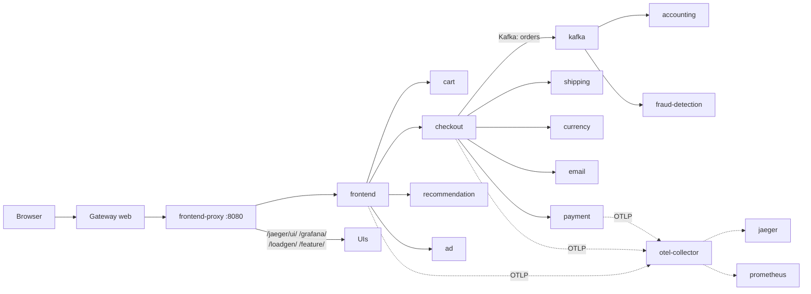

# 10. OpenTelemetry Demo (microservices)

> You end up with: a 20-service shop at `otel.kube.internal`, every request
> traceable from the browser through gRPC calls and a Kafka hop, and the same
> calls visible in Hubble.

## What it is

The OpenTelemetry community's demo shop. It exists to show a realistic
microservices estate with telemetry everywhere, so it's ideal to deploy and
take apart. One Helm chart installs:

| Part | What |
| --- | --- |
| Services | About 20, in a dozen languages: frontend, cart, checkout, payment, shipping, currency, recommendation, ad, email, quote, accounting, fraud-detection... |
| Protocols | HTTP and gRPC between services; Kafka topic `orders` from checkout to `accounting` and `fraud-detection` |
| `frontend-proxy` | Envoy in front of everything on port 8080, serving the shop and every UI under one hostname |
| `load-generator` | Locust, simulating shoppers |
| `flagd` | Feature flags that inject faults on demand |
| Telemetry | An OpenTelemetry Collector receiving traces, metrics and logs, with bundled Jaeger, Prometheus, Grafana and OpenSearch |



Every service sends **traces** to the collector over OTLP. A trace follows one
request across every service it touches; each hop is a span. That's what
makes this the right thing to learn microservices on: you can see them.

## On EKS

Any microservices estate, with the collector sending to AWS X-Ray, Amazon
Managed Prometheus or a vendor backend instead of the bundled Jaeger and
Prometheus.

## Requirements

**In the cluster**: Flux, the Gateway and ExternalDNS (lessons 2-3). About 6 GB
of free memory.

**On your machine**: `kubectl`, `helm`, `flux`, `hubble`, `curl`, `k9s`, `sofka`.

## Install by hand

### 1. Defaults first

```sh
helm --kube-context k3d-dev upgrade --install otel-demo opentelemetry-demo \
  --repo https://open-telemetry.github.io/opentelemetry-helm-charts --version 0.42.4 \
  -n otel-demo --create-namespace
```

k9s `:pods -n otel-demo` until everything is running (a few minutes; Kafka is
slowest). `:xray deploy otel-demo` shows the shape.

### 2. A route to the proxy

```yaml
# scratch/10/route.yaml
apiVersion: gateway.networking.k8s.io/v1
kind: HTTPRoute
metadata:
  name: otel
  namespace: otel-demo
spec:
  parentRefs:
    - name: web
      namespace: gateway
  hostnames: [otel.kube.internal]
  rules:
    - backendRefs:
        - name: frontend-proxy
          port: 8080
```

```sh
kubectl --context k3d-dev apply -f scratch/10/route.yaml
```

ExternalDNS names it. Open `http(s)://otel.kube.internal/` for the shop, and
`/jaeger/ui/`, `/grafana/`, `/loadgen/`, `/feature/` for the rest.

### 3. Iterate

| Try | Then look at |
| --- | --- |
| In Jaeger, pick service `frontend`, find a `checkout` trace | Every span, including the Kafka hop to `accounting` |
| `hubble observe -n otel-demo -f` (with the port-forward from lesson 1) | The same calls from the network's side |
| Turn on `paymentFailure` in `/feature/` | Red spans in Jaeger, errors in Grafana. Turn it off. |
| A second rule in the route: hostname `jaeger.otel.kube.internal` straight to the Jaeger Service | Find its name and port in `:svc -n otel-demo`. It may need its base path changed in values to work outside the proxy. |
| A values file with `components.load-generator.envOverrides: [{name: LOCUST_USERS, value: "50"}]`, then `helm upgrade ... --reuse-values -f` it | More traffic everywhere |

**Where to look**

| Check | kubectl | k9s | sofka |
| --- | --- | --- | --- |
| Everything running | `kubectl --context k3d-dev get pods -n otel-demo` | `:pods -n otel-demo`, `ctrl-z` for stragglers | `:pods -n otel-demo`, `ctrl-z` for stragglers |
| Every workload in one list | `kubectl --context k3d-dev get deploy,sts,jobs -n otel-demo` | `:deploy -n otel-demo` | `:workloads otel-demo` |
| The shape | `kubectl --context k3d-dev get deploy,svc -n otel-demo` | `:xray deploy otel-demo` | `:deploy -n otel-demo`, then `:xray` |
| Service names and ports | `kubectl --context k3d-dev get svc -n otel-demo` | `:svc -n otel-demo` | `:svc -n otel-demo` |
| `paymentFailure` from the inside | `kubectl --context k3d-dev -n otel-demo logs deploy/payment -f` | `l` on `payment` | `l`, `J` to lay out its JSON logs, `ctrl-z` for errors |
| Why a pod is `Pending` | `kubectl --context k3d-dev -n otel-demo describe pod <name>` | `d` | `X` |

### 4. Clean up

```sh
kubectl --context k3d-dev delete -f scratch/10/route.yaml
helm --kube-context k3d-dev uninstall otel-demo -n otel-demo
kubectl --context k3d-dev delete namespace otel-demo
```

## Install with Flux

| Kind | Name | File |
| --- | --- | --- |
| Namespace | `otel-demo` | `apps/base/otel-demo/namespace.yaml` |
| HelmRepository | `open-telemetry` | `apps/base/otel-demo/source.yaml` |
| HelmRelease | `otel-demo` | `apps/base/otel-demo/release.yaml` |
| ConfigMap | `otel-demo-values-base` | `apps/base/otel-demo/values.yaml` |
| ConfigMap | `otel-demo-values-local` | `apps/local/otel-demo/values.yaml` |
| HTTPRoute | `otel` | `apps/local/otel-demo/route.yaml` |

1. HelmRepository `url:
   https://open-telemetry.github.io/opentelemetry-helm-charts`; HelmRelease
   `chart: opentelemetry-demo`, `version: 0.42.4`.
2. Values: settings you'd keep anywhere (components off, resources) in base;
   hostnames and root URLs in local. Both can start as `values.yaml: "{}"`.
3. The route is `scratch/10/route.yaml`, unchanged.

## Exercises

1. Take one page load and explain every service it touched, from the trace
   and from Hubble.
2. Turn on `kafkaQueueProblems` and find the lag in Grafana. Lesson 11 builds
   on this.
3. Once lesson 6 is in: turn off the bundled Prometheus and Grafana in base
   values and point the collector at yours.
4. Harder: lock the namespace down with CiliumNetworkPolicies, one service at a
   time, using Hubble to see what each one needs. Allow the `ingress` entity
   into `frontend-proxy`. Finish with a default-deny that the shop still works
   behind.

## Where it gets hard

- Check Service names in `:svc` rather than guessing; some depend on the
  release name.
- Grafana and Jaeger expect to be served under the proxy's paths. On their own
  hostname they may need root-URL settings in the values.
- Memory: OpenSearch and Kafka are the heavy ones. If pods are `Pending`, check
  `kubectl --context k3d-dev top nodes`. That's usage, but the scheduler places
  pods by requests: sofka's `:nodes` has `%CPU/R` and `%MEM/R`, the share of
  each node that pods have already asked for.
- The Kafka consumers lag when the load generator is busy. That's lesson 11.

## Links

- <https://opentelemetry.io/docs/demo/architecture/>
- <https://opentelemetry.io/docs/demo/kubernetes-deployment/>
- <https://opentelemetry.io/docs/demo/feature-flags/>
