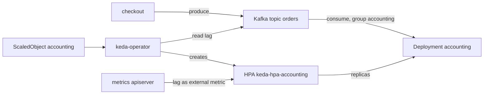

# 11. Event-driven scaling with KEDA

> You end up with: the shop's `accounting` consumer scaling out when Kafka lag
> builds up and back in when it clears, instead of on CPU.

## What it is

The Horizontal Pod Autoscaler scales on metrics the cluster already has,
usually CPU. A queue worker's real signal is how much work is waiting, which
lives outside Kubernetes. **KEDA** bridges that: it reads event sources
(Kafka lag, SQS depth, a Prometheus query, a cron schedule) and feeds them to
an HPA it manages for you.

| Piece | Does |
| --- | --- |
| `ScaledObject` | "Scale this Deployment on these triggers, between min and max replicas" |
| Scaler | One per trigger type. The `kafka` scaler reads a consumer group's lag. |
| keda-operator | Creates and owns the HPA, and scales between 0 and 1 itself |
| keda-operator-metrics-apiserver | Serves the trigger values to the HPA through the external metrics API |



The split matters: the HPA does 1 to N; only KEDA can go to and from 0,
because an HPA can't scale something with no pods to measure.

## On EKS

KEDA on SQS queue depth or MSK consumer lag is the standard pattern for queue
workers, with the scaler authenticating through an IAM role
(`TriggerAuthentication` with `podIdentity`).

## Requirements

**In the cluster**: the OpenTelemetry Demo in `otel-demo` (lesson 10), and
`metrics-server` (k3s ships it; `kubectl --context k3d-dev top nodes` works).

**On your machine**: `kubectl`, `helm`, `flux`, and `sofka`
or `k9s` ([lesson 0](00-tools.md)).

## Install by hand

### 1. KEDA

```sh
helm --kube-context k3d-dev upgrade --install keda keda --repo https://kedacore.github.io/charts \
  --version 2.21.0 -n keda --create-namespace
```

KEDA's defaults are fine.

```sh
kubectl --context k3d-dev get pods -n keda
```

The operator, the metrics apiserver and the admission webhooks.

sofka / k9s: `:pods -n keda`

### 2. Find the consumer

Its replica count, then the topic's partitions. The Kafka tools live in
`/opt/kafka/bin`, which isn't on the image's PATH:

```sh
kubectl --context k3d-dev get deploy accounting -n otel-demo
kubectl --context k3d-dev -n otel-demo exec deploy/kafka -- \
  /opt/kafka/bin/kafka-topics.sh --describe --topic orders --bootstrap-server localhost:9092
kubectl --context k3d-dev -n otel-demo exec deploy/kafka -- \
  /opt/kafka/bin/kafka-consumer-groups.sh --list --bootstrap-server localhost:9092
```

sofka / k9s: `:deploy -n otel-demo`, then `:pods -n otel-demo`, `s` on
`kafka`.

Partitions are the ceiling: one consumer per partition at most.

### 3. The ScaledObject

**Write `scratch/11/scaledobject.yaml`**
```yaml
# scratch/11/scaledobject.yaml
apiVersion: keda.sh/v1alpha1
kind: ScaledObject
metadata:
  name: accounting
  namespace: otel-demo
spec:
  scaleTargetRef:
    name: accounting
  minReplicaCount: 1
  maxReplicaCount: 3
  cooldownPeriod: 60
  triggers:
    - type: kafka
      metadata:
        bootstrapServers: kafka.otel-demo.svc:9092
        consumerGroup: accounting
        topic: orders
        lagThreshold: "10"
```

```sh
kubectl --context k3d-dev apply -f scratch/11/scaledobject.yaml
```

```sh
kubectl --context k3d-dev get scaledobjects -n otel-demo -w
kubectl --context k3d-dev -n otel-demo get hpa keda-hpa-accounting -w
```

The ScaledObject goes `READY True`, then `keda-hpa-accounting` appears,
created for you.

sofka / k9s: `:scaledobjects -n otel-demo`, then `:hpa -n otel-demo`. sofka
extra ([lesson 0](00-tools.md)): `X` on the ScaledObject if it isn't ready.

### 4. Iterate

Scaling as it happens, and what the operator thinks of it:

```sh
kubectl --context k3d-dev -n otel-demo get deploy accounting -w
kubectl --context k3d-dev -n keda logs deploy/keda-operator -f
```

sofka / k9s: `:deploy -n otel-demo`; `:pods -n keda`, `l` on `keda-operator`.
sofka extras: `T` on `accounting` timestamps each replica change, and
`ctrl-z` in the logs leaves only the errors.

| Try | Then look at |
| --- | --- |
| Raise the users at `/loadgen/`, or turn on `kafkaQueueProblems` in `/feature/` | `kubectl --context k3d-dev -n otel-demo get hpa keda-hpa-accounting -w`: the current value climbs, and `accounting` scales out |
| Drop the load the same way | Scale-in after `cooldownPeriod` and the HPA's own stabilisation |

The rest edit `scratch/11/scaledobject.yaml`, each with the load up. New or
changed lines sit between `# ── new ──` and `# ── end new ──`.

<details>
<summary>1. A lower lag threshold</summary>

**Replace `scratch/11/scaledobject.yaml`**
```yaml
# scratch/11/scaledobject.yaml
apiVersion: keda.sh/v1alpha1
kind: ScaledObject
metadata:
  name: accounting
  namespace: otel-demo
spec:
  scaleTargetRef:
    name: accounting
  minReplicaCount: 1
  maxReplicaCount: 3
  cooldownPeriod: 60
  triggers:
    - type: kafka
      metadata:
        bootstrapServers: kafka.otel-demo.svc:9092
        consumerGroup: accounting
        topic: orders
        # ── new ──
        lagThreshold: "2"
        # ── end new ──
```

```sh
kubectl --context k3d-dev apply -f scratch/11/scaledobject.yaml
kubectl --context k3d-dev -n otel-demo get hpa keda-hpa-accounting -w
```

It scales out much sooner. Put it back:

**Replace `scratch/11/scaledobject.yaml`**
```yaml
# scratch/11/scaledobject.yaml
apiVersion: keda.sh/v1alpha1
kind: ScaledObject
metadata:
  name: accounting
  namespace: otel-demo
spec:
  scaleTargetRef:
    name: accounting
  minReplicaCount: 1
  maxReplicaCount: 3
  cooldownPeriod: 60
  triggers:
    - type: kafka
      metadata:
        bootstrapServers: kafka.otel-demo.svc:9092
        consumerGroup: accounting
        topic: orders
        # ── new ──
        lagThreshold: "10"
        # ── end new ──
```

```sh
kubectl --context k3d-dev apply -f scratch/11/scaledobject.yaml
```

</details>

<details>
<summary>2. More consumers than partitions</summary>

Above the partition count from step 2:

**Replace `scratch/11/scaledobject.yaml`**
```yaml
# scratch/11/scaledobject.yaml
apiVersion: keda.sh/v1alpha1
kind: ScaledObject
metadata:
  name: accounting
  namespace: otel-demo
spec:
  scaleTargetRef:
    name: accounting
  minReplicaCount: 1
  # ── new ──
  maxReplicaCount: 6
  # ── end new ──
  cooldownPeriod: 60
  triggers:
    - type: kafka
      metadata:
        bootstrapServers: kafka.otel-demo.svc:9092
        consumerGroup: accounting
        topic: orders
        lagThreshold: "10"
```

```sh
kubectl --context k3d-dev apply -f scratch/11/scaledobject.yaml
kubectl --context k3d-dev -n otel-demo get deploy accounting -w
kubectl --context k3d-dev -n otel-demo exec deploy/kafka -- \
  /opt/kafka/bin/kafka-consumer-groups.sh --describe --group accounting --bootstrap-server localhost:9092
```

The extra consumers sit idle, with no partition next to them, and lag doesn't
fall faster. Put it back:

**Replace `scratch/11/scaledobject.yaml`**
```yaml
# scratch/11/scaledobject.yaml
apiVersion: keda.sh/v1alpha1
kind: ScaledObject
metadata:
  name: accounting
  namespace: otel-demo
spec:
  scaleTargetRef:
    name: accounting
  minReplicaCount: 1
  # ── new ──
  maxReplicaCount: 3
  # ── end new ──
  cooldownPeriod: 60
  triggers:
    - type: kafka
      metadata:
        bootstrapServers: kafka.otel-demo.svc:9092
        consumerGroup: accounting
        topic: orders
        lagThreshold: "10"
```

```sh
kubectl --context k3d-dev apply -f scratch/11/scaledobject.yaml
```

</details>

<details>
<summary>3. Scale to zero</summary>

**Replace `scratch/11/scaledobject.yaml`**
```yaml
# scratch/11/scaledobject.yaml
apiVersion: keda.sh/v1alpha1
kind: ScaledObject
metadata:
  name: accounting
  namespace: otel-demo
spec:
  scaleTargetRef:
    name: accounting
  # ── new ──
  minReplicaCount: 0
  # ── end new ──
  maxReplicaCount: 3
  cooldownPeriod: 60
  triggers:
    - type: kafka
      metadata:
        bootstrapServers: kafka.otel-demo.svc:9092
        consumerGroup: accounting
        topic: orders
        lagThreshold: "10"
```

```sh
kubectl --context k3d-dev apply -f scratch/11/scaledobject.yaml
kubectl --context k3d-dev -n otel-demo get deploy accounting -w
```

It scales to zero when idle. Work out what happens to orders meanwhile. Put
it back:

**Replace `scratch/11/scaledobject.yaml`**
```yaml
# scratch/11/scaledobject.yaml
apiVersion: keda.sh/v1alpha1
kind: ScaledObject
metadata:
  name: accounting
  namespace: otel-demo
spec:
  scaleTargetRef:
    name: accounting
  # ── new ──
  minReplicaCount: 1
  # ── end new ──
  maxReplicaCount: 3
  cooldownPeriod: 60
  triggers:
    - type: kafka
      metadata:
        bootstrapServers: kafka.otel-demo.svc:9092
        consumerGroup: accounting
        topic: orders
        lagThreshold: "10"
```

```sh
kubectl --context k3d-dev apply -f scratch/11/scaledobject.yaml
```

</details>

### 5. Clean up

```sh
kubectl --context k3d-dev delete -f scratch/11/scaledobject.yaml
helm --kube-context k3d-dev uninstall keda -n keda
```

Deleting the ScaledObject leaves `accounting` at whatever replica count it had.

## Install with Flux

| Kind | Name | File |
| --- | --- | --- |
| Namespace | `keda` | `infrastructure/base/keda/namespace.yaml` |
| HelmRepository | `kedacore` | `infrastructure/base/keda/source.yaml` |
| HelmRelease | `keda` | `infrastructure/base/keda/release.yaml` |
| ScaledObject | `otel-demo/accounting` | `apps/base/otel-demo/scaledobject.yaml` |

No values ConfigMaps: defaults.

<details>
<summary>Files to write: KEDA</summary>

**Write `infrastructure/base/keda/namespace.yaml`**
```yaml
# infrastructure/base/keda/namespace.yaml
apiVersion: v1
kind: Namespace
metadata:
  name: keda
```

**Write `infrastructure/base/keda/source.yaml`**
```yaml
# infrastructure/base/keda/source.yaml
apiVersion: source.toolkit.fluxcd.io/v1
kind: HelmRepository
metadata:
  name: kedacore
  namespace: keda
spec:
  interval: 1h
  url: https://kedacore.github.io/charts
```

**Write `infrastructure/base/keda/release.yaml`**
```yaml
# infrastructure/base/keda/release.yaml
apiVersion: helm.toolkit.fluxcd.io/v2
kind: HelmRelease
metadata:
  name: keda
  namespace: keda
spec:
  interval: 10m
  chart:
    spec:
      chart: keda
      version: 2.21.0
      sourceRef:
        kind: HelmRepository
        name: kedacore
```

</details>

The ScaledObject, unchanged from `scratch/11/`:

**Write `apps/base/otel-demo/scaledobject.yaml`**
```yaml
# apps/base/otel-demo/scaledobject.yaml
apiVersion: keda.sh/v1alpha1
kind: ScaledObject
metadata:
  name: accounting
  namespace: otel-demo
spec:
  scaleTargetRef:
    name: accounting
  minReplicaCount: 1
  maxReplicaCount: 3
  cooldownPeriod: 60
  triggers:
    - type: kafka
      metadata:
        bootstrapServers: kafka.otel-demo.svc:9092
        consumerGroup: accounting
        topic: orders
        lagThreshold: "10"
```

Push KEDA first and wait for `Ready`: `apps-base` can't apply the
ScaledObject until KEDA's CRDs exist, and nothing else in `apps-base` applies
meanwhile.

```sh
git add infrastructure/
git commit -m "KEDA with Flux"
git push
flux --context k3d-dev reconcile kustomization flux-system --with-source
kubectl --context k3d-dev get helmreleases -n keda -w
```

Then the ScaledObject:

```sh
git add apps/
git commit -m "Scale accounting on Kafka lag"
git push
flux --context k3d-dev reconcile kustomization flux-system --with-source
kubectl --context k3d-dev get scaledobjects -n otel-demo -w
```

## Exercises

1. Explain the numbers in `describe hpa` (or `d`): target, current, and how KEDA turned
   lag into them.
2. Add a second trigger, `cron`, holding 2 replicas during "business hours".
   KEDA takes the maximum of all triggers.
3. Watch `accounting` scale while Chaos Mesh (lesson 14) kills its pods.
4. Harder: the same scaling from a `prometheus` trigger on the demo's own
   Kafka metrics instead of the `kafka` scaler, and compare how quickly each
   reacts.

## Where it gets hard

- Flux and KEDA both want to set replicas. If the demo's HelmRelease has drift
  detection on, ignore `/spec/replicas` for Deployments (lesson 9), or they
  fight.
- Don't add your own HPA for the same Deployment; KEDA owns it.
- Consumers beyond the partition count do nothing.
- A wrong `bootstrapServers` or `consumerGroup` doesn't fail loudly: the
  ScaledObject goes not-ready and the reason is in the keda-operator's logs.
  sofka's `X` on the ScaledObject ([lesson 0](00-tools.md)) shows its `Ready` message first, which is
  often enough.

## Links

- <https://keda.sh/docs/latest/concepts/scaling-deployments/>
- <https://keda.sh/docs/latest/scalers/apache-kafka/>
- <https://fluxcd.io/flux/components/helm/helmreleases/#drift-detection>
