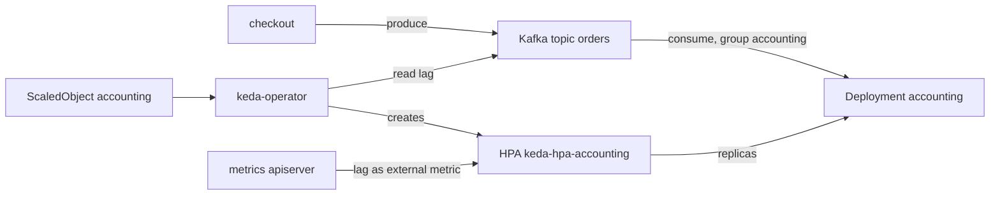

# 11. Event-driven scaling with KEDA

> You end up with: the shop's `accounting` consumer scaling out when Kafka lag
> builds up and back in when it clears, instead of on CPU.

## What it is

The Horizontal Pod Autoscaler scales on metrics the cluster already has,
usually CPU. A queue worker's real signal is how much work is waiting, which
lives outside Kubernetes. **KEDA** bridges that: it reads event sources
(Kafka lag, SQS depth, a Prometheus query, a cron schedule) and feeds them to
an HPA it manages for you.

| Piece | Does |
| --- | --- |
| `ScaledObject` | "Scale this Deployment on these triggers, between min and max replicas" |
| Scaler | One per trigger type. The `kafka` scaler reads a consumer group's lag. |
| keda-operator | Creates and owns the HPA, and scales between 0 and 1 itself |
| keda-operator-metrics-apiserver | Serves the trigger values to the HPA through the external metrics API |



The split matters: the HPA does 1 to N; only KEDA can go to and from 0,
because an HPA can't scale something with no pods to measure.

## On EKS

KEDA on SQS queue depth or MSK consumer lag is the standard pattern for queue
workers, with the scaler authenticating through an IAM role
(`TriggerAuthentication` with `podIdentity`).

## Requirements

**In the cluster**: the OpenTelemetry Demo in `otel-demo` (lesson 10), and
`metrics-server` (k3s ships it; `kubectl --context k3d-dev top nodes` works).

**On your machine**: `kubectl`, `helm`, `flux`, `k9s`, `sofka`.

## Install by hand

### 1. KEDA

```sh
helm --kube-context k3d-dev upgrade --install keda keda --repo https://kedacore.github.io/charts \
  --version 2.21.0 -n keda --create-namespace
```

KEDA's defaults are fine. k9s `:pods -n keda`: the operator, the metrics
apiserver and the admission webhooks.

### 2. Find the consumer

k9s `:deploy -n otel-demo`: `accounting` and its replica count. Then the
topic's partitions, from a shell in the Kafka pod (`:pods -n otel-demo`, `s`
on `kafka`):

```sh
# in the pod shell
kafka-topics.sh --describe --topic orders --bootstrap-server localhost:9092
```

If it isn't on the PATH, `find / -name kafka-topics.sh 2>/dev/null`.
Partitions are the ceiling: one consumer per partition at most.

### 3. The ScaledObject

```yaml
# scratch/11/scaledobject.yaml
apiVersion: keda.sh/v1alpha1
kind: ScaledObject
metadata:
  name: accounting
  namespace: otel-demo
spec:
  scaleTargetRef:
    name: accounting
  minReplicaCount: 1
  maxReplicaCount: 3
  cooldownPeriod: 60
  triggers:
    - type: kafka
      metadata:
        bootstrapServers: kafka.otel-demo.svc:9092
        consumerGroup: accounting
        topic: orders
        lagThreshold: "10"
```

```sh
kubectl --context k3d-dev apply -f scratch/11/scaledobject.yaml
```

`:scaledobjects -n otel-demo` until `READY True`, then `:hpa -n otel-demo`:
`keda-hpa-accounting`, created for you.

### 4. Iterate

| Try | Then look at |
| --- | --- |
| Raise the users at `/loadgen/`, or turn on `kafkaQueueProblems` | The HPA's current value climbs; `:deploy` scales out |
| Drop the load | Scale-in after `cooldownPeriod` and the HPA's own stabilisation |
| `lagThreshold: "2"` | Scales out much sooner |
| `maxReplicaCount` above the partition count | The extra consumers sit idle; lag doesn't fall faster |
| `minReplicaCount: 0` | It scales to zero when idle. Work out what happens to orders meanwhile. |

**Where to look**

| Check | kubectl | k9s | sofka |
| --- | --- | --- | --- |
| KEDA's pods | `kubectl --context k3d-dev get pods -n keda` | `:pods -n keda` | `:pods -n keda` |
| A shell in Kafka | `kubectl --context k3d-dev -n otel-demo exec -it deploy/kafka -- sh` | `:pods -n otel-demo`, `s` on `kafka` | The same |
| ScaledObject ready | `kubectl --context k3d-dev get scaledobjects -n otel-demo` | `:scaledobjects -n otel-demo` | `:scaledobjects -n otel-demo`, `X` if not |
| The HPA KEDA made | `kubectl --context k3d-dev -n otel-demo get hpa keda-hpa-accounting -w` | `:hpa -n otel-demo` | `:hpa -n otel-demo` |
| Scaling as it happens | `kubectl --context k3d-dev -n otel-demo get deploy accounting -w` | `:deploy -n otel-demo` | `T` on `accounting`: each replica change, timestamped |
| What the operator says | `kubectl --context k3d-dev -n keda logs deploy/keda-operator -f` | `:pods -n keda`, `l` on `keda-operator` | `:deploy -n keda`, `l` on `keda-operator`, `ctrl-z` |

### 5. Clean up

```sh
kubectl --context k3d-dev delete -f scratch/11/scaledobject.yaml
helm --kube-context k3d-dev uninstall keda -n keda
```

Deleting the ScaledObject leaves `accounting` at whatever replica count it had.

## Install with Flux

| Kind | Name | File |
| --- | --- | --- |
| Namespace | `keda` | `infrastructure/base/keda/namespace.yaml` |
| HelmRepository | `kedacore` | `infrastructure/base/keda/source.yaml` |
| HelmRelease | `keda` | `infrastructure/base/keda/release.yaml` |
| ScaledObject | `otel-demo/accounting` | `apps/base/otel-demo/scaledobject.yaml` |

No values ConfigMaps: defaults. The ScaledObject is `scratch/11/scaledobject.yaml`
unchanged. Push KEDA first and wait for `Ready`: `apps-base` can't apply the
ScaledObject until KEDA's CRDs exist, and nothing else in `apps-base` applies
meanwhile.

## Exercises

1. Explain the numbers in `d` on the HPA: target, current, and how KEDA turned
   lag into them.
2. Add a second trigger, `cron`, holding 2 replicas during "business hours".
   KEDA takes the maximum of all triggers.
3. Watch `accounting` scale while Chaos Mesh (lesson 14) kills its pods.
4. Harder: the same scaling from a `prometheus` trigger on the demo's own
   Kafka metrics instead of the `kafka` scaler, and compare how quickly each
   reacts.

## Where it gets hard

- Flux and KEDA both want to set replicas. If the demo's HelmRelease has drift
  detection on, ignore `/spec/replicas` for Deployments (lesson 9), or they
  fight.
- Don't add your own HPA for the same Deployment; KEDA owns it.
- Consumers beyond the partition count do nothing.
- A wrong `bootstrapServers` or `consumerGroup` doesn't fail loudly: the
  ScaledObject goes not-ready and the reason is in the keda-operator's logs.
  sofka's `X` on the ScaledObject shows its `Ready` message first, which is
  often enough.

## Links

- <https://keda.sh/docs/latest/concepts/scaling-deployments/>
- <https://keda.sh/docs/latest/scalers/apache-kafka/>
- <https://fluxcd.io/flux/components/helm/helmreleases/#drift-detection>
