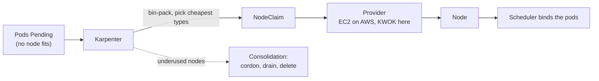

# 12. Karpenter on simulated nodes

> You end up with: Karpenter creating and removing nodes as pods come and go,
> making the same decisions it would on EKS, on fake nodes that cost nothing.

## What it is

Karpenter is a node autoscaler. When pods can't be scheduled, it works out
what nodes would fit them, picks the cheapest instance types that do, and
creates them. When nodes are underused, it moves pods off and removes them
(**consolidation**). Unlike the Cluster Autoscaler, it doesn't scale fixed
node groups: it chooses each node's shape per decision.

| Kind | Says |
| --- | --- |
| `NodePool` | What nodes may be created: requirements (arch, zones, instance families), taints, a CPU/memory limit, and disruption rules |
| `NodeClass` | Cloud-specific settings for those nodes. `EC2NodeClass` on AWS (AMI, subnets, security groups); `KWOKNodeClass` here |
| `NodeClaim` | One node Karpenter decided to create. It becomes a `Node` once the provider delivers it |



**KWOK** (Kubernetes WithOut Kubelet) fakes nodes: they register, report
capacity and show pods as running, but nothing actually runs. Karpenter's KWOK
provider uses it in place of EC2, with a catalogue of made-up instance types.

> [!IMPORTANT]
> This is the one lesson without a published chart or image. There's no
> released KWOK build of Karpenter: you build its image from source with `ko`,
> push it to the local registry, and install the chart from the source tree.

## On EKS

Karpenter with the AWS provider, its published chart, an `EC2NodeClass`, and
an IAM role to launch instances. The `NodePool` and disruption behaviour you
learn here carry over unchanged.

## Requirements

**In the cluster**: the local registry (lesson 7), and Flux for the Flux part.

**On your machine**: `git`, `go`, `ko`, `kwok`, `make`, `kubectl`, `helm`,
`flux`, and `sofka` or `k9s` ([lesson 0](00-tools.md)).

## Install by hand

Steps 1 to 4 run in a clone of Karpenter, outside this repo. Its Makefile uses
your *current* context, so set it first:

```sh
kubectl config use-context k3d-dev
git clone https://github.com/kubernetes-sigs/karpenter ~/repos/karpenter
```

### 1. A version that supports Kubernetes 1.36

```sh
# in the karpenter clone
git tag --sort=-v:refname | grep -E '^v[0-9]+\.[0-9]+\.[0-9]+$' | head
KARPENTER_VERSION=$(git tag --sort=-v:refname | grep -E '^v[0-9]+\.[0-9]+\.[0-9]+$' | head -1)
echo "$KARPENTER_VERSION"
```

Check the compatibility matrix in its docs supports 1.36 at that version. If
it doesn't, set `KARPENTER_VERSION` to one from the list that does. Then:

```sh
# in the karpenter clone
git checkout "$KARPENTER_VERSION"
```

### 2. The KWOK controller

```sh
# in the karpenter clone
make install-kwok
```

### 3. Build and push the image

```sh
# in the karpenter clone
KO_DOCKER_REPO=localhost:5050/karpenter ko build -B --tags "$KARPENTER_VERSION" \
  --insecure-registry sigs.k8s.io/karpenter/kwok
DIGEST=$(skopeo inspect --tls-verify=false \
  docker://localhost:5050/karpenter/kwok:"$KARPENTER_VERSION" | jq -r .Digest)
echo "$DIGEST"
```

The image is tagged with the Karpenter version, and `DIGEST` pins it.

### 4. Install the chart

These are the settings from the Makefile's `HELM_OPTS` and `install-kwok`
target, as a values file:

```yaml
# ~/repos/karpenter/karpenter-values.yaml
logLevel: debug
settings:
  preferencePolicy: Ignore
  featureGates:
    nodeRepair: true
    capacityBuffer: true
    staticCapacity: true
controller:
  image:
    repository: k3d-registry.localhost:5000/karpenter/kwok   # the name pods pull by
  resources:
    requests: {cpu: 500m, memory: 512Mi}
    limits: {memory: 1Gi}
```

```sh
# in the karpenter clone
kubectl --context k3d-dev apply -f kwok/charts/crds
helm --kube-context k3d-dev upgrade --install karpenter kwok/charts -n kube-system \
  --skip-crds -f karpenter-values.yaml \
  --set controller.image.tag="$KARPENTER_VERSION" \
  --set controller.image.digest="$DIGEST"
```

### 5. A node class and a pool

Back in this repo. The taint keeps everything that doesn't ask for fake nodes
off them:

**Write `scratch/12/nodepool.yaml`**
```yaml
# scratch/12/nodepool.yaml
apiVersion: karpenter.kwok.sh/v1alpha1
kind: KWOKNodeClass
metadata:
  name: default
---
apiVersion: karpenter.sh/v1
kind: NodePool
metadata:
  name: default
spec:
  template:
    spec:
      nodeClassRef:
        group: karpenter.kwok.sh
        kind: KWOKNodeClass
        name: default
      taints:
        - key: kwok
          effect: NoSchedule
      requirements:
        - key: kubernetes.io/arch
          operator: In
          values: [amd64]
  limits:
    cpu: 64
```

### 6. Something to schedule

**Write `scratch/12/inflate.yaml`**
```yaml
# scratch/12/inflate.yaml
apiVersion: apps/v1
kind: Deployment
metadata:
  name: inflate
  namespace: default
spec:
  replicas: 0
  selector:
    matchLabels:
      app: inflate
  template:
    metadata:
      labels:
        app: inflate
    spec:
      nodeSelector:
        karpenter.sh/nodepool: default
      tolerations:
        - key: kwok
          operator: Exists
          effect: NoSchedule
      containers:
        - name: pause
          image: registry.k8s.io/pause:3.10
          resources:
            requests:
              cpu: "1"
```

```sh
kubectl --context k3d-dev apply -f scratch/12/nodepool.yaml -f scratch/12/inflate.yaml
kubectl --context k3d-dev -n default scale deployment inflate --replicas 20
```

```sh
kubectl --context k3d-dev get nodeclaims,nodes -w
kubectl --context k3d-dev describe nodeclaims
```

Nodes appear, and each NodeClaim shows the instance type Karpenter chose and
why.

sofka / k9s: `:nodeclaims`, `:nodes`, `d` on a NodeClaim

### 7. Iterate

When pods stay `Pending`, find them, ask why, and see what each node has
promised and what Karpenter thinks:

```sh
kubectl --context k3d-dev -n default get pods --field-selector=status.phase=Pending
kubectl --context k3d-dev -n default describe pods -l app=inflate
kubectl --context k3d-dev describe nodes -l karpenter.sh/nodepool=default   # Allocated resources
kubectl --context k3d-dev -n kube-system logs deploy/karpenter -f
```

sofka / k9s: `ctrl-z` on `:pods -n default`, `d` on a pod or node;
`:pods -n kube-system`, `l` on `karpenter`. sofka extras: `X` on a pod, and
`:nodes` has `%CPU/R`.

> [!TIP]
> A sofka extra ([lesson 0](00-tools.md)): `X` on a node checks Ready,
> cordon, taints and pod capacity. On a fake node it shows the `kwok` taint,
> and during consolidation, the cordon Karpenter put on before draining it.

Steps 2 to 4 edit `scratch/12/nodepool.yaml`, each building on the last. New
or changed lines sit between `# ── new ──` and `# ── end new ──`.

#### 1. Scale down

```sh
kubectl --context k3d-dev -n default scale deployment inflate --replicas 2
kubectl --context k3d-dev get nodeclaims,nodes -w
```

Consolidation removes nodes, after `consolidateAfter`.

#### 2. Only empty nodes go

**Replace `scratch/12/nodepool.yaml`**
```yaml
# scratch/12/nodepool.yaml
apiVersion: karpenter.kwok.sh/v1alpha1
kind: KWOKNodeClass
metadata:
  name: default
---
apiVersion: karpenter.sh/v1
kind: NodePool
metadata:
  name: default
spec:
  template:
    spec:
      nodeClassRef:
        group: karpenter.kwok.sh
        kind: KWOKNodeClass
        name: default
      taints:
        - key: kwok
          effect: NoSchedule
      requirements:
        - key: kubernetes.io/arch
          operator: In
          values: [amd64]
  # ── new ──
  disruption:
    consolidationPolicy: WhenEmpty
    consolidateAfter: 30s
  # ── end new ──
  limits:
    cpu: 64
```

```sh
kubectl --context k3d-dev apply -f scratch/12/nodepool.yaml
kubectl --context k3d-dev -n default scale deployment inflate --replicas 20
kubectl --context k3d-dev get nodeclaims,nodes -w
```

Once the nodes are up:

```sh
kubectl --context k3d-dev -n default scale deployment inflate --replicas 2
kubectl --context k3d-dev get nodeclaims,nodes -w
```

Empty nodes go; half-empty ones stay.

#### 3. A CPU limit on the pool

**Replace `scratch/12/nodepool.yaml`**
```yaml
# scratch/12/nodepool.yaml
apiVersion: karpenter.kwok.sh/v1alpha1
kind: KWOKNodeClass
metadata:
  name: default
---
apiVersion: karpenter.sh/v1
kind: NodePool
metadata:
  name: default
spec:
  template:
    spec:
      nodeClassRef:
        group: karpenter.kwok.sh
        kind: KWOKNodeClass
        name: default
      taints:
        - key: kwok
          effect: NoSchedule
      requirements:
        - key: kubernetes.io/arch
          operator: In
          values: [amd64]
  disruption:
    consolidationPolicy: WhenEmpty
    consolidateAfter: 30s
  limits:
    # ── new ──
    cpu: 8
    # ── end new ──
```

```sh
kubectl --context k3d-dev apply -f scratch/12/nodepool.yaml
kubectl --context k3d-dev -n default scale deployment inflate --replicas 20
kubectl --context k3d-dev -n default get pods --field-selector=status.phase=Pending
kubectl --context k3d-dev get events -A --field-selector involvedObject.kind=NodePool
```

Some pods stay `Pending`, and the events say the limit was hit. Back to 64:

**Replace `scratch/12/nodepool.yaml`**
```yaml
# scratch/12/nodepool.yaml
apiVersion: karpenter.kwok.sh/v1alpha1
kind: KWOKNodeClass
metadata:
  name: default
---
apiVersion: karpenter.sh/v1
kind: NodePool
metadata:
  name: default
spec:
  template:
    spec:
      nodeClassRef:
        group: karpenter.kwok.sh
        kind: KWOKNodeClass
        name: default
      taints:
        - key: kwok
          effect: NoSchedule
      requirements:
        - key: kubernetes.io/arch
          operator: In
          values: [amd64]
  disruption:
    consolidationPolicy: WhenEmpty
    consolidateAfter: 30s
  limits:
    # ── new ──
    cpu: 64
    # ── end new ──
```

```sh
kubectl --context k3d-dev apply -f scratch/12/nodepool.yaml
```

#### 4. One node at a time

**Replace `scratch/12/nodepool.yaml`**
```yaml
# scratch/12/nodepool.yaml
apiVersion: karpenter.kwok.sh/v1alpha1
kind: KWOKNodeClass
metadata:
  name: default
---
apiVersion: karpenter.sh/v1
kind: NodePool
metadata:
  name: default
spec:
  template:
    spec:
      nodeClassRef:
        group: karpenter.kwok.sh
        kind: KWOKNodeClass
        name: default
      taints:
        - key: kwok
          effect: NoSchedule
      requirements:
        - key: kubernetes.io/arch
          operator: In
          values: [amd64]
  disruption:
    consolidationPolicy: WhenEmpty
    consolidateAfter: 30s
    # ── new ──
    budgets:
      - nodes: "1"
    # ── end new ──
  limits:
    cpu: 64
```

```sh
kubectl --context k3d-dev apply -f scratch/12/nodepool.yaml
kubectl --context k3d-dev -n default scale deployment inflate --replicas 20
kubectl --context k3d-dev get nodeclaims,nodes -w
```

Once the nodes are up:

```sh
kubectl --context k3d-dev -n default scale deployment inflate --replicas 2
kubectl --context k3d-dev get nodeclaims,nodes -w
```

Consolidation removes one node at a time. Put the NodePool back as it was in
step 5:

**Replace `scratch/12/nodepool.yaml`**
```yaml
# scratch/12/nodepool.yaml
apiVersion: karpenter.kwok.sh/v1alpha1
kind: KWOKNodeClass
metadata:
  name: default
---
apiVersion: karpenter.sh/v1
kind: NodePool
metadata:
  name: default
spec:
  template:
    spec:
      nodeClassRef:
        group: karpenter.kwok.sh
        kind: KWOKNodeClass
        name: default
      taints:
        - key: kwok
          effect: NoSchedule
      requirements:
        - key: kubernetes.io/arch
          operator: In
          values: [amd64]
  limits:
    cpu: 64
```

```sh
kubectl --context k3d-dev apply -f scratch/12/nodepool.yaml
```

### 8. Clean up

```sh
kubectl --context k3d-dev delete -f scratch/12/inflate.yaml
kubectl --context k3d-dev delete -f scratch/12/nodepool.yaml   # wait for nodes to go
helm --kube-context k3d-dev uninstall karpenter -n kube-system
```

Leave the KWOK controller and the image; Flux reuses them.

## Install with Flux

Everything is local: on EKS you'd use the AWS provider's published chart
instead.

| Kind | Name | File |
| --- | --- | --- |
| GitRepository | `kube-system/karpenter` | `infrastructure/local/karpenter/source.yaml` |
| HelmRelease | `kube-system/karpenter` | `infrastructure/local/karpenter/release.yaml` |
| ConfigMap | `kube-system/karpenter-values-local` | `infrastructure/local/karpenter/values.yaml` |
| KWOKNodeClass, NodePool | `default` | `infrastructure/local-config/karpenter/nodepool.yaml` |
| KWOK controller, image | | Stay by hand: steps 2 and 3 after a rebuild |

1. The chart comes from Git, not a chart repository, at the tag from step 1.
   Flux installs the chart's `crds/` itself. The values ConfigMap holds
   `karpenter-values.yaml` plus the image's tag and digest.
   The tag and digest come from your build, so set them again (a new shell
   loses them) and write the source and values from them, in this repo's root:

   ```sh
   KARPENTER_VERSION=$(git -C ~/repos/karpenter describe --tags --exact-match)
   DIGEST=$(skopeo inspect --tls-verify=false \
     docker://localhost:5050/karpenter/kwok:"$KARPENTER_VERSION" | jq -r .Digest)
   mkdir -p infrastructure/local/karpenter
   ```

   **Write `infrastructure/local/karpenter/source.yaml`**
   ```sh
   cat > infrastructure/local/karpenter/source.yaml <<EOF
   # infrastructure/local/karpenter/source.yaml
   apiVersion: source.toolkit.fluxcd.io/v1
   kind: GitRepository
   metadata:
     name: karpenter
     namespace: kube-system
   spec:
     interval: 1h
     url: https://github.com/kubernetes-sigs/karpenter
     ref:
       tag: ${KARPENTER_VERSION}
   EOF
   ```

   **Write `infrastructure/local/karpenter/values.yaml`**
   ```sh
   cat > infrastructure/local/karpenter/values.yaml <<EOF
   # infrastructure/local/karpenter/values.yaml
   apiVersion: v1
   kind: ConfigMap
   metadata:
     name: karpenter-values-local
     namespace: kube-system
     labels:
       reconcile.fluxcd.io/watch: Enabled
   data:
     values.yaml: |
       logLevel: debug
       settings:
         preferencePolicy: Ignore
         featureGates:
           nodeRepair: true
           capacityBuffer: true
           staticCapacity: true
       controller:
         image:
           repository: k3d-registry.localhost:5000/karpenter/kwok   # the name pods pull by
           tag: ${KARPENTER_VERSION}
           digest: ${DIGEST}
         resources:
           requests: {cpu: 500m, memory: 512Mi}
           limits: {memory: 1Gi}
   EOF
   ```

   ```sh
   cat infrastructure/local/karpenter/source.yaml infrastructure/local/karpenter/values.yaml
   ```

   The release has nothing build-specific:

   **Write `infrastructure/local/karpenter/release.yaml`**
   ```yaml
   # infrastructure/local/karpenter/release.yaml
   apiVersion: helm.toolkit.fluxcd.io/v2
   kind: HelmRelease
   metadata:
     name: karpenter
     namespace: kube-system
   spec:
     interval: 10m
     chart:
       spec:
         chart: ./kwok/charts
         sourceRef:
           kind: GitRepository
           name: karpenter
     valuesFrom:
       - kind: ConfigMap
         name: karpenter-values-local
   ```

2. The NodePool needs Karpenter's CRDs, so it goes in `infra-local-config`
   (lesson 4), unchanged from `scratch/12/`:

   **Write `infrastructure/local-config/karpenter/nodepool.yaml`**
   ```yaml
   # infrastructure/local-config/karpenter/nodepool.yaml
   apiVersion: karpenter.kwok.sh/v1alpha1
   kind: KWOKNodeClass
   metadata:
     name: default
   ---
   apiVersion: karpenter.sh/v1
   kind: NodePool
   metadata:
     name: default
   spec:
     template:
       spec:
         nodeClassRef:
           group: karpenter.kwok.sh
           kind: KWOKNodeClass
           name: default
         taints:
           - key: kwok
             effect: NoSchedule
         requirements:
           - key: kubernetes.io/arch
             operator: In
             values: [amd64]
     limits:
       cpu: 64
   ```

3. `inflate` stays in `scratch/`: it's a test load, not something to keep.

## Exercises

1. Explain why Karpenter chose the instance types it did for 20 pods of 1 CPU,
   then for 20 pods of 3 CPU.
2. Two NodePools with different `weight`s and requirements, and see which wins.
3. Spread `inflate` across zones with a `topologySpreadConstraint`, and watch
   Karpenter create nodes in each.
4. Harder: set `expireAfter: 5m` on the NodePool and watch drift and
   expiration replace nodes while a PodDisruptionBudget limits how many
   `inflate` pods can be down at once.

## Where it gets hard

- The name ko pushes (`localhost:5050/...`) isn't the one pods pull
  (`k3d-registry.localhost:5000/...`). Same image, two hosts.
- DaemonSets that tolerate every taint (Cilium's agent, for one) land on the
  fake nodes and show as running. Ignore them.
- Keep real workloads off fake nodes: they'd be "running" nowhere. The taint
  does that.
- Delete NodePools and NodeClaims before uninstalling, or their finalizers
  hang.
- Versions must line up: the Karpenter tag, its KWOK provider and Kubernetes
  1.36.

## Links

- <https://karpenter.sh/docs/concepts/>
- <https://github.com/kubernetes-sigs/karpenter/tree/main/kwok>
- <https://karpenter.sh/docs/concepts/disruption/>
- <https://kwok.sigs.k8s.io/>
