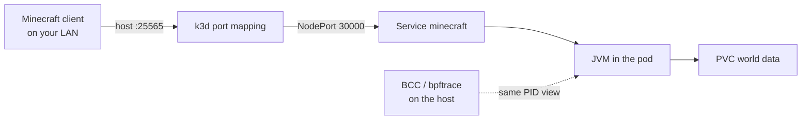

# 13. Minecraft (Java)

> You end up with: a Minecraft server you and friends can join, and a flame
> graph of what its JVM spends time on, taken with BPF from the host.

## What it is

A real stateful JVM workload, with players to make load. The
`itzg/minecraft-server` image downloads and runs the server jar; its Helm
chart adds the Service, a PersistentVolumeClaim for the world, and an RCON
side door for console commands.

| Piece | What |
| --- | --- |
| Deployment, one replica | One server process, `java ... minecraft_server` |
| PVC | The world, on k3s `local-path` storage on one node |
| Service | Port 25565. Here a NodePort, because k3d maps host 25565 to node port 30000 |
| RCON | Remote console on a second port, used by `rcon-cli` inside the pod |



It's here for the BPF Performance Tools book. Rootful Podman shares the
host's PID view, so the JVM is an ordinary process to tools on your machine.

## On EKS

Nothing Minecraft-specific. The same chart would use a `LoadBalancer` Service
(an NLB) and an EBS volume. The profiling technique applies to any JVM
service.

## Requirements

**In the cluster**: Flux (lesson 2). About 3 GB of spare memory. Host port
25565 is already mapped to node port 30000 by the dotfiles k3d config.

**On your machine**

| Tool | Why |
| --- | --- |
| `kubectl`, `helm`, `flux`, `git` | As usual |
| `sofka` or `k9s` | [Lesson 0](00-tools.md) |
| `bpftrace`, BCC tools in `/usr/share/bcc/tools/` | Profiling. The dotfiles `bpf` step, then a reboot. |
| A Minecraft Java client | Joining |

## Install by hand

### 1. Values

```yaml
# scratch/13/values-base.yaml
minecraftServer:
  eula: "TRUE"          # you accept the Minecraft EULA
  type: VANILLA
  version: "26.3"
  memory: 2048M
  jvmXXOpts: "-XX:+PreserveFramePointer"   # keeps stacks walkable for BPF
resources:
  requests: {cpu: 500m, memory: 2560Mi}
  limits: {memory: 3Gi}
persistence:
  dataDir:
    enabled: true
    Size: 5Gi           # capital S in this chart
```

```yaml
# scratch/13/values-local.yaml
minecraftServer:
  serviceType: NodePort
  nodePort: 30000
```

### 2. Install and join

```sh
helm --kube-context k3d-dev upgrade --install minecraft minecraft \
  --repo https://itzg.github.io/minecraft-server-charts/ --version 5.2.0 \
  -n minecraft --create-namespace -f scratch/13/values-base.yaml -f scratch/13/values-local.yaml
```

```sh
kubectl --context k3d-dev -n minecraft logs deploy/minecraft -f
```

The first start downloads the server jar, so pods need working external DNS.
When it logs `Done`, join from a client at this machine's LAN address, port
25565.

sofka / k9s: `:pods -n minecraft`, `l`

### 3. The console

```sh
kubectl --context k3d-dev -n minecraft exec -it deploy/minecraft -- rcon-cli list
kubectl --context k3d-dev -n minecraft exec -it deploy/minecraft -- rcon-cli tps
```

sofka / k9s: `s` on the pod, then `rcon-cli list` and `rcon-cli tps`.

### 4. Iterate

| Try | Then look at |
| --- | --- |
| `memory: 1024M` | Startup time and `rcon-cli tps` under load |
| `limits.memory` below heap plus overhead (`2304Mi` with a 2048M heap) | An OOM kill under load: `describe pod` shows `OOMKilled` under `Last State` |
| Delete the pod | The world survives on the PVC |
| `helm uninstall` then reinstall | Does the world survive? Check the PVC's reclaim behaviour |

Memory against the limit, and the world on its PVC:

```sh
kubectl --context k3d-dev -n minecraft top pod
kubectl --context k3d-dev get pvc -n minecraft
```

sofka / k9s: `d` on the pod for `OOMKilled`; `:pvc -n minecraft`. They differ
on memory:

- sofka: `⏎` on the pod shows memory as a share of request and limit, with a
  five-minute trend; `X` says `OOMKilled`; `x` on the PVC browses its files
  through the server pod ([lesson 0](00-tools.md)).
- k9s: the `%MEM/L` column in `:pods -n minecraft`.

### 5. Clean up

```sh
helm --kube-context k3d-dev uninstall minecraft -n minecraft
kubectl --context k3d-dev delete namespace minecraft   # deletes the world
```

## Install with Flux

| Kind | Name | File |
| --- | --- | --- |
| Namespace | `minecraft` | `apps/base/minecraft/namespace.yaml` |
| HelmRepository | `itzg` | `apps/base/minecraft/source.yaml` |
| HelmRelease | `minecraft` | `apps/base/minecraft/release.yaml` |
| ConfigMap | `minecraft-values-base` | `apps/base/minecraft/values.yaml` |
| ConfigMap | `minecraft-values-local` | `apps/local/minecraft/values.yaml` |

HelmRepository `url: https://itzg.github.io/minecraft-server-charts/`;
HelmRelease `chart: minecraft`, `version: 5.2.0`. The ConfigMaps hold the two
scratch files: the NodePort is local because the port mapping is k3d's.

## Profiling

This is the hard part, so it comes last. All of it runs on your machine.

1. Find the JVM. `^java` matters: without it `pgrep` matches the wrapper
   process:
   ```sh
   PID=$(pgrep -f '^java .*minecraft_server')
   ```
2. Where it waits, rather than where it runs:
   ```sh
   sudo /usr/share/bcc/tools/offcputime -p "$PID" 10
   ```
3. A CPU profile in folded format, 49 Hz for 30 seconds, while someone plays:
   ```sh
   sudo /usr/share/bcc/tools/profile -p "$PID" -F 49 -f 30 > mc.folded
   ```
4. Java frames show as hex: the JIT-compiled code has no symbols. Have the JVM
   write a perf map, then put it where BCC looks on the host:
   ```sh
   # in the pod shell
   jcmd 1 Compiler.perfmap
   ```
   ```sh
   sudo cp /proc/$PID/root/tmp/perf-1.map /tmp/perf-$PID.map
   ```
   Inside the container the JVM is PID 1, so it wrote `perf-1.map`; BCC wants
   the host PID. Run step 3 again.
5. A flame graph:
   ```sh
   git clone https://github.com/brendangregg/FlameGraph ~/repos/FlameGraph
   ~/repos/FlameGraph/flamegraph.pl mc.folded > mc.svg
   cp mc.svg ~/Downloads/   # Zen can only open files from there
   ```
6. Watch an OOM kill as it happens: lower the memory limit in base values,
   push, add load, and run `sudo /usr/share/bcc/tools/oomkill`. Compare what
   the cluster records: `describe pod` (or sofka's `X`) says `OOMKilled`, `oomkill`
   says which process the kernel chose and how big it was.

## Exercises

1. Compare `tps` with 1 and 5 players, and find the difference in the flame
   graph.
2. `sudo /usr/share/bcc/tools/biolatency 10` while the world saves.
3. Harder: count the JVM's syscalls by type for 10 seconds, then explain the
   top three:
   ```sh
   sudo bpftrace -e "tracepoint:syscalls:sys_enter_* /pid == $PID/ { @[probe] = count(); } interval:s:10 { exit(); }"
   ```

## Where it gets hard

- Port 25565 is reachable from your LAN. That's how friends join, and also
  anyone else on the network.
- The world lives on one node's disk and goes with the cluster.
- Heap (`memory`) plus JVM overhead must fit under the limit, or it's
  OOM-killed under load rather than at start.
- The perf map is a snapshot: methods compiled after `jcmd` ran show as hex
  until you run it again.

## Links

- <https://github.com/itzg/minecraft-server-charts>
- <https://docker-minecraft-server.readthedocs.io/>
- <https://www.brendangregg.com/bpf-performance-tools-book.html>
- <https://github.com/brendangregg/FlameGraph>
