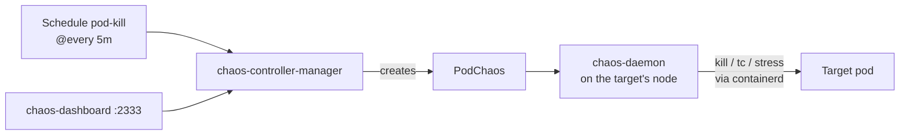

# 14. Chaos Mesh with an on/off switch

> You end up with: scheduled experiments that kill pods, add latency and burn
> CPU in the shop, all switched on and off by one value in Git.

## What it is

Chaos engineering is breaking things on purpose, on a schedule, to find out
what copes before a real failure does it for you. Netflix's Chaos Monkey
started it by killing instances at random. **Chaos Mesh** does the same inside
Kubernetes, with an experiment kind per kind of failure:

| Kind | Breaks |
| --- | --- |
| `PodChaos` | Kills pods or containers, or makes them fail |
| `NetworkChaos` | Adds latency, loss, duplication or a partition between pods |
| `StressChaos` | Burns CPU or memory inside a container |
| `IOChaos`, `TimeChaos`, `DNSChaos`... | Slow disks, skewed clocks, wrong DNS answers |
| `Schedule` | Runs any of the above on a cron schedule |



The controller decides what to break; a privileged **chaos-daemon** on every
node does it, reaching containers through the container runtime. A `Schedule`
is paused when it carries `experiment.chaos-mesh.org/pause: "true"`; any other
value runs it. That's the switch this lesson builds.

## On EKS

AWS Fault Injection Service for AWS-level faults (terminate instances, throttle
APIs), or Chaos Mesh/Litmus on EKS for pod-level ones. On EKS the runtime is
containerd at its default socket, so the k3s socket setting below goes away.

## Requirements

**In the cluster**: Flux (lesson 2) and something worth breaking: the
OpenTelemetry Demo (lesson 10) shows failures clearly in Jaeger and Grafana.

**On your machine**: `kubectl`, `helm`, `flux`, `git`, and `sofka`
or `k9s` ([lesson 0](00-tools.md)).

## Install by hand

### 1. Chaos Mesh

**`scratch/14/values-local.yaml`**
```yaml
# scratch/14/values-local.yaml
chaosDaemon:
  runtime: containerd
  socketPath: /run/k3s/containerd/containerd.sock   # k3s's, not the default
dashboard:
  securityMode: false   # no login; local only
```

```sh
helm --kube-context k3d-dev upgrade --install chaos-mesh chaos-mesh --repo https://charts.chaos-mesh.org \
  --version 2.8.5 -n chaos-mesh --create-namespace -f scratch/14/values-local.yaml
```

```sh
kubectl --context k3d-dev get pods -n chaos-mesh
kubectl --context k3d-dev -n chaos-mesh port-forward svc/chaos-dashboard 2333
```

The controller, the dashboard, and a `chaos-daemon` on every node. The UI is
on <http://localhost:2333>.

sofka / k9s: `:pods -n chaos-mesh`; forward on `:svc -n chaos-mesh` with sofka
`f`, k9s `Shift-f`.

### 2. One experiment, once

Before scheduling anything, kill one pod by hand:

**`scratch/14/pod-kill.yaml`**
```yaml
# scratch/14/pod-kill.yaml
apiVersion: chaos-mesh.org/v1alpha1
kind: PodChaos
metadata:
  name: kill-one
  namespace: otel-demo
spec:
  action: pod-kill
  mode: one
  selector:
    namespaces: [otel-demo]
    labelSelectors:
      app.kubernetes.io/component: cart
```

```sh
kubectl --context k3d-dev apply -f scratch/14/pod-kill.yaml
```

```sh
kubectl --context k3d-dev get pods -n otel-demo -w
kubectl --context k3d-dev -n otel-demo describe podchaos kill-one
```

A `cart` pod restarts, and the PodChaos shows the record.

sofka / k9s: `:pods -n otel-demo`, `d` on the PodChaos.

A one-off experiment runs once. To run it again, delete it and re-apply:

```sh
kubectl --context k3d-dev delete -f scratch/14/pod-kill.yaml
kubectl --context k3d-dev apply -f scratch/14/pod-kill.yaml
```

### 3. Iterate

Steps 1 to 3 edit `scratch/14/pod-kill.yaml`, each building on the last, and
re-create the experiment. New or changed lines sit between `# ── new ──` and
`# ── end new ──`.

<details>
<summary>1. No label selector</summary>

The same file with `labelSelectors` removed:

**`scratch/14/pod-kill.yaml`**
```yaml
# scratch/14/pod-kill.yaml
apiVersion: chaos-mesh.org/v1alpha1
kind: PodChaos
metadata:
  name: kill-one
  namespace: otel-demo
spec:
  action: pod-kill
  mode: one
  selector:
    namespaces: [otel-demo]
```

```sh
kubectl --context k3d-dev delete -f scratch/14/pod-kill.yaml
kubectl --context k3d-dev apply -f scratch/14/pod-kill.yaml
kubectl --context k3d-dev get pods -n otel-demo -w
```

A random demo pod dies each time. Which ones does the shop notice?

</details>

<details>
<summary>2. Half the namespace</summary>

**`scratch/14/pod-kill.yaml`**
```yaml
# scratch/14/pod-kill.yaml
apiVersion: chaos-mesh.org/v1alpha1
kind: PodChaos
metadata:
  name: kill-one
  namespace: otel-demo
spec:
  action: pod-kill
  # ── new ──
  mode: fixed-percent
  value: "50"
  # ── end new ──
  selector:
    namespaces: [otel-demo]
```

```sh
kubectl --context k3d-dev delete -f scratch/14/pod-kill.yaml
kubectl --context k3d-dev apply -f scratch/14/pod-kill.yaml
kubectl --context k3d-dev get pods -n otel-demo -w
```

Half the namespace at once.

</details>

<details>
<summary>3. Kill a container, not the pod</summary>

**`scratch/14/pod-kill.yaml`**
```yaml
# scratch/14/pod-kill.yaml
apiVersion: chaos-mesh.org/v1alpha1
kind: PodChaos
metadata:
  name: kill-one
  namespace: otel-demo
spec:
  # ── new ──
  action: container-kill
  # ── end new ──
  # ── new ──
  mode: one
  # ── end new ──
  # ── new ──
  containerNames: [cart]
  # ── end new ──
  selector:
    namespaces: [otel-demo]
    # ── new ──
    labelSelectors:
      app.kubernetes.io/component: cart
    # ── end new ──
```

```sh
kubectl --context k3d-dev delete -f scratch/14/pod-kill.yaml
kubectl --context k3d-dev apply -f scratch/14/pod-kill.yaml
kubectl --context k3d-dev get pods -n otel-demo -w
kubectl --context k3d-dev -n otel-demo get pods -l app.kubernetes.io/component=cart
```

The container restarts (`RESTARTS` goes up); the pod survives. Put the file
back as it was in "One experiment, once":

**`scratch/14/pod-kill.yaml`**
```yaml
# scratch/14/pod-kill.yaml
apiVersion: chaos-mesh.org/v1alpha1
kind: PodChaos
metadata:
  name: kill-one
  namespace: otel-demo
spec:
  # ── new ──
  action: pod-kill
  # ── end new ──
  mode: one
  selector:
    namespaces: [otel-demo]
    labelSelectors:
      app.kubernetes.io/component: cart
```

</details>

<details>
<summary>4. 200ms latency on cart for two minutes</summary>

**`scratch/14/latency.yaml`**
```yaml
# scratch/14/latency.yaml
apiVersion: chaos-mesh.org/v1alpha1
kind: NetworkChaos
metadata:
  name: cart-latency
  namespace: otel-demo
spec:
  action: delay
  mode: all
  selector:
    namespaces: [otel-demo]
    labelSelectors:
      app.kubernetes.io/component: cart
  delay:
    latency: 200ms
  duration: 2m
```

```sh
kubectl --context k3d-dev apply -f scratch/14/latency.yaml
kubectl --context k3d-dev -n otel-demo describe networkchaos cart-latency
```

Slow spans in Jaeger for the next two minutes. It stops on its own; remove
the record:

```sh
kubectl --context k3d-dev delete -f scratch/14/latency.yaml
```

</details>

If a selector matches nothing, check the label:

```sh
kubectl --context k3d-dev -n otel-demo get pods -l app.kubernetes.io/component=cart
kubectl --context k3d-dev get events -n otel-demo --sort-by=.lastTimestamp
```

The second is what broke, in order.

sofka / k9s: `:pods -n otel-demo`, `/-l app.kubernetes.io/component=cart`.
What broke: sofka `T` on `cart`'s Deployment; k9s `:events -n otel-demo`.

> [!TIP]
> A sofka extra ([lesson 0](00-tools.md)), and where its timeline earns its
> keep. Open `:workloads otel-demo` before you flip the switch: `ctrl-z` keeps
> only what's hurt right now, `T` on a Deployment says when it lost pods and
> when it had them back, and `:bundle` on it writes the incident up for you.

### 4. Clean up

```sh
kubectl --context k3d-dev delete -f scratch/14/ --ignore-not-found
helm --kube-context k3d-dev uninstall chaos-mesh -n chaos-mesh
```

## Install with Flux

| Kind | Name | File |
| --- | --- | --- |
| Namespace | `chaos-mesh` | `infrastructure/base/chaos-mesh/namespace.yaml` |
| HelmRepository | `chaos-mesh` | `infrastructure/base/chaos-mesh/source.yaml` |
| HelmRelease | `chaos-mesh` | `infrastructure/base/chaos-mesh/release.yaml` |
| ConfigMap | `chaos-mesh-values-local` | `infrastructure/local/chaos-mesh/values.yaml` |
| HTTPRoute | `chaos-mesh/dashboard` | `infrastructure/local/chaos-mesh/route.yaml` |
| Kustomization | `flux-system/chaos` | `clusters/dev/chaos.yaml` |
| Namespace, Schedules | `chaos` | `chaos/*.yaml` |

1. **The chart.** The HelmRelease reads only the local ConfigMap, which holds
   `scratch/14/values-local.yaml` unchanged.
   <details>
   <summary>Chaos Mesh as Flux files</summary>

   **`infrastructure/base/chaos-mesh/namespace.yaml`**
   ```yaml
   # infrastructure/base/chaos-mesh/namespace.yaml
   apiVersion: v1
   kind: Namespace
   metadata:
     name: chaos-mesh
   ```

   **`infrastructure/base/chaos-mesh/source.yaml`**
   ```yaml
   # infrastructure/base/chaos-mesh/source.yaml
   apiVersion: source.toolkit.fluxcd.io/v1
   kind: HelmRepository
   metadata:
     name: chaos-mesh
     namespace: chaos-mesh
   spec:
     interval: 1h
     url: https://charts.chaos-mesh.org
   ```

   **`infrastructure/base/chaos-mesh/release.yaml`**
   ```yaml
   # infrastructure/base/chaos-mesh/release.yaml
   apiVersion: helm.toolkit.fluxcd.io/v2
   kind: HelmRelease
   metadata:
     name: chaos-mesh
     namespace: chaos-mesh
   spec:
     interval: 10m
     chart:
       spec:
         chart: chaos-mesh
         version: 2.8.5
         sourceRef:
           kind: HelmRepository
           name: chaos-mesh
     valuesFrom:
       - kind: ConfigMap
         name: chaos-mesh-values-local
   ```

   **`infrastructure/local/chaos-mesh/values.yaml`**
   ```yaml
   # infrastructure/local/chaos-mesh/values.yaml
   apiVersion: v1
   kind: ConfigMap
   metadata:
     name: chaos-mesh-values-local
     namespace: chaos-mesh
     labels:
       reconcile.fluxcd.io/watch: Enabled
   data:
     values.yaml: |
       chaosDaemon:
         runtime: containerd
         socketPath: /run/k3s/containerd/containerd.sock   # k3s's, not the default
       dashboard:
         securityMode: false   # no login; local only
   ```

   **`infrastructure/local/chaos-mesh/route.yaml`**
   ```yaml
   # infrastructure/local/chaos-mesh/route.yaml
   apiVersion: gateway.networking.k8s.io/v1
   kind: HTTPRoute
   metadata:
     name: dashboard
     namespace: chaos-mesh
   spec:
     parentRefs:
       - name: web
         namespace: gateway
     hostnames: [chaos.kube.internal]
     rules:
       - backendRefs:
           - name: chaos-dashboard
             port: 2333
   ```

   </details>
2. **The switch.** Experiments get their own folder and Kustomization, so one
   variable reaches all of them, and so they apply only after the CRDs exist:

   **`clusters/dev/chaos.yaml`**
   ```yaml
   # clusters/dev/chaos.yaml
   apiVersion: kustomize.toolkit.fluxcd.io/v1
   kind: Kustomization
   metadata:
     name: chaos
     namespace: flux-system
   spec:
     dependsOn:
       - name: infra-local
     interval: 10m
     retryInterval: 1m
     sourceRef:
       kind: GitRepository
       name: flux-system
     path: ./chaos
     prune: true
     postBuild:
       substitute:
         CHAOS_PAUSED: "true"
   ```

   `postBuild.substitute` replaces `${CHAOS_PAUSED}` in every file under
   `./chaos` before applying. `${CHAOS_PAUSED:=true}` means "true if unset".
3. **Experiments on a schedule**, each with the annotation:

   **`chaos/pod-kill.yaml`**
   ```yaml
   # chaos/pod-kill.yaml
   apiVersion: chaos-mesh.org/v1alpha1
   kind: Schedule
   metadata:
     name: pod-kill
     namespace: chaos
     annotations:
       experiment.chaos-mesh.org/pause: "${CHAOS_PAUSED:=true}"
   spec:
     schedule: "@every 5m"
     type: PodChaos
     historyLimit: 5
     concurrencyPolicy: Forbid
     podChaos:
       action: pod-kill
       mode: one
       selector:
         namespaces: [otel-demo]
   ```

   Plus the namespace, and the latency experiment from above on a schedule:

   **`chaos/namespace.yaml`**
   ```yaml
   # chaos/namespace.yaml
   apiVersion: v1
   kind: Namespace
   metadata:
     name: chaos
   ```

   **`chaos/latency.yaml`**
   ```yaml
   # chaos/latency.yaml
   apiVersion: chaos-mesh.org/v1alpha1
   kind: Schedule
   metadata:
     name: cart-latency
     namespace: chaos
     annotations:
       experiment.chaos-mesh.org/pause: "${CHAOS_PAUSED:=true}"
   spec:
     schedule: "@every 15m"
     type: NetworkChaos
     historyLimit: 5
     concurrencyPolicy: Forbid
     networkChaos:
       action: delay
       mode: all
       selector:
         namespaces: [otel-demo]
         labelSelectors:
           app.kubernetes.io/component: cart
       delay:
         latency: 200ms
       duration: 2m
   ```

4. Commit, push, and look:
   ```sh
   git add clusters/ infrastructure/ chaos/
   git commit -m "Chaos Mesh and paused experiments"
   git push
   flux --context k3d-dev reconcile kustomization flux-system --with-source
   kubectl --context k3d-dev get schedules -n chaos
   ```
   They're there, paused.
   sofka / k9s: `:schedules -n chaos`.

> [!WARNING]
> Don't `kubectl apply` files from `chaos/` by hand. Without Flux, the
> annotation is the literal string `${CHAOS_PAUSED:=true}`, which isn't
> `"true"`, so the Schedule runs. To check one is valid, use
> `kubectl --context k3d-dev apply --dry-run=server -f chaos/pod-kill.yaml`.

## Exercises

1. Flip `CHAOS_PAUSED` to `"false"` and push. Watch
   `kubectl --context k3d-dev get pods -n otel-demo -w`, the
   dashboard's timeline and Jaeger. Flip it back: no new experiments start;
   running ones finish their `duration`.
2. A `StressChaos` schedule burning CPU in one service, and find it in
   Grafana.
3. Emergency stop without Git. Suspend first, or Flux puts the old value back:
   ```sh
   flux --context k3d-dev suspend kustomization chaos
   kubectl --context k3d-dev -n chaos annotate schedules --all \
     experiment.chaos-mesh.org/pause=true --overwrite
   ```
   Fix Git and push, then resume Flux and lift the pause:
   ```sh
   flux --context k3d-dev resume kustomization chaos
   kubectl --context k3d-dev -n chaos annotate schedules --all \
     experiment.chaos-mesh.org/pause-
   ```
   From a TUI, sofka `t` suspends and resumes; k9s `Shift-t` (dotfiles
   plugin).
4. Harder: decide which demo services cope with losing a pod and which don't,
   then fix one with `replicas: 2` and a PodDisruptionBudget in its values, and
   prove it with the same experiment.

## Where it gets hard

- The chart's default runtime is Docker. Without the containerd settings the
  daemon can't find containers and every experiment fails to inject.
- Annotation values are strings. Quote `"${CHAOS_PAUSED:=true}"`, or YAML
  makes `true` a boolean and the object is rejected.
- `chaos-daemon` runs privileged in the host's PID namespace. That's normal
  for Chaos Mesh, and a reason it stays off clusters you don't own.
- Scope selectors to namespaces you mean. One that matches `kube-system` takes
  the cluster down with it.
- `NetworkChaos` uses `tc` inside the pod's network namespace. It's untested
  here alongside Cilium's BPF programs; Hubble shows whether delays land.

A lighter alternative is kube-monkey: opt-in by label, kills pods on a
schedule, and nothing else.

## Links

- <https://chaos-mesh.org/docs/basic-features/>
- <https://chaos-mesh.org/docs/production-installation-using-helm/>
- <https://chaos-mesh.org/docs/define-scheduling-rules/>
- <https://fluxcd.io/flux/components/kustomize/kustomizations/#post-build-variable-substitution>
