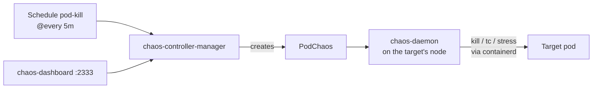

# 14. Chaos Mesh with an on/off switch

> You end up with: scheduled experiments that kill pods, add latency and burn
> CPU in the shop, all switched on and off by one value in Git.

## What it is

Chaos engineering is breaking things on purpose, on a schedule, to find out
what copes before a real failure does it for you. Netflix's Chaos Monkey
started it by killing instances at random. **Chaos Mesh** does the same inside
Kubernetes, with an experiment kind per kind of failure:

| Kind | Breaks |
| --- | --- |
| `PodChaos` | Kills pods or containers, or makes them fail |
| `NetworkChaos` | Adds latency, loss, duplication or a partition between pods |
| `StressChaos` | Burns CPU or memory inside a container |
| `IOChaos`, `TimeChaos`, `DNSChaos`... | Slow disks, skewed clocks, wrong DNS answers |
| `Schedule` | Runs any of the above on a cron schedule |



The controller decides what to break; a privileged **chaos-daemon** on every
node does it, reaching containers through the container runtime. A `Schedule`
is paused when it carries `experiment.chaos-mesh.org/pause: "true"`; any other
value runs it. That's the switch this lesson builds.

## On EKS

AWS Fault Injection Service for AWS-level faults (terminate instances, throttle
APIs), or Chaos Mesh/Litmus on EKS for pod-level ones. On EKS the runtime is
containerd at its default socket, so the k3s socket setting below goes away.

## Requirements

**In the cluster**: Flux (lesson 2) and something worth breaking: the
OpenTelemetry Demo (lesson 10) shows failures clearly in Jaeger and Grafana.

**On your machine**: `kubectl`, `helm`, `flux`, `git`, and `sofka`
or `k9s` ([lesson 0](00-tools.md)).

## By hand, for comparison

> [!NOTE]
> Read this, don't run it. Below, experiments live in Git behind one switch.

By hand, Chaos Mesh is one `helm` command, and an experiment runs the moment
you apply it:

**Example only: don't run it**
```sh
helm --kube-context k3d-dev upgrade --install chaos-mesh chaos-mesh --repo https://charts.chaos-mesh.org \
  --version 2.8.5 -n chaos-mesh --create-namespace -f values-local.yaml
kubectl --context k3d-dev apply -f pod-kill.yaml
```

Nothing records who broke what, or how to stop it all at once.

## Install with Flux

| Kind | Name | File |
| --- | --- | --- |
| Namespace | `chaos-mesh` | `~/repos/personal/kube_local/infrastructure/base/chaos-mesh/namespace.yaml` |
| HelmRepository | `chaos-mesh` | `~/repos/personal/kube_local/infrastructure/base/chaos-mesh/source.yaml` |
| HelmRelease | `chaos-mesh` | `~/repos/personal/kube_local/infrastructure/base/chaos-mesh/release.yaml` |
| ConfigMap | `chaos-mesh-values-local` | `~/repos/personal/kube_local/infrastructure/local/chaos-mesh/values.yaml` |
| HTTPRoute | `chaos-mesh/dashboard` | `~/repos/personal/kube_local/infrastructure/local/chaos-mesh/route.yaml` |
| Kustomization | `flux-system/chaos` | `~/repos/personal/kube_local/clusters/dev/chaos.yaml` |
| Namespace, Schedules | `chaos` | `~/repos/personal/kube_local/chaos/*.yaml` |

### 1. The chart

The HelmRelease reads only the local ConfigMap: the containerd socket is
k3s's.

```sh
mkdir -p ~/repos/personal/kube_local/infrastructure/base/chaos-mesh ~/repos/personal/kube_local/infrastructure/local/chaos-mesh chaos
```

**Write `~/repos/personal/kube_local/infrastructure/base/chaos-mesh/namespace.yaml`**
```yaml
# ~/repos/personal/kube_local/infrastructure/base/chaos-mesh/namespace.yaml
apiVersion: v1
kind: Namespace
metadata:
  name: chaos-mesh
```

**Write `~/repos/personal/kube_local/infrastructure/base/chaos-mesh/source.yaml`**
```yaml
# ~/repos/personal/kube_local/infrastructure/base/chaos-mesh/source.yaml
apiVersion: source.toolkit.fluxcd.io/v1
kind: HelmRepository
metadata:
  name: chaos-mesh
  namespace: chaos-mesh
spec:
  interval: 1h
  url: https://charts.chaos-mesh.org
```

**Write `~/repos/personal/kube_local/infrastructure/base/chaos-mesh/release.yaml`**
```yaml
# ~/repos/personal/kube_local/infrastructure/base/chaos-mesh/release.yaml
apiVersion: helm.toolkit.fluxcd.io/v2
kind: HelmRelease
metadata:
  name: chaos-mesh
  namespace: chaos-mesh
spec:
  interval: 10m
  chart:
    spec:
      chart: chaos-mesh
      version: 2.8.5
      sourceRef:
        kind: HelmRepository
        name: chaos-mesh
  valuesFrom:
    - kind: ConfigMap
      name: chaos-mesh-values-local
```

**Write `~/repos/personal/kube_local/infrastructure/local/chaos-mesh/values.yaml`**
```yaml
# ~/repos/personal/kube_local/infrastructure/local/chaos-mesh/values.yaml
apiVersion: v1
kind: ConfigMap
metadata:
  name: chaos-mesh-values-local
  namespace: chaos-mesh
  labels:
    reconcile.fluxcd.io/watch: Enabled
data:
  values.yaml: |
    chaosDaemon:
      runtime: containerd
      socketPath: /run/k3s/containerd/containerd.sock   # k3s's, not the default
    dashboard:
      securityMode: false   # no login; local only
```

**Write `~/repos/personal/kube_local/infrastructure/local/chaos-mesh/route.yaml`**
```yaml
# ~/repos/personal/kube_local/infrastructure/local/chaos-mesh/route.yaml
apiVersion: gateway.networking.k8s.io/v1
kind: HTTPRoute
metadata:
  name: dashboard
  namespace: chaos-mesh
spec:
  parentRefs:
    - name: web
      namespace: gateway
  hostnames: [chaos.kube.internal]
  rules:
    - backendRefs:
        - name: chaos-dashboard
          port: 2333
```

### 2. The switch

Experiments get their own folder and Kustomization, so one variable reaches
all of them, and so they apply only after the CRDs exist.
`postBuild.substitute` replaces `${CHAOS_PAUSED}` in every file under
`./chaos` before applying; `${CHAOS_PAUSED:=true}` means "true if unset".

**Write `~/repos/personal/kube_local/clusters/dev/chaos.yaml`**
```yaml
# ~/repos/personal/kube_local/clusters/dev/chaos.yaml
apiVersion: kustomize.toolkit.fluxcd.io/v1
kind: Kustomization
metadata:
  name: chaos
  namespace: flux-system
spec:
  dependsOn:
    - name: infra-local
  interval: 10m
  retryInterval: 1m
  sourceRef:
    kind: GitRepository
    name: flux-system
  path: ./chaos
  prune: true
  postBuild:
    substitute:
      CHAOS_PAUSED: "true"
```

### 3. Experiments on a schedule

Each carries the pause annotation:

**Write `~/repos/personal/kube_local/chaos/namespace.yaml`**
```yaml
# ~/repos/personal/kube_local/chaos/namespace.yaml
apiVersion: v1
kind: Namespace
metadata:
  name: chaos
```

**Write `~/repos/personal/kube_local/chaos/pod-kill.yaml`**
```yaml
# ~/repos/personal/kube_local/chaos/pod-kill.yaml
apiVersion: chaos-mesh.org/v1alpha1
kind: Schedule
metadata:
  name: pod-kill
  namespace: chaos
  annotations:
    experiment.chaos-mesh.org/pause: "${CHAOS_PAUSED:=true}"
spec:
  schedule: "@every 5m"
  type: PodChaos
  historyLimit: 5
  concurrencyPolicy: Forbid
  podChaos:
    action: pod-kill
    mode: one
    selector:
      namespaces: [otel-demo]
```

**Write `~/repos/personal/kube_local/chaos/latency.yaml`**
```yaml
# ~/repos/personal/kube_local/chaos/latency.yaml
apiVersion: chaos-mesh.org/v1alpha1
kind: Schedule
metadata:
  name: cart-latency
  namespace: chaos
  annotations:
    experiment.chaos-mesh.org/pause: "${CHAOS_PAUSED:=true}"
spec:
  schedule: "@every 15m"
  type: NetworkChaos
  historyLimit: 5
  concurrencyPolicy: Forbid
  networkChaos:
    action: delay
    mode: all
    selector:
      namespaces: [otel-demo]
      labelSelectors:
        app.kubernetes.io/component: cart
    delay:
      latency: 200ms
    duration: 2m
```

### 4. Push and look

```sh
git -C ~/repos/personal/kube_local pull
git -C ~/repos/personal/kube_local add ~/repos/personal/kube_local/clusters/ ~/repos/personal/kube_local/infrastructure/ ~/repos/personal/kube_local/chaos/
git -C ~/repos/personal/kube_local commit -m "Chaos Mesh and paused experiments"
git -C ~/repos/personal/kube_local push
flux --context k3d-dev reconcile kustomization flux-system --with-source
kubectl --context k3d-dev get schedules -n chaos
```

They're there, paused. The dashboard is at <https://chaos.kube.internal>.

sofka / k9s: `:schedules chaos`

> [!WARNING]
> Don't `kubectl apply` files from `~/repos/personal/kube_local/chaos/` by hand. Without Flux, the
> annotation is the literal string `${CHAOS_PAUSED:=true}`, which isn't
> `"true"`, so the Schedule runs. To check one is valid, use
> `kubectl --context k3d-dev apply --dry-run=server -f ~/repos/personal/kube_local/chaos/pod-kill.yaml`.

## Iterate

Every change is a commit; the last step pauses everything again. New or
changed lines sit between `# ── new ──` and `# ── end new ──`.

What broke, in order:

```sh
kubectl --context k3d-dev get events -n otel-demo --sort-by=.lastTimestamp
```

sofka `T` on a Deployment; k9s `:events otel-demo`.

> [!TIP]
> A sofka extra ([lesson 0](00-tools.md)), and where its timeline earns its
> keep. Open `:workloads otel-demo` before you flip the switch: `ctrl-z` keeps
> only what's hurt right now, `T` on a Deployment says when it lost pods and
> when it had them back, and `:bundle` on it writes the incident up for you.

### 1. Flip the switch

**Replace `~/repos/personal/kube_local/clusters/dev/chaos.yaml`**
```yaml
# ~/repos/personal/kube_local/clusters/dev/chaos.yaml
apiVersion: kustomize.toolkit.fluxcd.io/v1
kind: Kustomization
metadata:
  name: chaos
  namespace: flux-system
spec:
  dependsOn:
    - name: infra-local
  interval: 10m
  retryInterval: 1m
  sourceRef:
    kind: GitRepository
    name: flux-system
  path: ./chaos
  prune: true
  postBuild:
    substitute:
      # ── new ──
      CHAOS_PAUSED: "false"
      # ── end new ──
```

And every minute rather than five, while you watch:

**Replace `~/repos/personal/kube_local/chaos/pod-kill.yaml`**
```yaml
# ~/repos/personal/kube_local/chaos/pod-kill.yaml
apiVersion: chaos-mesh.org/v1alpha1
kind: Schedule
metadata:
  name: pod-kill
  namespace: chaos
  annotations:
    experiment.chaos-mesh.org/pause: "${CHAOS_PAUSED:=true}"
spec:
  # ── new ──
  schedule: "@every 1m"
  # ── end new ──
  type: PodChaos
  historyLimit: 5
  concurrencyPolicy: Forbid
  podChaos:
    action: pod-kill
    mode: one
    selector:
      namespaces: [otel-demo]
```

```sh
git -C ~/repos/personal/kube_local pull
git -C ~/repos/personal/kube_local add ~/repos/personal/kube_local/clusters/dev/chaos.yaml ~/repos/personal/kube_local/chaos/pod-kill.yaml
git -C ~/repos/personal/kube_local commit -m "Chaos on, pod-kill every minute"
git -C ~/repos/personal/kube_local push
flux --context k3d-dev reconcile kustomization chaos --with-source
kubectl --context k3d-dev get pods -n otel-demo -w
```

A random demo pod dies each minute, and each run leaves a PodChaos in
`chaos`: `kubectl --context k3d-dev get podchaos -n chaos`. Which ones does the
shop notice?

### 2. Half the namespace

**Replace `~/repos/personal/kube_local/chaos/pod-kill.yaml`**
```yaml
# ~/repos/personal/kube_local/chaos/pod-kill.yaml
apiVersion: chaos-mesh.org/v1alpha1
kind: Schedule
metadata:
  name: pod-kill
  namespace: chaos
  annotations:
    experiment.chaos-mesh.org/pause: "${CHAOS_PAUSED:=true}"
spec:
  schedule: "@every 1m"
  type: PodChaos
  historyLimit: 5
  concurrencyPolicy: Forbid
  podChaos:
    # ── new ──
    action: pod-kill
    mode: fixed-percent
    value: "50"
    # ── end new ──
    selector:
      namespaces: [otel-demo]
```

```sh
git -C ~/repos/personal/kube_local pull
git -C ~/repos/personal/kube_local add ~/repos/personal/kube_local/chaos/pod-kill.yaml
git -C ~/repos/personal/kube_local commit -m "pod-kill: half the namespace"
git -C ~/repos/personal/kube_local push
flux --context k3d-dev reconcile kustomization chaos --with-source
kubectl --context k3d-dev get pods -n otel-demo -w
```

### 3. Kill a container, not the pod

**Replace `~/repos/personal/kube_local/chaos/pod-kill.yaml`**
```yaml
# ~/repos/personal/kube_local/chaos/pod-kill.yaml
apiVersion: chaos-mesh.org/v1alpha1
kind: Schedule
metadata:
  name: pod-kill
  namespace: chaos
  annotations:
    experiment.chaos-mesh.org/pause: "${CHAOS_PAUSED:=true}"
spec:
  schedule: "@every 1m"
  type: PodChaos
  historyLimit: 5
  concurrencyPolicy: Forbid
  podChaos:
    # ── new ──
    action: container-kill
    mode: one
    containerNames: [cart]
    # ── end new ──
    selector:
      namespaces: [otel-demo]
      # ── new ──
      labelSelectors:
        app.kubernetes.io/component: cart
      # ── end new ──
```

```sh
git -C ~/repos/personal/kube_local pull
git -C ~/repos/personal/kube_local add ~/repos/personal/kube_local/chaos/pod-kill.yaml
git -C ~/repos/personal/kube_local commit -m "container-kill on cart"
git -C ~/repos/personal/kube_local push
flux --context k3d-dev reconcile kustomization chaos --with-source
kubectl --context k3d-dev -n otel-demo get pods -l app.kubernetes.io/component=cart -w
```

`RESTARTS` goes up; the pod survives.

### 4. 200ms latency on cart, now

The latency Schedule runs every 15 minutes. For one run now, a one-off in the
same folder, under the same switch:

**Write `~/repos/personal/kube_local/chaos/latency-now.yaml`**
```yaml
# ~/repos/personal/kube_local/chaos/latency-now.yaml
apiVersion: chaos-mesh.org/v1alpha1
kind: NetworkChaos
metadata:
  name: cart-latency-now
  namespace: chaos
  annotations:
    experiment.chaos-mesh.org/pause: "${CHAOS_PAUSED:=true}"
spec:
  action: delay
  mode: all
  selector:
    namespaces: [otel-demo]
    labelSelectors:
      app.kubernetes.io/component: cart
  delay:
    latency: 200ms
  duration: 2m
```

```sh
git -C ~/repos/personal/kube_local pull
git -C ~/repos/personal/kube_local add ~/repos/personal/kube_local/chaos/latency-now.yaml
git -C ~/repos/personal/kube_local commit -m "Latency on cart, once"
git -C ~/repos/personal/kube_local push
flux --context k3d-dev reconcile kustomization chaos --with-source
kubectl --context k3d-dev -n chaos describe networkchaos cart-latency-now
```

Slow spans in Jaeger for the next two minutes. A one-off runs once, so remove
it from Git once it's done:

```sh
git -C ~/repos/personal/kube_local pull
git -C ~/repos/personal/kube_local rm ~/repos/personal/kube_local/chaos/latency-now.yaml
git -C ~/repos/personal/kube_local commit -m "Drop the one-off latency"
git -C ~/repos/personal/kube_local push
flux --context k3d-dev reconcile kustomization chaos --with-source
```

### 5. Pause everything

Back to the install's experiments, paused:

**Replace `~/repos/personal/kube_local/chaos/pod-kill.yaml`**
```yaml
# ~/repos/personal/kube_local/chaos/pod-kill.yaml
apiVersion: chaos-mesh.org/v1alpha1
kind: Schedule
metadata:
  name: pod-kill
  namespace: chaos
  annotations:
    experiment.chaos-mesh.org/pause: "${CHAOS_PAUSED:=true}"
spec:
  # ── new ──
  schedule: "@every 5m"
  # ── end new ──
  type: PodChaos
  historyLimit: 5
  concurrencyPolicy: Forbid
  podChaos:
    # ── new ──
    action: pod-kill
    mode: one
    # ── end new ──
    selector:
      namespaces: [otel-demo]
```

**Replace `~/repos/personal/kube_local/clusters/dev/chaos.yaml`**
```yaml
# ~/repos/personal/kube_local/clusters/dev/chaos.yaml
apiVersion: kustomize.toolkit.fluxcd.io/v1
kind: Kustomization
metadata:
  name: chaos
  namespace: flux-system
spec:
  dependsOn:
    - name: infra-local
  interval: 10m
  retryInterval: 1m
  sourceRef:
    kind: GitRepository
    name: flux-system
  path: ./chaos
  prune: true
  postBuild:
    substitute:
      # ── new ──
      CHAOS_PAUSED: "true"
      # ── end new ──
```

```sh
git -C ~/repos/personal/kube_local pull
git -C ~/repos/personal/kube_local add ~/repos/personal/kube_local/clusters/dev/chaos.yaml ~/repos/personal/kube_local/chaos/pod-kill.yaml
git -C ~/repos/personal/kube_local commit -m "Chaos paused"
git -C ~/repos/personal/kube_local push
flux --context k3d-dev reconcile kustomization chaos --with-source
kubectl --context k3d-dev get schedules -n chaos
```

## Exercises

1. Flip `CHAOS_PAUSED` to `"false"` and push. Watch
   `kubectl --context k3d-dev get pods -n otel-demo -w`, the
   dashboard's timeline and Jaeger. Flip it back: no new experiments start;
   running ones finish their `duration`.
2. A `StressChaos` schedule burning CPU in one service, and find it in
   Grafana.
3. Emergency stop without Git. Suspend first, or Flux puts the old value back:
   ```sh
   flux --context k3d-dev suspend kustomization chaos
   kubectl --context k3d-dev -n chaos annotate schedules --all \
     experiment.chaos-mesh.org/pause=true --overwrite
   ```
   Fix Git and push, then resume Flux and lift the pause:
   ```sh
   flux --context k3d-dev resume kustomization chaos
   kubectl --context k3d-dev -n chaos annotate schedules --all \
     experiment.chaos-mesh.org/pause-
   ```
   From a TUI, sofka `t` suspends and resumes; k9s `Shift-t` (dotfiles
   plugin).
4. Harder: decide which demo services cope with losing a pod and which don't,
   then fix one with `replicas: 2` and a PodDisruptionBudget in its values, and
   prove it with the same experiment.

## Where it gets hard

- The chart's default runtime is Docker. Without the containerd settings the
  daemon can't find containers and every experiment fails to inject.
- Annotation values are strings. Quote `"${CHAOS_PAUSED:=true}"`, or YAML
  makes `true` a boolean and the object is rejected.
- `chaos-daemon` runs privileged in the host's PID namespace. That's normal
  for Chaos Mesh, and a reason it stays off clusters you don't own.
- Scope selectors to namespaces you mean. One that matches `kube-system` takes
  the cluster down with it.
- `NetworkChaos` uses `tc` inside the pod's network namespace. It's untested
  here alongside Cilium's BPF programs; Hubble shows whether delays land.

A lighter alternative is kube-monkey: opt-in by label, kills pods on a
schedule, and nothing else.

## Links

- <https://chaos-mesh.org/docs/basic-features/>
- <https://chaos-mesh.org/docs/production-installation-using-helm/>
- <https://chaos-mesh.org/docs/define-scheduling-rules/>
- <https://fluxcd.io/flux/components/kustomize/kustomizations/#post-build-variable-substitution>
