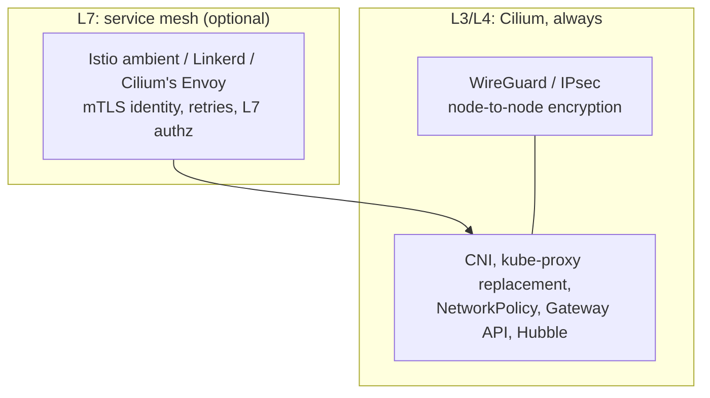

# 16. What to pair with Cilium (stub)

> [!NOTE]
> A stub. It lays out the options and what each costs in this cluster. Pick
> one, then the lesson gets written in the usual layout: by hand for
> comparison, install with Flux, iterate, exercises.

> You end up with: traffic between pods encrypted, and, depending on the
> choice, workload identity and L7 policy between services.

## What it is

Lesson 4's HTTPS stops at the Gateway. From there to the Service, and between
every pod, traffic is plain HTTP over VXLAN on `k3d0`. Cilium has encryption
and mutual authentication switched off:

```sh
helm --kube-context k3d-dev get values cilium -n kube-system -a -o json | jq '{encryption: .encryption.enabled, mutualAuth: .authentication.mutual.spire.enabled}'
```

Two separate problems hide in "mTLS between services":

| Problem | Question it answers | Solved by |
| --- | --- | --- |
| Encryption in transit | Can anyone on the wire read it? | Cilium WireGuard or IPsec, or a mesh's mTLS |
| Workload identity | Is the caller really `checkout`, and may it call `POST /orders`? | A mesh (SPIFFE identity in a certificate), or Cilium mutual auth |



Cilium stays the CNI whatever is chosen: every mesh needs a CNI underneath.
The choice is what sits beside it or on top.

## The options

| Option | What it adds | Pros | Cons |
| --- | --- | --- | --- |
| **A. Cilium WireGuard** | `encryption.type: wireguard` | Values change only; kernel datapath, near-zero cost; no certificates; covers every pod, meshed or not | No identity; traffic between pods on the same node isn't encrypted (it never leaves the node); L7 untouched |
| **B. Cilium IPsec** | `encryption.type: ipsec` and a key Secret | Same coverage as A; the usual answer when FIPS-approved ciphers are required | A key to create and rotate (SOPS, lesson 5); more overhead and more to go wrong than WireGuard |
| **C. A + Cilium mutual auth** | SPIRE in the cluster, `authentication.mode: required` on policies | Workload identity without a mesh; stays one vendor | Beta; authenticates but doesn't encrypt on its own, so it leans on A; small community compared with Istio |
| **D. A + Cilium service mesh** | Per-node Envoy for L7, Gateway API GAMMA routes on Services | No new control plane; L7 traffic splitting and policy through objects you already know; Hubble keeps L7 visibility | No mTLS identity beyond C; thinner on retries and timeouts than Istio; less common on EKS |
| **E. Istio ambient** | ztunnel per node (L4 mTLS), waypoint proxies where L7 is wanted | Real SPIFFE mTLS per service account; `AuthorizationPolicy` on identity and path; retries, timeouts, fault injection; no sidecars; what most EKS shops mean by "mesh" | A second control plane; Cilium values to make room for it (below); Hubble goes blind at L7 for meshed traffic; more memory |
| **F. Istio sidecar** | An Envoy in every pod | The most mature and documented mode | A proxy per pod: memory, restarts to inject, slower rollouts. Ambient replaces it for new installs |
| **G. Linkerd** | A small Rust proxy per pod | Simplest mesh to run; mTLS on by default; light | Sidecars; stable releases come from Buoyant, open source is edge releases only; smaller feature set than Istio |

Combinations worth naming:

| Combination | When |
| --- | --- |
| A alone | "Encrypt in transit" is the whole requirement |
| A + E | Encryption for everything, identity and L7 for meshed services. WireGuard then double-encrypts meshed traffic: keep it only for what's outside the mesh, or for a compliance rule with no exceptions |
| E alone | The usual EKS pattern: mesh traffic is mTLS, AWS Nitro hardware encrypts between instances anyway |
| C + D | All-Cilium, if staying with one vendor matters more than maturity |

## On EKS

- The AWS VPC CNI encrypts nothing. Current Nitro instance types encrypt
  traffic between each other in hardware, which covers some "in transit"
  requirements without any of this.
- Common setups: VPC CNI + Istio; Cilium (chained with the VPC CNI or
  replacing it) + Istio; Cilium with WireGuard where the CNI is Cilium.
- VPC Lattice handles service-to-service across VPCs and accounts, outside the
  cluster. AWS App Mesh is end of life: nothing new on it.
- Istio's identities can come from its own CA or from AWS Private CA through
  cert-manager.

## What it touches here

| Area | A, B | C | D | E | F, G |
| --- | --- | --- | --- | --- | --- |
| Cilium values (`infrastructure/base/cilium/values.yaml`) | `encryption.*` | `authentication.mutual.*` | `envoy.*`, GAMMA | `socketLB.hostNamespaceOnly: true`, `cni.exclusive: false` | `cni.exclusive: false` |
| Rebuild (`kube-delete` / `kube-create`) | No. Every Cilium agent restarts: a short traffic drop | No | No | No | No |
| New charts | None | SPIRE (Cilium's chart) | None | `base`, `istiod`, `istio-cni`, `ztunnel` | Istio or Linkerd charts |
| Hubble L7 and `httpV2` metrics (lessons 7, 10) | Kept | Kept | Kept | Lost for meshed traffic | Lost for meshed traffic |
| Flagger (lesson 10) | Unchanged | Unchanged | Unchanged | Move to Istio's metrics, or keep canaries on Gateway traffic | Same as E |
| OTel Demo (lesson 11) as the test estate | Yes | Yes | Yes | Yes: mesh one namespace first | Yes |
| Memory | None | SPIRE server and agents | Envoy per node | ztunnel per node, istiod, waypoints | A proxy per pod |

> [!WARNING]
> Wrong Cilium values take the network down, and Flux with it. The recovery
> is the one from lesson 2's **Hand Cilium to Flux**: suspend the
> HelmRelease, rerun `bootstrap.sh`, fix Git, resume.

## Requirements

**In the cluster**: lessons 0 to 15 done. The OpenTelemetry Demo (lesson 11)
is the traffic to encrypt and mesh.

**On your machine**: `kubectl`, `helm`, `flux`, `cilium`, `hubble`, and
`sofka` or `k9s`. For E: `istioctl`. For G: `linkerd`. `tcpdump` (from the
base image) to see the wire before and after.

## Decide

| Question | If yes |
| --- | --- |
| Is "encrypted in transit" the whole requirement? | A |
| Do callers need to prove who they are, and policy name them? | E (or C to stay all-Cilium) |
| Do you want retries, timeouts and fault injection without code? | E |
| Must Hubble keep seeing HTTP for every service? | A, C or D |
| Do you want what you'll most likely meet on EKS? | E, with or without A |

The lesson, once chosen, proves the change the same way whatever it is:
`tcpdump -i k3d0` before and after, `cilium --context k3d-dev encrypt status`
for A and B, and Hubble or the mesh's own tooling for who called whom.

## Links

- <https://docs.cilium.io/en/stable/security/network/encryption-wireguard/>
- <https://docs.cilium.io/en/stable/network/servicemesh/mutual-authentication/mutual-authentication/>
- <https://docs.cilium.io/en/stable/network/servicemesh/gateway-api/gamma/>
- <https://istio.io/latest/docs/ambient/overview/>
- <https://istio.io/latest/docs/ambient/install/platform-prerequisites/>
- <https://linkerd.io/>
