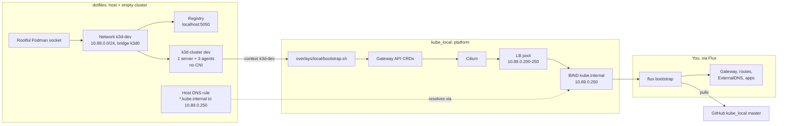
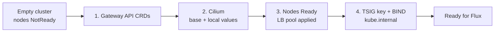

# Local Kubernetes

A single k3d cluster (`dev`) on rootful Podman that emulates a naked EKS cluster
closely enough to learn Flux, Cilium, Gateway API, cert-manager, external-dns
and Karpenter without cloud spend. Cluster shape lives in the dotfiles repo;
everything installed onto it lives here.

## What it achieves

- A cluster that boots with no CNI and no service routing, like a managed
  cluster before its add-ons, so the install order is explicit.
- Cilium as the entire network layer (CNI, kube-proxy replacement, L2
  load-balancing, Gateway API, Hubble) for eBPF and tracing study.
- A clean handoff: the bootstrap stops once networking works. Whatever GitOps
  tool comes next (Flux now, maybe Argo CD later) takes over from there.

## How the two repos fit



The repos don't call each other. They agree on these values, so change both
sides together. The dotfiles side is in its own `kubernetes.md`.

| Value | dotfiles | kube_local |
| --- | --- | --- |
| Cluster `dev`, context `k3d-dev` | `home/dot_config/k3d/config.yaml` | `bootstrap.sh` default argument |
| API endpoint `k3d-dev-serverlb:6443` | k3d's load balancer | `k8sServiceHost` in `overlays/local/cilium-values.yaml` |
| Network `10.89.0.0/24` | `_CLUSTER_SUBNET` in `services/k8s.py` | LB pool in `overlays/local/lb-ipam.yaml` |
| DNS `10.89.0.250`, zone `kube.internal` | `_KUBE_DNS_SERVER`, `_KUBE_DNS_DOMAIN` | `overlays/local/dns/bind.yaml` |
| flannel, kube-proxy, servicelb, traefik, network policy off | k3s args | Cilium replaces all of them |
| Registry `k3d-registry.localhost:5000` | created by `services/k8s.py` | image references, Flux image automation |

## Local vs cloud

| Path | Holds |
| --- | --- |
| `cilium/values.yaml` | Settings you'd also use on EKS. |
| `overlays/local/` | Everything that only exists because this is k3d. |

Helm merges the base values and then `overlays/local/cilium-values.yaml`, so no
Kustomize is involved.

## Cluster shape (dotfiles: `~/.config/k3d/config.yaml`)

| Decision | Why |
| --- | --- |
| 1 server + 3 agents | EKS hides the control plane; workloads only see the agents. |
| `--cluster-init` | Embedded etcd on the server, the datastore EKS uses, not SQLite. |
| Control-plane `NoSchedule` taint | Workloads land only on agents, as on EKS. |
| flannel, kube-proxy, servicelb, traefik, network-policy all disabled | Cilium provides all of it; nothing competes with it. |
| Region/zone/instance-type/nodegroup labels (`eu-west-2`, a/b/c, `m5.large`, `general`) | Topology-spread and affinity manifests behave as they would on EKS. |
| k3s pinned to 1.36 | A minor EKS offers in standard support (until Aug 2027). |
| Rootful Podman | Cilium loads BPF programs; atomic Fedora disables unprivileged BPF. |
| No host bpffs mount | Each node gets its own bpffs; a shared one would collide pinned maps. |
| Fixed Podman network `k3d-dev` (bridge `k3d0`, `10.89.0.0/24`) | Created by dotfiles, so LB IPs and the host DNS route always point at the same place. |
| API server on `127.0.0.1` | Not reachable from the LAN. Mapped ports 25565 and 30001-30004 still are. |

## Networking: Cilium 1.20

1.20 is the first minor whose compatibility matrix includes Kubernetes 1.36
(1.18 stops at 1.33).

Base (`cilium/values.yaml`):

- `kubeProxyReplacement: true`: Cilium implements Services in eBPF.
- `gatewayAPI.enabled: true`: the ingress direction now ingress-nginx is retired.
  Not the chart default.
- Hubble (relay + UI) and `bpf.monitorAggregation: none`: full flow visibility
  and unaggregated trace events.

Local overlay (`overlays/local/cilium-values.yaml`):

- `k8sServiceHost: k3d-dev-serverlb` / 6443: no kube-proxy, so Cilium needs the
  API server address directly.
- `routingMode: tunnel` (vxlan): k3d doesn't install pod CIDR routes on nodes.
- L2 announcements + `lb-ipam.yaml`: stand in for a cloud load balancer.
  `type: LoadBalancer` services get an IP in `10.89.0.200-250` that the host can
  reach.
- `cgroup.autoMount.enabled: false`, `cgroup.hostRoot: /sys/fs/cgroup`: k3d nodes
  don't propagate mounts, so an auto-mounted cgroup2 never reaches the agent and
  socket-LB hooks attach where no pod lives (ClusterIPs then fail with
  `network is unreachable`). If you change this on a running cluster, rebuild
  it: Cilium reuses its pinned hooks across restarts.
- `operator.replicas: 1`.
- `ipam.mode: kubernetes`: pods get IPs from the per-node CIDRs k3s assigns
  (`10.42.0.0/16`). Cilium's own default pool, `10.0.0.0/8`, overlaps the node
  network.

## Bootstrap

`overlays/local/bootstrap.sh`, the only imperative step:



1. Apply the Gateway API v1.6.3 CRDs. They must exist before the Cilium operator
   starts, or it disables Gateway API until restarted.
2. `helm upgrade --install` Cilium with base + local values, pinned to the
   `k3d-dev` kube-context so it can't land anywhere else.
3. Wait for Cilium and Ready nodes, then apply the LB-IPAM pool.
4. Generate the TSIG key and start BIND for `kube.internal` (see DNS).

Re-runnable. Flux (or Argo CD) is installed by hand afterwards; see README.md.

GitOps tools reconcile from the pushed remote branch, not from this checkout.
`bootstrap.sh` reads local files; Flux only sees what's on GitHub.

## Working with the cluster

k3d writes the `k3d-dev` context into `~/.kube/config` and makes it current.
Pass `--context k3d-dev` (or `--kube-context` for helm) whenever you also have
work contexts, so nothing lands on the wrong cluster.

| To | Run |
| --- | --- |
| Poke at resources | `kubectl`, `k9s` |
| See the node containers | `kpodman ps` (plain `podman` is rootless and shows nothing) |
| Cilium health | `cilium status --context k3d-dev` |
| Live flows | `cilium hubble port-forward &` then `hubble observe -f` |
| Hubble UI | `cilium hubble ui` |
| Reach a LoadBalancer/Gateway | Its `10.89.0.2xx` address, or a `*.kube.internal` name once ExternalDNS is in |

## Getting started with Flux

Flux pulls from GitHub, not from this checkout. Push before expecting a change.

### If you know Argo CD

| Argo CD | Flux |
| --- | --- |
| `Application` (Git path) | `GitRepository` + `Kustomization` (Flux's sync object, not Kustomize overlays) |
| `Application` (Helm chart) | `HelmRepository`/`OCIRepository` + `HelmRelease` |
| repo-server | source-controller |
| App of apps | A `Kustomization` whose path contains more `Kustomization`s |
| Sync / auto-sync | Continuous by `interval`; force with `flux reconcile` |
| Disable auto-sync | `flux suspend` / `flux resume` |
| Prune, health checks | `prune: true`, `wait: true` |
| UI | None built in; use `flux get`, `flux events`, `k9s` |

There is no Kustomize unless you add a `kustomization.yaml` yourself. A Flux
`Kustomization` pointed at a plain directory applies every manifest in it.

### 1. Bootstrap

Create a fine-grained GitHub token scoped to `kube_local` with Administration
read/write (bootstrap adds an SSH deploy key), Contents read/write, and
Metadata read.

```sh
flux check --pre --context k3d-dev
export GITHUB_TOKEN=...
flux bootstrap github --context k3d-dev \
  --owner bourbonfgiles --repository kube_local --personal --private=false \
  --branch master --path clusters/dev \
  --components-extra image-reflector-controller,image-automation-controller \
  --read-write-key
git pull
```

`--private=false` because the repo is public; without it bootstrap assumes a
private repo. The last two flags are for image promotion later: the image
controllers watch registries, and image automation commits tag bumps back to
Git, which needs a deploy key with write access. Adding them now saves a second
bootstrap. Bootstrap installs the controllers into `flux-system`, commits
`clusters/dev/flux-system/`, and creates a `GitRepository` and a `Kustomization`,
both named `flux-system`, that sync `clusters/dev`. From here, anything committed
under `clusters/dev/` gets applied.

```sh
flux get all -A
flux events -A
```

### 2. What's yours to build

Nothing beyond the platform is installed. Suggested order, each as Flux objects
under `clusters/dev/`:

1. A `Gateway` (`gatewayClassName: cilium`). Cilium gives it an IP from the LB
   pool, usually `10.89.0.200`.
2. A first `HelmRelease` (podinfo is the usual one) and an `HTTPRoute` to it
   through that Gateway. Test with `curl -H 'Host: <name>' http://10.89.0.200/`
   until DNS is in.
3. ExternalDNS as a `HelmRelease`, writing to the local BIND (see DNS below).
   Then a hostname on a route becomes a real name.
4. Cilium itself (below).
5. Whatever you want to run on it.

Then change something in Git, push, and watch helm-controller roll it out.
Delete an `HTTPRoute` with `kubectl` and the next reconcile puts it back.
Deleting a chart's Deployment doesn't, unless the HelmRelease sets
`spec.driftDetection.mode: enabled`, the Flux equivalent of Argo's self-heal.

Once Flux owns something, change it through Git only. A manual `helm upgrade`
just gets reverted on the next reconcile.

### 3. Make Flux own Cilium

Add a `HelmRepository` for `https://helm.cilium.io` and a `HelmRelease` named
`cilium` in `kube-system`, pinned to the same version as
`overlays/local/bootstrap.sh`. Same name and namespace means helm-controller
takes over the release bootstrap made instead of installing a second one.

Values have to come from the HelmRelease itself: `valuesFrom` reads ConfigMaps
and Secrets, not files in Git. Either inline both values files (base first, then
local), or commit them as two ConfigMaps and list both under `valuesFrom` in
that order.

Leave `k8sServiceHost` in the values. If Flux drops it, Cilium loses the API
server and the cluster's networking goes down.

### 4. Image promotion (later)

The pieces are already in place: a registry pods can reach at
`k3d-registry.localhost:5000` (plain HTTP, so set `spec.insecure: true` on the
`ImageRepository`), and the image controllers from bootstrap. The loop:

1. Build and push `localhost:5050/<app>:1.0.0` from the host.
2. `ImageRepository` scans `k3d-registry.localhost:5000/<app>`.
3. `ImagePolicy` picks the newest tag matching a semver range.
4. `ImageUpdateAutomation` commits the new tag into the HelmRelease values,
   wherever a `# {"$imagepolicy": "<ns>:<policy>"}` marker comment sits.

### Day 2

```sh
flux get kustomizations -A      # is the sync healthy?
flux logs -A --level=error       # what failed?
flux diff kustomization flux-system --path clusters/dev   # what would change?
flux trace -n <ns> deployment <name>                       # which Flux object owns this?
flux suspend helmrelease cilium -n kube-system             # stop reconciling while you experiment
flux resume helmrelease cilium -n kube-system
```

Starting over: rebuild the cluster, run `bootstrap.sh`, and run the same
`flux bootstrap` command again. It reuses what's already in Git. `flux uninstall`
removes Flux but leaves the deploy key in the GitHub repo settings.

## DNS: a local stand-in for Route53

`bootstrap.sh` runs BIND serving `kube.internal` on `10.89.0.250`, with an empty
zone. It accepts RFC2136 updates signed with the TSIG key `externaldns`
(`hmac-sha256`). The key is generated into the Secret `externaldns-tsig`, in both
the `dns` and `external-dns` namespaces, and never goes in Git.

| Piece | Where |
| --- | --- |
| BIND | `overlays/local/dns/bind.yaml` |
| TSIG key | `overlays/local/dns/tsig-secret.sh` |
| Pods resolve `kube.internal` | `overlays/local/dns/coredns-custom.yaml` |
| Host resolves `kube.internal` | dotfiles `dotfiles-kube-dns.service` (Linux) |

What ExternalDNS needs to talk to it (chart `external-dns` from
`https://kubernetes-sigs.github.io/external-dns/`):

- Provider `rfc2136`, zone `kube.internal`, host `bind.dns.svc.cluster.local.`
  on port 53. Keep the trailing dot: it skips the pod's search list.
- TSIG key name `externaldns`, algorithm `hmac-sha256`. The secret comes from
  the `secret` key of `externaldns-tsig`.
- Turn on AXFR so it can read the zone back, or it can't see what it owns.
- Sources for Gateway API routes are `gateway-httproute` and friends, not
  `ingress`.

On EKS the provider becomes `aws` with an IRSA role. The sources and policy
don't change, so split your values the same way as Cilium's.

Check BIND directly with `dig @10.89.0.250 <name>.kube.internal`.
BIND keeps the zone in an `emptyDir`, so a restart empties it until ExternalDNS
syncs again.

## Gotchas already paid for

- Cilium's Gateway reaches backends from the `ingress` identity (Hubble shows
  `(ingress)` as the source). A plain `NetworkPolicy` can't select it, so once
  an app locks down ingress, routes return 503. Allow it with a
  `CiliumNetworkPolicy` using `fromEntities: [ingress]`. Envoy refuses the
  request itself, so you see a 503, not a Hubble `DROPPED`.
- Rootful Podman shares the host's PID view, so BPF tools run on the host
  against pod processes. For a JVM, `-XX:+PreserveFramePointer` keeps stacks
  walkable. k3d maps host port 25565 to NodePort 30000, and 30001-30004
  straight through, if you want something reachable without the Gateway.

## Registry

- Persistent standalone k3d registry (created by the dotfiles, not the
  cluster), so the image cache survives `k3d cluster delete`.
- Push from the host to `localhost:5050` (`--tls-verify=false` with Podman).
- In manifests use `k3d-registry.localhost:5050/...` or
  `k3d-registry.localhost:5000/...`; both are mirrored on the nodes.
  `localhost:5050` does not work from pods.

## Deliberate EKS-fidelity gaps

Handled later via GitOps, not emulated in the cluster itself:

- **IRSA / Pod Identity**: no AWS IAM locally; use static creds or the Pod
  Identity webhook when needed.
- **Route53**: BIND over RFC2136 instead (see DNS). LocalStack's Route53 DNS
  answering needs a LocalStack account plan, so it was ruled out.
- **Storage**: a local-path StorageClass aliased `gp3` with
  `WaitForFirstConsumer`; no real EBS.
- **Karpenter**: the KWOK provider; its AWS `EC2NodeClass` fields don't apply.
- **Load balancers**: L2 announcements instead of an AWS NLB/ALB.

## Environment-specific values to verify

- The LB-IPAM range must sit inside the k3d network:
  `podman --url $DOCKER_HOST network inspect k3d-dev`.
- `GITHUB_TOKEN` exported before `flux bootstrap`.
